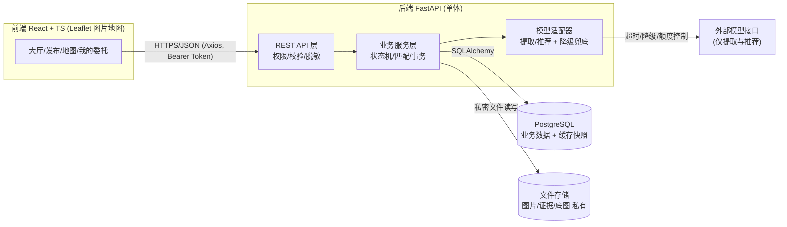
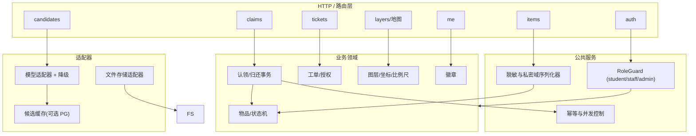
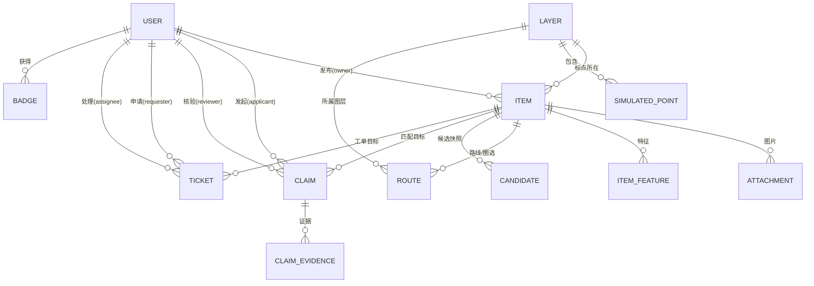

# 校园寻物局 · 阶段2架构设计说明书（v1.0）

## 0. 文档信息

| 项 | 内容 |
|---|---|
| 项目 | 校园寻物局（校园失物协作平台） |
| 阶段 | 阶段2：架构与开发准备（仅设计，不实现） |
| 特性名 | `campus_lost_found` |
| 写入路径 | `.codeartsdoer/specs/campus_lost_found/design.md` |
| 上游输入 | 已确认需求规格 `spec.md` v1.0（2026-10-03） |
| 状态 | v1.0（2026-10-03） |
| 图表约定 | mermaid |

**边界声明**：本项目为参赛作品，当前仓库为空目录（0 源文件），从零搭建。本文不实现产品功能，不产生业务代码、开发记录与测试结果。所有需求依据来自已确认的 `spec.md`，未证实判断沿用其 `[假设]` 标记。

---

# 一、需求与存量功能关系分析

## 1.1 存量资产盘点

| 资产 | 说明 | 约束 |
|---|---|---|
| 源码仓库 | 空目录，无既有业务代码 | 全部功能为新增 |
| 需求规格 `spec.md` | 阶段1已确认 v1.0 | 四套状态机、权限边界、10 条假设、EARS 验收为设计唯一依据 |
| 规划文档 `competition-plan/` | README、阶段提示词、评分验收清单、记录模板、Rules/Skill 设计稿 | Rules/Skill 原文依据 |
| 码道配置 | `rule/metadata.properties` 仅 `projectExpert=[]` | Rules/Skill 由团队按官方文档配置 |

**结论**：本次为纯增量设计，不涉及存量和存量改造。

---

# 二、增量设计方案

## 2.1 总体架构关系

### 2.1.1 架构原则

- **单体架构**（前后端分离）：一个 FastAPI 后端、一个 React 前端、一个 PostgreSQL，不引入微服务、独立向量数据库、消息队列、真实视频。
- **后端为唯一权威**：权限、状态机、脱敏、比例尺门控、事务全部后端强制。
- **AI 为旁路增强**：特征提取与候选推荐可整体降级为手动/规则，故障不阻断主流程。
- **分层可增量落地**：先业务闭环（阶段3），再加地图（阶段4）与 AI（阶段5），工单协作（阶段6）。

### 2.1.2 上下文视图



| 组件 | 职责 | 关键约束 |
|---|---|---|
| 前端 React | 渲染大厅/地图/表单/委托页 | 不放密钥；不自行判断权限 |
| 后端 FastAPI | 认证鉴权、状态机、事务、脱敏、比例尺门控、幂等 | 权限判断在服务端；私密字段不进公共响应 |
| PostgreSQL | 业务实体 + 文件元数据 + 候选缓存快照 | 事务保证同一物品仅一次归还 |
| 文件存储 FS | 图片、认领证据、底图 | 受控接口发放，不暴露目录 |
| 模型适配器 AIHW | 特征提取 + 候选推荐 | 仅提取与推荐，超时降级 |

## 2.2 服务/组件总体架构

### 2.2.1 后端分层模块



| 模块 | 职责 | 归属 |
|---|---|---|
| `auth`、`RoleGuard` | 注册、登录、JWT、角色权限 | B |
| `items` | 发布、筛选、详情脱敏 | B |
| `layers/map` | 图层版本、归一化坐标、比例尺标定、点位 | B/A |
| `claims` | 认领、核验、交接、归还事务、幂等 | B |
| `tickets` | 工单状态机、接单、授权、反馈 | B |
| `candidates/feature` | 特征提取、候选匹配、来源标识、降级 | C |
| `me/badges` | 我的委托聚合、徽章去重 | B |
| 前端 map/leaflet | 渲染、坐标换算、画圈/路线、米数门控 | A |
| 前端交互 | 表单、筛选、状态展示、权限提示 | A |
| 评估/证据/演示 | 匹配评估、证据卡、演示脚本 | C |

### 2.2.2 模型接口适配（旁路，可降级）

| 能力 | 输入 | 输出 | 失败行为 |
|---|---|---|---|
| 特征提取 | 图片（可选）+ 文字 | 结构化标签/描述片段 | 留空，允许手动描述继续 |
| 候选推荐 | 已确认特征 + 候选库 | ≤3 候选 + 解释 + 来源标识 | 降级规则推荐或空候选 |

| 模型故障场景 | 系统行为 | 阻断主流程 |
|---|---|---|
| 未配置 Key | 跳过，来源标"规则推荐/空" | 否 |
| 超时 | 返回规则推荐或空候选 | 否 |
| 解析失败/额度耗尽 | 同上 + 记录告警 | 否 |
| 结果含他者私密信息 | 后端过滤 | 否 |
| 模型尝试批准/归还 | 接口层拒绝（模型无写路由） | — |

## 2.3 数据模型

### 2.3.1 设计目标
支撑四套状态机 + 双向匹配 + 工单协作 + 私密域隔离；术语与 spec.md 严格一致；并发可闭合、可幂等、可溯源。私密字段公开序列化时剥离。

### 2.3.2 实体关系图



### 2.3.3 实体与字段
主键统一 UUID，时间戳 `created_at/updated_at`。私密字段：联系方式、精确位置、证据、路线。

**① `user`**：`id` UUID PK；`username` varchar(64) UNIQUE；`password_hash` text（哈希）；`role` enum(student/staff/admin)；`display_name` varchar(64)；`contact` text（私密）；`created_at`。注册接口强制拒绝 `role≠student`。

**② `layer`**：`id`；`name` varchar(64) UNIQUE；`image_path` text；`version` varchar(32)；`width/height` int；`scale_calibrated` boolean DEFAULT false；`pixels_per_meter` numeric（仅标定后）。未标定 ⇒ `pixels_per_meter IS NULL` ⇒ 不输出米数。

**③ `item`**：`id`；`direction` enum(lost/found)；`category` varchar(32)；`title` varchar(128)；`description` text（公开）；`location_area` varchar(128)（楼层级脱敏公开）；`precise_location` text（私密）；`time_occurred` timestamptz NULLABLE；`status` enum；`owner_user_id` FK→user；`layer_id` FK→layer NULLABLE；`norm_x/norm_y` numeric [0,1]；`is_simulated` boolean（模拟点位标识）；`source` enum(manual/rule/cache/model)；`created_at/updated_at`。
status：lost=`寻找中/核验中/已找回/已撤销`；found=`待认领/核验中/已归还/已撤销`。

**④ `attachment`**：`id/item_id`；`file_path` text；`is_evidence` boolean；`created_at`。

**⑤ `item_feature`**：`id/item_id`；`labels` jsonb；`extracted_text` text；`source` enum(manual/model)；`confirmed` boolean（确认后参与匹配）；`confidence` numeric（仅展示）。

**⑥ `route`**：`id/item_id/layer_id`；`kind` enum(polyline/circle)；`geometry` jsonb（归一化点序列 或 `{cx,cy,r}`）；`floor_segments` jsonb（分层路线）；`is_private` boolean 默认 true；`authorized` boolean。

**⑦ `simulated_point`**：`id/layer_id`；`label` varchar(64)；`norm_x/norm_y` numeric；`is_simulated` boolean 恒 true；`description` text；`created_by` FK→user。

**⑧ `claim`**：`id`；`found_item_id` FK→item；`lost_item_id` FK→item NULLABLE；`applicant_user_id` FK→user；`reviewer_user_id` FK→user NULLABLE；`status` enum(待审核/已通过/已拒绝/已完成)；`idempotency_key` varchar(64) UNIQUE；`reviewed_at/completed_at` timestamptz NULLABLE。

**⑨ `claim_evidence`**：`id/claim_id`；`kind` enum(image/text)；`content` text；`created_at`。仅发布者本人 + 该单处理 staff 可见。

**⑩ `ticket`**：`id/item_id`；`requester_user_id` FK→user（仅本人申请）；`assignee_user_id` FK→user NULLABLE；`status` enum(待接单/处理中/已反馈)；`route_authorized` boolean DEFAULT false；`result` text；时间戳。

**⑪ `badge`**：`id/user_id`；`kind` varchar(32)；`awarded_at`。`UNIQUE(user_id, kind)` 防重复。

**⑫ `candidate`**：`id/lost_item_id/found_item_id`；`score` numeric（仅排序）；`explanation` text；`source` enum(simulated/rule/cache/model)；时间戳。

## 2.4 核心接口清单

### 2.4.1 约定
基路径 `/api/v1`；`Authorization: Bearer <JWT>`；错误结构 `{code, message, details?}`；`RoleGuard` 后端注入；脱敏由序列化器统一执行。

| 状态码 | code | 语义 |
|---|---|---|
| 400 | VALIDATION | 参数缺失 |
| 401 | UNAUTH | 未登录 |
| 403 | FORBIDDEN | 越权 |
| 404 | NOT_FOUND | 不存在 |
| 409 | STATE_CONFLICT | 非法流转/重复归还 |
| 422 | PRECONDITION | 前置不满足（未标定比例尺） |
| 503 | MODEL_UNAVAILABLE | 模型降级（不阻断） |

### 2.4.2 接口分组

**A. 认证用户**：`GET /auth/me`；`POST /auth/register`（禁止 role 字段，带 staff/admin⇒403）；`POST /auth/login`；`POST /admin/staff`（仅 admin）。

**B. 发布筛选**：`POST /items`（权限 student；后置 lost→寻找中/found→待认领）；`GET /items`（筛选，脱敏概览，绝不含 precise_location/contact/evidence/route）；`GET /items/{id}`（公开字段，本人或授权 staff 追加私密字段）。

**C. 地图**：`GET /layers`（含 version）；`GET /layers/{id}/image`；`GET /layers/{id}/points`（is_simulated 必标记）；`POST /items/{id}/map-anchor`（仅发布者本人）；`POST /layers/{id}/calibrate`（仅 admin）。

**D. 特征与候选（AI，实验）**：`POST /items/{id}/extract`（模型不可用返回空 + 503）；`GET /items/{id}/candidates`（≤3 条，source 四类，仅发布者本人，降级规则/空）。

**E. 核验归还**：`POST /claims`（证据必填，幂等键）；`POST /claims/{id}/review`（仅 staff）；`POST /claims/{id}/complete`（仅 staff；后置 claim已完成/lost已找回/found已归还；同一物品仅一次，重复⇒409）。

**F. 工单**：`POST /tickets`（仅本人）；`POST /tickets/{id}/assign`（仅 staff）；`POST /tickets/{id}/authorize-route`（仅发布者本人）；`GET /tickets/{id}/route`（发布者或已授权已分配 assignee，否则 403）；`POST /tickets/{id}/feedback`（仅 assignee）。

**G. 我的委托与徽章**：`GET /me/items`、`GET /me/claims`、`GET /me/tickets`、`GET /me/badges`。

### 2.4.3 权限矩阵速查

| 接口 | student | staff | admin |
|---|---|---|---|
| 发布/认领申请/转工单 | ✓（本人） | ✓（本人） | ✓ |
| 核验/归还/接单/反馈 | ✗ | ✓ | ✓ |
| 创建 staff / 标定比例尺 | ✗ | ✗ | ✓ |
| 查看他人私密 | ✗ | 仅授权+分配 | ✓ |

## 2.5 模块任务表与三人责任

| 序号 | 模块任务 | 前置 | 责任 |
|---|---|---|---|
| T1 | 后端骨架：FastAPI+SQLAlchemy+Alembic+Pydantic | — | B |
| T2 | 认证鉴权 + 角色守卫 + 脱敏序列化 | T1 | B |
| T3 | 物品发布/列表/详情 + 状态机骨架 | T2 | B |
| T4 | 认领提交/核验/归还事务 + 幂等 | T3 | B |
| T5 | 前端工程 + 通用组件 | T2 | A |
| T6 | 大厅/发布/认领/我的委托页 | T3,T5 | A |
| T7 | 图层/底图/归一化坐标/标定/点位后端 | T1 | B |
| T8 | Leaflet 图片地图 + 缩放/标点/画圈/分层路线 | T7 | A |
| T9 | 特征提取适配器 + 降级兜底 | T3 | C |
| T10 | 候选匹配 + 四类来源标识 + 候选缓存 | T9 | C |
| T11 | 工单状态机 + 接单/授权/反馈后端 | T1 | B |
| T12 | 工单协作 UI + 模拟点位 + 核查清单 | T11,T8 | A |
| T13 | 徽章发放去重 + 我的委托聚合 | T4,T11 | B |
| T14 | 匹配评估 + 证据卡 | T10 | C |
| T15 | Docker Compose dev/demo/deploy + 密钥后端化 | T1 | B |
| T16 | Rules/Skill 配置 + 阶段验收 | T1–T15 | C |

关键路径：`T1 → T2 → (T3 → T4) → T5/T6 → T7 → T8 → T9 → T10 → T14 → T11 → T12 → T13 → T15 → T16`。

## 2.6 地图技术约定
1. 3 个固定图层：室外示意图、楼1F、楼2F。
2. `layer.version` 统一，变更递增，前端做缓存失效。
3. 以图片左上角为原点 (0,0)，norm = 像素/尺寸，归一化 [0,1]。
4. 圆形范围：中心 (cx,cy) + 半径 r（归一化）。
5. 分层路线：`floor_segments` 跨层多段线。
6. 比例尺门控：未标定 ⇒ 不返回/不渲染米数，后端返回 422。
7. 模拟点位恒标记"模拟点位"，不宣称真实坐标/覆盖。
8. 版本一致性：地图状态持久化回后端。

## 2.7 归还事务、重复请求与状态冲突
以 `found_item.status` 为闭合点，事务 + 行锁 + CAS：

```
事务开始
1. SELECT ... FOR UPDATE（行锁）
2. 校验 found 且 status='核验中'
3. 校验 claim.status='已通过'
4. UPDATE item SET status='已归还' WHERE id AND status='核验中'（CAS）
5. 关联 lost_item CAS 置 '已找回'
6. UPDATE claim SET status='已完成'
7. 提交；影响行数=0 ⇒ 回滚 409
事务结束
```

幂等：`claim.idempotency_key UNIQUE`；`claim.completed_at` 已存在⇒幂等返回；`badge UNIQUE(user_id,kind)` 去重。四套状态机统一守卫函数校验合法流转，非法流转 409。

## 2.8 开发、演示与部署配置
- `.env.example`/后端 `.env`：密钥仅存后端，`.env` 入 `.gitignore`。
- `docker-compose.dev.yml`（热更新）、`docker-compose.demo.yml`（种子数据+模拟点位+稳定降级）、`docker-compose.prod.yml`（生产镜像+受控卷）。
- 密钥：`DATABASE_URL`、DB 密码、`JWT_SECRET`、`MODEL_API_KEY` 仅存后端；私密证据/联系/路线不进公共接口。
- 演示默认 `MODEL_DISABLED=true` 或降超时，验证模型故障不阻断。

## 2.9 码道项目级 Rules 设计

```text
# 校园寻物局项目约束

技术栈：React＋TypeScript、FastAPI、PostgreSQL、Docker Compose、Leaflet 图片地图，单体架构。

- 工作人员权限在后端检查，不能自行注册获取。
- 公开接口不返回联系方式、私密特征、认领证据或路线。
- 路线默认本人可见，主动授权且工单分配后处理人员可见。
- AI 只提取与推荐，用户确认特征，工作人员核验所有权。
- 同一物品只完成一次归还；相关状态更新具有事务和重复请求处理。
- 模拟点位、规则推荐、缓存结果和实时模型分别标明来源。
- 点位距离不代表覆盖范围，无比例尺的地图不显示米数。
- 密钥只存后端，不出现在代码、日志、截图或对话中。
- 不把私密证据、联系方式或路线作为模型输入。
- 模型故障不阻断手动发布、筛选、核验和归还。
- 不接入真实视频，不增加无关框架、商城、3D或自动追踪。
- 修改业务状态同步检查权限、异常与回归场景。
- 只报告实际执行结果；真实、模拟、目标和未验证项分别标记。
- 需求来自场景分析，未证实判断标为假设；团队模拟不代表真实用户认可。
- 每次任务限定范围，输出改动、实际验证、未解决项和证据索引。
```

## 2.10 "校园业务验收" Skill 设计

**名称**：`校园业务验收`
**触发时机**：变更角色、公开/私密字段、状态、地图保存、模型降级、工单或准备阶段交付时。
**输入**：`spec.md`、验收清单、本次代码差异、可用测试命令及环境。
**输出**：检查表、实际测试结果、可复现问题、未执行原因、最小修复建议。
**流程**：读规格与差异 → 映射验收场景 → 检查权限/状态/事务/图层/模型来源/故障行为 → 执行检查并保留输出 → 失败提供复现与最小修复 → 输出通过/不通过/未执行/不适用（阶段是否通过由人工决定）。

**重点检查矩阵**：

| 范围 | 场景 |
|---|---|
| 权限 | 学生越权、他生读私密、未授权 staff 读路线 |
| 归还 | 未核验即归还、重复提交、多申请、状态冲突 |
| 地图 | 保存刷新、楼层切换、跨层片段、无比例尺 |
| 模型 | 未配置、超时、解析失败、额度耗尽、来源标识 |
| 工单 | 本人申请、分配授权、结果反馈、重复徽章 |
| 真实性 | 目标冒充结果、假设冒充结论、模拟冒充真实 |

**边界**：仅引用已确认清单，不新增业务规则，不自动购买/发布/提交。