# 校园寻物局 · 阶段2架构设计说明书（v2.0）

## 0. 文档信息

| 项 | 内容 |
|---|---|
| 项目 | 校园寻物局（校园失物协作平台） |
| 阶段 | 阶段2：架构与开发准备（仅设计，不实现） |
| 特性名 | `campus_lost_found` |
| 写入路径 | `.codeartsdoer/specs/campus_lost_found/design.md` |
| 上游输入 | 已确认需求规格 `spec.md` v2.0（2026-10-14） |
| 状态 | v2.0（2026-10-14） |
| 图表约定 | mermaid |

**版本说明**：本文档在 v1.0（2026-10-03）架构设计基础上升级，v1.0 描述的四套状态机、权限边界与发布→匹配→认领→核验→归还→协助工单闭环仍然有效；v2.0 在其上叠加教职工自助申请、评论/点赞/收藏/接取委托、积分称号、建筑与多层地图、上传与存储抽象、AI 对话式辅助等增量能力，不删除、不改变既有行为。第一章为 v2.0 增量需求与存量代码的关系分析，第二章 2.1~2.16 为 v1.0 与阶段3 已落地的归档设计（继续有效），2.17 起为 v2.0 增量设计方案。

**边界声明**：本文不实现产品功能，不产生业务代码、开发记录与测试结果。所有需求依据来自已确认的 `spec.md`，未证实判断沿用其 `[假设]` 标记。

---

## v1.0 → v2.0 架构决定摘要

> 本表为 v2.0 技术设计阶段须强制采用的架构决定（与 `spec.md` 2 章变更记录一一对应），后续 2.17 起各节按此展开。与这些决定冲突的历史描述（如 2.6 地图坐标原点、2.2.1 服务划分）以本文 2.17 起的改写为准。

| # | 架构决定 |
|---|---|
| D1 | 教职工申请：`user` 表新增 `staff_status`（none/pending/approved/rejected）、`staff_no`、`department`、`staff_reject_reason`；审核通过前 `role` 保持 `student`，审核通过时 `role` 改为 `staff`；现有所有基于 `role` 的权限判断保持不变 |
| D2 | 新建表：`building`、`comment`、`item_like`、`item_favorite`、`item_helper`、`point_record`；`point_record` 对 `(user_id, reason, ref_id)` 建唯一约束 |
| D3 | 修改表：`layer` 增 `building_id`、`floor`；`item` 增 `building_id`、`floor`；`route` 增 `visibility`；`attachment` 增 `owner_user_id`、`comment_id`、`purpose`、`mime`、`size`；`simulated_point` 增 `kind`、`is_public` |
| D4 | 点赞数、评论数、收藏数、协助者人数不建冗余计数字段，查询时用子查询统计 |
| D5 | 新增服务模块：`staff_application_service`、`upload_service`（含存储抽象）、`comment_service`、`reaction_service`、`helper_service`、`points_service`、`building_service`、`ai_service`；积分只能经 `points_service` 写入 |
| D6 | 新增接口按下表设计（路径可微调，须在 design.md 列出完整请求、响应、权限和错误码），详见 2.21 |
| D7 | 前端路由：`/hall`、`/hall/:id`、`/publish`、`/map`、`/ai`、`/me`、`/me/*`、`/staff/claims`、`/staff/tickets`、`/admin/staff-applications`；旧路径重定向到新路径 |
| D8 | 地图功能全部以 `CampusMap` 子组件的形式实现为独立图层，通过 `useCampusMap()` 获取地图实例；坐标统一使用归一化坐标，**原点在图片左下角** |
| D9 | 依赖：后端只新增 `httpx` 和 `Pillow`；前端不新增依赖，点位聚合、绘制工具、热力层自行实现 |
| D10 | 模型配置项：`MODEL_BASE_URL`、`MODEL_NAME`、`MODEL_API_KEY`、`MODEL_TIMEOUT_SECONDS`（默认 10），未配置时视为不可用并走降级 |

---

# 一、需求与存量功能关系分析

## 1.1 存量资产盘点

v1.0 架构已在代码中落地（不再是空目录），且阶段3 已完成后端骨架、迁移基线、服务层下沉、分页/搜索、校验补强、前端接口层/组件化、地图组件化等改造。v2.0 在此存量之上做增量。

| 资产 | 说明 | 约束 |
|---|---|---|
| 后端模型（12 张表） | `backend/app/models/`：`user`/`badge`/`item`/`attachment`/`item_feature`/`route`/`candidate`/`layer`/`simulated_point`/`claim`/`claim_evidence`/`ticket` | 表结构为 v1.0 契约，v2.0 只能增列/增表，不改既有列名与类型 |
| 后端服务层 | `backend/app/services/`：`user_service`、`item_service`、`claim_service`、`ticket_service`、`matching_service`、`model` | `claim_service` 的加锁/事务顺序、`model.extract_features` 的降级桩不得破坏 |
| 后端路由 | `backend/app/api/v1/`：`auth`、`admin`、`items`、`claims`、`layers`、`tickets`、`me` | 既有接口路径/响应/状态码保持不变；`require_role` 基于 `Role` 枚举，v2.0 不改变 |
| 鉴权与安全 | `backend/app/core/`：`deps.get_current_user`、`require_role`、`security` | `get_current_user` 按 `user.role` 判断；教职工申请新增 `staff_status` 不影响现有 `role` 逻辑 |
| 配置 | `backend/app/config.py`：`database_url`、`jwt_secret`、`model_api_key`、`model_disabled`、`model_timeout_seconds`、`file_storage_dir` | v2.0 扩为 `MODEL_BASE_URL`/`MODEL_NAME`/`MODEL_TIMEOUT_SECONDS` 默认 10，并保留 `model_disabled` 降级开关 |
| 迁移 | `backend/alembic/versions/`：`5a312e915b0f_initial_schema.py`、`7b8c9d0e1f2a_add_claim_review_reason.py` | v2.0 新增一张迁移，挂最新 head 之上 |
| 前端 | `frontend/src/`：`api/`（6 资源文件 + `client`）、`components/`（含 `CampusMap/`）、`hooks/`（`useAsync`/`useDebounce`/`useLayers`）、`pages/`（9 页）、`types.ts`、`styles/tokens.css` | 路由结构、`useAsync`、`tokens.css` 可复用；v2.0 改路由与新增页面/图层组件 |
| 依赖 | 后端 `requirements.txt`（无 `httpx`/`Pillow`）；前端 `package.json`（axios/leaflet/react/react-router-dom） | 后端仅新增 `httpx`、`Pillow`；前端不新增 |
| 需求规格 | `spec.md` v2.0（2026-10-14） | 六套状态机（含教职工申请、接取委托）、16 条假设、EARS 验收、18 项变更记录为设计依据 |

**结论**：v2.0 为「存量叠加增量」，保留 v1.0 闭环与全部既有测试；新增能力（互动、教职工、建筑地图、积分、AI 对话）以新增表/服务/接口方式落地，对既有表仅做加列，对既有接口仅做补充分支。

## 1.2 需求功能与存量功能对比

### 1.2.1 已实现功能（可直接复用）

| 需求功能（v2.0） | 存量功能 | 代码位置 | 匹配度 |
|---|---|---|---|
| 注册/登录/JWT/角色 | `auth.py` 注册登录、`security.create_access_token`、`deps.get_current_user` | `api/v1/auth.py`、`core/security.py`、`core/deps.py` | 100% |
| 学生自助注册即生效 | `POST /auth/register` 强制 `Role.student` | `api/v1/auth.py:16`、`services/user_service.py:8` | 100% |
| 管理员创建工作人员 | `POST /admin/staff`（`require_role(admin)`） | `api/v1/admin.py:14` | 100% |
| 寻物/拾获发布、列表、详情、标点、路线、候选 | `items.py` 全套 + `item_service` + `matching_service` | `api/v1/items.py`、`services/item_service.py`、`services/matching_service.py` | 100% |
| 认领提交/核验/归还事务（同一物品仅一次归还） | `claim_service` 行锁 + CAS + 幂等键 | `services/claim_service.py` | 100% |
| 协助工单（接单/授权路线/反馈） | `ticket_service` + `tickets.py` | `services/ticket_service.py`、`api/v1/tickets.py` | 100% |
| 列表分页/搜索/响应模型 | `Page[T]`、`limit/offset`、`ilike` 搜索 | `schemas/common.py`、`services/item_service.py:43` | 100% |
| 归一化坐标/比例尺门控 | `Field(ge=0,le=1)`、`scale_calibrated`、`pixels_per_meter` | `schemas/layer.py`、`api/v1/layers.py` | 75%（见 2.6、2.22.3 坐标原点） |
| 前端接口层/Hook/组件 | `api/*`、`useAsync/useDebounce/useLayers`、`CampusMap`、`tokens.css` | `frontend/src/` | 100% |
| 地图组件化（Leaflet 实例生命周期） | `CampusMap.tsx`、`MapContext.tsx`、`coords.ts` | `components/CampusMap/` | 75%（见 2.6、2.22.3 坐标原点） |

### 1.2.2 需要扩展的功能

| 需求功能（v2.0） | 存量功能 | 差异说明 | 扩展方向 |
|---|---|---|---|
| 教职工自助申请与审核 | 仅管理员创建 staff，无申请流程 | 缺 `staff_status` 等字段与申请/审核接口；审核通过前需按学生权限 | `user` 加列 + 新增 `staff_application_service` + 三/四接口（见 2.21.1） |
| 照片多图/去位置/可见性 | `attachment` 仅 `item_id/file_path/is_evidence`；无上传接口 | 需最多 6 图、EXIF 去除、拾获帖照片仅发布者与 staff 可见 | `attachment` 加列 + `upload_service` + `POST /uploads` 与 `POST /items/{id}/photos` |
| 路线可见性（圈选公开/路径私密） | `route.is_private` 固定 true | 圈选范围默认公开、路径默认私密 | `route` 用 `visibility` 替换 `is_private`（见 2.18.3 迁移映射） |
| 地图图层与建筑 | 固定 3 图层、无建筑表、原点左上角 | 需 2.5D 底图 + 建筑表 + 多可开关图层 + 左下角原点 | `layer/item` 加列 + 新建 `building` 表 + `building_service` + 图层组件（见 2.22） |
| AI 能力 | `model.extract_features` 为降级桩（仅返回 `degraded=True`） | 需真实模型客户端 + 智能整理发帖 + 地点推荐 + 超时 10s 降级 | 新增 `ai_service` + `httpx` 客户端 + `POST /ai/*`（见 2.23） |
| 积分/称号 | `badge` 表 + `feedback` 发 `assist` 徽章 | 需积分事件（+20/+15/+10）、唯一约束、称号阈值集中配置 | 新建 `point_record` 表 + `points_service`（见 2.18.2、2.24） |
| 前端路由与页面 | `/`、`/items/:id`、`/tickets` 等 8 路由 | 需底部四标签、大厅详情、AI 页、我的子页、staff/admin 入口 | 改路由 + 新增页面 + 旧路径重定向（见 2.22） |

### 1.2.3 需要新增的功能或接口

按业务模块分组（详细契约见 2.21）：

- **教职工**：`POST /me/staff-application`（本人提交申请）、`GET /admin/staff-applications`、`POST /admin/staff-applications/{user_id}/approve`、`POST /admin/staff-applications/{user_id}/reject`。
- **上传与照片**：`POST /uploads`、`GET /uploads/{id}`、`POST /items/{id}/photos`（照片关联到帖子）。
- **帖子补充操作**：`POST /items/{id}/withdraw`（撤销）、`POST /items/{id}/mark-found`（我已找回）。
- **评论**：`GET /items/{id}/comments`、`POST /items/{id}/comments`、`DELETE /comments/{id}`。
- **点赞收藏**：`POST/DELETE /items/{id}/like`、`POST/DELETE /items/{id}/favorite`。
- **接取委托与致谢**：`POST/DELETE /items/{id}/helpers`、`POST /items/{id}/thank`。
- **积分**：`GET /me/points`。
- **我的**：`GET /me/favorites`、`/me/likes`、`/me/comments`、`/me/helping`。
- **建筑**：`GET /buildings`、`GET /buildings/{id}`。
- **点位**：`GET /layers/{id}/points`（按身份过滤监控点位，替代/扩充现有 `simulated-points`）。
- **AI**：`POST /ai/draft-post`、`POST /ai/search-advice`。

**新增表**：`building`、`comment`、`item_like`、`item_favorite`、`item_helper`、`point_record`（字段见 2.18.2）。
**新增服务**：`staff_application_service`、`upload_service`、`comment_service`、`reaction_service`、`helper_service`、`points_service`、`building_service`、`ai_service`（职责见 2.19）。

## 1.3 存量功能详细分析

对 v2.0 直接复用或扩展的存量实现，其契约与约束如下（避免新设计与之冲突）：

| 存量实现 | 接口契约 | 关键约束 | 对 v2.0 的影响 |
|---|---|---|---|
| `deps.require_role(*roles)` | 返回 `User`，`user.role not in roles` 则 403 | 仅按 `Role` 枚举判断 | 教职工审核通过前 `role=student`，天然无法通过 staff 守卫，满足「审核前按学生权限」 |
| `claim_service.create_claim` | 幂等键 + `lock_items` 行锁 + `serialize_claim_mutation` | 加锁顺序、flush/commit 位置、CAS 条件更新不可变 | v2.0「致谢 +20 分」「归还 +15 分」须在 `complete_claim` 成功提交后经 `points_service` 追加，不得侵入既有事务 |
| `ticket_service.feedback` | 置 `feedback` 后发 `assist` 徽章（`IntegrityError` 回滚） | 徽章去重靠 `UNIQUE(user_id,kind)` | v2.0 工单反馈 +10 分改为经 `points_service`，与徽章并存；积分唯一约束 `(user_id,reason,ref_id)` |
| `item_service.get_item_detail` | 返回 dict，`precise_location` 仅 owner 非空 | 私密字段不进入公开响应 | v2.0 详情需追加 `building_id/floor`、点赞/评论/收藏/协助人数、`is_liked/is_favorited/is_helper`（子查询统计） |
| `model.extract_features` | 纯降级桩，返回 `degraded=True` | 无远程调用 | 由 `ai_service` 接管真实调用，`model.py` 保留为兜底或直接改造为降级路径 |
| `Layer/SimulatedPoint` | `image_path`、`scale_calibrated`、`pixels_per_meter`；`SimulatedPoint.is_simulated` 恒 true | 未标定不输出米数；模拟点位标注来源 | v2.0 `simulated_point` 增 `kind/is_public` 区分求助点与监控点；监控点仅 staff 可见 |
| `Route.is_private` | `create_route` 固定 `is_private=True` | 路线默认私密 | v2.0 以 `visibility` 替换，`circle` 默认 `public`、`polyline` 默认 `private`（见 2.18.3 迁移映射） |

---

# 二、增量设计方案

## 2.1 总体架构关系

### 2.1.1 架构原则

- **单体架构**（前后端分离）：一个 FastAPI 后端、一个 React 前端、一个 PostgreSQL，不引入微服务、独立向量数据库、消息队列、真实视频。
- **后端为唯一权威**：权限、状态机、脱敏、比例尺门控、事务全部后端强制。
- **AI 为旁路增强**：特征提取与候选推荐可整体降级为手动/规则，故障不阻断主流程。
- **分层可增量落地**：先业务闭环（阶段3），再加地图（阶段4）与 AI（阶段5），工单协作（阶段6）。

### 2.1.2 上下文视图

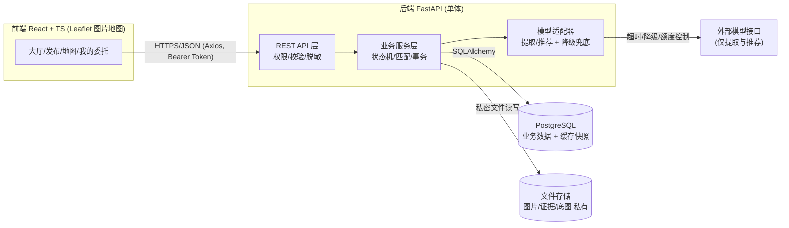

| 组件 | 职责 | 关键约束 |
|---|---|---|
| 前端 React | 渲染大厅/地图/表单/委托页 | 不放密钥；不自行判断权限 |
| 后端 FastAPI | 认证鉴权、状态机、事务、脱敏、比例尺门控、幂等 | 权限判断在服务端；私密字段不进公共响应 |
| PostgreSQL | 业务实体 + 文件元数据 + 候选缓存快照 | 事务保证同一物品仅一次归还 |
| 文件存储 FS | 图片、认领证据、底图 | 受控接口发放，不暴露目录 |
| 模型适配器 AIHW | 特征提取 + 候选推荐 | 仅提取与推荐，超时降级 |

## 2.2 服务/组件总体架构

### 2.2.1 后端分层模块

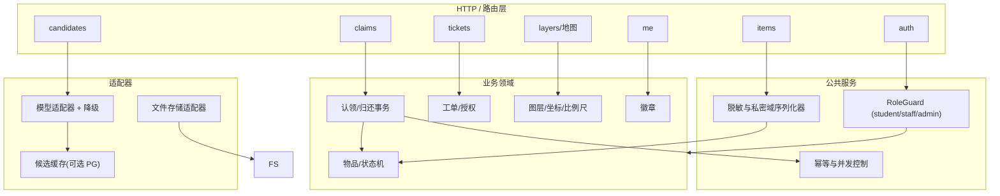

| 模块 | 职责 | 归属 |
|---|---|---|
| `auth`、`RoleGuard` | 注册、登录、JWT、角色权限 | B |
| `items` | 发布、筛选、详情脱敏 | B |
| `layers/map` | 图层版本、归一化坐标、比例尺标定、点位 | B/A |
| `claims` | 认领、核验、交接、归还事务、幂等 | B |
| `tickets` | 工单状态机、接单、授权、反馈 | B |
| `candidates/feature` | 特征提取、候选匹配、来源标识、降级 | C |
| `me/badges` | 我的委托聚合、徽章去重 | B |
| 前端 map/leaflet | 渲染、坐标换算、画圈/路线、米数门控 | A |
| 前端交互 | 表单、筛选、状态展示、权限提示 | A |
| 评估/证据/演示 | 匹配评估、证据卡、演示脚本 | C |

### 2.2.2 模型接口适配（旁路，可降级）

| 能力 | 输入 | 输出 | 失败行为 |
|---|---|---|---|
| 特征提取 | 图片（可选）+ 文字 | 结构化标签/描述片段 | 留空，允许手动描述继续 |
| 候选推荐 | 已确认特征 + 候选库 | ≤3 候选 + 解释 + 来源标识 | 降级规则推荐或空候选 |

| 模型故障场景 | 系统行为 | 阻断主流程 |
|---|---|---|
| 未配置 Key | 跳过，来源标"规则推荐/空" | 否 |
| 超时 | 返回规则推荐或空候选 | 否 |
| 解析失败/额度耗尽 | 同上 + 记录告警 | 否 |
| 结果含他者私密信息 | 后端过滤 | 否 |
| 模型尝试批准/归还 | 接口层拒绝（模型无写路由） | — |

## 2.3 数据模型

### 2.3.1 设计目标
支撑四套状态机 + 双向匹配 + 工单协作 + 私密域隔离；术语与 spec.md 严格一致；并发可闭合、可幂等、可溯源。私密字段公开序列化时剥离。

### 2.3.2 实体关系图

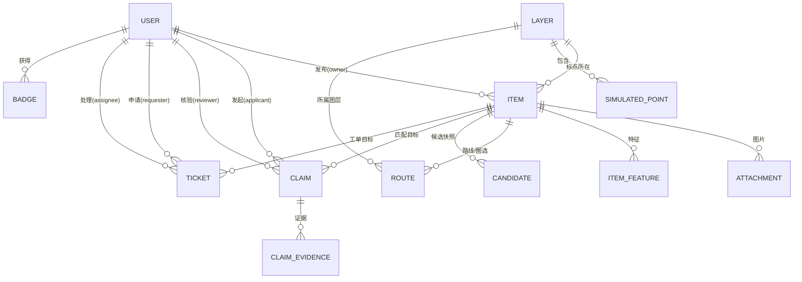

### 2.3.3 实体与字段
主键统一 UUID，时间戳 `created_at/updated_at`。私密字段：联系方式、精确位置、证据、路线。

**① `user`**：`id` UUID PK；`username` varchar(64) UNIQUE；`password_hash` text（哈希）；`role` enum(student/staff/admin)；`display_name` varchar(64)；`contact` text（私密）；`created_at`。注册接口强制拒绝 `role≠student`。

**② `layer`**：`id`；`name` varchar(64) UNIQUE；`image_path` text；`version` varchar(32)；`width/height` int；`scale_calibrated` boolean DEFAULT false；`pixels_per_meter` numeric（仅标定后）。未标定 ⇒ `pixels_per_meter IS NULL` ⇒ 不输出米数。X2a 追加（见 2.28.2）：`kind`（`flat`/`iso`/`floor`）决定该图层能否写入位置数据；`rooms` JSON 仅楼层图使用，保存房间名与房间中心。

**③ `item`**：`id`；`direction` enum(lost/found)；`category` varchar(32)；`title` varchar(128)；`description` text（公开）；`location_area` varchar(128)（楼层级脱敏公开）；`precise_location` text（私密）；`time_occurred` timestamptz NULLABLE；`status` enum；`owner_user_id` FK→user；`layer_id` FK→layer NULLABLE；`norm_x/norm_y` numeric [0,1]；`is_simulated` boolean（模拟点位标识）；`source` enum(manual/rule/cache/model)；`created_at/updated_at`。
status：lost=`寻找中/核验中/已找回/已撤销`；found=`待认领/核验中/已归还/已撤销`。

**④ `attachment`**：`id/item_id`；`file_path` text；`is_evidence` boolean；`created_at`。

**⑤ `item_feature`**：`id/item_id`；`labels` jsonb；`extracted_text` text；`source` enum(manual/model)；`confirmed` boolean（确认后参与匹配）；`confidence` numeric（仅展示）。

**⑥ `route`**：`id/item_id/layer_id`；`kind` enum(polyline/circle)；`geometry` jsonb（归一化点序列 或 `{cx,cy,r}`）；`floor_segments` jsonb（分层路线）；`is_private` boolean 默认 true；`authorized` boolean。

**⑦ `simulated_point`**：`id/layer_id`；`label` varchar(64)；`norm_x/norm_y` numeric；`is_simulated` boolean 恒 true；`description` text；`created_by` FK→user。

**⑧ `claim`**：`id`；`found_item_id` FK→item；`lost_item_id` FK→item NULLABLE；`applicant_user_id` FK→user；`reviewer_user_id` FK→user NULLABLE；`status` enum(待审核/已通过/已拒绝/已完成)；`idempotency_key` varchar(64) UNIQUE；`reviewed_at/completed_at` timestamptz NULLABLE。

**⑨ `claim_evidence`**：`id/claim_id`；`kind` enum(image/text)；`content` text；`created_at`。仅发布者本人 + 该单处理 staff 可见。

**⑩ `ticket`**：`id/item_id`；`requester_user_id` FK→user（仅本人申请）；`assignee_user_id` FK→user NULLABLE；`status` enum(待接单/处理中/已反馈)；`route_authorized` boolean DEFAULT false；`result` text；时间戳。

**⑪ `badge`**：`id/user_id`；`kind` varchar(32)；`awarded_at`。`UNIQUE(user_id, kind)` 防重复。

**⑫ `candidate`**：`id/lost_item_id/found_item_id`；`score` numeric（仅排序）；`explanation` text；`source` enum(simulated/rule/cache/model)；时间戳。

## 2.4 核心接口清单

### 2.4.1 约定
基路径 `/api/v1`；`Authorization: Bearer <JWT>`；错误结构 `{code, message, details?}`；`RoleGuard` 后端注入；脱敏由序列化器统一执行。

| 状态码 | code | 语义 |
|---|---|---|
| 400 | VALIDATION | 参数缺失 |
| 401 | UNAUTH | 未登录 |
| 403 | FORBIDDEN | 越权 |
| 404 | NOT_FOUND | 不存在 |
| 409 | STATE_CONFLICT | 非法流转/重复归还 |
| 422 | PRECONDITION | 前置不满足（未标定比例尺） |
| 503 | MODEL_UNAVAILABLE | 模型降级（不阻断） |

### 2.4.2 接口分组

**A. 认证用户**：`GET /auth/me`；`POST /auth/register`（禁止 role 字段，带 staff/admin⇒403）；`POST /auth/login`；`POST /admin/staff`（仅 admin）。

**B. 发布筛选**：`POST /items`（权限 student；后置 lost→寻找中/found→待认领）；`GET /items`（筛选，脱敏概览，绝不含 precise_location/contact/evidence/route）；`GET /items/{id}`（公开字段，本人或授权 staff 追加私密字段）。

**C. 地图**：`GET /layers`（含 version）；`GET /layers/{id}/image`；`GET /layers/{id}/points`（is_simulated 必标记）；`POST /items/{id}/map-anchor`（仅发布者本人）；`POST /layers/{id}/calibrate`（仅 admin）。

**D. 特征与候选（AI，实验）**：`POST /items/{id}/extract`（模型不可用返回空 + 503）；`GET /items/{id}/candidates`（≤3 条，source 四类，仅发布者本人，降级规则/空）。

**E. 核验归还**：`POST /claims`（证据必填，幂等键）；`POST /claims/{id}/review`（仅 staff）；`POST /claims/{id}/complete`（仅 staff；后置 claim已完成/lost已找回/found已归还；同一物品仅一次，重复⇒409）。

**F. 工单**：`POST /tickets`（仅本人）；`POST /tickets/{id}/assign`（仅 staff）；`POST /tickets/{id}/authorize-route`（仅发布者本人）；`GET /tickets/{id}/route`（发布者或已授权已分配 assignee，否则 403）；`POST /tickets/{id}/feedback`（仅 assignee）。

**G. 我的委托与徽章**：`GET /me/items`、`GET /me/claims`、`GET /me/tickets`、`GET /me/badges`。

### 2.4.3 权限矩阵速查

| 接口 | student | staff | admin |
|---|---|---|---|
| 发布/认领申请/转工单 | ✓（本人） | ✓（本人） | ✓ |
| 核验/归还/接单/反馈 | ✗ | ✓ | ✓ |
| 创建 staff / 标定比例尺 | ✗ | ✗ | ✓ |
| 查看他人私密 | ✗ | 仅授权+分配 | ✓ |

## 2.5 模块任务表与三人责任

| 序号 | 模块任务 | 前置 | 责任 |
|---|---|---|---|
| T1 | 后端骨架：FastAPI+SQLAlchemy+Alembic+Pydantic | — | B |
| T2 | 认证鉴权 + 角色守卫 + 脱敏序列化 | T1 | B |
| T3 | 物品发布/列表/详情 + 状态机骨架 | T2 | B |
| T4 | 认领提交/核验/归还事务 + 幂等 | T3 | B |
| T5 | 前端工程 + 通用组件 | T2 | A |
| T6 | 大厅/发布/认领/我的委托页 | T3,T5 | A |
| T7 | 图层/底图/归一化坐标/标定/点位后端 | T1 | B |
| T8 | Leaflet 图片地图 + 缩放/标点/画圈/分层路线 | T7 | A |
| T9 | 特征提取适配器 + 降级兜底 | T3 | C |
| T10 | 候选匹配 + 四类来源标识 + 候选缓存 | T9 | C |
| T11 | 工单状态机 + 接单/授权/反馈后端 | T1 | B |
| T12 | 工单协作 UI + 模拟点位 + 核查清单 | T11,T8 | A |
| T13 | 徽章发放去重 + 我的委托聚合 | T4,T11 | B |
| T14 | 匹配评估 + 证据卡 | T10 | C |
| T15 | Docker Compose dev/demo/deploy + 密钥后端化 | T1 | B |
| T16 | Rules/Skill 配置 + 阶段验收 | T1–T15 | C |

关键路径：`T1 → T2 → (T3 → T4) → T5/T6 → T7 → T8 → T9 → T10 → T14 → T11 → T12 → T13 → T15 → T16`。

## 2.6 地图技术约定
1. 图层体系：v1.0 为固定 3 图层（室外示意图、楼1F、楼2F）；v2.0 改为「建筑层 + 帖子点位层（聚合）+ 求助点位层 + 监控点位层 + AI 推荐层 + 热力层 + 绘制工具层」独立开关，楼层图经 `layer.building_id + floor` 关联建筑（详见 2.22）。**X2a 更新**：图层按 `kind` 分为室外平面图（`flat`）、2.5D 选楼图（`iso`）、楼层图（`floor`）；位置数据只允许写在 `flat` 与 `floor`，写在 `iso` 一律 400（见 2.28.3）。
2. `layer.version` 统一，变更递增，前端做缓存失效。
3. **归一化坐标原点（v2.0 变更）**：坐标统一为归一化 `[0,1]`，**原点在图片左下角**（x 向右增大，y 向上增大）。与 v1.0「左上角原点」不同，前端 `coords.ts` 的换算函数实行为：`lng = nx * width`、`lat = ny * height`；逆变换 `nx = lng / width`、`ny = lat / height`（CRS.Simple 的纬度向上增大，与左下角原点同向，故不需要 `1 - ny`；本节原公式 `lat = (1 - ny) * height` 与实现不符，X2a 一并更正，见 2.28.11.3）。**X2a 核验**：`20261018_v2_incremental.py` 未执行 `1 - ny` 转换；若历史库确实存在按左上角写入的数据，需单独校正，X2a 新导入数据一律按左下角写入，不改变存量坐标。
4. 圆形范围：中心 (cx,cy) + 半径 r（归一化，y 向上）。
5. 分层路线：`floor_segments` 跨层多段线。
6. 比例尺门控：未标定 ⇒ 不返回/不渲染米数，后端返回 422。
7. 模拟点位恒标记"模拟点位"，不宣称真实坐标/覆盖；监控点位为模拟数据且仅工作人员可见（`simulated_point.kind`/`is_public`）。
8. 版本一致性：地图状态持久化回后端。

## 2.7 归还事务、重复请求与状态冲突
以 `found_item.status` 为闭合点，事务 + 行锁 + CAS：

```
事务开始
1. SELECT ... FOR UPDATE（行锁）
2. 校验 found 且 status='核验中'
3. 校验 claim.status='已通过'
4. UPDATE item SET status='已归还' WHERE id AND status='核验中'（CAS）
5. 关联 lost_item CAS 置 '已找回'
6. UPDATE claim SET status='已完成'
7. 提交；影响行数=0 ⇒ 回滚 409
事务结束
```

幂等：`claim.idempotency_key UNIQUE`；`claim.completed_at` 已存在⇒幂等返回；`badge UNIQUE(user_id,kind)` 去重。四套状态机统一守卫函数校验合法流转，非法流转 409。

## 2.8 开发、演示与部署配置
- `.env.example`/后端 `.env`：密钥仅存后端，`.env` 入 `.gitignore`。
- `docker-compose.dev.yml`（热更新）、`docker-compose.demo.yml`（种子数据+模拟点位+稳定降级）、`docker-compose.prod.yml`（生产镜像+受控卷）。
- 密钥：`DATABASE_URL`、DB 密码、`JWT_SECRET`、`MODEL_API_KEY` 仅存后端；私密证据/联系/路线不进公共接口。
- 演示默认 `MODEL_DISABLED=true` 或降超时，验证模型故障不阻断。

## 2.9 码道项目级 Rules 设计

```text
# 校园寻物局项目约束

技术栈：React＋TypeScript、FastAPI、PostgreSQL、Docker Compose、Leaflet 图片地图，单体架构。

- 工作人员权限在后端检查，不能自行注册获取。
- 公开接口不返回联系方式、私密特征、认领证据或路线。
- 路线默认本人可见，主动授权且工单分配后处理人员可见。
- AI 只提取与推荐，用户确认特征，工作人员核验所有权。
- 同一物品只完成一次归还；相关状态更新具有事务和重复请求处理。
- 模拟点位、规则推荐、缓存结果和实时模型分别标明来源。
- 点位距离不代表覆盖范围，无比例尺的地图不显示米数。
- 密钥只存后端，不出现在代码、日志、截图或对话中。
- 不把私密证据、联系方式或路线作为模型输入。
- 模型故障不阻断手动发布、筛选、核验和归还。
- 不接入真实视频，不增加无关框架、商城、3D或自动追踪。
- 修改业务状态同步检查权限、异常与回归场景。
- 只报告实际执行结果；真实、模拟、目标和未验证项分别标记。
- 需求来自场景分析，未证实判断标为假设；团队模拟不代表真实用户认可。
- 每次任务限定范围，输出改动、实际验证、未解决项和证据索引。
```

## 2.10 "校园业务验收" Skill 设计

**名称**：`校园业务验收`
**触发时机**：变更角色、公开/私密字段、状态、地图保存、模型降级、工单或准备阶段交付时。
**输入**：`spec.md`、验收清单、本次代码差异、可用测试命令及环境。
**输出**：检查表、实际测试结果、可复现问题、未执行原因、最小修复建议。
**流程**：读规格与差异 → 映射验收场景 → 检查权限/状态/事务/图层/模型来源/故障行为 → 执行检查并保留输出 → 失败提供复现与最小修复 → 输出通过/不通过/未执行/不适用（阶段是否通过由人工决定）。

**重点检查矩阵**：

| 范围 | 场景 |
|---|---|
| 权限 | 学生越权、他生读私密、未授权 staff 读路线 |
| 归还 | 未核验即归还、重复提交、多申请、状态冲突 |
| 地图 | 保存刷新、楼层切换、跨层片段、无比例尺 |
| 模型 | 未配置、超时、解析失败、额度耗尽、来源标识 |
| 工单 | 本人申请、分配授权、结果反馈、重复徽章 |
| 真实性 | 目标冒充结果、假设冒充结论、模拟冒充真实 |

**边界**：仅引用已确认清单，不新增业务规则，不自动购买/发布/提交。
---

## 2.11 数据库迁移基线与索引设计（阶段3 · T02 细化）

> 本小节为阶段3编码任务「建立 Alembic 迁移基线，并为常用查询列补索引」的增量设计，对应 `tasks.md` 的 T02。上游依据：`spec.md` 3.3 资源依赖（Alembic）、本 `design.md` 2.3 数据模型与 2.5 T1/T02。硬约束：不改表名/列名/列类型；不改 `backend/tests/conftest.py`（测试继续 `create_all`）。

### 2.11.1 需求与存量功能对比

**本任务开始前的存量现状**：

| 存量项 | 位置 | 说明 |
|---|---|---|
| 12 个 SQLAlchemy 模型 | `backend/app/models/*.py` | user / badge / item / attachment / item_feature / route / candidate / layer / simulated_point / claim / claim_evidence / ticket，均已定义 |
| Alembic 环境 | `backend/alembic/env.py` | `target_metadata = Base.metadata`，连接取自 `get_settings().database_url`；但 `versions/` 无任何迁移版本，schema 无版本追踪 |
| 建表方式 | `seed.py`、`tests/conftest.py` | 依赖 `Base.metadata.create_all` 建表，不产生可回放的迁移历史 |
| 索引现状 | 各模型文件 | 仅个别外键列带 `index=True`，未系统覆盖本任务清单 |

**需求功能对比**：

| 需求功能 | 存量匹配情况 | 判定 |
|---|---|---|
| 8 组常用查询列补索引 | 部分列已带 `index=True`，需系统补齐 17 个索引 | 需扩展 |
| 生成初始迁移基线（12 表 + 全部索引） | `versions/` 为空，无迁移版本 | 需新增 |
| `seed.py` 仅写管理员与图层种子数据 | 现依赖 `create_all` 建表后再写种子 | 需改造 |
| Dockerfile 启动命令「迁移→种子→启动」 | 当前无迁移步骤 | 需改造 |
| README 本地运行步骤增加 `alembic upgrade head` | 当前无迁移步骤 | 需改造 |

### 2.11.2 索引设计

**索引清单（17 个，按表分组）**：

| 表 | 列 | 索引用途 |
|---|---|---|
| item | owner_user_id | 按发布者反查「我的委托」 |
| item | direction | 寻物/拾获方向筛选 |
| item | status | 状态筛选（大厅列表） |
| item | created_at | 列表按时间倒序 |
| claim | found_item_id | 按拾获物品反查认领 |
| claim | lost_item_id | 按寻物物品反查认领 |
| claim | applicant_user_id | 按申请人反查认领 |
| claim | status | 认领状态筛选 |
| claim_evidence | claim_id | 按认领反查证据 |
| ticket | item_id | 按物品反查工单 |
| ticket | requester_user_id | 按申请人反查工单 |
| ticket | assignee_user_id | 按处理人反查工单 |
| ticket | status | 工单状态筛选 |
| route | item_id | 按物品反查路线 |
| simulated_point | layer_id | 按图层反查模拟点位 |
| item_feature | item_id | 按物品反查特征 |
| attachment | item_id | 按物品反查附件 |

**选择依据**：17 列均为「外键列（关联/反查）」或「高频筛选列（status/direction）」或「列表排序列（created_at）」。外键列与常用筛选列加索引是项目代码规范要求（见 `docs/代码规范.md`「外键列和常用筛选列加索引」）。

**实现方式与约束**：仅在对应模型 `mapped_column(...)` 上追加 `index=True`，索引名由 SQLAlchemy 默认生成 `ix_<表>_<列>`（Alembic 用 `op.f()` 规范化）。不新增显式 `Index` 对象，不改列定义、不改表名/列名/列类型。
### 2.11.3 迁移基线设计

**基线形态**：单一初始迁移 `backend/alembic/versions/xxxx_initial_schema.py`，`down_revision = None`。`upgrade()` 按依赖顺序执行 12 张表的 `op.create_table` 与全部 `op.create_index`；`downgrade()` 逆序 `op.drop_index` 与 `op.drop_table`。

**枚举跨库兼容（关键决策）**：模型侧所有枚举列使用 `SAEnum(..., native_enum=False, length=N)`；迁移侧对应生成 `sa.Enum('...', name='...', native_enum=False, length=N)`。效果：

- SQLite（无原生 ENUM）与 PostgreSQL（显式禁用原生 ENUM）下均落为 `VARCHAR(N)` 字符串存储，两种数据库 DDL 行为一致。
- 避免 PostgreSQL 原生 ENUM 类型在 SQLite 下不可用，以及枚举值后续变更需 `ALTER TYPE` 的兼容成本。
- 保证 `alembic check` 判定模型与迁移一致（模型 `SAEnum` 与迁移 `sa.Enum` 参数匹配）。

**主键与默认值**：

- 主键 `sa.Uuid()`：PostgreSQL 落 native UUID，SQLite 落 `CHAR(32)`，由 SQLAlchemy 类型适配，跨库一致。
- 时间戳 `server_default=sa.text('(CURRENT_TIMESTAMP)')`：PostgreSQL 与 SQLite 均支持，与模型 `func.now()` 对齐。

**迁移命令与生命周期**：

| 命令 | 作用 | 使用时机 |
|---|---|---|
| `alembic upgrade head` | 建库/升级到最新版本 | 新环境初始化、容器启动 |
| `alembic downgrade -1` | 回退一步 | 排错 |
| `alembic check` | 校验模型与迁移脚本一致 | 验收 / CI |

**schema 一致性保证**：模型仅追加 `index=True`（不改表名/列名/列类型），因此 `create_all` 与迁移脚本生成相同 schema。测试链路（`conftest.py` 继续 `create_all`）与迁移建库互不冲突，且迁移不依赖数据库外键报错（建表仅声明约束，业务写入前仍由 service 校验引用存在）。

### 2.11.4 启动流程改造

- 改造前：`seed.py`（`create_all` + 写种子）→ 启动服务。
- 改造后：`alembic upgrade head`（建表/升级）→ `python seed.py`（仅写种子）→ `uvicorn`（启动服务）。


**各文件改动边界**：

| 文件 | 改动 |
|---|---|
| `backend/seed.py` | 移除 `create_all`，仅保留幂等种子写入（管理员按 username 存在则跳过；图层按 name 幂等 upsert；X2a 起改为按 `kind` 幂等，见 2.28.6.3） |
| `backend/Dockerfile` | `CMD` 改为 `alembic upgrade head && python seed.py && uvicorn app.main:app ...` |
| `README.md` | 本地运行步骤在 `seed.py` 之前插入 `alembic upgrade head` |

### 2.11.5 验收方案

| # | 验收项 | 期望结果 |
|---|---|---|
| 1 | 删除 `backend/demo.db` → `alembic upgrade head` → `python seed.py` → 启动 → 访问 `/api/v1/health` | 全链路成功，health 返回 ok |
| 2 | 再次执行 `alembic upgrade head` | 幂等，不报错（无待应用迁移） |
| 3 | 执行 `alembic check` | 报告模型与迁移一致，无差异 |
| 4 | `pytest tests/ -q` | 后端测试结果不变（`conftest.py` 继续 `create_all`） |

> 说明：`backend/demo.db` 为本地 SQLite 演示库（`scripts/configure_local.py` 生成 `DATABASE_URL=sqlite:///./demo.db`）；`backend/test_pytest.db` 为测试库，二者互不影响，验收仅针对前者。
---

## 2.12 服务层下沉重构设计（阶段3 · T20）

> 本小节为阶段3编码任务「将路由文件中的业务逻辑下沉至服务层」的增量设计，对应 `tasks.md` 的 T20。上游依据：本 `design.md` 2.2.1 后端分层模块（HTTP/路由层与业务领域分离）、`docs/代码规范.md`「分层」一节。目标为纯重构：接口地址、参数、返回内容、状态码、错误信息全部保持不变。

### 2.12.1 现状与目标

**存量现状**：`app/api/v1/` 下路由函数混杂业务判断、查询拼装与事务提交（`db.query`/`db.add`/`db.commit`），违反「路由层只做取参数、鉴权、调用、返回」的分层约定。

**目标结构**：

| 层 | 职责 | 本次改动 |
|---|---|---|
| `app/api/v1/` | 解析请求、鉴权依赖、调用 service、返回 schema | 移除业务逻辑，仅保留路由职责 |
| `app/services/` | 业务规则、状态流转、事务 | 新增，承接下沉逻辑 |

### 2.12.2 服务划分

| 新建文件 | 承接来源 | 职责 |
|---|---|---|
| `item_service.py` | `items.py` | 物品创建/列表/详情/标点/路线/特征提取/候选获取 |
| `claim_service.py` | `claims.py` | 认领创建/审核/完成三段逻辑及辅助函数 |
| `ticket_service.py` | `tickets.py` | 工单列表/创建/接单/授权路线/查路线/反馈 |
| `matching_service.py` | `items.py` 候选打分 | 导出 `find_candidates`，输入寻物记录返回 ≤3 候选 |
| `user_service.py` | `auth.py` + `admin.py` | 合并「检查用户名存在并创建用户」 |

### 2.12.3 关键约束

- `claim_service.py` 中 `serialize_claim_mutation`、`lock_items`、`replay`、`restore_unclaimed`、`editable_claim` 及创建/审核/完成逻辑原样搬移，加锁顺序、flush/commit 位置、条件更新语句不变。
- 不改 `tests/`、`models/`、`schemas/`；不新增依赖；不顺手优化其他问题。
- 验收：测试仍 18 通过 1 跳过；`ruff check` 无报错；五个路由文件不再出现 `db.query`/`db.add`/`db.commit`。
---

## 2.13 接口响应模型、列表分页与大厅搜索设计

> 本小节为「给所有接口补响应模型、列表接口分页、大厅关键词搜索」任务的增量设计。上游依据：`docs/代码规范.md`「接口」一节（列表接口统一 `limit`/`offset`、返回 `items/total/limit/offset`、每个接口声明 `response_model`）、`spec.md` 3.1 大厅功能（按类别/地点/时间/状态筛选）。本任务会改变列表接口返回结构，前端调用与测试同步适配。硬约束：`precise_location` 仅对发布者本人返回；分页参数越界返回 400（而非 FastAPI 默认 422）。

### 2.13.1 需求与存量功能对比

| 需求功能 | 存量实现 | 代码位置 | 匹配度 |
|---|---|---|---|
| 泛型分页模型 Page | `Page[T]`（items/total/limit/offset） | `backend/app/schemas/common.py:4` | 100% |
| GET /items 分页 + limit/offset | `response_model=Page[ItemPublic]`，`Query(20, ge=1, le=100)`、`Query(0, ge=0)` | `backend/app/api/v1/items.py:22` | 100% |
| GET /claims 分页 | `response_model=Page[ClaimOut]`，仅 staff | `backend/app/api/v1/claims.py:16` | 100% |
| GET /tickets 分页 | `response_model=Page[TicketOut]` | `backend/app/api/v1/tickets.py:16` | 100% |
| GET /me/items、/me/claims、/me/tickets 分页 | 三接口均 `Page[...]` | `backend/app/api/v1/me.py:17/28/39` | 100% |
| GET /items 关键词 q | `ilike` 匹配 title/description/category | `backend/app/services/item_service.py:56` | 100% |
| category 改模糊匹配 | `Item.category.ilike(f"%{category}%")` | `backend/app/services/item_service.py:61` | 100% |
| 8 个接口补齐 response_model | 均已声明 | 见 2.13.5 清单 | 100% |
| precise_location 仅发布者可见 | 详情按 owner 判断，非本人置 None | `backend/app/services/item_service.py:99` | 100% |
| 前端读取 items、types Page | 页面读 `.data.items`；`Page<T>` 已定义 | `frontend/src/types.ts:5`、各页面 | 100% |
| 测试适配与新增 | `test_pagination.py` 4 用例；`test_acceptance.py` 读 items | `backend/tests/` | 100% |

**结论**：本任务所有改动点已在代码中落地，本节作为该实现方案的归档设计，记录关键决策与接口契约，便于后续回归与评审，不新增实现工作。

### 2.13.2 分页模型设计

**泛型模型** `Page[T]`（`backend/app/schemas/common.py`）：

| 字段 | 类型 | 说明 |
|---|---|---|
| `items` | `list[T]` | 当前页数据，T 由各列表接口指定（ItemPublic/ClaimOut/TicketOut） |
| `total` | `int` | 满足筛选条件的总条数（供前端未来翻页） |
| `limit` | `int` | 本次请求每页条数，回显 |
| `offset` | `int` | 本次请求偏移量，回显 |

**设计要点**：
- 采用 Pydantic v2 泛型（`class Page[T](BaseModel)`，项目 pydantic 2.13 支持 PEP 695 语法），`items` 元素类型由 T 在声明处静态确定，杜绝 `Any` 与手写字典。
- `total` 在应用 offset/limit **之前**用 `query.count()` 计算，是「过滤后全集条数」而非「当前页条数」；`limit/offset` 回显请求值，便于前端与日志定位分页状态。
- 分页排序统一 `created_at` 倒序（claims 追加 `id` 作稳定二级排序），保证翻页稳定、不重不漏。

### 2.13.3 列表接口分页改造

| 接口 | 返回 | limit/offset | 排序 |
|---|---|---|---|
| GET /items | Page[ItemPublic] | Query(20, ge=1, le=100) / Query(0, ge=0) | created_at desc |
| GET /claims | Page[ClaimOut] | 同上 | created_at desc, id |
| GET /tickets | Page[TicketOut] | 同上 | created_at desc |
| GET /me/items | Page[ItemPublic] | 同上 | created_at desc |
| GET /me/claims | Page[ClaimOut] | 同上 | created_at desc |
| GET /me/tickets | Page[TicketOut] | 同上 | created_at desc |

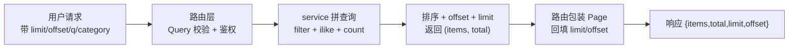

**校验与错误**：
- `limit` 超出 1~100、`offset` 小于 0 由 FastAPI `Query(ge=..., le=...)` 触发 `RequestValidationError`；`app/errors.py:42` 的处理器统一转为 **400 / VALIDATION**，满足代码规范「参数错 400」，避免默认 422。
- 列表接口均保留鉴权（`get_current_user`）；claims 列表仍仅 staff/admin（`require_role(Role.staff)`）；tickets 列表对非 staff 在服务层按 `requester_user_id` 自动过滤。

**服务层签名**：`list_items/list_claims/list_tickets/list_my_*` 统一返回 `tuple[list[T], int]`（数据 + total），路由层负责包装为 `Page` 并回填 limit/offset，职责边界与「路由只取参/鉴权/调用/返回」分层约定一致。

### 2.13.4 大厅关键词搜索

GET /items 新增 `q` 参数，`category` 由精确匹配改为模糊匹配：

| 参数 | 匹配方式 | 匹配字段 |
|---|---|---|
| `q` | `ilike`（不区分大小写） | title、description、category（OR 关系） |
| `category` | `ilike`（模糊） | category |
| `location_area` | `ilike`（模糊） | location_area |

**设计要点**：
- 用 SQLAlchemy `ilike(f"%{kw}%")` 实现不区分大小写包含匹配；多字段用 `or_` 组合。
- `q` 与 `direction/status` 等筛选为 AND 关系，可叠加。
- 关键词为空串时跳过该条件（`if q:`），不产生空匹配子句。
- 搜索仅作用于公开概览字段（title/description/category），不触及 precise_location 等私密字段，符合隐私约束。

### 2.13.5 响应模型补齐清单

为原先直接返回字典的接口声明 `response_model`，字段与现有返回完全一致：

| 接口 | 响应模型 | 关键字段 |
|---|---|---|
| GET /items/{id} 物品详情 | `ItemDetail` | 公开字段 + is_owner + norm/layer + precise_location（仅 owner 非空） |
| POST /items/{id}/map-anchor 设置标点 | `MapAnchorOut` | ok |
| POST /items/{id}/route 创建路线 | `RouteOut` | id、kind、is_private |
| GET /items/{id}/route 查询路线 | `list[RouteDetail]` | id、kind、geometry、floor_segments、is_private、authorized |
| POST /items/{id}/extract 特征提取 | `FeatureExtractionOut` | labels、extracted_text、confidence、source、degraded |
| GET /items/{id}/candidates 候选列表 | `list[CandidateOut]` | found_item_id、score、explanation、source、title、category、location_area |
| GET /me/badges 我的徽章 | `list[BadgeOut]` | id、kind、awarded_at |
| GET /tickets/{id}/route 工单路线 | `list[TicketRouteOut]` | id、kind、geometry、floor_segments |

**设计要点**：
- 服务层返回 dict 中枚举字段以 `.value` 字符串传出，Pydantic 校验时还原为对应枚举，响应 JSON 仍是字符串值，对外契约不变。
- `precise_location` 在 `get_item_detail` 按 `item.owner_user_id == user.id` 判断：非发布者恒为 `null`，发布者返回原文；`is_owner` 字段独立表达归属，二者解耦，便于前端展示。
- 列表模型 `ItemPublic` **不含** `precise_location` 字段，公开列表永不泄露精确位置。

### 2.13.6 前端适配

| 改动 | 位置 |
|---|---|
| 新增泛型 `Page<T>` 类型 | `frontend/src/types.ts:5` |
| 大厅读 `.data.items` + q 搜索输入 | `frontend/src/pages/Home.tsx` |
| 我的委托读三接口 `.data.items` | `frontend/src/pages/MyDelegations.tsx` |
| 认领审核读 `.data.items` | `frontend/src/pages/StaffClaims.tsx` |
| 工单页读 `.data.items` + Page 断言 | `frontend/src/pages/Tickets.tsx` |

**设计要点**：
- 本任务不做翻页 UI，页面仍一次取默认 limit=20 的结果，仅将读取位置从数组改为 `.items`，保证现有功能不变。
- 前端类型与后端 schema 对齐：`Item` 增加可选 `precise_location`、`is_owner`；`Page<T>` 字段与后端一致。

### 2.13.7 测试设计

**现有用例适配**：`test_acceptance.py` 中读取列表的断言由 `r.json()[0]` 改为 `r.json()["items"][0]`（如 `test_private_fields_not_in_public_list`），断言内容不变。

**新增用例**（`backend/tests/test_pagination.py`）：

| 用例 | 覆盖要求 |
|---|---|
| test_list_items_pagination_applies_limit_and_offset | limit/offset 生效，total 正确，越界页返回空 items |
| test_list_items_limit_over_100_returns_400 | limit=101 返回 400 |
| test_list_items_keyword_search_matches_title_description_category | q 命中标题/描述/类别，且不区分大小写 |
| test_item_detail_precise_location_hidden_from_non_owner | 发布者可见 precise_location，他人为 null |

### 2.13.8 验收方案

| # | 验收项 | 期望 |
|---|---|---|
| 1 | 后端 `pytest tests/ -q` | 全部通过（含新增 4 用例）；PostgreSQL 并发用例按环境跳过 |
| 2 | 后端 `ruff check .` | 无报错 |
| 3 | 前端 `npm run lint` 与 `npm run build` | 通过 |
| 4 | 打开 `/docs` | 上述接口均展示 Page 响应结构与 8 个补齐的响应模型 |
---

## 2.14 输入校验与一致性修复设计（阶段3 · T22）

> 本小节为「修复一批已确认的输入校验和一致性问题」任务的增量设计。上游依据：`spec.md` 第 4/5 章（状态机与权限边界）、`docs/代码规范.md`「数据」一节（字符串字段必须有长度上限、归一化坐标用 `Field(ge=0, le=1)` 约束、写入前校验被引用的记录存在）、以及本次任务给定的 8 条缺陷清单。
>
> **允许修改**：`backend/app/schemas/`、`backend/app/services/`、`backend/app/api/v1/`、`backend/app/models/claim.py`、新建一个 Alembic 迁移、`backend/tests/test_validation.py`、`frontend/src/pages/StaffClaims.tsx`、`frontend/src/components/Layout.tsx`。
>
> **硬约束**：不改变认领流程的加锁与事务顺序；不改动第 1~8 条之外的行为。

### 2.14.1 需求与存量功能对比

| # | 需求功能 | 存量实现 | 代码位置 | 判定 |
|---|---|---|---|---|
| 1 | 归一化坐标 0~1，越界 400 | `MapAnchorRequest`/`SimulatedPointCreate` 已用 `Field(ge=0, le=1)`，越界由 `RequestValidationError` 处理器统一转 400/VALIDATION | `schemas/layer.py:27-28,45-46`、`errors.py:42` | 需扩展（补 schema 约束） |
| 2 | 各类字符串长度上限 | 各 schema 已声明 `StringConstraints(max_length=...)` | `schemas/item.py`、`auth.py`、`staff.py`、`layer.py`、`claim.py` | 需扩展（补 schema 约束） |
| 3 | pixels_per_meter 必须 > 0 | `CalibrateRequest` 已用 `Field(gt=0)` | `schemas/layer.py:22` | 需扩展 |
| 4 | 路线几何按 kind 判别结构 | `RouteCreate` 已拆为 `PolylineGeometry`/`CircleGeometry` 联合 + `model_validator` | `schemas/layer.py:50-78` | 需扩展 |
| 5 | 引用存在性校验（layer_id 404） | 三处写入均先 `db.get(Layer, ...)` 判空 | `api/v1/layers.py:68`、`services/item_service.py:105,118` | 需扩展 |
| 6 | 特征提取 text 改请求体 + 去重更新 | `FeatureExtractRequest` 请求体 + `extract_item_features` 按 `confirmed=False` 复用 | `schemas/item.py:56`、`api/v1/items.py:69-76`、`services/item_service.py:151-163` | 需扩展 |
| 7 | 工作人员可执行操作管理员同样可执行 | 后端 `require_role(Role.staff, Role.admin)`，前端导航含 admin | `api/v1/{claims,tickets,layers}.py`、`components/Layout.tsx:29` | 需扩展 |
| 8 | 认领拒绝理由列 + 保存 + 返回 | `claim.review_reason` 列 + 迁移 + 审核保存 + 详情返回 + 前端理由输入 | `models/claim.py:24`、`alembic/versions/7b8c9d0e1f2a_*.py`、`services/claim_service.py:90,171`、`pages/StaffClaims.tsx:139-147` | 需扩展 |

**结论**：本任务为「校验补强 + 一致性修复」，无新增实体、无新增接口，全部改动落在既有 schema/service/路由/模型/迁移/前端组件上；8 条均已在代码中落地，本节作为实现方案归档设计，记录关键决策与契约。

### 2.14.2 分层归属与文件改动清单

| 文件 | 分层 | 改动 |
|---|---|---|
| `backend/app/schemas/layer.py` | schemas | `MapAnchorRequest`/`SimulatedPointCreate` 归一化坐标 `Field(ge=0, le=1)`；`SimulatedPointCreate.label` 1~64、`description` ≤500；`CalibrateRequest.pixels_per_meter` `gt=0`；新增 `RoutePoint/PolylineGeometry/CircleGeometry`，`RouteCreate.geometry` 改为判别联合 + `model_validator` |
| `backend/app/schemas/item.py` | schemas | `ItemCreate.description` ≤2000、`precise_location` ≤200；新增 `FeatureExtractRequest`（`text` 请求体字段 ≤2000） |
| `backend/app/schemas/auth.py` | schemas | `RegisterRequest.contact` ≤100 |
| `backend/app/schemas/staff.py` | schemas | `StaffCreateRequest.contact` ≤100 |
| `backend/app/schemas/claim.py` | schemas | `ReviewRequest.reason` ≤500；`ClaimDetail` 新增 `review_reason` |
| `backend/app/services/item_service.py` | services | `set_map_anchor`/`create_route` 写入前校验 `layer_id` 存在（404）；`extract_item_features` 复用 `confirmed=False` 的 `ItemFeature`，不新增重复记录 |
| `backend/app/api/v1/items.py` | api | `extract` 改为从 `body: FeatureExtractRequest` 取 `text` |
| `backend/app/api/v1/layers.py` | api | `create_simulated_point` 写入前校验 `layer_id` 存在（404） |
| `backend/app/services/claim_service.py` | services | `review_claim` 保存 `review_reason`；`get_claim` 返回 `review_reason` |
| `backend/app/models/claim.py` | models | `Claim` 新增 `review_reason: Mapped[str \| None]`（`Text`，可空） |
| `backend/alembic/versions/7b8c9d0e1f2a_add_claim_review_reason.py` | 迁移 | 新增迁移：`op.add_column('claim', sa.Column('review_reason', sa.Text(), nullable=True))` |
| `backend/tests/test_validation.py` | tests | 8 类校验与一致性用例 |
| `frontend/src/components/Layout.tsx` | components | 导航「认领审核」对 `role === 'staff' \|\| 'admin'` 显示 |
| `frontend/src/pages/StaffClaims.tsx` | pages | 拒绝时可填写理由（`textarea`），提交时携带 `reason` |

**分层说明**：所有参数范围/长度校验下沉到 `schemas` 层（Pydantic），路由与服务层不做手写范围判断；引用存在性与去重更新属业务规则，落在 `services` 层；路由仅取参、鉴权、调用、返回。
### 2.14.3 schema 结构设计

**归一化坐标与长度约束**（`schemas/layer.py`、`schemas/item.py`、`schemas/auth.py`、`schemas/staff.py`、`schemas/claim.py`）：

| Schema 字段 | 约束 | 越界行为 |
|---|---|---|
| `MapAnchorRequest.norm_x/norm_y` | `float = Field(ge=0, le=1)` | 400 / VALIDATION |
| `SimulatedPointCreate.norm_x/norm_y` | `float = Field(ge=0, le=1)` | 400 / VALIDATION |
| `SimulatedPointCreate.label` | `StringConstraints(strip_whitespace=True, min_length=1, max_length=64)` | 400 |
| `SimulatedPointCreate.description` | `StringConstraints(max_length=500)`，可空 | 400 |
| `ItemCreate.description` | `StringConstraints(max_length=2000)`，默认 `""` | 400 |
| `ItemCreate.precise_location` | `StringConstraints(max_length=200)`，可空 | 400 |
| `RegisterRequest.contact` / `StaffCreateRequest.contact` | `StringConstraints(max_length=100)`，可空 | 400 |
| `ReviewRequest.reason` | `StringConstraints(max_length=500)`，可空 | 400 |
| `CalibrateRequest.pixels_per_meter` | `float = Field(gt=0)` | 400 |
| `FeatureExtractRequest.text` | `StringConstraints(strip_whitespace=True, max_length=2000)`，可空 | 400 |

**路线几何判别联合**（`schemas/layer.py`）：

| 模型 | 字段与约束 | 语义 |
|---|---|---|
| `RoutePoint` | `x: float = Field(ge=0, le=1)`、`y: float = Field(ge=0, le=1)` | 归一化坐标点 |
| `PolylineGeometry` | `points: list[RoutePoint] = Field(min_length=2, max_length=200)` | 折线，2~200 个点 |
| `CircleGeometry` | `center: RoutePoint`、`radius: float = Field(gt=0, le=1)` | 圆，圆心 + 半径（0<r≤1） |
| `RouteCreate` | `kind: RouteKind`、`layer_id: uuid.UUID \| None`、`geometry: PolylineGeometry \| CircleGeometry \| None`、`floor_segments: list \| None` | 顶层创建模型 |

`RouteCreate` 以 `@model_validator(mode="after")` 校验 `kind` 与 `geometry` 结构匹配：`polyline` 必须为 `PolylineGeometry`、`circle` 必须为 `CircleGeometry`，否则抛 `ValueError`，由校验处理器转 400。`geometry` 可空（允许先建路线后补几何），但一旦提供则必须与 `kind` 一致。

**响应模型**：`ClaimDetail(ClaimOut)` 新增 `review_reason: str | None = None`，与 `Claim` 模型新增列对齐；`RouteDetail`/`TicketRouteOut` 的 `geometry: dict | None` 继续以字典回显（存储侧 `RouteCreate.geometry.model_dump()` 落库），对外契约不变。

### 2.14.4 service 改动

**引用存在性（第 5 条）**：

| 函数 | 改动 |
|---|---|
| `set_map_anchor`（`services/item_service.py`） | 在 `_get_owned_item` 后、写入 `item.layer_id/norm_*` 前，`db.get(Layer, body.layer_id)` 为空则 `raise ApiError(404, "NOT_FOUND", "图层不存在")` |
| `create_route`（`services/item_service.py`） | 在 `_get_owned_item` 后，`body.layer_id is not None` 且 `db.get(Layer, ...)` 为空则 404 |
| `create_simulated_point`（`api/v1/layers.py`） | 在 `require_role` 后，`db.get(Layer, layer_id)` 为空则 `raise ApiError(404, ...)` |

> 说明：`layer_id` 在三处均为可选/路径参数，须「写入前校验引用存在」而非依赖数据库外键报错，符合代码规范「不依赖数据库外键报错」。

**特征提取去重（第 6 条）**：

`extract_item_features`（`services/item_service.py`）改为「查找未确认记录 → 有则更新、无则新建」：

```
feature = db.query(ItemFeature).filter(item_id == id, confirmed == False).first()
if feature is None: 新建 ItemFeature(item_id, confirmed=False) 并 db.add
feature.labels / extracted_text / source / confidence = result[...]
db.commit()
```

同一物品重复调用仅更新已有未确认记录，不再新增重复 `ItemFeature`。`extract` 路由（`api/v1/items.py`）改为接收 `body: FeatureExtractRequest`，`text` 从请求体取，不再从地址栏参数取。

**拒绝理由（第 8 条）**：

`review_claim`（`services/claim_service.py`）在状态流转与 `reviewer_user_id`、`reviewed_at` 赋值同处追加 `claim.review_reason = body.reason`；`get_claim` 在构造 `ClaimDetail` 时透传 `review_reason=claim.review_reason`。**不改变** `editable_claim`/`lock_items` 的加锁顺序、`flush`/`commit` 位置与条件更新语句。

### 2.14.5 迁移内容

新建 `backend/alembic/versions/7b8c9d0e1f2a_add_claim_review_reason.py`，`down_revision = '5a312e915b0f'`（挂在初始基线之上）：

- `upgrade()`：`op.add_column('claim', sa.Column('review_reason', sa.Text(), nullable=True))`
- `downgrade()`：`op.drop_column('claim', 'review_reason')`

`review_reason` 用 `Text` 可空列，不设默认值、不加索引（仅审核写入，低频查询）；模型侧 `Mapped[str | None] = mapped_column(Text, nullable=True)` 与迁移一致，`alembic check` 无差异。测试链路 `conftest.py` 继续 `create_all`，`review_reason` 随模型建表，与迁移建库行为一致。

### 2.14.6 角色一致与前端改动

**后端**：以下操作已统一 `require_role(Role.staff, Role.admin)`，管理员与工作人员同权：

| 操作 | 路由 |
|---|---|
| 查看/审核/确认归还认领 | `api/v1/claims.py` 的 `GET /claims`、`POST /claims/{id}/review`、`POST /claims/{id}/complete` |
| 接单/反馈工单 | `api/v1/tickets.py` 的 `POST /tickets/{id}/assign`、`POST /tickets/{id}/feedback` |
| 查看/创建模拟点位 | `api/v1/layers.py` 的 `GET/POST /layers/{id}/simulated-points` |

**前端**：`components/Layout.tsx` 导航「认领审核」入口条件由仅 staff 改为 `role === 'staff' || role === 'admin'`；`pages/StaffClaims.tsx` 同步以 `role !== 'staff' && role !== 'admin'` 守卫，拒绝时新增「拒绝理由（可选）」`textarea`，`act('reject')` 提交 `{ approve: false, reason: reason.trim() || undefined }`。

> 前端隐藏按钮仅作展示，权限仍在后端强制（`require_role`），管理员可执行操作不会因前端条件遗漏而受限。

### 2.14.7 测试设计思路

新增 `backend/tests/test_validation.py`（复用 `test_acceptance.py` 的 `create_user/login/register/auth` 与自建 `create_layer/item/staff_token/admin_token` 辅助函数），按 8 条逐类覆盖，每类含正常 + 非法输入/权限：

| # | 用例 | 覆盖 |
|---|---|---|
| 1 | `test_map_anchor_coordinate_out_of_range_returns_400`、`test_simulated_point_coordinate_out_of_range_returns_400` | 归一化坐标越界（1.5 / -0.1）返回 400 |
| 2 | `test_item_description_and_precise_location_length_limits`、`test_contact_length_limit_on_register_and_staff`、`test_simulated_point_label_and_description_length_limits`、`test_review_reason_length_limit` | 各字符串长度上限（2001/201/101/65/501/501）返回 400，临界值（2000/200）返回 200 |
| 3 | `test_calibrate_non_positive_pixels_per_meter_returns_400` | `pixels_per_meter` 为 0 / 负 返回 400 |
| 4 | `test_route_polyline_geometry_validation`、`test_route_circle_geometry_validation` | 折线少于 2 点 / 坐标越界 / 结构错配；圆半径 0 或 >1 / 结构错配 返回 400，合法结构 200 |
| 5 | `test_simulated_point_missing_layer_returns_404`、`test_map_anchor_missing_layer_returns_404`、`test_route_missing_layer_returns_404` | `layer_id` 不存在返回 404 |
| 6 | `test_extract_uses_request_body_and_length_limit`、`test_extract_repeat_updates_existing_unconfirmed_feature` | 请求体 `text` 生效、>2000 返回 400；重复调用仅一条 `ItemFeature` 且内容为最新 |
| 7 | `test_admin_can_review_and_complete_claim`、`test_admin_can_assign_and_feedback_ticket`、`test_admin_can_list_simulated_points` | 管理员可查看/审核/完成认领、接单/反馈工单、查看模拟点位 |
| 8 | `test_review_reason_saved_and_returned` | 拒绝理由保存且认领详情返回 |

### 2.14.8 验收方案

| # | 验收项 | 期望 |
|---|---|---|
| 1 | `cd backend && .venv/Scripts/python -m pytest tests/ -q` | 全部通过（含新增 `test_validation.py` 用例；PostgreSQL 并发用例按环境跳过） |
| 2 | `cd backend && .venv/Scripts/python -m ruff check .` | 无报错 |
| 3 | `cd backend && .venv/Scripts/alembic upgrade head` + `alembic check` | 迁移应用成功，模型与迁移一致无差异 |
| 4 | `cd frontend && npm run lint` 与 `npm run build` | 通过 |---

## 2.15 前端接口层、请求 Hook 与基础组件重构设计

> 本小节为「为前端搭建接口层、请求 Hook、设计变量和基础组件，并把现有页面迁移过去」任务的增量设计。上游依据：`spec.md` 3.1 必做功能（大厅/发布/匹配/认领/工单/我的委托/地图）、`docs/代码规范.md`「前端」一节（`src/api/` 每类资源一个文件、页面不直接写接口地址、不写内联 `style`、统一 `useAsync`、颜色/间距/圆角/字号只引用 `tokens.css`）。目标为**纯前端重构**：页面功能与文案不变，视觉只做统一，不改路由结构、页面数量与业务流程；不新增任何第三方依赖；全程不使用 `any`。

**用户已确认的三个关键点（必须纳入）**：
1. 颜色取值：主色 `#2563eb`、成功 `#16a34a`、警告 `#d97706`、危险 `#dc2626`；所有颜色只定义在 `tokens.css`，组件与页面不得出现任何颜色数值。
2. 搜索框 `q` 与类别输入框一样，均做 300 毫秒防抖。
3. `AuthContext` 的 `login`、`register`、`me` 也改用 `api/auth.ts`、`api/me.ts`；最终整个 `frontend/src` 中只有 `src/api/` 目录下文件可导入并使用 `client`。

**硬约束**：不引入 UI 组件库与 CSS 框架；不改路由结构、页面数量、业务流程；不使用 `any`。

### 2.15.1 需求与存量功能对比

#### 已实现功能（可直接复用）

| 需求功能 | 存量功能 | 代码位置 | 匹配度 |
|---|---|---|---|
| axios 封装与鉴权注入 | `client`（baseURL `/api/v1`、Bearer 注入、401 广播 `auth-expired`、`errorMessage`） | `frontend/src/api/client.ts:1-48` | 100% |
| 前端基础类型 | `Direction/ItemStatus/Source/Page/Item/Ticket/Claim/ClaimDetail/Candidate` 及中文 label | `frontend/src/types.ts:1-92` | 75% |
| 认证上下文 | `AuthProvider`（login/register/logout/token 持久化/auth-expired 监听） | `frontend/src/auth/AuthContext.tsx:17-87` | 75% |
| 路由结构 | 8 个路由 + Layout + RequireAuth | `frontend/src/App.tsx:14-36` | 100% |

#### 需扩展的功能

| 需求功能 | 存量功能 | 差异说明 | 扩展方向 |
|---|---|---|---|
| `types.ts` 与后端响应对齐 | `Item` 缺 `norm_x/norm_y/layer_id`；缺 `Role/User/Layer/SimulatedPoint/Badge/Evidence/FeatureExtractionOut` | 后端 `ItemDetail` 已含 `norm_x/norm_y/layer_id/precise_location/is_owner`（`schemas/item.py:37-53`） | `Item` 增补三字段（可选），新增上述类型 |
| AuthContext 改走接口层 | `login/register/me` 直接 `client.post/get`（`AuthContext.tsx:38-80`） | 需满足「只有 `src/api/` 可引用 client」 | 改用 `api/auth.ts` 的 `login/register/me` |
| Layout 角色中文 + 去内联 style | 显示 `角色：{role}`，内联 style（`Layout.tsx:16-31`） | 需中文映射 + 组件化 | 用 `roleLabels` + 基础组件 + `Layout.module.css` |
| 页面状态管理 | 各页面手写 `active/loading/error` 标记与 `client` 调用 | 需统一到 `useAsync` | 用 `useAsync` 替换 |
| 大厅类别/搜索防抖 | 输入即时发请求（`Home.tsx:38-54`） | q 与 category 均需 300ms 防抖 | 用 `useDebounce` |
| 幂等键生成 | `crypto.randomUUID()`（`ItemDetail.tsx:76`） | 非 HTTPS 且非 localhost 下不存在 | 新建 `utils/id.ts` 兜底 |

#### 需新增的功能或接口

**接口层（`src/api/`）**：`auth.ts`、`items.ts`、`claims.ts`、`tickets.ts`、`layers.ts`、`me.ts`（`client.ts` 保留为唯一 axios 入口）。

**Hook（`src/hooks/`）**：`useAsync.ts`、`useDebounce.ts`。

**设计变量（`src/styles/`）**：`tokens.css`。

**基础组件（`src/components/`）**：`Button`、`Card`、`Tag`、`Field`、`Empty`、`ErrorNotice`、`Spinner`、`PageContainer`（各带同名 `.module.css`）。

**工具（`src/utils/`）**：`id.ts`（幂等键生成，兼容非 HTTPS 环境的 `crypto.randomUUID`）。

### 2.15.2 目标目录结构与依赖关系

```
frontend/src/
├── api/
│   ├── client.ts        # 唯一 axios 入口（仅 api/ 内部引用）
│   ├── auth.ts          # 登录/注册/当前用户
│   ├── items.ts         # 物品 CRUD/标点/路线/特征/候选
│   ├── claims.ts        # 认领列表/详情/提交/审核/完成
│   ├── tickets.ts       # 工单列表/创建/接单/授权/反馈/路线
│   ├── layers.ts        # 图层列表/底图/标定/模拟点位
│   └── me.ts            # 我的物品/认领/工单/徽章
├── hooks/
│   ├── useAsync.ts      # 异步请求状态（data/error/loading/reload）
│   └── useDebounce.ts   # 输入防抖
├── styles/
│   └── tokens.css       # CSS 设计变量（唯一颜色来源）
├── utils/
│   └── id.ts            # 幂等键生成
├── components/
│   ├── Button.tsx / Button.module.css
│   ├── Card.tsx / Card.module.css
│   ├── Tag.tsx / Tag.module.css
│   ├── Field.tsx / Field.module.css
│   ├── Empty.tsx / Empty.module.css
│   ├── ErrorNotice.tsx / ErrorNotice.module.css
│   ├── Spinner.tsx / Spinner.module.css
│   ├── PageContainer.tsx / PageContainer.module.css
│   ├── Layout.tsx（改造）+ Layout.module.css（新增）
│   └── RequireAuth.tsx（改造）
├── pages/（9 页改造，删除内联 style 与 client 调用）
├── auth/AuthContext.tsx（改造，改走接口层）
├── types.ts（补全）
├── App.tsx / main.tsx / index.css（index.css 精简为 tokens 引入 + reset）
```

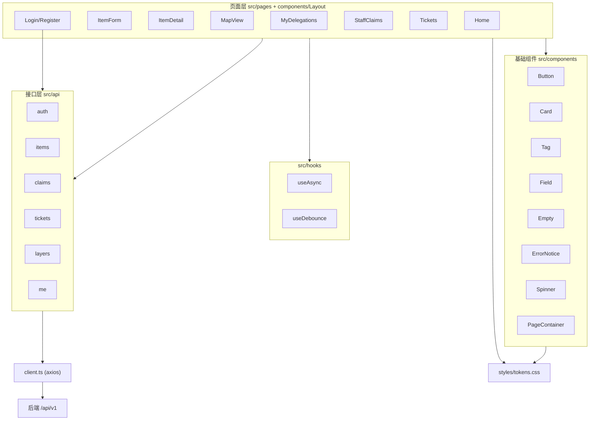

**依赖边界**：页面与 `AuthContext` 只依赖接口层函数与 Hook；只有 `src/api/*` 导入 `client.ts`；颜色/间距/圆角/字号只引用 `tokens.css` 变量。

### 2.15.3 接口层设计

#### 总体设计

- 每个资源一个文件，导出「带完整类型的请求函数」，命名与后端业务语言一致（`listItems`、`getItem`、`createClaim` 等）。
- 所有函数返回 `Promise<具体类型>`，入参使用精确接口类型（可选参数显式标注 `| null | undefined`），**不使用 `any`**。
- `client.ts` 继续承担 baseURL、Bearer 注入、401 广播与 `errorMessage`；`setToken/getToken` 供 `AuthContext` 使用，但页面不再 import client。
- 列表接口统一返回 `Page<T>`；`GET /layers` 返回数组；`GET /layers/{id}/image` 返回 `Blob`。

#### 接口清单

**`auth.ts`**（`Role`/`User` 定义于 `types.ts`）：

```ts
export interface LoginRequest { username: string; password: string }
export interface RegisterRequest { username: string; password: string; display_name: string; contact?: string | null }
export interface TokenResponse { token: string; role: Role }

export function login(body: LoginRequest): Promise<TokenResponse>
export function register(body: RegisterRequest): Promise<TokenResponse>
export function me(): Promise<User>
```

**`items.ts`**：

```ts
export interface ListItemsParams {
  direction?: Direction | null
  category?: string | null
  location_area?: string | null
  status?: ItemStatus | null
  q?: string | null
  limit?: number
  offset?: number
}
export interface ItemCreateInput {
  direction: Direction
  category: string
  title: string
  description: string
  location_area: string
  precise_location: string | null
  time_occurred?: string | null
  is_simulated?: boolean
}
export interface MapAnchorInput { layer_id: string; norm_x: number; norm_y: number; is_simulated?: boolean }
export interface RoutePoint { x: number; y: number }
export interface PolylineGeometry { points: RoutePoint[] }
export interface CircleGeometry { center: RoutePoint; radius: number }
export type RouteKind = 'polyline' | 'circle'
export interface RouteCreateInput {
  kind: RouteKind
  layer_id?: string | null
  geometry?: PolylineGeometry | CircleGeometry | null
  floor_segments?: unknown[] | null
}
export interface RouteOut { id: string; kind: RouteKind; is_private: boolean }
export interface RouteDetail {
  id: string
  kind: RouteKind
  geometry: Record<string, unknown> | null
  floor_segments: unknown[] | null
  is_private: boolean
  authorized: boolean
}
export interface FeatureExtractionOut {
  labels: Record<string, unknown> | null
  extracted_text: string | null
  confidence: number | null
  source: string
  degraded: boolean
}

export function listItems(params?: ListItemsParams): Promise<Page<Item>>
export function getItem(id: string): Promise<Item>
export function createItem(body: ItemCreateInput): Promise<Item>
export function setMapAnchor(id: string, body: MapAnchorInput): Promise<{ ok: boolean }>
export function createRoute(id: string, body: RouteCreateInput): Promise<RouteOut>
export function getRoutes(id: string): Promise<RouteDetail[]>
export function extractFeatures(id: string, text: string | null): Promise<FeatureExtractionOut>
export function getCandidates(id: string): Promise<Candidate[]>
```

> 说明：`route`/`feature` 等函数为对齐后端契约一并补齐，供后续地图/提取页使用，本阶段页面若未用到可先不调用；核心要求是 `listItems`、`getItem`、`createItem`、`getCandidates` 及 `Item` 增补 `norm_x/norm_y/layer_id`。

**`claims.ts`**：

```ts
export interface EvidenceInput { kind: 'text' | 'image'; content: string }
export interface ClaimCreateInput {
  found_item_id: string
  lost_item_id: string | null
  evidence: EvidenceInput[]
  idempotency_key: string
}
export interface ReviewInput { approve: boolean; reason?: string | null }
export interface ListClaimsParams { status?: ClaimStatus | null; limit?: number; offset?: number }

export function listClaims(params?: ListClaimsParams): Promise<Page<Claim>>
export function getClaim(id: string): Promise<ClaimDetail>
export function createClaim(body: ClaimCreateInput): Promise<Claim>
export function reviewClaim(id: string, body: ReviewInput): Promise<Claim>
export function completeClaim(id: string): Promise<Claim>
```

**`tickets.ts`**：

```ts
export interface TicketCreateInput { item_id: string }
export interface FeedbackInput { result: string }
export interface TicketRoute {
  id: string
  kind: RouteKind
  geometry: Record<string, unknown> | null
  floor_segments: unknown[] | null
}
export interface ListTicketsParams { status?: TicketStatus | null; limit?: number; offset?: number }

export function listTickets(params?: ListTicketsParams): Promise<Page<Ticket>>
export function createTicket(body: TicketCreateInput): Promise<Ticket>
export function assignTicket(id: string): Promise<Ticket>
export function authorizeRoute(id: string): Promise<Ticket>
export function getTicketRoute(id: string): Promise<TicketRoute[]>
export function feedbackTicket(id: string, body: FeedbackInput): Promise<Ticket>
```

**`layers.ts`**：

```ts
export interface CalibrateInput { pixels_per_meter: number }
export interface SimulatedPointInput { label: string; norm_x: number; norm_y: number; description?: string | null }

export function listLayers(): Promise<Layer[]>
export function getLayerImage(id: string, signal?: AbortSignal): Promise<Blob>
export function calibrateLayer(id: string, body: CalibrateInput): Promise<Layer>
export function listSimulatedPoints(id: string): Promise<SimulatedPoint[]>
export function createSimulatedPoint(id: string, body: SimulatedPointInput): Promise<SimulatedPoint>
```

**`me.ts`**：

```ts
export function listMyItems(params?: { limit?: number; offset?: number }): Promise<Page<Item>>
export function listMyClaims(params?: { limit?: number; offset?: number }): Promise<Page<Claim>>
export function listMyTickets(params?: { limit?: number; offset?: number }): Promise<Page<Ticket>>
export function listMyBadges(): Promise<Badge[]>
```

### 2.15.4 类型补全（`types.ts`）

**新增类型**（与后端 schema 对齐，`id` 均以字符串承接 UUID）：

| 类型 | 字段 |
|---|---|
| `Role` | `'student' \| 'staff' \| 'admin'` |
| `roleLabels: Record<Role, string>` | 学生 / 工作人员 / 管理员 |
| `User` | `id; username; display_name; role: Role` |
| `Layer` | `id; name; version; width; height; scale_calibrated; image_path: string \| null` |
| `SimulatedPoint` | `id; label; norm_x; norm_y; is_simulated; description: string \| null` |
| `Badge` | `id; kind; awarded_at` |
| `EvidenceKind` | `'text' \| 'image'` |

**`Item` 增补**：`norm_x: number | null`、`norm_y: number | null`、`layer_id: string | null`（列表响应中为 null，详情响应返回实际值；`precise_location`/`is_owner` 保持可选）。

**`ClaimDetail` 增补**：`review_reason: string | null`（对齐后端 `ClaimDetail.review_reason`）。

> 设计说明：`Item` 作为「列表项 + 详情」的超集接口沿用现状（详情字段可选）；如后续需区分可再定义 `ItemDetail extends Item` 将 `norm_x/norm_y/layer_id` 收敛为必填，本阶段为降低改动面暂用单一接口 + 可选字段。

### 2.15.5 请求 Hook 设计

**`useAsync.ts`**：

```ts
export interface AsyncState<T> {
  data: T | null
  error: string | null
  loading: boolean
  reload: () => void
}
export function useAsync<T>(fn: () => Promise<T>, deps: DependencyList): AsyncState<T>
```

- `fn` 返回 Promise；挂载及 `deps` 变化时自动执行，`loading` 置 true，成功后写入 `data`，失败后把 `errorMessage(e)` 写入 `error`。
- **旧结果丢弃**：用「请求序号 + active 标志」实现——每次执行/卸载递增序号，回调前校验序号未变且未卸载，否则丢弃结果，避免竞态与卸载后 setState 告警。
- `reload` 手动重新触发（不改变依赖数组）。

**`useDebounce.ts`**：

```ts
export function useDebounce<T>(value: T, delayMs = 300): T
```

- 内部 `useEffect` + `setTimeout`，返回延迟后的值；value 变化 300ms 内重置计时器，清理时 `clearTimeout`。

**页面用法**（以 `Home.tsx` 为例）：`q`、`category` 分别 `useDebounce` 得到 `debouncedQ/debouncedCategory`，连同 `direction/status` 作为 `useAsync(listItems, [debouncedQ, debouncedCategory, direction, status])` 的依赖，实现搜索框与类别输入均 300ms 防抖后发请求。
### 2.15.6 设计变量（`styles/tokens.css`）

唯一颜色来源；组件与页面只引用变量，不写具体数值。取值沿用现有页面颜色（`index.css` 与各页内联色），主/成功/警告/危险按用户确认值。

```css
:root {
  /* 语义色 */
  --color-primary: #2563eb;
  --color-success: #16a34a;
  --color-warning: #d97706;
  --color-danger: #dc2626;

  /* 文字三级 */
  --color-text-1: #1f2937;   /* 主要 */
  --color-text-2: #6b7280;   /* 次要 */
  --color-text-3: #9ca3af;   /* 辅助 */

  /* 背景两级 */
  --color-bg-1: #f5f7fa;     /* 页面背景 */
  --color-bg-2: #ffffff;     /* 卡片/容器背景 */

  /* 边框 */
  --color-border: #e5e7eb;

  /* 间距 6 级 */
  --space-1: 4px;
  --space-2: 8px;
  --space-3: 12px;
  --space-4: 16px;
  --space-5: 24px;
  --space-6: 32px;

  /* 圆角 3 级 */
  --radius-sm: 4px;
  --radius-md: 8px;
  --radius-lg: 12px;

  /* 字号 5 级 */
  --font-xs: 12px;
  --font-sm: 14px;
  --font-md: 16px;
  --font-lg: 20px;
  --font-xl: 24px;

  /* 阴影 2 级 */
  --shadow-sm: 0 1px 2px rgba(0, 0, 0, 0.06);
  --shadow-md: 0 4px 12px rgba(0, 0, 0, 0.10);
}
```

**取值依据**：主色 #2563eb、成功 #16a34a、警告 #d97706、危险 #dc2626 为用户确认值；文字 #1f2937/#6b7280、背景 #f5f7fa/#ffffff、边框 #e5e7eb 沿用 `index.css:9-10`、`Home.tsx:69`、`Layout.tsx:21`；圆角 8px 沿用 `index.css:29`；字号/间距从现有 14px、12px、8px、16px、24px、32px 归纳为 5/6/3/2 级。`index.css` 精简为 `@import './styles/tokens.css'` + reset（`*{box-sizing}`、`body{margin:0}`、`font-family`、控件 `font: inherit`）。

### 2.15.7 基础组件设计

每个组件一个文件 + 同名 `.module.css`，样式只引用 tokens 变量；组件与业务无关，可复用。

| 组件 | Props | 变体/行为 |
|---|---|---|
| `Button` | `variant?: 'primary' \| 'secondary' \| 'danger'`（默认 primary）、`loading?: boolean`、`disabled?: boolean`、`type?: 'button' \| 'submit'`、`onClick?`、`children` | loading 时禁用并显示 `Spinner`；disabled/loading 均不可点击 |
| `Card` | `children`、`className?` | 背景 bg-2、圆角 radius-md、内边距 space-4、阴影 shadow-sm |
| `Tag` | `children`、`tone?: 'neutral' \| 'primary' \| 'success' \| 'warning' \| 'danger'` | 小型标签，用于状态/来源标识 |
| `Field` | `label: string`、`error?: string \| null`、`required?: boolean`、`htmlFor?`、`children` | 表单项：label + 控件插槽 + 错误提示（danger 色，`role="alert"`） |
| `Empty` | `text?: string`（默认「暂无数据」） | 空态占位 |
| `ErrorNotice` | `message: string` | 错误提示（`role="alert"`，danger 色） |
| `Spinner` | `size?: 'sm' \| 'md'` | 加载指示（CSS 动画，不引第三方图标） |
| `PageContainer` | `children` | 页面容器：max-width、margin auto、内边距 space-5（替代原 `.page`） |

**无障碍约定**：`Button` 支持 `loading` 时加 `aria-busy`；`Field` 通过 `htmlFor` 关联 label 与控件（或控件自带 `aria-label`）；`ErrorNotice`/`Empty` 带 `role="alert"`/`role="status"`，满足代码规范「表单控件必须有 label 或 aria-label」「提交类按钮请求期间禁用」。

**`Layout` 改造**：内联 style 移入新增 `Layout.module.css`；角色显示改用 `roleLabels[role]`（学生/工作人员/管理员），`role` 为 null 时不渲染角色；导航「认领审核」条件保持 `role === 'staff' || role === 'admin'`；「退出」用 `Button variant="secondary"`。

### 2.15.8 页面迁移映射

| 页面 | 原 client 调用 | 迁移后调用 | 组件/Hook |
|---|---|---|---|
| `Home` | `GET /items` | `listItems(params)` | `useAsync` + `useDebounce`(q、category 各 300ms) + `Card`/`Tag`/`Empty`/`ErrorNotice`/`Spinner`/`PageContainer` |
| `ItemDetail` | `GET /items/:id`、`GET /items/:id/candidates`、`GET /me/items`、`POST /claims` | `getItem`/`getCandidates`/`listMyItems`/`createClaim` | `useAsync` + `Card`/`Field`/`Button` + `id.ts` 幂等键 |
| `ItemForm` | `POST /items` | `createItem` | `Field`/`Button`/`ErrorNotice`/`PageContainer` |
| `Login` | `login`（context） | `login`（context 内部已改走 `api/auth.ts`） | `Field`/`Button`/`ErrorNotice` |
| `Register` | `register`（context） | `register`（context） | `Field`/`Button`/`ErrorNotice` |
| `MapView` | `GET /layers`、`GET /layers/:id/image`、`GET /layers/:id/simulated-points` | `listLayers`/`getLayerImage`/`listSimulatedPoints` | `useAsync`(图层)+ Leaflet 副作用保留 + `ErrorNotice`/`PageContainer` |
| `MyDelegations` | `GET /me/items\|claims\|tickets\|badges` | `listMyItems`/`listMyClaims`/`listMyTickets`/`listMyBadges`（`Promise.all`） | `useAsync` + `Card`/`Tag`/`Empty`/`Spinner` |
| `StaffClaims` | `GET /claims`、`GET /claims/:id`、`GET /items/:id`、`POST review/complete` | `listClaims`/`getClaim`/`getItem`/`reviewClaim`/`completeClaim` | `useAsync` + 提交 `busy` 保留（`Button loading`）+ `Card`/`Field`/`Tag` |
| `Tickets` | `GET /tickets`、`GET /me/items`、`POST /tickets*` | `listTickets`/`listMyItems`/`createTicket`/`assignTicket`/`authorizeRoute`/`feedbackTicket` | `useAsync` + `Button loading` + `Card`/`Field`/`Empty` |
| `AuthContext` | `client.post /auth/login`、`/auth/register`、`client.get /auth/me` | `login`/`register`/`me`（`api/auth.ts`） | 保持 token 持久化与 auth-expired 监听逻辑 |

**迁移原则**：页面只做「数据获取 + 组件拼装」，不写接口地址、不写 `client.`、不写内联 `style`；提交类操作（认领、发布、审核、工单动作）保留 `busy` 防重复，改用 `Button loading/disabled` 呈现；列表空态用 `Empty`，错误用 `ErrorNotice`，加载用 `Spinner`。

### 2.15.9 兼容性修复（`utils/id.ts`）

`ItemDetail.tsx:76` 使用 `crypto.randomUUID()`，在非 HTTPS 且非 localhost 环境下不存在。新建 `utils/id.ts`：

```ts
export function createIdempotencyKey(): string
```

- 优先 `crypto.randomUUID()`（带 `typeof crypto !== 'undefined' && 'randomUUID' in crypto` 判空）；
- 不可用时回退 `crypto.getRandomValues(new Uint8Array(16))` 生成 32 位十六进制串（与 UUID 长度一致），保障幂等键在 HTTP 环境可用。
- 返回值为「等长随机十六进制串」，满足后端 `idempotency_key` 长度 ≤64 约束（`schemas/claim.py:19`）。

`ItemDetail` 的 `key.current = crypto.randomUUID()` 改为 `key.current = createIdempotencyKey()`，其余逻辑不变。

### 2.15.10 验收方案

| # | 验收项 | 期望 |
|---|---|---|
| 1 | `frontend/src` 搜索 `style={{` | 结果 0 |
| 2 | `frontend/src/pages` 搜索 `client.` | 结果 0（`client` 仅 `src/api/` 内引用） |
| 3 | `frontend/src` 中颜色十六进制数值 | 仅出现在 `styles/tokens.css`，组件/页面零颜色数值 |
| 4 | `cd frontend && npm run lint` | 通过（无 any、无未用导入） |
| 5 | `cd frontend && npm run build` | 通过（`tsc -b` 类型检查 + vite 构建） |
| 6 | 启动前后端手工走查 | 注册→发布寻物→发布拾获→查看候选→提交认领→我的委托→打开地图 全流程正常，文案与功能不变 |
---

## 2.16 地图逻辑抽取为可复用组件设计（阶段3 · CampusMap 组件化重构）

> 本小节为「把地图页里的地图逻辑抽成可复用组件，为后续发帖标点/圈范围/画路径做准备」任务的增量设计。上游依据：`spec.md` 3.1 地图模块（缩放/标点/室外画圈/分层路线）、本 `design.md` 2.6 地图技术约定（归一化坐标、比例尺门控）、`docs/代码规范.md`「前端」一节（`src/components/` 可复用组件、Hook 以 `use` 开头、不使用 `any`、样式只引用 tokens 变量）。目标为**纯前端重构**：本任务**不新增任何地图功能**，不新增依赖，不改后端。允许改动范围见下表。

| 文件 | 动作 | 说明 |
|---|---|---|
| `frontend/src/components/CampusMap/coords.ts` | 新建 | 归一化↔地图坐标换算纯函数 + `LayerDims` 类型 |
| `frontend/src/components/CampusMap/MapContext.tsx` | 新建 | `CampusMapContext` + `useCampusMap()`（外部调用抛错） |
| `frontend/src/components/CampusMap/CampusMap.tsx` | 新建 | 主组件：Leaflet 生命周期、底图、占位矩形、markers、Context Provider |
| `frontend/src/components/CampusMap/CampusMap.module.css` | 新建 | 地图容器样式（引用 tokens 变量） |
| `frontend/src/hooks/useLayers.ts` | 新建 | 图层列表获取 Hook |
| `frontend/src/pages/ClickCoordsPopup.tsx` | 新建 | 图层组件：监听点击弹归一化坐标 popup（`useCampusMap` 验证用例） |
| `frontend/src/pages/MapView.tsx` | 改造 | 只做：选图层、取模拟点位、组装 markers、传数据 |

### 2.16.1 需求与存量功能对比

#### 已实现功能（可直接复用）

| 需求功能 | 存量功能 | 代码位置 | 匹配度 |
|---|---|---|---|
| 图层列表获取 `listLayers()` | `listLayers(): Promise<Layer[]>` | `frontend/src/api/layers.ts:15` | 100% |
| 底图加载 `getLayerImage()` | `getLayerImage(id, signal): Promise<Blob>`（支持 AbortSignal） | `frontend/src/api/layers.ts:20` | 100% |
| 模拟点位获取 `listSimulatedPoints()` | `listSimulatedPoints(id): Promise<SimulatedPoint[]>` | `frontend/src/api/layers.ts:30` | 100% |
| 图层/点位类型 | `Layer`、`SimulatedPoint` | `frontend/src/types.ts:61-78` | 100% |
| 异步请求 Hook | `useAsync<T>(fn, deps): AsyncState<T>` | `frontend/src/hooks/useAsync.ts:11` | 100% |
| Context 写法参照 | `AuthContext`（createContext + Provider + `useAuth` 外部抛错） | `frontend/src/auth/AuthContext.tsx:15-92` | 75% |
| 错误信息归一化 | `errorMessage(e, fallback)` | `frontend/src/utils/error.ts:3` | 100% |
| CSS 设计变量 | `--color-border-strong`、`--color-map-bg`、`--color-warning` | `frontend/src/styles/tokens.css:14-16` | 100% |

#### 需扩展的功能

| 需求功能 | 存量功能 | 差异说明 | 扩展方向 |
|---|---|---|---|
| Leaflet 实例生命周期管理 | `MapView.tsx:39-94` 的 useEffect（创建/销毁、底图、占位矩形、点击弹坐标） | 逻辑与页面耦合，坐标换算两处重复（点击 76-78、点位 106），无法复用 | 下沉为 `CampusMap` 组件 + 坐标换算抽成 `coords.ts` 纯函数 |
| 归一化坐标↔地图坐标换算 | 点击 `nx=e.latlng.lng/width`、点位 `L.latLng(norm_y*height, norm_x*width)` 两处各写一遍 | 逻辑重复、易错 | 抽成 `normToLatLng`/`latLngToNorm` 两个纯函数 |
| 图层列表获取 | `MapView.tsx:26` 直接 `useAsync(() => listLayers(), [])` | 与页面耦合 | 抽成 `useLayers()` Hook |
| 点击弹坐标 popup | `MapView.tsx:76-83` 在 map click 事件里 `L.popup().openOn(map)` | 与 Leaflet 实例创建耦合，无法独立复用 | 抽成独立图层组件 `ClickCoordsPopup`（通过 `useCampusMap` 获取实例） |

#### 需新增的功能或接口

**组件（`src/components/CampusMap/`）**：`coords.ts`、`MapContext.tsx`、`CampusMap.tsx`、`CampusMap.module.css`。

**页面图层组件（`src/pages/`）**：`ClickCoordsPopup.tsx`。

**Hook（`src/hooks/`）**：`useLayers.ts`。

### 2.16.2 目标目录结构与组件职责

```
frontend/src/
├── components/CampusMap/
│   ├── coords.ts          # 归一化↔地图坐标换算纯函数 + LayerDims 类型
│   ├── MapContext.tsx     # CampusMapContext + useCampusMap()（外部调用抛错）
│   ├── CampusMap.tsx      # 主组件：Leaflet 生命周期、底图、占位矩形、markers、Context Provider
│   └── CampusMap.module.css
├── hooks/
│   └── useLayers.ts       # 图层列表获取 Hook
└── pages/
    ├── MapView.tsx        # 改造：选图层、取点位、组装 markers、传数据
    └── ClickCoordsPopup.tsx # 图层组件：监听点击弹归一化坐标 popup（useCampusMap 验证用例）
```

**职责边界**：

| 组件/模块 | 职责 | 不负责 |
|---|---|---|
| `coords.ts` | 坐标换算纯函数 | 不依赖 React、不依赖 Leaflet 实例 |
| `MapContext.tsx` | 提供 Context 与 `useCampusMap` | 不创建/销毁 Leaflet 实例 |
| `CampusMap.tsx` | 创建/销毁 Leaflet 实例、加载底图、占位矩形、渲染 markers、点击回调分发、提供 Context | 不弹 popup、不关心业务后缀 |
| `ClickCoordsPopup.tsx` | 监听地图点击并弹归一化坐标 popup | 不渲染任何 DOM（返回 null） |
| `useLayers.ts` | 获取图层列表 | 不处理底图/点位 |
| `MapView.tsx` | 选图层、取模拟点位、组装 markers、拼装子组件 | 不直接操作 Leaflet |

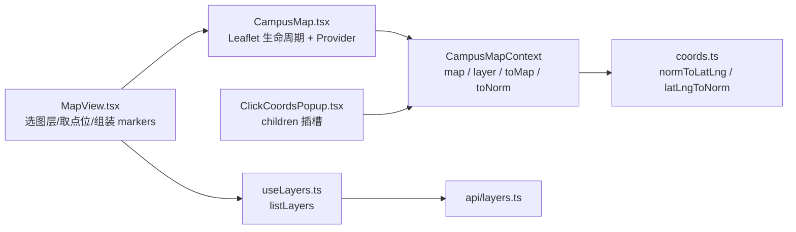
### 2.16.3 坐标换算纯函数设计（coords.ts）

**设计原则**：换算逻辑与 Leaflet 实例、React 生命周期解耦，入参只依赖图层尺寸（`width/height`），供后续图层组件（帖子点位、求助点、绘制工具）复用。

**类型与签名**：

```ts
import L from 'leaflet'
import type { LatLng } from 'leaflet'

// 仅依赖图层尺寸的窄接口，避免函数与完整 Layer 类型耦合
export interface LayerDims {
  width: number
  height: number
}

// 归一化坐标 → Leaflet 地图坐标（CRS.Simple 下 lat=y、lng=x，原点为图片左下角）
export function normToLatLng(nx: number, ny: number, dims: LayerDims): LatLng

// Leaflet 地图坐标 → 归一化坐标 { x, y }
export function latLngToNorm(latlng: LatLng, dims: LayerDims): { x: number; y: number }
```

**换算关系**（与本 `design.md` 2.6 约定一致）：
- 地图坐标：`lng = nx * width`、`lat = ny * height`（即 `L.latLng(ny * height, nx * width)`）。
- 归一化坐标：`x = lng / width`、`y = lat / height`。

**归一化坐标对象约定**：统一用 `{ x, y }` 表达（`x` 对应水平/lng 方向，`y` 对应垂直/lat 方向），避免现有代码中 `norm_x`/`norm_y` 与 `lat`/`lng` 混用造成的顺序错误。`MapMarker` 与 `onMapClick` 回调均采用 `{ x, y }`。

### 2.16.4 MapContext 与 useCampusMap 设计（MapContext.tsx）

**Context 值契约**：

```ts
import type { Map as LeafletMap, LatLng } from 'leaflet'
import type { Layer } from '../../types'

export interface CampusMapContextValue {
  map: LeafletMap | null                       // 实例就绪前为 null；切换图层时随实例重建更新
  layer: Layer                                 // 当前图层信息
  toMap: (nx: number, ny: number) => LatLng    // 绑定当前图层的归一化→地图换算
  toNorm: (latlng: LatLng) => { x: number; y: number } // 绑定当前图层的地图→归一化换算
}

export const CampusMapContext = createContext<CampusMapContextValue | null>(null)
export function useCampusMap(): CampusMapContextValue // 外部调用 throw new Error('useCampusMap 必须在 CampusMap 组件内使用')
```

**设计要点**：
- `CampusMapContext` 由 `CampusMap` 内部创建 Provider，`value` 通过 `useMemo` 依赖 `[map, layer]` 生成；`toMap`/`toNorm` 为 `normToLatLng`/`latLngToNorm` 绑定当前 `layer` 后的闭包，子组件无需再传图层。
- `useCampusMap` 参考 `AuthContext.useAuth`（`AuthContext.tsx:88-91`）的抛错约定：`context === null` 时抛中文错误，保证在 `CampusMap` 外部调用时立刻暴露。
- `map` 为 `null` 的语义：组件首次渲染、以及图层切换中「旧实例已销毁、新实例尚未创建」的窗口期。子组件拿到 `null` 即代表「当前不可叠加图层」，从机制上杜绝持有已销毁实例的引用。

### 2.16.5 CampusMap 组件设计（CampusMap.tsx）

**Props 契约**：

```ts
import type { ReactNode } from 'react'
import type { Layer } from '../../types'

// 点位：归一化坐标 + 展示文案 + 颜色（label 的「（模拟点位）」后缀由 MapView 组装）
export interface MapMarker {
  x: number
  y: number
  label: string
  color: string
}

export interface CampusMapProps {
  layer: Layer
  markers: MapMarker[]
  onMapClick?: (norm: { x: number; y: number }) => void  // 可选，点击时回调归一化坐标
  onImageError?: (message: string) => void                 // 可选，底图加载失败通知外部
  children?: ReactNode                                     // 可选，叠加额外控件（在 Context 范围内）
}
```

**内部状态与引用**：
- `map` 用 **`useState<LeafletMap | null>`** 管理（原 `MapView` 用 `useRef`），保证 Context 值随实例重建同步更新。
- `containerRef`（Leaflet 挂载 DOM）、`markerGroupRef`（点位图层组）、`onClickRef`/`onErrorRef`（保存最新回调，避免 useEffect 依赖内联回调导致地图被反复重建）。

**Leaflet 生命周期（完整保留原清理逻辑）**：

要点（迁移自 `MapView.tsx:39-94`，逻辑不变）：
1. `useEffect` 依赖 `[layer]`；`layer` 变化（切换图层）触发重建。
2. 切换/卸载时 cleanup 顺序：`active=false` → `controller.abort()` → `revokeObjectURL(objectUrl)` → `map.remove()` → `setMap(null)` → `markerGroupRef.current = null`。**「先 setMap(null) 再建新实例」是保证子组件不拿到已销毁实例的关键**。
3. 创建实例：`L.map(container, { crs: L.CRS.Simple, minZoom: -3, maxZoom: 3 })`；`bounds = L.latLngBounds([0,0],[layer.height, layer.width])`；`fitBounds` + `setMaxBounds(bounds.pad(0.2))`。
4. 无底图（`image_path` 为空）：`L.rectangle(bounds, { color: cssVar('--color-border-strong'), weight: 1, fillOpacity: 0.03 })` 占位矩形。
5. 有底图：`getLayerImage(layer.id, controller.signal)` → `URL.createObjectURL(blob)` → `L.imageOverlay(url, bounds)`；失败时 `onErrorRef.current?.(errorMessage(e, '底图加载失败'))`。
6. 点击：`map.on('click', (e) => onClickRef.current?.(latLngToNorm(e.latlng, layer)))`。**组件只分发 `onMapClick`，不弹任何 popup**。

**markers 渲染（独立 useEffect）**：

要点（迁移自 `MapView.tsx:96-110`）：
1. `useEffect` 依赖 `[markers, map, layer]`；`map` 为 `null` 时直接返回。
2. `markerGroupRef.current` 为 `null` 时 `L.layerGroup().addTo(map)`；重建地图后（cleanup 已置 null）会重新创建。
3. `clearLayers()` 后逐点 `L.circleMarker(normToLatLng(m.x, m.y, layer), { color: m.color }).bindTooltip(m.label)`。

**渲染结构**：

```tsx
<CampusMapContext.Provider value={value}>
  <div ref={containerRef} className={styles.map} />
  {children}
</CampusMapContext.Provider>
```

- `children` 渲染在 Provider 范围内，`value` 由 `useMemo` 依 `[map, layer]` 生成。
- `CampusMap.module.css` 迁移自 `MapView.module.css` 的 `.map`（height/border/background 引用 tokens 变量）。
### 2.16.6 ClickCoordsPopup 图层组件设计（ClickCoordsPopup.tsx）

**职责**：作为 `<CampusMap>` 的子组件，通过 `useCampusMap()` 获取地图实例与换算函数，自行监听点击事件并弹出与现状完全相同的归一化坐标 popup；同时作为 `useCampusMap()` 的验证用例（替代原计划「临时子组件验证后删除」）。

**设计要点**：
- 组件**不渲染任何 DOM**（返回 `null`），仅用副作用监听事件。
- `const { map, toNorm } = useCampusMap()`；`useEffect` 依赖 `[map, toNorm]`：
  - `map` 为 `null` 时直接返回（窗口期不注册监听）。
  - 注册处理器：`const handler = (e: LeafletMouseEvent) => { const { x, y } = toNorm(e.latlng); L.popup().setLatLng(e.latlng).setContent(\`归一化坐标 (${x.toFixed(3)}, ${y.toFixed(3)})\`).openOn(map) }`。
  - `map.on('click', handler)`；cleanup 中 `map.off('click', handler)`，保证**地图实例变化或组件卸载时移除自身监听**。
- 事件监听随 `map` 变化自动重绑：切换图层时 `map` 经历「旧实例 → null → 新实例」，cleanup 先移除旧实例监听，新实例就绪后重新注册，故切换 5 次后点击只弹出一个 popup（旧实例监听已移除、新实例仅一个监听）。

**popup 内容与现状完全一致**：`归一化坐标 (${x.toFixed(3)}, ${y.toFixed(3)})`，坐标值由 `toNorm`（绑定当前图层）计算。

### 2.16.7 useLayers Hook 设计（useLayers.ts）

```ts
export function useLayers(): AsyncState<Layer[]>
```

- 复用 `useAsync(() => listLayers(), [])`，返回 `AsyncState<Layer[]>`（`data/error/loading/reload`）。
- 不额外封装业务逻辑，仅把 `listLayers()` 的调用从页面抽离，供 `MapView` 及后续页面复用。

### 2.16.8 MapView 改造设计（MapView.tsx）

**改造后职责**：只做「选图层 → 取模拟点位 → 组装 markers → 传给 CampusMap + 挂载 ClickCoordsPopup」。

**改造要点**：
1. 移除 Leaflet 相关 import（`L`、`leaflet/dist/leaflet.css`、`getLayerImage`）与全部实例生命周期/点击/markers 逻辑（原 `useRef`、`mapRef`、`markerGroupRef`、两个 map 相关 useEffect）。
2. 图层获取改为 `const { data: layers, error: layersError } = useLayers()`。
3. 组装 markers：`points`（staff/admin 时 `listSimulatedPoints`）映射为 `MapMarker`，`label = \`${p.label}（模拟点位）\``，`color = cssVar('--color-warning')`（保留约束 5「模拟点位标识来源」）。
4. 渲染：`{layer && <CampusMap layer={layer} markers={markers} onImageError={setImageError}><ClickCoordsPopup /></CampusMap>}`。`onMapClick` 当前不传（暂无标点需求，为后续标点/圈范围/画路径预留）。
5. `calibrated`、`imageError`、图层选择 `<select>`、`hint` 文案、`ErrorNotice`、空态提示保留不变。
6. `leaflet.css` 引入位置随地图逻辑迁至 `CampusMap.tsx`（`MapView` 不再 import）。

> 说明：`MapMarker`、`CampusMapProps` 类型由 `CampusMap.tsx` 导出，`MapView` 从组件文件导入，不写入 `types.ts`（`types.ts` 不在本次允许修改清单内）。

### 2.16.9 验收方案

| # | 验收项 | 期望 |
|---|---|---|
| 1 | `cd frontend && npm run lint` | 通过（无 `any`、无未用导入、无内联 `style`） |
| 2 | `cd frontend && npm run build` | 通过（`tsc -b` 类型检查 + vite 构建） |
| 3 | 打开地图页，室外图 | 正常显示底图 |
| 4 | 切换到无底图的楼层 | 显示占位矩形 |
| 5 | 来回切换图层 5 次 | 页面始终只有一个地图实例（无残留 DOM 节点） |
| 6 | 切换图层 5 次后点击地图 | 坐标 popup 正常弹出且**只弹出一个**（证明旧实例监听已移除、新实例监听已注册） |
| 7 | 点击地图 | 弹出 `归一化坐标 (x, y)`，内容与改造前一致 |
| 8 | 离开地图页再返回 | 无报错（实例与事件监听正确销毁） |
| 9 | `ClickCoordsPopup` 作为 `useCampusMap` 验证用例 | 组件内成功获取 `map` 实例与换算函数；切换图层后拿到新实例（原「临时子组件验证后删除」步骤取消，由该组件常驻验证） |
---

# 三、v2.0 增量设计方案

> 本章为 v2.0 需求（`spec.md` v2.0）相对 v1.0 存量的增量架构设计，对应文档头部 D1~D10 架构决定。前文 2.1~2.16 中与此冲突的描述（2.6 地图坐标原点、2.2.1 服务划分）以本章为准。

## 2.17 增量设计总览与上下文视图

### 2.17.1 增量范围

v2.0 在「发布→匹配→认领→核验→归还→协助工单」闭环之上叠加六条新链路，均不改动既有行为：

1. **教职工链路**：学生自助提交申请（工号+选填部门）→ 管理员审核 → 通过则 `role` 由 `student` 转 `staff`。
2. **互动链路**：评论 / 点赞 / 收藏 / 接取委托 / 致谢，围绕 `item` 展开，计数全部子查询统计。
3. **发布增强链路**：照片多图上传（去 EXIF）→ 发布；撤销 / 我已找回；圈选默认公开、路径默认私密。
4. **地图增强链路**：建筑数据导入 → 多层图层可开关 → 楼层图 → 绘制工具 → 从地图发帖。
5. **积分称号链路**：致谢 +20 / 归还 +15 / 工单反馈 +10，唯一约束防重复，阈值集中配置。
6. **AI 辅助链路**：智能整理发帖草稿、寻物地点推荐，均经用户确认才落库，模型不可用降级。

### 2.17.2 上下文视图

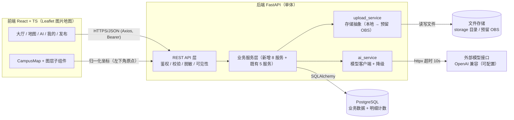

| 组件 | 职责 | 关键约束 |
|---|---|---|
| 前端 | 四标签导航、大厅卡片、地图图层开关、AI 对话、我的 | 不放密钥；权限不靠前端隐藏；375px 可用、点击区 ≥44px |
| 后端 API | 鉴权、校验、脱敏、可见性过滤、调用 service | 私密字段与监控点位不进入公共响应 |
| 新增服务层 | 教职工/评论/点赞收藏/接取委托/积分/建筑/上传/AI | 积分只经 `points_service`；service 首参 `db`、用户显式传入 |
| 存储抽象 | `upload_service` + `StorageBackend` 接口 | 本地目录实现，预留 OBS 实现；受控发放不暴露目录 |
| 模型适配 | `ai_service` + httpx | 仅提取/推荐/生成草稿；超时 10s 降级；结果经用户确认才落库 |

## 2.18 数据模型增量设计

### 2.18.1 新增枚举

新增于 `backend/app/models/enums.py`（沿用 `SAEnum(native_enum=False, length=N)` 约定，跨库一致）：

| 枚举 | 值 | length | 用途 |
|---|---|---|---|
| `StaffStatus` | `none` / `pending` / `approved` / `rejected` | 16 | 教职工申请状态（`user.staff_status`） |
| `Visibility` | `public` / `private` | 16 | 路线/圈选可见性（`route.visibility`） |
| `AttachmentPurpose` | `item_photo` / `comment_image` / `evidence` | 16 | 附件用途（`attachment.purpose`） |
| `SimulatedPointKind` | `help_point` / `monitor_point` | 16 | 求助点位 vs 监控点位（`simulated_point.kind`） |
| `PointReason` | `thank` / `return` / `ticket_feedback` | 16 | 积分事件（`point_record.reason`） |
| `HelperStatus` | `active` / `abandoned` | 16 | 接取委托状态（`item_helper.status`） |

> 说明：`item.status` 复用现有 `ItemStatus`（lost/found 方向共用同一枚举，`found` 值表示「已找回」）；`comment` 软删除用布尔 `is_deleted`，不引入删除状态枚举。

### 2.18.2 新表定义

主键统一 `UUID`，时间戳 `created_at`（`server_default=func.now()`）。字段约束遵循「字符串设长度上限、外键列加索引、唯一约束防重复」。

**① `building`（建筑）**

| 字段 | 类型 | 约束 | 说明 |
|---|---|---|---|
| `id` | UUID | PK | |
| `code` | varchar(32) | NOT NULL, UNIQUE | 建筑编号（配置导入唯一键） |
| `name` | varchar(64) | NOT NULL | 建筑名称 |
| `category` | varchar(32) | NOT NULL | 类别（教学楼/食堂/图书馆/宿舍/其他） |
| `floors` | int | NOT NULL, default 1 | 层数 |
| `click_region` | jsonb | NULLABLE | 地图点击区域（归一化多边形点序列，左下角原点） |
| `label_position` | jsonb | NULLABLE | 标签位置 `{x, y}`（归一化） |
| `created_at` | timestamptz | NOT NULL | |

索引：`code` UNIQUE；`category` 加普通索引（建筑卡片按类别筛选）。

**② `comment`（评论，一层回复 + 软删除）**

| 字段 | 类型 | 约束 | 说明 |
|---|---|---|---|
| `id` | UUID | PK | |
| `item_id` | UUID FK→item | NOT NULL, index | 所属帖子 |
| `author_user_id` | UUID FK→user | NOT NULL, index | 评论者 |
| `parent_id` | UUID FK→comment | NULLABLE, index | 回复的父评论（仅一层） |
| `content` | text | NOT NULL | 1~500 字 |
| `is_deleted` | boolean | NOT NULL, default false | 软删除标记 |
| `created_at` | timestamptz | NOT NULL | |

**③ `item_like`（点赞，一人一次可取消）**

| 字段 | 类型 | 约束 | 说明 |
|---|---|---|---|
| `id` | UUID | PK | |
| `item_id` | UUID FK→item | NOT NULL | |
| `user_id` | UUID FK→user | NOT NULL | |
| `created_at` | timestamptz | NOT NULL | |

唯一约束 `UNIQUE(item_id, user_id)`（`uq_item_like_item_user`）；索引 `item_id`、`user_id`。

**④ `item_favorite`（收藏，结构同点赞）**

| 字段 | 类型 | 约束 | 说明 |
|---|---|---|---|
| `id` | UUID | PK | |
| `item_id` | UUID FK→item | NOT NULL | |
| `user_id` | UUID FK→user | NOT NULL | |
| `created_at` | timestamptz | NOT NULL | |

唯一约束 `UNIQUE(item_id, user_id)`（`uq_item_favorite_item_user`）；索引 `item_id`、`user_id`。

**⑤ `item_helper`（接取委托/协助者）**

| 字段 | 类型 | 约束 | 说明 |
|---|---|---|---|
| `id` | UUID | PK | |
| `item_id` | UUID FK→item | NOT NULL, index | 被接取的寻物帖 |
| `user_id` | UUID FK→user | NOT NULL, index | 协助者 |
| `status` | HelperStatus | NOT NULL, default active | 进行中 / 已放弃 |
| `thanked` | boolean | NOT NULL, default false | 是否已被致谢（积分去重依据） |
| `created_at` | timestamptz | NOT NULL | |

唯一约束 `uq_item_helper_item_user`（`item_id`, `user_id`），同一用户对同一帖子最多一条记录（由 F14 验收修复引入，见 2.27.3.1、2.27.3.2）。同一组合的 `active` 记录存在时再次接取返回 409；存在 `abandoned` 记录时再次接取原地恢复该行（见 2.27.3.3、2.27.3.4）。

**⑥ `point_record`（积分记录，只增不减）**

| 字段 | 类型 | 约束 | 说明 |
|---|---|---|---|
| `id` | UUID | PK | |
| `user_id` | UUID FK→user | NOT NULL, index | 积分归属 |
| `reason` | PointReason | NOT NULL | 事件类型 |
| `amount` | int | NOT NULL（>0） | 积分值（+20/+15/+10） |
| `ref_id` | UUID | NOT NULL | 事件对象 id（claim / helper / ticket） |
| `created_at` | timestamptz | NOT NULL | |

唯一约束 `UNIQUE(user_id, reason, ref_id)`（`uq_point_record_user_reason_ref`）——同一事件对同一人只计一次；索引 `user_id`（按人查积分明细）。

### 2.18.3 修改表定义（仅加列，不改既有列）

**`user` 新增 4 列（教职工申请）**

| 列 | 类型 | 约束 | 说明 |
|---|---|---|---|
| `staff_status` | StaffStatus | NOT NULL, default `none` | 审核前保持 `none/pending`，`role` 仍为 `student` |
| `staff_no` | varchar(20) | NULLABLE | 工号（4~20 位字母/数字） |
| `department` | varchar(64) | NULLABLE | 部门（选填） |
| `staff_reject_reason` | text | NULLABLE | 拒绝理由（申请人可见） |

**`layer` 新增 2 列（楼层图关联建筑）**

| 列 | 类型 | 约束 | 说明 |
|---|---|---|---|
| `building_id` | UUID FK→building | NULLABLE, index | 楼层图所属建筑 |
| `floor` | int | NULLABLE | 楼层（1F/2F…；室外示意图为 NULL） |

**`item` 新增 2 列（点选建筑与楼层）**

| 列 | 类型 | 约束 | 说明 |
|---|---|---|---|
| `building_id` | UUID FK→building | NULLABLE, index | 物品所在建筑 |
| `floor` | int | NULLABLE | 物品所在楼层 |

**`route` 新增 `visibility` 并替换 `is_private`**

| 列 | 类型 | 约束 | 说明 |
|---|---|---|---|
| `visibility` | Visibility | NOT NULL, default `private` | `circle` 默认 `public`、`polyline` 默认 `private` |

迁移映射（数据迁移）：`is_private=true → visibility='private'`；`is_private=false → visibility='public'`；迁移完成后删除 `is_private` 列。`RouteOut/RouteDetail/TicketRouteOut` 的 `is_private` 字段同步改为 `visibility`（对外契约变化，前端 `types.ts` 同步）。

**`attachment` 新增 5 列（上传者、评论图、用途、媒体类型、大小）**

| 列 | 类型 | 约束 | 说明 |
|---|---|---|---|
| `owner_user_id` | UUID FK→user | NULLABLE, index | 上传者（拾获帖照片可见性鉴权） |
| `comment_id` | UUID FK→comment | NULLABLE, index | 评论图片关联（最多 3 图） |
| `purpose` | AttachmentPurpose | NOT NULL, default `item_photo` | 用途：帖子图/评论图/证据 |
| `mime` | varchar(64) | NULLABLE | `image/jpeg` 等 |
| `size` | int | NULLABLE | 字节数 |

**`simulated_point` 新增 2 列（求助 vs 监控、公开性）**

| 列 | 类型 | 约束 | 说明 |
|---|---|---|---|
| `kind` | SimulatedPointKind | NOT NULL, default `help_point` | `help_point`（保卫处/服务台/失物招领处，公开）；`monitor_point`（模拟监控，仅 staff） |
| `is_public` | boolean | NOT NULL, default true | 公开性；监控点位置 `false` |

**坐标语义迁移（历史设计，未执行）**：v1.0 文档将 `y` 轴定义为「左上角原点」，v2.0 改为「左下角原点」，原计划迁移时对既有 `norm_y`/`y` 做 `y' = 1 - y` 转换。**X2a 核验**：`20261018_v2_incremental.py` 未包含该转换；当前前端换算为 `lat = ny * height`，与新导入素材一致。交付前需确认存量数据是否按左上角写入，若有则由数据维护单独校正；X2a 不改变存量坐标（见 2.6 第 3 条）。

**X2a 追加列（双视图地图，详见 2.28.2）**

| 表 | 列 | 类型 | 约束 | 说明 |
|---|---|---|---|---|
| `layer` | `kind` | LayerKind | NOT NULL, default `flat`, index | `flat` 室外平面图 / `iso` 2.5D 选楼图 / `floor` 楼层图；迁移回填既有楼层图为 `floor` |
| `layer` | `rooms` | JSON | NULLABLE | 楼层房间：`[{"name": str, "x": float, "y": float}]`，仅 `kind=floor` 使用 |
| `building` | `iso_hit_area` | JSON | NULLABLE | 2.5D 命中区域，`[{x,y}]`，与 `click_region` 同构 |
| `building` | `iso_label_position` | JSON | NULLABLE | 2.5D 标签位置 `{x,y}` |
| `building` | `draw_order` | int | NOT NULL, default 0 | 2.5D 绘制层级，命中重叠时取最大值；素材中存在负值 |
| `building` | `entrance_node` | int | NULLABLE | 路网入口节点编号，仅存档，不参与位置计算 |

语义约定：`building.click_region` 改存室外平面轮廓（素材 `flat.footprint`），`building.label_position` 改存室外标签点（素材 `flat.label_anchor`）。字段名不变，推荐算法、演示数据、前端 `buildingAt`/`buildingCenter` 继续复用；2.5D 几何只进 `iso_hit_area`/`iso_label_position`，不参与位置写入。

### 2.18.4 计数查询策略（不建冗余字段）

点赞数、评论数、收藏数、协助者人数**不落冗余计数字段**，统一用明细表子查询统计（架构决定 D4）：

| 计数 | 统计口径 | SQL 逻辑 |
|---|---|---|
| 点赞数 | `item_like` 行数 | `SELECT COUNT(*) FROM item_like WHERE item_id = :id` |
| 评论数 | 未软删除评论 | `SELECT COUNT(*) FROM comment WHERE item_id = :id AND is_deleted = false` |
| 收藏数 | `item_favorite` 行数 | `SELECT COUNT(*) FROM item_favorite WHERE item_id = :id` |
| 协助者人数 | 进行中委托 | `SELECT COUNT(*) FROM item_helper WHERE item_id = :id AND status = 'active'` |

实现约束：
- 列表接口（`GET /items`、`/me/*`）用 `subquery` + `group_by` 一次性聚合，避免 N+1；详情接口用相关子查询或 `selectinload` 批量加载。
- 同时返回「我是否已点赞/已收藏/已接取」布尔：列表用 `EXISTS` 子查询（携带当前 `user.id`），详情用单条查询。
- 计数与点赞/收藏状态以明细表为唯一事实源，删除/取消后计数自然回落，不维护一致性回写。

### 2.18.5 实体关系图（v2.0 增量）

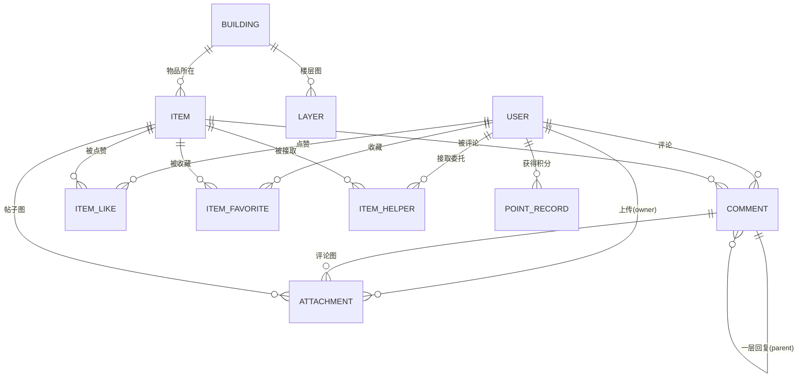

### 2.18.6 Alembic 迁移设计

新建单张迁移 `backend/alembic/versions/xxxx_v2_incremental.py`，`down_revision = '7b8c9d0e1f2a'`（挂最新 head）：

- **建表**：`building`、`comment`、`item_like`、`item_favorite`、`item_helper`、`point_record`（含唯一约束与索引）。
- **加列**：`user` 加 `staff_status/staff_no/department/staff_reject_reason`；`layer` 加 `building_id/floor`；`item` 加 `building_id/floor`；`attachment` 加 `owner_user_id/comment_id/purpose/mime/size`；`simulated_point` 加 `kind/is_public`。
- **数据迁移**：`route` 加 `visibility` → 按 `is_private` 回填 → 删 `is_private`；`item`/`simulated_point` 的 `norm_y`、`route.geometry`、`building` 无存量数据，`y' = 1 - y` 转换仅针对存量 `norm_y` 列（若初始库已有演示数据则执行，否则跳过）。
- **枚举兼容**：新枚举均 `SAEnum(..., native_enum=False, length=16)`，SQLite/PostgreSQL 落为 `VARCHAR(16)`，与既有 2.11.3 约定一致，`alembic check` 一致。
- 测试链路 `conftest.py` 继续 `create_all`，新表/新列随模型建表；迁移与 `create_all` 产出同构 schema。
## 2.19 新服务模块职责划分

新增 8 个服务文件（`backend/app/services/`），均遵循「首参 `db: Session`、当前用户显式传入、一次业务只 commit 一次、不依赖 FastAPI 的 Request/Depends」分层约定。

| 服务文件 | 职责 | 关键业务规则 |
|---|---|---|
| `staff_application_service.py` | 教职工申请提交、申请列表（管理员）、审核通过/拒绝 | 提交校验工号 4~20 位字母/数字；通过时 `role` student→staff；拒绝须填理由；终态不可再改；`role` 保持 student 直到通过 |
| `upload_service.py` | 文件上传、图片处理、存储抽象、按可见性下载 | Pillow 去 EXIF；格式 jpg/png/webp、单张 ≤5MB；写入前校验引用存在；返回受控 `GET /uploads/{id}` |
| `comment_service.py` | 评论创建/列表/软删除 | 1~500 字、最多 3 图、仅一层回复；软删除显示「该评论已删除」；删除限本人或 staff/admin |
| `reaction_service.py` | 点赞/收藏的创建与取消、计数子查询、我的点赞/收藏列表 | 一人一次可取消；`UNIQUE(item_id,user_id)` 兜底 + 应用层幂等；计数子查询统计 |
| `helper_service.py` | 接取/放弃委托、协助者名单与人数、致谢 | 非发布者、帖子在「寻找中/核验中」方可接取；致谢 ≤3 人并触发积分 |
| `points_service.py` | 积分写入（**唯一入口**）、积分查询、称号计算 | 唯一约束 `(user_id,reason,ref_id)` 防重复；只增不减；称号阈值集中配置 |
| `building_service.py` | 建筑列表/详情、配置导入 | `code` 唯一；导入幂等 upsert；层数/点击区域/标签位置落库 |
| `ai_service.py` | 模型客户端（httpx）、智能整理发帖、地点推荐 | 超时 10s 降级；输出经用户确认才落库；请求不含精确位置/联系方式/认领证据 |

**积分写入调用点（积分只能经 `points_service` 写入，架构决定 D5）**：

| 事件 | reason | amount | ref_id | 触发位置（在既有事务提交成功后追加） |
|---|---|---|---|---|
| 失主致谢协助者 | `thank` | +20 | `item_helper.id` | `helper_service.thank` → `points_service.add` |
| 拾获帖归还完成 | `return` | +15 | `claim.id` | `claim_service.complete_claim` 成功后 → `points_service.add` |
| 工作人员工单反馈 | `ticket_feedback` | +10 | `ticket.id` | `ticket_service.feedback` 成功后 → `points_service.add` |

> 约束：`points_service.add` 依赖 `UNIQUE(user_id,reason,ref_id)`，重复触发捕获 `IntegrityError` 后静默幂等（只计一次）；发帖/评论/点赞**不产生积分**。既有 `ticket_service.feedback` 的 `assist` 徽章逻辑保留，与积分并存不冲突。

## 2.20 数据流与存储抽象（上传）

### 2.20.1 上传数据流

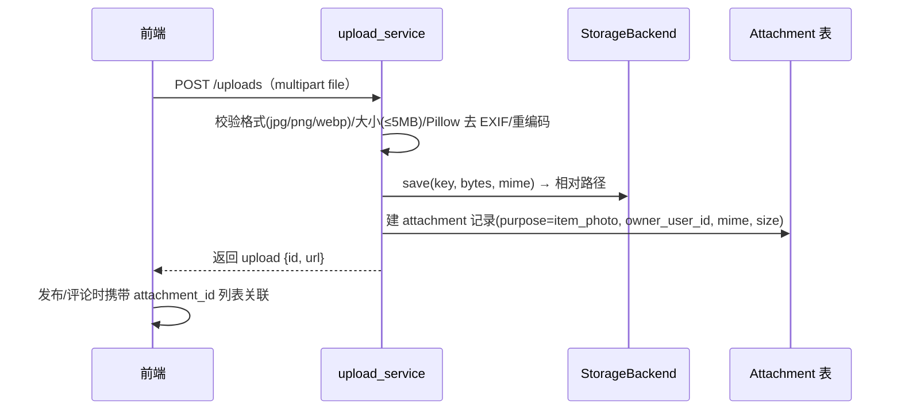

- 前端上传阶段：压缩长边 ≤1600px；后端上传阶段：Pillow 重新打开并保存，剥离 EXIF（GPS/相机信息），仅保留像素。
- 上传返回 `attachment_id`，不立即绑定业务对象；发布（`POST /items` 扩展 `photo_ids`）或评论（`POST /items/{id}/comments` 扩展 `photo_ids`）时关联，未关联的孤儿附件可被定期清理（可选，不阻塞主流程）。
- 底图（`layer.image_path`）与认领证据仍走既有受控路径，不经过 `POST /uploads` 的帖子图流程。

### 2.20.2 存储抽象接口

```python
# backend/app/services/storage.py（Protocol 接口，本地实现 + 预留 OBS 实现）
class StorageBackend(Protocol):
    def save(self, key: str, data: bytes, mime: str) -> str: ...  # 返回存储相对路径
    def load(self, key: str) -> bytes: ...
    def delete(self, key: str) -> None: ...
```

| 实现 | 说明 | 引入时机 |
|---|---|---|
| `LocalStorageBackend` | 写入 `settings.file_storage_dir`（默认 `./storage`），返回相对路径 | v2.0 默认实现（沿用现有 `get_layer_image` 的路径读取方式） |
| `OBSStorageBackend` | 对接华为云 OBS（`obs://bucket/key`），密钥仅存后端 `.env` | 预留，v2.0 不引入 OBS SDK，仅定义接口与配置占位 |

约束：文件不暴露真实目录（所有下载经受控接口 `GET /uploads/{id}` / `GET /layers/{id}/image`）；存储抽象使「本地 → OBS」切换不改上层业务与接口契约。

### 2.20.3 照片可见性鉴权

| 照片用途 | 可见范围 | 鉴权逻辑 |
|---|---|---|
| `item_photo`（寻物帖） | 任一已登录用户 | `item.direction == lost` → 公开 |
| `item_photo`（拾获帖） | 发布者本人 + staff/admin | 他人访问返回「为防冒领，照片已隐藏」（403） |
| `comment_image` | 随评论公开（评论未软删除） | 评论可见即图可见 |
| `evidence` | 发布者本人 + 该单处理 staff | 沿用 `claim_evidence` 规则，不走公开接口 |

实现约束：`GET /uploads/{id}` 根据 `attachment.purpose` + 关联对象的 `owner/direction/status` 决定是否放行；未登录 401、越权 403、不存在 404。
## 2.21 新增接口设计（完整契约）

> 约定：基路径 `/api/v1`；鉴权 `Authorization: Bearer <JWT>`；错误结构 `{code, message, details?}`；`code` 取值 `VALIDATION/UNAUTH/FORBIDDEN/NOT_FOUND/STATE_CONFLICT`；列表接口统一 `limit`（默认 20，最大 100）/`offset`，返回 `{items,total,limit,offset}`。所有新增接口均声明 `response_model`，路径沿用复数名词与短横线。

### 2.21.1 教职工申请与审核

| 方法 路径 | 权限 | 请求 | 响应 | 错误码 |
|---|---|---|---|---|
| `POST /me/staff-application` | 登录（`role=student` 且非待审核） | `StaffApplicationCreate` | `UserOut`（`staff_status=pending`） | 401；403（已 staff/admin）；409（已有 pending/approved）；400（工号格式不合法） |
| `GET /admin/staff-applications` | `admin` | `status`（默认 pending）、`limit/offset` | `Page[StaffApplicationOut]` | 401；403 |
| `POST /admin/staff-applications/{user_id}/approve` | `admin` | 无 body | `UserOut`（`role=staff`、`staff_status=approved`） | 401；403；404（用户不存在）；409（状态非 pending） |
| `POST /admin/staff-applications/{user_id}/reject` | `admin` | `StaffRejectRequest` | `UserOut`（`staff_status=rejected`、`staff_reject_reason=reason`） | 401；403；404；409（状态非 pending）；400（理由为空） |

```python
# schemas/staff_application.py
class StaffApplicationCreate(BaseModel):
    staff_no: Annotated[str, StringConstraints(strip_whitespace=True, min_length=4, max_length=20, pattern=r'^[A-Za-z0-9]+$')]
    department: Annotated[str, StringConstraints(max_length=64)] | None = None

class StaffRejectRequest(BaseModel):
    reason: Annotated[str, StringConstraints(strip_whitespace=True, min_length=1, max_length=500)]

class StaffApplicationOut(BaseModel):
    user_id: uuid.UUID
    username: str
    display_name: str
    staff_no: str | None
    department: str | None
    staff_status: StaffStatus
    created_at: datetime
```

**业务说明**：学生提交申请后 `staff_status=pending`、`role` 保持 `student`（审核前按学生权限，天然无法通过 `require_role(staff/admin)` 守卫）。管理员通过时 `user.role = staff`、`staff_status=approved`；拒绝时 `staff_status=rejected`、记录理由。已通过/已拒绝为终态，不可再改。管理员直接创建工作人员（`POST /admin/staff`）不受影响。

### 2.21.2 上传与照片

| 方法 路径 | 权限 | 请求 | 响应 | 错误码 |
|---|---|---|---|---|
| `POST /uploads` | 登录 | multipart `file`（jpg/png/webp，≤5MB） | `UploadOut` | 401；400（格式/大小不合法） |
| `GET /uploads/{id}` | 按可见性（见 2.20.3） | 无 | 图片二进制 | 401；404；403（拾获帖照片非本人非 staff） |
| `POST /items/{id}/photos` | 发布者本人 | `PhotoBindRequest`（`photo_ids` 最多 6） | `ItemDetail`（含照片） | 401；403；404；400（超 6 张/附件不存在或非本人上传） |

```python
# schemas/upload.py
class UploadOut(BaseModel):
    id: uuid.UUID
    url: str          # 受控下载地址 /api/v1/uploads/{id}
    mime: str
    size: int

class PhotoBindRequest(BaseModel):
    photo_ids: list[uuid.UUID] = Field(min_length=1, max_length=6)
```

**业务说明**：`POST /uploads` 经 `upload_service` 校验格式与大小、Pillow 去 EXIF、写入存储、建 `attachment`（`purpose=item_photo`、`owner_user_id=user.id`）。发布时 `POST /items` 扩展可选 `photo_ids`（≤6）关联帖子图；`POST /items/{id}/photos` 用于发布后补传/替换照片。拾获帖照片 `GET /uploads/{id}` 仅发布者 + staff/admin 可见，他人 403。

### 2.21.3 帖子补充操作（撤销 / 我已找回）

| 方法 路径 | 权限 | 请求 | 响应 | 错误码 |
|---|---|---|---|---|
| `POST /items/{id}/withdraw` | 发布者本人 | 无 body | `ItemPublic`（`status=withdrawn`） | 401；403；404；409（状态不允许，见下） |
| `POST /items/{id}/mark-found` | 发布者本人 | 无 body | `ItemPublic`（`status=found`） | 401；403；404；409（非寻物帖/状态非寻找中/存在已通过认领） |

**业务规则**：
- `withdraw`：仅 `lost` 且 `searching`，或 `found` 且 `pending` 可直接撤销；`reviewing` 且无已通过认领可撤销（沿用既有状态机）。已找回/已归还/已撤销为终态不可撤销。
- `mark-found`：仅 `lost` 且 `searching`，且不存在 `status=approved` 的认领；置 `found`（已找回）。存在有效认领时 409（须走归还闭环）。

### 2.21.4 评论

| 方法 路径 | 权限 | 请求 | 响应 | 错误码 |
|---|---|---|---|---|
| `GET /items/{id}/comments` | 登录 | `limit/offset` | `Page[CommentOut]`（顶层评论 + 一层子回复） | 401；404（item 不存在） |
| `POST /items/{id}/comments` | 登录 | `CommentCreate` | `CommentOut` | 401；400（内容空/超长、图片>3）；404（item/parent 不存在）；409（parent 已删除或层级非法） |
| `DELETE /comments/{id}` | 本人 或 staff/admin | 无 body | `CommentDeletedOut`（软删除） | 401；403；404；409（已删除） |

```python
# schemas/comment.py
class CommentCreate(BaseModel):
    content: Annotated[str, StringConstraints(strip_whitespace=True, min_length=1, max_length=500)]
    parent_id: uuid.UUID | None = None
    photo_ids: list[uuid.UUID] = Field(default_factory=list, max_length=3)

class CommentOut(BaseModel):
    id: uuid.UUID
    item_id: uuid.UUID
    author: CommentAuthorOut           # {id, display_name, role_label, title}
    content: str
    parent_id: uuid.UUID | None
    is_deleted: bool
    images: list[UploadOut]            # 最多 3 张（attachment.purpose=comment_image）
    created_at: datetime
```

**业务规则**：仅一层回复（`parent_id` 指向的父评论不得再有 `parent_id`）；软删除显示「该评论已删除」但保留骨架（计数不含已删除）；评论图片最多 3 张（`attachment.purpose=comment_image`、`comment_id` 关联）。删除权限：本人删除自己的，staff/admin 删除任意。
### 2.21.5 点赞与收藏

| 方法 路径 | 权限 | 请求 | 响应 | 错误码 |
|---|---|---|---|---|
| `POST /items/{id}/like` | 登录 | 无 body | `ReactionOut`（`liked=true`、`like_count`） | 401；404（item 不存在） |
| `DELETE /items/{id}/like` | 登录 | 无 body | `ReactionOut`（`liked=false`、`like_count`） | 401；404 |
| `POST /items/{id}/favorite` | 登录 | 无 body | `ReactionOut`（`favorited=true`、`favorite_count`） | 401；404 |
| `DELETE /items/{id}/favorite` | 登录 | 无 body | `ReactionOut`（`favorited=false`、`favorite_count`） | 401；404 |

```python
# schemas/reaction.py
class ReactionOut(BaseModel):
    liked: bool = False
    favorited: bool = False
    like_count: int = 0
    favorite_count: int = 0
```

**业务规则**：一人一次、再次调用即取消（幂等 toggle 语义）；`POST` 无记录则插入、有记录则返回当前态；`DELETE` 有记录则删除、无记录则幂等返回。计数由 `reaction_service` 子查询统计，返回「我是否已操作」+ 计数。

### 2.21.6 接取委托与致谢

| 方法 路径 | 权限 | 请求 | 响应 | 错误码 |
|---|---|---|---|---|
| `POST /items/{id}/helpers` | 登录（非发布者） | 无 body | `HelperOut`（`helper_count`、`is_helper=true`） | 401；403（发布者本人）；404；409（帖子非寻找中/核验中、或已接取） |
| `DELETE /items/{id}/helpers` | 登录（协助者本人） | 无 body | `HelperOut`（`is_helper=false`） | 401；403；404；409（未接取） |
| `POST /items/{id}/thank` | 发布者本人 | `ThankRequest`（`helper_ids` ≤3） | `ThankOut`（`thanked_count`） | 401；403；404；409（帖子非已找回、helper 不存在或非本帖、超 3 人） |

```python
# schemas/helper.py
class ThankRequest(BaseModel):
    helper_ids: list[uuid.UUID] = Field(min_length=1, max_length=3)

class HelperOut(BaseModel):
    helper_count: int
    is_helper: bool

class ThankOut(BaseModel):
    thanked_count: int
```

**业务规则**：接取须为「寻找中/核验中」的寻物帖且非发布者；同一用户对同一帖子已有 `active` 记录时再次接取返回 409，仅有 `abandoned` 记录时原地恢复该行（口径 B，见 2.27.3.3）；致谢仅在寻物帖「已找回」后、从 active 协助者中选最多 3 人，致谢成功触发 `points_service.add(thank, +20, helper.id)`，并将 `item_helper.thanked` 置 true（防止重复致谢计分）。

### 2.21.7 积分与称号

| 方法 路径 | 权限 | 请求 | 响应 | 错误码 |
|---|---|---|---|---|
| `GET /me/points` | 登录（本人） | `limit/offset` | `MyPointsOut` | 401 |

```python
# schemas/points.py
class PointRecordOut(BaseModel):
    id: uuid.UUID
    reason: PointReason
    amount: int
    ref_id: uuid.UUID
    created_at: datetime

class MyPointsOut(BaseModel):
    total: int                     # 累计积分
    title: str                     # 当前称号
    next_title: str | None         # 下一称号
    next_threshold: int | None     # 距下一称号所需总分
    records: Page[PointRecordOut]  # 积分明细（分页）
```

**业务规则**：称号阈值与名称集中配置（见 2.24）；积分明细按 `created_at` 倒序；`total` 由 `point_record` 求和计算，不建冗余总分列。

### 2.21.8 我的列表（收藏/点赞/评论/接取委托）

| 方法 路径 | 权限 | 请求 | 响应 | 错误码 |
|---|---|---|---|---|
| `GET /me/favorites` | 登录（本人） | `limit/offset` | `Page[ItemPublic]`（含 `favorited=true`） | 401 |
| `GET /me/likes` | 登录（本人） | `limit/offset` | `Page[ItemPublic]`（含 `liked=true`） | 401 |
| `GET /me/comments` | 登录（本人） | `limit/offset` | `Page[MyCommentOut]`（含 item 概览） | 401 |
| `GET /me/helping` | 登录（本人） | `limit/offset` | `Page[ItemPublic]`（含 `is_helper=true`） | 401 |

**业务规则**：均以明细表（`item_favorite/item_like/comment/item_helper`）按 `user_id` 反查后 join `item`，返回 `ItemPublic` + 计数与「我是否已操作」；`/me/comments` 返回评论内容 + 所属帖子概览。列表 `ItemPublic` 扩展字段（计数、`is_liked/is_favorited/is_helper`）为可选，详情必返回。

### 2.21.9 建筑

| 方法 路径 | 权限 | 请求 | 响应 | 错误码 |
|---|---|---|---|---|
| `GET /buildings` | 登录 | `category?`、`limit/offset` | `Page[BuildingOut]` | 401 |
| `GET /buildings/{id}` | 登录 | 无 | `BuildingOut` | 401；404 |

```python
# schemas/building.py
class BuildingOut(BaseModel):
    id: uuid.UUID
    code: str
    name: str
    category: str
    floors: int
    click_region: list[dict] | None      # 归一化多边形点序列（左下角原点）
    label_position: dict | None          # {x, y}
    active_item_count: int               # 该建筑进行中帖子数（子查询）
    has_floor_map: bool                  # 是否有楼层图（layer.building_id 存在）
```

**业务规则**：`building_service` 提供配置导入（幂等 upsert，`code` 唯一）；`active_item_count` 为该建筑进行中帖子数子查询；`has_floor_map` 依据 `layer.building_id == id` 判定（首批 1~2 栋有平面图）。

### 2.21.10 点位过滤（按身份）

| 方法 路径 | 权限 | 请求 | 响应 | 错误码 |
|---|---|---|---|---|
| `GET /layers/{id}/points` | 登录 | 无 | `LayerPointsOut` | 401；404（layer 不存在） |

```python
# schemas/layer.py 扩展
class LayerPointOut(BaseModel):
    id: uuid.UUID
    kind: SimulatedPointKind     # help_point / monitor_point
    label: str
    norm_x: float                # 左下角原点归一化
    norm_y: float
    is_simulated: bool
    is_public: bool
    description: str | None

class LayerPointsOut(BaseModel):
    points: list[LayerPointOut]
    has_monitor: bool            # 当前用户是否可见监控点（staff/admin）
```

**业务规则**：求助点（`kind=help_point`、`is_public=true`）对所有登录用户可见；监控点（`kind=monitor_point`、`is_public=false`）仅 staff/admin 可见，且标注「模拟」。学生请求时过滤掉 `monitor_point`，`has_monitor=false`。该接口取代/扩展现有 `GET /layers/{id}/simulated-points`（旧接口保留或改为薄封装）。

### 2.21.11 AI 接口

| 方法 路径 | 权限 | 请求 | 响应 | 错误码 |
|---|---|---|---|---|
| `POST /ai/draft-post` | 登录 | `DraftPostRequest` | `DraftPostOut`（草稿，未落库） | 401；400（描述为空）；503（模型不可用，走降级返回空草稿提示） |
| `POST /ai/search-advice` | 登录 | `SearchAdviceRequest` | `SearchAdviceOut` | 401；400；503（降级返回规则结果） |

```python
# schemas/ai.py
class DraftPostRequest(BaseModel):
    text: Annotated[str, StringConstraints(strip_whitespace=True, min_length=1, max_length=2000)]

class DraftPostOut(BaseModel):
    category: str | None
    title: str | None
    description: str | None
    location_area: str | None     # 楼层级脱敏，不含精确位置
    building_code: str | None
    floor: int | None
    time_occurred: datetime | None
    source: Source                # model / rule
    degraded: bool

class SearchAdviceRequest(BaseModel):
    item_id: uuid.UUID | None = None   # 引用某寻物帖的圈选/路径
    geometry: dict | None = None       # 或现场绘制几何（circle/polyline，归一化）
    category: str | None = None

class SearchAdviceLocation(BaseModel):
    building_code: str
    building_name: str
    reason: str                  # 推荐理由
    order: int                   # 建议寻找顺序 1~5

class SearchAdviceOut(BaseModel):
    locations: list[SearchAdviceLocation]   # 最多 5 个
    source: Source                          # model / rule
    degraded: bool
```

**业务规则**：
- `draft-post`：自然语言 → 提取类型/类别/标题/描述/地点/时间/建筑，生成草稿；**草稿不落库**，前端展示由用户确认或修改后经 `POST /items` 发布，发布时 `source` 标注「AI 生成」。模型不可用降级为「提示手动填写」+ `degraded=true`。
- `search-advice`：先规则打分（距离、历史记录数、同类别历史数、建筑类型-类别对应），再模型生成解释；最多 5 个地点 + 理由 + 顺序；模型不可用降级为规则结果 + 模板解释。
- **发送给模型的内容不含**精确位置、联系方式、认领证据、他人私密路径（脱敏到楼层级/建筑级）。

### 2.21.12 错误码与权限矩阵汇总

| 状态码 | code | 语义 | 触发场景（新增） |
|---|---|---|---|
| 400 | VALIDATION | 参数缺失/非法 | 工号格式、评论超长、图片>3、照片>6、致谢>3 |
| 401 | UNAUTH | 未登录 | 所有新增接口未登录 |
| 403 | FORBIDDEN | 越权 | 非 admin 审核、非本人撤销/致谢、拾获帖照片越权 |
| 404 | NOT_FOUND | 不存在 | item/comment/building/layer/attachment 不存在 |
| 409 | STATE_CONFLICT | 状态冲突 | 重复申请、重复归还、重复接取、终态操作、重复致谢 |
| 503 | MODEL_UNAVAILABLE | 模型降级 | AI 接口模型不可用（不阻断，走降级） |

## 2.22 前端路由与地图图层组件

### 2.22.1 前端路由清单与重定向

| 新路由 | 页面/组件 | 说明 |
|---|---|---|
| `/hall` | `Hall.tsx`（原 `Home.tsx`） | 大厅卡片列表（首图/建筑楼层/点赞/评论/接取人数，加载更多） |
| `/hall/:id` | `ItemDetail.tsx` | 帖子详情（互动、接取委托、撤销/找回、照片可见性） |
| `/publish` | `ItemForm.tsx` | 发布（照片≤6、标点/圈范围/画路径、AI 整理草稿确认） |
| `/map` | `MapView.tsx` | 地图（多图层开关、绘制工具、建筑点选） |
| `/ai` | `AiPage.tsx`（新增） | AI 对话式界面（智能整理发帖 + 地点推荐） |
| `/me` | `Me.tsx`（新增） | 我的（昵称/身份/称号/积分进度） |
| `/me/*` | 子路由 | `/me/favorites`、`/me/likes`、`/me/comments`、`/me/helping`、`/me/points`、`/me/items`、`/me/claims`、`/me/tickets` |
| `/staff/claims` | `StaffClaims.tsx` | 认领审核 |
| `/staff/tickets` | `Tickets.tsx` | 工单处理 |
| `/admin/staff-applications` | `StaffApplications.tsx`（新增） | 教职工审核 |

**旧路径重定向（`<Navigate>` / `redirect`）**：`/` → `/hall`；`/items/:id` → `/hall/:id`；`/tickets` → `/staff/tickets`。其余旧路径（`/me` 原有语义）由 `/me/*` 承接。

**布局**：移动端底部四标签「大厅/地图/AI/我的」，≥768px 改左侧导航；工作人员/管理员专属入口从「我的」进入；前端隐藏按钮仅作展示，权限仍后端强制。

### 2.22.2 地图图层组件清单（CampusMap 子组件）

地图功能全部以 `CampusMap` 子组件实现为独立图层（架构决定 D8），通过 `useCampusMap()` 获取 `map` 实例，各自注册/清理事件与图层：

| 图层组件 | 文件（`src/components/CampusMap/`） | 职责 | 可见条件 |
|---|---|---|---|
| `BuildingLayer` | `BuildingLayer.tsx` | 渲染建筑点击区域 + 标签，点击弹建筑卡片（名称/类别/进行中帖子数/进入楼层） | 建筑层开关 |
| `ItemPointsLayer` | `ItemPointsLayer.tsx` | 帖子点位（寻物/拾获不同图标）+ 聚合为数字气泡，点开列表 | 帖子点位层开关 |
| `HelpPointsLayer` | `HelpPointsLayer.tsx` | 求助点位（保卫处/服务台/失物招领处） | 求助点位层开关，所有人 |
| `MonitorPointsLayer` | `MonitorPointsLayer.tsx` | 监控点位（标注「模拟」） | 仅 staff/admin |
| `AIRecommendLayer` | `AIRecommendLayer.tsx` | AI 推荐地点高亮，标注「AI 生成，仅供参考」+ 来源 | AI 推荐层开关 |
| `HeatmapLayer` | `HeatmapLayer.tsx` | 热力层（自行实现，不引第三方） | 热力层开关 |
| `DrawToolLayer` | `DrawToolLayer.tsx` | 绘制工具（标点/圈范围/画路径，完成/撤销/清空），「发布到大厅」入口 | 绘制模式 |
| `FloorSwitcher` | `FloorSwitcher.tsx` | 楼层图切换（有平面图的建筑） | 进入楼层模式 |
| `IsoBuildingLayer` | `IsoBuildingLayer.tsx`（X2a 新增） | 2.5D 选楼层：按 `iso_hit_area` 命中、高亮选中与推荐建筑、显示帖子数量角标与楼名 | 室内视图 |

**X2a 更新**：视图分「室外平面图（`flat`）/ 室内 2.5D（`iso`）/ 楼层（`floor`）」三种。`flat` 视图保留上表全部图层；`iso` 视图由 `IsoBuildingLayer` 取代 `BuildingLayer`，保留监控点层（坐标经矩阵换算）、AI 推荐高亮（矩阵换算），不显示绘制工具、求助点层与热力层；`floor` 视图复用 `BuildingLayer` 渲染房间名、用 `FloorSwitcher` 切换楼层，绘制工具仅在有底图时提供。详见 2.28.11。

**实现约束**：
- 每个图层组件为 `null` 渲染（仅副作用），通过 `useCampusMap()` 拿 `map/layer/toMap/toNorm`，`map` 为 `null` 时跳过注册。
- 图层开关由 `MapView.tsx`（或 `useLayers` 扩展）维护，`CampusMap` 本身不关心业务图层。
- 点位聚合、绘制工具、热力层均自行实现，不新增第三方依赖。
- `useCampusMap` 的 `MapContext` 需在 `layer` 变化时按「旧实例销毁 → null → 新实例」顺序重建，保证子组件不持有已销毁实例（沿用 2.16 生命周期）。

### 2.22.3 坐标换算契约（左下角原点）

沿用 `coords.ts` 纯函数，但语义改为左下角原点：

```ts
// 归一化 (nx, ny) 左下角原点 → Leaflet CRS.Simple 地图坐标
export function normToLatLng(nx: number, ny: number, dims: LayerDims): LatLng
//   lng = nx * dims.width
//   lat = ny * dims.height
export function latLngToNorm(latlng: LatLng, dims: LayerDims): { x: number; y: number }
//   x = latlng.lng / dims.width
//   y = latlng.lat / dims.height
```

- 归一化对象统一 `{x, y}`，`x` 向右、`y` 向上。
- 后端 `norm_x/norm_y`、`simulated_point`、`building.click_region/label_position`、`route.geometry` 均遵循左下角原点；存量数据迁移时 `y' = 1 - y`。
- X2a 补充：`coords.ts` 追加平面→2.5D 的仿射换算 `flatToIso(point, matrix)` 与多边形命中纯函数；矩阵不写死，来自 `GET /map/meta`。位置数据只使用室外平面图坐标，2.5D 坐标仅用于渲染（见 2.28.11.3）。

## 2.23 模型客户端与降级策略

### 2.23.1 配置项（架构决定 D10）

扩展 `backend/app/config.py`（`Settings`）：

| 配置 | 类型 | 默认 | 说明 |
|---|---|---|---|
| `model_base_url` | str | `""` | OpenAI 兼容接口 Base URL |
| `model_name` | str | `""` | 模型名 |
| `model_api_key` | str | `""` | 密钥（仅后端 `.env`） |
| `model_timeout_seconds` | int | `10` | 超时秒数（v2.0 由 5 改为 10） |
| `model_disabled` | bool | `true` | 显式关闭开关（未配置/演示环境置 true） |

**可用性判定**：`model_disabled == true` 或 `model_base_url/model_name/model_api_key` 任一为空 ⇒ 视为不可用，走降级。

### 2.23.2 客户端封装（`ai_service` + httpx）

- 用 `httpx.AsyncClient(timeout=model_timeout_seconds)` 调用 `/chat/completions`（OpenAI 兼容）。
- 两个能力入口：`draft_post(text)`、`search_advice(payload)`；返回结构化结果 + `degraded` 标志。
- 对模型输出做字段校验与私密过滤：剥离精确位置、联系方式、认领证据、他人私密路径。
- 超时/网络错误/解析失败/额度耗尽 ⇒ 返回降级结果，记录告警日志（不抛 500，不阻断主流程）。

### 2.23.3 降级矩阵

| 场景 | 行为 | 阻断主流程 |
|---|---|---|
| 未配置 / `model_disabled=true` | `draft-post` 提示手动填写；`search-advice` 返回规则结果 + 模板解释；`degraded=true` | 否 |
| 超时（>10s） | 同上，`source=rule` | 否 |
| 解析失败/额度耗尽 | 同上 + 记录告警 | 否 |
| 结果含私密信息 | 后端过滤后再返回 | 否 |
| 模型尝试批准认领/归还/替发布 | 接口层拒绝（模型无写路由，AI 输出须经用户确认才落库） | — |

## 2.24 积分与称号体系

### 2.24.1 积分事件与唯一约束

| 事件 | reason | 分值 | ref_id | 唯一约束 |
|---|---|---|---|---|
| 失主致谢协助者 | `thank` | +20 | `item_helper.id` | `(user_id, reason, ref_id)` |
| 拾获帖归还完成 | `return` | +15 | `claim.id` | 同上 |
| 工作人员工单反馈 | `ticket_feedback` | +10 | `ticket.id` | 同上 |

约束：积分只增不减、同一事件对同一人只计一次（`UNIQUE` 兜底 + `IntegrityError` 幂等）；发帖/评论/点赞不产生积分；积分只能经 `points_service` 写入（其他服务调用其 `add`）。

### 2.24.2 称号阈值（集中配置）

阈值与名称集中在 `points_service`（或配置模块）常量中：

| 阈值（累计积分） | 称号 |
|---|---|
| 0 | 见习寻物人 |
| 20 | 热心同学 |
| 60 | 寻物能手 |
| 150 | 校园守护者 |
| 300 | 寻物传说 |

`GET /me/points` 依据 `total` 计算当前称号与「距下一称号所需总分」；昵称旁展示身份 + 称号；既有 `badge` 协助徽章保留，与积分称号并存。

## 2.25 v2.0 权限矩阵更新

| 操作 | student | 教职工（审核中） | staff | admin |
|---|---|---|---|---|
| 发布/认领申请/转工单/评论/点赞/收藏/接取委托 | ✓（本人规则） | ✓（按学生权限） | ✓ | ✓ |
| 撤销/我已找回/致谢/照片补传 | ✓（本人） | ✓（本人） | ✓（本人） | ✓ |
| 提交教职工申请 | ✓ | ✓（不可重复） | ✗ | ✗ |
| 审核教职工申请 | ✗ | ✗ | ✗ | ✓ |
| 核验/归还/接单/反馈/删任意评论/看监控点 | ✗ | ✗ | ✓ | ✓ |
| 创建 staff / 标定比例尺 / 导入建筑 | ✗ | ✗ | ✗ | ✓ |
| 查看他人私密（路线/证据/拾获帖照片） | ✗ | ✗ | 仅授权+分配/拾获帖照片 staff 可见 | ✓ |

**关键不变**：教职工审核通过前 `role=student`，后端 `require_role` 按 `role` 判断，故审核中教职工天然无 staff 权限；审核通过时 `role` 转 `staff`，既有基于 `role` 的权限判断全部保持不变（架构决定 D1）。

---

## 2.26 F14 我的页面整合（增量实现方案）

### 2.26.0 文档信息与范围

| 项 | 内容 |
|---|---|
| 任务编号 | F14 |
| 任务类型 | 增量功能（页面整合 + 两个新查询接口 + 一个查询接口扩展 + 已批准的存量缺陷修复），不改变认领、核验、归还、协助工单的既有行为 |
| 特性名 | `campus_lost_found` |
| 本文档路径 | `.codeartsdoer/specs/campus_lost_found/design.md`（2.26 节） |
| 需求依据 | `spec.md` 6.18（F14 验收细化已于 2026-10-20 确认，5 条修改意见已落入本节）、6.16 积分称号；验收阶段追加 6.19（F14 验收修复），其实现方案见 **2.27** |
| 上游设计 | 本文 2.21.7（积分接口）、2.21.8（我的列表）、2.21.12（错误码）、2.22.1（前端路由）、2.24（积分与称号） |
| 允许修改 | `backend/app/api/v1/me.py`、`backend/app/services/staff_application_service.py`、`backend/app/services/comment_service.py`、`backend/app/services/helper_service.py`（仅新增 `list_my_helping`）、`backend/app/services/claim_service.py`、`backend/app/schemas/comment.py`、`backend/app/schemas/item.py`、`backend/app/schemas/claim.py`、`backend/tests/test_me_lists.py`（新建）、`backend/tests/test_staff_application.py`、`frontend/src/api/me.ts`、`frontend/src/types.ts`、`frontend/src/components/ItemCard/ItemCard.tsx` 及 `ItemCard.module.css`、`frontend/src/pages/Me.tsx` 及样式、`frontend/src/pages/MeList.tsx`/`MePoints.tsx`（新建）及样式、删除 `frontend/src/pages/MyDelegations.tsx`、`frontend/src/App.tsx`（仅增加路由） |
| 不修改 | 认领审核/归还/工单服务与路由、`helper_service` 的既有接取/放弃/致谢函数（**6.19.3 验收修复另行改造 `take_helper`，见 2.27.3.3**）、`points_service`、`PageHeader`、`AppShell`、`AuthContext`、数据库模型与迁移（**6.19.3 验收修复新增 `item_helper` 唯一约束与迁移，见 2.27.3、2.27.4**）、其他页面 |
| 新增依赖 | 无（前端沿用 React Router、Axios、现有 UI 组件） |
| 数据库迁移 | 2.26 自身**无**（仅新增只读查询，不新增表、列、索引）；6.19.3 验收修复新增一个迁移，文件与步骤见 2.27.3.2、2.27.4 |
| 沙箱约束 | 本文档不执行 `pytest`、不启动服务、不安装依赖；验证命令列入 2.26.10 由用户本地执行 |

**边界声明**：本节只描述“如何实现”，不包含完整业务代码与测试结果；所有接口字段、排序与错误码以本节为准。

### 2.26.1 需求与存量功能关系分析

#### 2.26.1.1 已实现功能（可直接复用）

| 需求功能 | 存量功能 | 代码位置 | 匹配度 |
|---|---|---|---|
| 我的发布列表（分页） | `GET /me/items`，`Page[ItemPublic]`，`created_at` 倒序 | `backend/app/api/v1/me.py:35-43`；`backend/app/services/item_service.py:183-187` | 100% |
| 我的认领列表（分页） | `GET /me/claims`，`Page[ClaimOut]`，`created_at` 倒序 | `backend/app/api/v1/me.py:46-54`；`backend/app/services/claim_service.py:72-76` | 75%（无物品标题） |
| 我的工单列表（分页） | `GET /me/tickets`，`Page[TicketOut]`（含 `status`、`result`） | `backend/app/api/v1/me.py:57-65`；`backend/app/services/ticket_service.py:26-30`；`backend/app/schemas/ticket.py:14-24` | 100% |
| 我的收藏 / 我的点赞列表 | `GET /me/favorites`、`GET /me/likes`，返回 `Page[ItemPublic]` 并补齐互动状态 | `backend/app/api/v1/me.py:74-93`；`backend/app/services/reaction_service.py:101-112` | 100% |
| 大厅列表同款帖子概要 | `serialize_items` 统一输出建筑、首图、四类计数与 `is_*` 状态 | `backend/app/services/item_service.py:69-108` | 100% |
| 我的徽章 | `GET /me/badges`，`list[BadgeOut]` | `backend/app/api/v1/me.py:68-71`；`backend/app/schemas/auth.py:55-58` | 100% |
| 积分、称号、下一称号阈值 | `GET /me/points` 返回 `total/title/next_title/next_threshold` + 分页明细 | `backend/app/api/v1/me.py:96-116`；`backend/app/services/points_service.py:68-81` | 100% |
| 教职工申请提交与拒绝理由 | `POST /me/staff-application`；`UserOut` 含 `staff_status`、`staff_reject_reason` | `backend/app/api/v1/me.py:26-32`；`backend/app/services/staff_application_service.py:10-22`；`backend/app/schemas/auth.py:42-53` | 75%（拒绝后不可重提） |
| 前端登录态与身份信息 | `useAuth()` 暴露 `role/displayName/staffStatus/staffRejectReason/refresh/logout` | `frontend/src/auth/AuthContext.tsx:102-121` | 100% |
| 帖子卡片 | `ItemCard` 接收 `Item`，内部完成首图加载、状态标签、跳转 `/hall/:id` | `frontend/src/components/ItemCard/ItemCard.tsx:44-69` | 75%（无内容底部插槽） |
| 二级页页头 | `PageHeader` 支持 `backTo` 与返回按钮 | `frontend/src/components/AppShell/PageHeader.tsx:5-25` | 100% |
| 三态与加载更多 | `useAsync` + `LoadingState`/`EmptyState`/`ErrorState`；`Hall` 已实现追加分页与去重 | `frontend/src/hooks/useAsync.ts:11-46`；`frontend/src/pages/Hall.tsx:68-92,126-142` | 100% |
| 设计变量与移动端基线 | `tokens.css` 提供颜色/间距/圆角/字号；CSS Module 约定 | `frontend/src/styles/tokens.css:1-57` | 100% |

**结论**：F14 的列表展示、计数来源、积分数据、身份信息与通用交互均已存在；缺口集中在两个新查询接口、`/me/claims` 标题字段、`ItemCard` 内容底部插槽、`/me` 页面重组、通用列表页与积分页。

#### 2.26.1.2 需要扩展的功能

| 需求功能 | 存量功能 | 差异说明 | 扩展方向 |
|---|---|---|---|
| 个人卡片（身份标签 + 称号 + 积分进度） | `Me.tsx` 仅显示昵称、角色、申请状态与占位文案 | 缺称号、积分、进度条、可点击进入积分页 | 重写 `Me.tsx` 顶部卡片；积分取 `GET /me/points`；进度只用接口返回的 `title/next_title/next_threshold`，前端不保存阈值 |
| 教职工拒绝后重新申请 | `POST /me/staff-application` 对 `rejected` 返回 409「申请已结束，不能重复提交」 | 与 spec 6.18.2「重新申请成功→待审核」冲突 | 修改 `staff_application_service.submit_application`：允许 `rejected` 重提、置 `pending`、清空 `staff_reject_reason`；已批准，见 2.26.3.5 |
| 数字入口计数 | 四个分页接口已返回 `total` | 页面未使用 `total` | 以 `limit=1` 并发请求四个接口，取 `total`；失败显示 `—` |
| 我的评论 | 仅 `GET /items/{id}/comments`（按帖子） | 无跨帖子的本人评论查询 | 新增 `GET /me/comments` |
| 我接取的委托 | 详情页 `helpers` 与 `is_helper` | 无跨帖子的本人委托查询 | 新增 `GET /me/helping`；同一 `(item_id,user_id)` 只有一条记录 |
| 我的认领展示物品标题 | `ClaimOut` 只有 `found_item_id` | 列表需要标题 | `/me/claims` 改用 `MyClaimOut`，后端一次 `JOIN item` 返回 `item_title`；前端不逐条补查 |
| 帖子卡片插入委托信息 | `ItemCard` 只接收 `item` | 无内容底部插槽 | 新增可选 `extra?: ReactNode`，渲染在卡片内容底部；大厅不传，显示效果不变 |
| 我的徽章入口 | 徽章接口存在 | 无页面入口 | 在 `Me.tsx` 内用弹出面板展示，不新建页面 |

#### 2.26.1.3 需要新增的功能或接口

**后端**

1. `GET /me/comments`：本人未删除评论，分页、时间倒序，含所属帖子 `item_id` 与 `item_title`；已撤销帖子照常返回。
2. `GET /me/helping`：本人接取的委托（含已放弃），分页、按接取时间倒序，返回大厅同款帖子概要 + `helper_status` + `thanked`。
3. `GET /me/claims` 响应扩展：改用 `Page[MyClaimOut]`，每条增加 `item_title`，由 `claim_service.list_my_claims` 一次 `JOIN item` 返回；不新增路由。
4. 服务层：新增 `comment_service.list_my_comments`、`helper_service.list_my_helping`；改造 `claim_service.list_my_claims` 联表取标题。
5. 响应 schema：`MyCommentOut`、`MyHelpingOut`、`MyClaimOut`。
6. 已批准修复：`staff_application_service.submit_application` 允许 `rejected` 重新提交。

**前端**

1. `MeList.tsx`：`/me/:kind` 通用列表页，覆盖 7 种 kind，帖子类复用 `ItemCard`。
2. `MePoints.tsx`：`/me/points` 积分明细页，顶部分数区与卡片一致。
3. `Me.tsx` 重组：个人卡片、拒绝理由卡、4 个数字入口、列表入口、徽章面板、工作人员分组、退出登录。
4. `api/me.ts` 新增 `listMyFavorites`、`listMyLikes`、`listMyComments`、`listMyHelping`；`listMyClaims` 返回类型改为 `Page<MyClaim>`。
5. `types.ts` 新增 `HelperStatus`、`HelpingItem`、`MyComment`、`MyClaim`、`helperStatusLabels`、`pointProgress`；**不新增** `pointTitles`。
6. `ItemCard.tsx` 新增可选 `extra?: ReactNode`，`ItemCard.module.css` 新增底部插槽样式。
7. 删除 `MyDelegations.tsx`（全仓无引用，已确认）。

#### 2.26.1.4 存量约束与依赖

| 约束 | 现状 | 对 F14 的影响 |
|---|---|---|
| 分页契约 | 所有列表 `limit` 默认 20、`ge=1,le=100`，`offset ge=0`，返回 `{items,total,limit,offset}` | 新接口完全沿用；非法参数由 `RequestValidationError` 统一转 400（`backend/app/errors.py:39-57`） |
| 错误模型 | `ApiError` + 统一处理器；未登录由 `get_current_user` 抛 401 | 新接口无需新增错误分支 |
| 序列化脱敏 | `serialize_items` 不含 `precise_location/norm_x/route`；拾获帖首图对非本人非 staff 隐藏 | `/me/helping` 复用该函数，天然满足私密字段约束 |
| 评论模型 | `comment.is_deleted` 软删除；`created_at` 为数据库时间 | 查询必须显式过滤 `is_deleted=false`；排序需 `id` 兜底 |
| 委托模型 | 规格约定 `(item_id,user_id)` 唯一，同一人对同一帖子只有一条记录；`status` 为 active/abandoned | `/me/helping` 一条记录对应一个帖子；`total` 即去重后的帖子数；列表 key 用 `item.id`（`helper_id` 亦唯一） |
| 认领契约 | `ClaimOut` 被 `/claims`、创建/审核/完成共用，不能直接加必填字段 | 新增 `MyClaimOut(ClaimOut)` 仅用于 `/me/claims`；`ClaimOut` 保持原样，其他认领接口不受影响 |
| `ItemCard` 扩展点 | 组件只接收 `item`，内部是整块 `Link` | 新增可选 `extra`，渲染在卡片内容底部；只放展示型内容（Tag/文字），不放按钮或链接，避免嵌套交互 |
| 积分阈值 | 后端持有 `POINT_TITLES`；接口返回 `title`、`next_title`、`next_threshold` | 前端不保存阈值表；进度用 `total / next_threshold` 表达“距离下一称号的累计完成度” |
| 教职工重提 | service 当前禁止 `rejected` 再次提交 | 已批准修改；`approved` 用户正常数据下 `role` 已为 `staff`，会先命中 403，409 仅作防御性分支 |
| 委托唯一性落点 | 迁移与模型未见显式 `UniqueConstraint`，现有唯一性由 `helper_service._active_helper` 的应用层检查保证 | 6.19.3 要求补数据库层约束，模型与迁移需同时声明 | 按 2.27.3 实施：模型声明 `uq_item_helper_item_user`，迁移清理重复后加约束 |
| 时间精度 | SQLite `func.now()` 秒级，同秒记录顺序不稳定 | 新查询统一 `created_at DESC, id DESC`；测试不依赖同秒内严格顺序 |

### 2.26.2 增量设计方案：后端接口契约

#### 2.26.2.1 总体设计

| 方法 路径 | 权限 | 请求参数 | 响应 | 排序 | 错误码 |
|---|---|---|---|---|---|
| `GET /me/comments` | 登录（本人） | `limit`（默认 20，1~100）、`offset`（默认 0，≥0） | `Page[MyCommentOut]` | `created_at DESC, id DESC` | 400 `VALIDATION`；401 `UNAUTH` |
| `GET /me/helping` | 登录（本人） | 同上 | `Page[MyHelpingOut]` | `item_helper.created_at DESC, item_helper.id DESC` | 400 `VALIDATION`；401 `UNAUTH` |
| `GET /me/claims`（扩展） | 登录（本人） | 同上 | `Page[MyClaimOut]` | `claim.created_at DESC, claim.id DESC` | 400 `VALIDATION`；401 `UNAUTH` |

设计说明：

- 三个接口均不接受任何 `user_id` 参数，用户身份只来自 `get_current_user`，从契约上排除“按他人 id 查询”。
- 均为只读查询：不 `commit`、不加锁、不写积分、不改状态，因此不影响既有状态机。
- 返回体沿用 `Page[T]`（`backend/app/schemas/common.py:4-8`），与 `total/limit/offset` 一致。
- 不新增成功外的业务异常：不存在“找不到”场景（空列表即 `items=[]`、`total=0`）。

#### 2.26.2.2 `GET /me/comments`

**业务语义**：返回当前登录用户作为作者的、未软删除的评论（含对评论的回复），按发表时间倒序；所属帖子无论是否撤销都照常返回标题与 id。

**请求示例**

```
GET /api/v1/me/comments?limit=20&offset=0
Authorization: Bearer <token>
```

**响应示例**

```json
{
  "items": [
    {
      "id": "7f1c2a64-3d0e-4b7a-9a51-2f6f0f8a1c11",
      "item_id": "2b9d7f10-8c34-4f6e-9f0e-5a6b7c8d9e01",
      "item_title": "黑色折叠伞",
      "content": "今天上午在图书馆三楼靠窗位置见过类似的伞",
      "created_at": "2026-10-20T09:12:33+00:00"
    }
  ],
  "total": 1,
  "limit": 20,
  "offset": 0
}
```

**字段契约（`MyCommentOut`）**

| 字段 | 类型 | 可空 | 说明 |
|---|---|---|---|
| `id` | UUID | 否 | 评论 id |
| `item_id` | UUID | 否 | 所属帖子 id，用于前端跳转 `/hall/{item_id}` |
| `item_title` | string | 否 | 所属帖子标题（帖子被撤销也返回原值） |
| `content` | string | 否 | 评论正文全文；不返回 `is_deleted`、`parent_id`、图片、作者、回复 |
| `created_at` | datetime（带时区） | 否 | 发表时间 |

**查询规则**

1. 过滤 `comment.author_user_id = current_user.id` 且 `comment.is_deleted IS FALSE`。
2. `JOIN item ON item.id = comment.item_id`，只取 `item.title`；**不**过滤 `item.status`，因此 `withdrawn` 帖子照常返回。
3. 分页前用同一过滤条件 `count()` 得到 `total`；列表与计数条件必须完全一致。
4. 排序 `created_at DESC, id DESC`，保证同秒数据在多次分页间稳定。
5. 不读取附件表、不拼作者信息、不返回私密字段（联系方式、证据、精确位置、路线均不在查询范围内）。

#### 2.26.2.3 `GET /me/helping`

**业务语义**：返回当前登录用户接取过的委托记录（`active` 与 `abandoned` 都返回），按接取时间倒序；同一 `(item_id, user_id)` 只有一条记录，因此每条对应一个帖子。每条包含与大厅列表一致的帖子概要、委托状态、是否已被致谢。

**请求示例**

```
GET /api/v1/me/helping?limit=20&offset=0
Authorization: Bearer <token>
```

**响应示例**

```json
{
  "items": [
    {
      "id": "2b9d7f10-8c34-4f6e-9f0e-5a6b7c8d9e01",
      "direction": "lost",
      "category": "钥匙",
      "title": "丢失一串宿舍钥匙",
      "description": "银色钥匙，挂蓝色挂件",
      "location_area": "图书馆",
      "time_occurred": "2026-10-19T08:30:00+00:00",
      "status": "found",
      "is_simulated": false,
      "is_demo": false,
      "source": "manual",
      "created_at": "2026-10-19T09:00:00+00:00",
      "building_id": "9a1b2c3d-4e5f-4a6b-8c7d-0e1f2a3b4c5d",
      "building_name": "图书馆",
      "floor": 3,
      "first_photo": null,
      "like_count": 2,
      "comment_count": 1,
      "helper_count": 1,
      "favorite_count": 0,
      "is_liked": false,
      "is_favorited": false,
      "is_helper": true,
      "helper_id": "3c4d5e6f-7a8b-4c9d-8e0f-1a2b3c4d5e6f",
      "helper_status": "active",
      "thanked": true,
      "taken_at": "2026-10-19T10:15:00+00:00"
    }
  ],
  "total": 1,
  "limit": 20,
  "offset": 0
}
```

**字段契约（`MyHelpingOut`）**

| 字段 | 类型 | 可空 | 说明 |
|---|---|---|---|
| `id` | UUID | 否 | **帖子** id（与大厅一致），不是委托记录 id |
| `direction`/`category`/`title`/`description`/`location_area`/`time_occurred`/`status`/`is_simulated`/`is_demo`/`source`/`created_at` | 同 `ItemPublic` | 同 `ItemPublic` | 大厅列表同款概要字段 |
| `building_id`/`building_name`/`floor` | 同 `ItemPublic` | 是 | 地点信息（不含精确坐标） |
| `first_photo` | `UploadOut \| null` | 是 | 首图；可见性规则与大厅完全一致（拾获帖对非本人非 staff 隐藏） |
| `like_count`/`comment_count`/`helper_count`/`favorite_count` | int | 否 | 批量统计，非冗余列 |
| `is_liked`/`is_favorited`/`is_helper` | bool | 否 | 当前用户视角的互动状态；`is_helper` 仅在存在 active 记录时为真 |
| `helper_id` | UUID | 否 | 委托记录 id；与 `id` 一一对应，前端列表 key 可用其一 |
| `helper_status` | `active \| abandoned` | 否 | 前端映射为“进行中 / 已放弃” |
| `thanked` | bool | 否 | 该次接取是否已被致谢 |
| `taken_at` | datetime | 否 | 接取时间（`item_helper.created_at`），列表排序键 |

**查询规则**

1. 以 `item_helper` 为主表，过滤 `user_id = current_user.id`，**不过滤状态**，`active` 与 `abandoned` 都返回。
2. `JOIN item ON item.id = item_helper.item_id`；帖子撤销/归还后仍返回（委托历史不随帖子状态消失）。
3. `(item_id, user_id)` 唯一，同一帖子最多返回一条记录；放弃后再次接取是一条记录的状态变化，不产生第二行。
4. `total` 为满足条件的 `item_helper` 行数，与 `items` 使用同一过滤条件；因每帖最多一条，`total` 同时等于去重后的帖子数。
5. 帖子概要统一走 `item_service.serialize_items` 批量序列化，保证建筑名、首图、计数、`is_*` 与大厅逐字段一致，且不引入 `precise_location/norm_x/layer_id`。
6. 不返回申请者/发布者联系方式、认领证据、路线。

#### 2.26.2.4 错误码与校验

| 场景 | 状态码 | code | 中文信息 | 产生位置 |
|---|---|---|---|---|
| `limit < 1`、`limit > 100`、`offset < 0` | 400 | `VALIDATION` | 参数校验失败 | `Query` 约束 + `RequestValidationError` 处理器 |
| 未携带令牌 / 令牌无效 / 用户不存在 | 401 | `UNAUTH` | 未登录 / 令牌无效 / 用户不存在 | `get_current_user` |
| 空结果 | 200 | — | `items: []`、`total: 0` | 正常返回，不视为错误 |

**明确不做**：不新增 403（接口无他人 id 参数）、不新增 404（无路径资源）、不新增 409（只读）。

#### 2.26.2.5 `GET /me/claims`（响应扩展）

**业务语义**：保持原有“本人提交的认领申请，按申请时间倒序”语义，仅在每条记录中增加物品标题。标题由后端一次 `JOIN` 返回，前端不得逐条请求 `GET /items/{id}` 补查。

**请求示例**

```
GET /api/v1/me/claims?limit=20&offset=0
Authorization: Bearer <token>
```

**响应示例**

```json
{
  "items": [
    {
      "id": "5a6b7c8d-9e0f-4a1b-8c2d-3e4f5a6b7c8d",
      "found_item_id": "2b9d7f10-8c34-4f6e-9f0e-5a6b7c8d9e01",
      "lost_item_id": null,
      "applicant_user_id": "9f0e5a6b-7c8d-4e9f-8a1b-2c3d4e5f6a7b",
      "reviewer_user_id": null,
      "status": "pending",
      "created_at": "2026-10-20T09:30:00+00:00",
      "item_title": "黑色折叠伞"
    }
  ],
  "total": 1,
  "limit": 20,
  "offset": 0
}
```

**字段契约（`MyClaimOut(ClaimOut)`）**

| 字段 | 类型 | 可空 | 说明 |
|---|---|---|---|
| `id` | UUID | 否 | 认领 id |
| `found_item_id` | UUID | 否 | 拾获帖 id，用于前端跳转 `/hall/{found_item_id}` |
| `lost_item_id` | UUID \| null | 是 | 关联的寻物帖 id |
| `applicant_user_id` | UUID | 否 | 申请人 id（本人） |
| `reviewer_user_id` | UUID \| null | 是 | 审核人 id |
| `status` | `ClaimStatus` | 否 | `pending/approved/rejected/completed` |
| `created_at` | datetime（带时区） | 否 | 申请时间 |
| `item_title` | string | 否 | 拾获帖标题；帖子撤销或已归还也返回原值 |

**查询规则**

1. 过滤 `claim.applicant_user_id = current_user.id`。
2. `JOIN item ON item.id = claim.found_item_id`，只取 `item.title`；**不**过滤 `item.status`。
3. `count()` 与列表使用同一过滤条件，得到一致的 `total`。
4. 排序 `claim.created_at DESC, claim.id DESC`，保证同秒分页稳定。
5. 不返回 `evidence`、`review_reason`、联系方式、精确位置、路线；这些字段只在 `ClaimDetail` 中按权限返回。
6. `ClaimOut` 本身保持不变，`GET /claims`、创建/审核/完成接口继续使用 `ClaimOut`，不受本次扩展影响。

### 2.26.3 服务层与 schemas 设计

#### 2.26.3.1 服务层查询函数

| 模块 | 函数签名 | 职责 | 返回 |
|---|---|---|---|
| `backend/app/services/comment_service.py` | `list_my_comments(db: Session, user: User, limit: int, offset: int) -> tuple[list[dict], int]` | 按作者反查未删除评论，关联帖子标题，稳定分页 | `(items, total)`，每个 item 的键与 `MyCommentOut` 一一对应 |
| `backend/app/services/helper_service.py` | `list_my_helping(db: Session, user: User, limit: int, offset: int) -> tuple[list[tuple[ItemHelper, Item]], int]` | 按协助者反查接取记录（含已放弃），按接取时间分页 | `(rows, total)`，`rows` 为 `(helper, item)` 对，每帖最多一条 |
| `backend/app/services/claim_service.py` | `list_my_claims(db: Session, user: User, limit: int, offset: int) -> tuple[list[tuple[Claim, str]], int]` | 按申请人反查认领，联表取拾获帖标题，稳定分页 | `(rows, total)`，`rows` 为 `(claim, item_title)` 对 |

设计约束：

- 三个函数均以 `db` 为第一参数、`current_user` 显式传入，符合 `docs/代码规范.md` 服务层约定。
- 均为只读：不 `flush`、不 `commit`、不加锁，不触发积分写入。
- 新增 `list_my_comments`、`list_my_helping`；改造 `list_my_claims` 的返回结构以携带标题；`list_liked_items`/`list_favorited_items`/`list_my_tickets`/`list_my_items` 的行为不变。
- 不在 service 内调用 `item_service`，避免与 `item_service → helper_service` 的现有导入形成循环；帖子序列化留在 API 层按既有 `/me/likes` 的方式完成。

#### 2.26.3.2 查询组织方式

**`list_my_comments`**

1. 计数：`count(comment.id)`，条件为 `author_user_id = :me AND is_deleted = false`。
2. 列表：`comment JOIN item` 取 `comment.id, item_id, content, created_at, item.title`，同一组条件，`ORDER BY comment.created_at DESC, comment.id DESC`，`OFFSET/LIMIT`。
3. 帖子标题从 `item` 表读取，**不**判断 `item.status`，满足“已撤销帖子照常返回”。
4. 结果在函数内组装为 `{"id", "item_id", "item_title", "content", "created_at"}`，避免 API 层再查一次标题。
5. 不读 `attachment`，不计算点赞/回复数，保持单次两查询（count + list）。

**`list_my_helping`**

1. 计数：`count(item_helper.id)`，条件为 `user_id = :me`（不过滤 `status`）。
2. 列表：`item_helper JOIN item` 返回 `(ItemHelper, Item)` 元组，`ORDER BY item_helper.created_at DESC, item_helper.id DESC`。
3. `(item_id, user_id)` 唯一，同一帖子最多一行；放弃后再次接取只改该行状态，不新增行。
4. 不在本函数内序列化帖子，交由 API 层批量处理（见 2.26.3.3）。

**`list_my_claims`**

1. 计数：`count(claim.id)`，条件为 `applicant_user_id = :me`。
2. 列表：`claim JOIN item ON item.id = claim.found_item_id`，返回 `(Claim, Item.title)`，同一组条件，`ORDER BY claim.created_at DESC, claim.id DESC`。
3. 不判断 `item.status`，撤销/归还后的拾获帖仍返回标题。
4. 标题与认领在同一次查询中返回，不产生逐条补查。

**索引依据**：`comment.author_user_id`、`item_helper.user_id`、`claim.applicant_user_id` 均已建索引（`backend/app/models/comment.py:15`、`backend/app/models/item_helper.py:16`、`backend/app/models/claim.py`），本次不新增索引、不做迁移。

#### 2.26.3.3 API 层薄封装

`backend/app/api/v1/me.py` 新增两个路由并改造一个既有路由，位置紧随现有 `/me/likes`、`/me/favorites`：

| 路由 | 处理逻辑 | 行数量级 |
|---|---|---|
| `GET /me/comments` | 调 `comment_service.list_my_comments` → 组装 `Page[MyCommentOut]` | 约 8 行 |
| `GET /me/helping` | 调 `helper_service.list_my_helping` → 批量序列化 → 合并委托字段 → `Page[MyHelpingOut]` | 约 15 行（含私有辅助 `_merge_helping`） |
| `GET /me/claims`（改造） | 调 `claim_service.list_my_claims` → 将 `(claim, title)` 组装为 `MyClaimOut` → `Page[MyClaimOut]` | 约 8 行 |

**helping 合并规则**：

1. `rows, total = helper_service.list_my_helping(...)`。
2. `payload = item_service.serialize_items(db, [item for _, item in rows], user)`，一次批量查询建筑、首图与互动计数。
3. 以 `payload` 的 `id` 建索引，按 `rows` 顺序逐条输出 `{**payload[item.id], "helper_id": helper.id, "helper_status": helper.status, "thanked": helper.thanked, "taken_at": helper.created_at}`。
4. 每帖最多一条记录，因此按 `item.id` 索引不会丢数据；输出顺序仍以 `rows` 为准。
5. 该方法与 `/me/likes` 现有写法一致（API 层调用 `serialize_items`），不把序列化职责下沉到 `helper_service`。

**claims 组装规则**：

1. `rows, total = claim_service.list_my_claims(...)`。
2. 逐条 `MyClaimOut(**ClaimOut.model_validate(claim).model_dump(), item_title=title)`，保留 `ClaimOut` 的全部字段。
3. 响应模型改为 `Page[MyClaimOut]`，其他认领接口继续使用 `ClaimOut`。

#### 2.26.3.4 schemas 设计

**`backend/app/schemas/comment.py` 追加**

| 类 | 字段 | 说明 |
|---|---|---|
| `MyCommentOut` | `id: UUID`、`item_id: UUID`、`item_title: str`、`content: str`、`created_at: datetime` | 只读响应模型，不设 `from_attributes`（service 已返回 dict） |

**`backend/app/schemas/item.py` 追加**

| 类 | 字段 | 说明 |
|---|---|---|
| `MyHelpingOut(ItemPublic)` | 继承 `ItemPublic` 全部字段；追加 `helper_id: UUID`、`helper_status: HelperStatus`、`thanked: bool`、`taken_at: datetime` | 复用大厅字段契约，避免字段漂移 |

**`backend/app/schemas/claim.py` 追加**

| 类 | 字段 | 说明 |
|---|---|---|
| `MyClaimOut(ClaimOut)` | 继承 `ClaimOut` 全部字段；追加 `item_title: str` | 仅 `/me/claims` 使用；`ClaimOut` 与 `ClaimDetail` 保持不变 |

**放置位置说明**：`schemas/item.py` 第 8 行已导入 `schemas/helper.py` 的 `HelperUserOut`，若在 `helper.py` 反向导入 `ItemPublic` 会形成循环导入。因此 `MyHelpingOut` 定义在 `item.py`，仅需追加 `HelperStatus` 枚举导入；`schemas/helper.py` 本次不改。`MyClaimOut` 与 `ClaimOut` 同文件，避免 `me.py` 跨模块拼装字段。

设计理由：

- `MyHelpingOut` 采用继承而非重新声明，保证“与大厅列表相同字段”由类型系统约束；`ItemPublic` 后续扩展时本接口自动跟随。
- `helper_status` 直接复用 `app.models.enums.HelperStatus`（`active/abandoned`），不新增字符串常量；中文文案由前端映射，后端不下发展示文案。
- `MyCommentOut` 不包含 `is_deleted`，因为接口只返回未删除评论；不包含 `parent_id`，因为列表不需要区分层级。
- `MyClaimOut` 采用继承而不是修改 `ClaimOut`，避免给 `GET /claims`、创建、审核、完成等接口引入无数据来源的必填字段。

#### 2.26.3.5 教职工“重新申请”的后端改动（已批准）

spec 6.18.2 要求“已拒绝 → 重新申请成功 → 待审核”。现有 `staff_application_service.submit_application`（`backend/app/services/staff_application_service.py:10-22`）对 `approved/rejected` 一律 409，与需求冲突；该缺陷已批准修复。

**修改逻辑**：

1. 保留角色校验：仅 `role == student` 可提交（否则 403）。
2. `pending` 继续返回 409「申请正在审核中」。
3. `rejected` 允许重新提交：写入新的 `staff_no`/`department`，`staff_status` 置 `pending`，`staff_reject_reason` 置 `None`。
4. `approved` 仍返回 409「申请已结束，不能重复提交」；正常数据下 approved 用户的 `role` 已为 `staff`，会先命中 403，该分支作为防御性校验保留。
5. 其余字段与流程不变；不新增接口、不改 `UserOut`、不改管理员审核逻辑；一次提交只 `commit` 一次。

**影响面**：仅影响被拒绝用户的再次提交；对 `none/pending/approved` 的正常行为不变。已核对现有测试：`test_duplicate_application_conflicts` 只覆盖 `pending` 重复提交（仍应 409），没有“拒绝后不可重提”的断言，因此无需修改既有断言。

**新增测试**：在 `backend/tests/test_staff_application.py` 增加 `test_rejected_application_can_be_resubmitted`，覆盖“管理员拒绝 → 学生重新提交成功 → `staff_status=pending` → `staff_reject_reason` 为空 → 管理员再次看到待审核”。

### 2.26.4 增量设计方案：前端路由与组件拆分

#### 2.26.4.1 路由设计

| 路由 | 页面 | 说明 |
|---|---|---|
| `/me` | `Me.tsx`（重写） | 个人数据中心 |
| `/me/points` | `MePoints.tsx`（新建） | 积分明细 |
| `/me/:kind` | `MeList.tsx`（新建） | `kind ∈ posts/helping/favorites/likes/claims/comments/tickets` |

`App.tsx` 只做三件事：引入 `MeList`、`MePoints`，在 `/me` 之后追加两条 `Route`。`/me/points` 写在 `/me/:kind` 之前，避免被通配参数捕获（React Router 7 虽按静态优先匹配，显式顺序更易读）。

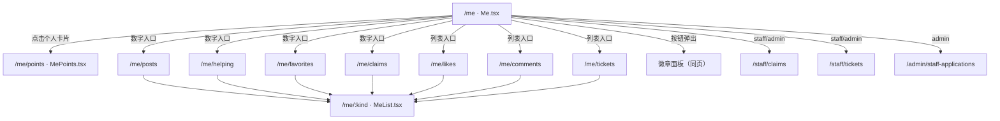

#### 2.26.4.2 组件树

```mermaid
graph TD
  MePage["Me.tsx"] --> Header["PageHeader 我的"]
  MePage --> Profile["ProfileCard（同文件内）"]
  Profile --> PointsLink["Link → /me/points"]
  Profile --> Progress["称号 + 积分 + 进度条"]
  MePage --> Reject["RejectNotice（同文件内）"]
  MePage --> Counts["CountEntries（4 个数字入口）"]
  MePage --> Menu["ListEntries（4 个列表入口）"]
  MePage --> StaffGroup["StaffEntries（按角色）"]
  MePage --> Logout["退出登录"]
  MePage --> BadgePanel["BadgePanel（同文件内，条件渲染）"]
  ListPage["MeList.tsx"] --> ListHeader["PageHeader title + backTo=/me"]
  ListPage --> KindBody["按 kind 渲染"]
  KindBody --> ItemCard["ItemCard（posts/helping/favorites/likes）"]
  KindBody --> Rows["claims/comments/tickets 行卡片"]
  ListPage --> More["加载更多 Button"]
  PointsPage["MePoints.tsx"] --> PointsHeader["PageHeader 积分明细 + backTo=/me"]
  PointsPage --> Summary["积分摘要（称号/总分/进度）"]
  PointsPage --> Records["积分记录列表"]
  PointsPage --> PointsMore["加载更多 Button"]
```

约束：`ItemCard` 只做一处向后兼容扩展——新增可选 `extra?: ReactNode`，渲染在卡片内容底部；大厅不传，现有 DOM 与显示不变。`PageHeader`、`Button`、`Card`、`Tag`、`Empty`、`ErrorNotice`、`Spinner` 只复用、不修改；新增展示结构全部写在 `Me.tsx`/`MeList.tsx`/`MePoints.tsx` 三个文件内部（允许清单不含新组件文件）。

#### 2.26.4.3 `Me.tsx` 设计

**页面结构（自上而下）**

1. `PageHeader title="我的"`（一级页，无返回按钮）。
2. 个人卡片：
   - 昵称：`displayName || '未设置昵称'`。
   - 身份标签：按下表派生，用 `Tag` 展示。
   - 称号 + 当前积分：来自 `GET /me/points`。
   - 进度：未达最高称号时显示进度条 + 「再得 N 分成为 {next_title}」；已达最高称号显示「已达最高称号」。
   - 点击主体进入 `/me/points`；卡片内不放嵌套交互元素，避免链接内嵌按钮。
   - 积分请求失败：不显示 0 分或默认称号，改为卡片底部失败提示 + 「重试」（调用 `useAsync` 的 `reload`）。
3. 拒绝理由卡：仅 `staffStatus === 'rejected'` 时渲染。
4. 数字入口（一行 4 个）：我的发布、我接取的、我的收藏、我的认领。
5. 列表入口：我点赞的、我的评论、我的工单、我的徽章。
6. 工作人员/管理员分组（仅 `role === 'staff' || role === 'admin'`）：认领审核、工单处理；管理员追加教职工审核。
7. 退出登录按钮（页面最底部）：`logout()` 后 `navigate('/login')`。
8. 徽章面板（条件渲染覆盖层）。

**身份标签判定（优先级从高到低）**

| 条件 | 标签文案 | tone |
|---|---|---|
| `role === 'admin'` | 管理员 | `primary` |
| `role === 'staff'` | 工作人员 | `primary` |
| `role === 'student' && staffStatus === 'pending'` | 教职工审核中 | `warning` |
| 其他（`student`，含 `none/rejected/approved` 但 role 未转） | 学生 | `neutral` |

依据：审核通过时后端同时把 `role` 改为 `staff`（`staff_application_service.py:41-48`），因此 “approved 但 role=student” 的正常数据不存在；若出现异常数据，按“学生”兜底，不虚构身份。

**积分进度算法**

- 前端**不保存**任何称号阈值表；只使用 `GET /me/points` 返回的 `total`、`title`、`next_title`、`next_threshold`。
- `title` 只用于展示当前称号，不参与计算；`next_threshold === null` 时视为已达最高称号，不渲染进度条，只显示「已达最高称号」。
- `progress = clamp(total / next_threshold, 0, 1)`，表达“距离下一称号的累计完成度”。接口没有返回当前称号阈值，因此不复刻后端 `POINT_TITLES`，避免出现第二份阈值配置。
- 进度条用带 `role="progressbar"` 的 div + `aria-valuenow/aria-valuemin/aria-valuemax`，宽度只用 CSS 变量与百分比类，不写内联 `style`。
  - 由于不能用内联样式，宽度通过 `className` 切换 **11 档类名**（`.p0`…`.p10`，步长 10%），由 `Math.round(progress * 10)` 选择；避免内联样式且视觉精度足够。
- 文案：`再得 ${next_threshold - total} 分成为 ${next_title}`；接口数据异常（差值 ≤0）时按达到该称号处理，不显示负数。

**数字入口**

| 入口 | 目标路由 | 计数请求（`limit=1`） | 计数来源 |
|---|---|---|---|
| 我的发布 | `/me/posts` | `listMyItems({ limit: 1 })` | `total` |
| 我接取的 | `/me/helping` | `listMyHelping({ limit: 1 })` | `total` |
| 我的收藏 | `/me/favorites` | `listMyFavorites({ limit: 1 })` | `total` |
| 我的认领 | `/me/claims` | `listMyClaims({ limit: 1 })` | `total` |

实现要点：

- 使用一个 `useAsync` 包住 `Promise.allSettled([...])`；成功项取 `total`，失败项置 `null`。
- 渲染时 `null` 显示 `—`（占位符），**不得**显示 0；四个入口互不影响。
- 计数请求只取 `total`，不缓存、不由列表条数推算；进入列表页后由该页自身接口重新计数。
- 每个入口是 `<Link>`，`min-height: 44px`，含数字与中文标签，`aria-label` 形如“我的发布，3 条”。

**列表入口**

| 入口 | 路由 | 形式 |
|---|---|---|
| 我点赞的 | `/me/likes` | Link 行 |
| 我的评论 | `/me/comments` | Link 行 |
| 我的工单 | `/me/tickets` | Link 行 |
| 我的徽章 | 无路由 | `<button type="button">` 打开面板 |

**工作人员分组**：沿用现有角色判断（`role === 'staff' || role === 'admin'`），放在列表入口下方单独一组，标题为「工作人员」；管理员额外显示「教职工审核」。前端隐藏仅为展示，权限仍由后端强制。

**徽章面板**

- 触发：点击「我的徽章」，`open=true`。
- 数据：`useAsync(() => open ? listMyBadges() : Promise.resolve([]), [open])`，打开时才请求。
- 展示：标题「我的徽章」+ 关闭按钮 + 徽章列表（`kind` 映射：`assist → 协助徽章`，未知 kind 原样显示）+ 授予日期（`toLocaleDateString('zh-CN')`）。
- 空态：`还没有获得徽章`。
- 状态：加载中 `LoadingState`；失败 `ErrorState` 可重试。
- 交互：`role="dialog" aria-modal="true"`；点击遮罩（`event.target === event.currentTarget`）或按 `Esc` 关闭；打开时聚焦关闭按钮。不实现焦点循环（不新增依赖），在风险中注明。

**重新申请**

- 条件：`staffStatus === 'rejected'`；展示 `staffRejectReason || '未填写拒绝理由'`。
- 点击「重新申请」展开表单（同页内，不跳转）：
  - 字段：`staff_no`（必填，4~20 位字母或数字）、`department`（选填，≤64）；使用现有 `Field` 组件，控件带 `aria-label`。
  - 预填：展开时调用 `me()`（`api/auth.ts`）尝试带出原 `staff_no/department`；失败则留空，不阻断提交。
  - 提交：`applyStaffApplication({ staff_no, department })`；请求期间 `Button loading` 且输入禁用，防重复提交。
  - 成功：`await refresh()`（`AuthContext` 重新拉取 `/auth/me`）→ 身份标签变「教职工审核中」→ 拒绝卡与按钮消失 → 展示「申请已提交，等待审核」提示。
  - 失败：保留表单与按钮，展示后端中文错误（`errorMessage`）。
  - 前端校验只做体验兜底，最终以 `StaffApplicationCreate` 的约束为准。

#### 2.26.4.4 `MeList.tsx` 设计

**入口校验**：`useParams()` 取 `kind`；若不在 `KIND_CONFIG` 中，返回 `<Navigate to="/me" replace />`。

**kind 配置表**

| kind | 页面标题 | 数据来源 | 行渲染 | 空态文案 |
|---|---|---|---|---|
| `posts` | 我的发布 | `listMyItems` | `ItemCard` | 还没有发布过寻物或拾获 |
| `helping` | 我接取的 | `listMyHelping` | `ItemCard` + 委托状态/致谢标签 | 还没有接取过委托 |
| `favorites` | 我的收藏 | `listMyFavorites` | `ItemCard` | 还没有收藏任何记录 |
| `likes` | 我点赞的 | `listMyLikes` | `ItemCard` | 还没有点赞任何记录 |
| `claims` | 我的认领 | `listMyClaims` | 行卡片（标题/状态/时间） | 还没有提交过认领申请 |
| `comments` | 我的评论 | `listMyComments` | 行卡片（摘要/帖子标题/时间） | 还没有发表过评论 |
| `tickets` | 我的工单 | `listMyTickets` | 行卡片（状态/结果） | 还没有提交过协助工单 |

**页面结构**

```
PageHeader(title=标题, backTo="/me")
  首屏：loading → LoadingState；error 且无数据 → ErrorState(onRetry=reload)
  空数据 → EmptyState(对应文案)
  列表（帖子类 ul + ItemCard；其余 ul + 行卡片）
  加载更多（items.length < total 时显示）
  追加失败 → ErrorState（不清空已加载数据）
```

**分页与状态实现**

- `PAGE_SIZE = 20`。
- 首屏用 `useAsync(() => fetchPage(kind, 0), [kind])`；`data` 提供首屏 `items/total`。
- 追加页存于本地 `extra: Row[]`；`kind` 变化时 `useEffect` 清空，避免切换列表后串数据。
- `loadMore` 以 `offset = data.items.length + extra.length` 请求；追加前按行标识去重（帖子类用 `item.id`，claims 用 `claim.id`，comments 用评论 `id`，tickets 用 `ticket.id`）。
- 加载更多失败：保留已加载数据，底部显示 `ErrorState`（带重试），不切回整页错误。
- 首屏与追加共用同一个 `fetchPage` 函数，返回统一的 `{ items, total }`。

**帖子类列表**：`<li key={item.id}><ItemCard item={item} /></li>`。

**helping 附加信息**：通过 `ItemCard` 新增的 `extra` 属性传入，渲染在卡片内容底部，不再包裹外层标签行。**标签派生规则以 6.19.2 为准，原「`abandoned` → 已放弃、`active` → 进行中」的简化映射已由 2.27.2.2 的真值表取代**：

- 状态标签：`abandoned` → 已放弃（`neutral`）；`active` 且帖子 `status ∈ {searching, reviewing}` → 进行中（`primary`）；`active` 且帖子已离开进行中 → `thanked ? 已被致谢（success）: 已结束（neutral）`。
- 独立「已被致谢」标签：仅当状态标签**不是**「已被致谢」且 `thanked === true` 时渲染（`success`）。
- `taken_at` → 「接取于 YYYY/M/D」小号文字，与标签同一行，允许换行。
- `extra` 内只放 `Tag` 与 `span`，不放按钮或链接（`ItemCard` 外层是 `Link`，避免嵌套交互）。
- 列表 key 用 `item.id`；由于 `(item_id,user_id)` 唯一，`helper_id` 与 `item.id` 一一对应。

**claims 行**：显示 `claim.item_title`、`claimStatusLabels[status]`、申请时间；整行 `<Link to={/hall/${found_item_id}}>`。标题直接来自 `/me/claims` 响应，前端不调用 `getItem`、不建标题缓存、不做逐条补查。`item_title` 缺失属于接口契约违约，按后端错误处理，不用占位标题掩盖。

**comments 行**：显示评论摘要（`content.length > 60 ? content.slice(0, 60) + '…' : content`）、`item_title`、时间；整行链接到 `/hall/${item_id}`（帖子撤销后详情仍可打开，`get_item_detail` 不限制状态）。

**tickets 行**：显示 `ticketStatusLabels[status]` 与 `result || '等待处理结果'`；不提供跳转（无申请人可见的工单详情页），不展示接单人信息。

#### 2.26.4.5 `MePoints.tsx` 设计

- `PageHeader title="积分明细" backTo="/me"`。
- 顶部摘要：称号、当前积分、进度条与「再得 N 分成为 …」/「已达最高称号」；数据来自 `GET /me/points` 的 `total/title/next_title/next_threshold`。
- 明细列表：每条显示事件说明、`+{amount} 分`、时间。
  - `reason` 映射：`thank → 协助寻物获致谢`、`return → 拾获物品完成归还`、`ticket_feedback → 工单处理反馈`。
  - 未知 reason 显示「积分变动」，不隐藏记录。
- 分页：`PAGE_SIZE = 20`，首屏 `limit=20&offset=0`；`loadMore` 用 `records.offset + records.items.length` 追加；`records.total` 用于判断是否还有更多。
- 首次加载失败：整页 `ErrorState` 可重试；追加失败：底部 `ErrorState`，保留已加载记录。
- 空态：`还没有积分记录`。
- 与 `Me.tsx` 的积分摘要使用同一个 `pointProgress(total, next_threshold)` 派生函数，不读取任何前端阈值表，也不复用页面组件文件，避免页面相互引用。

#### 2.26.4.6 接口层与类型改动

**`frontend/src/api/me.ts`**（追加新函数，并改造 `listMyClaims` 的返回类型）

| 函数 | 请求 | 返回类型 |
|---|---|---|
| `listMyFavorites(params)` | `GET /me/favorites` | `Page<Item>` |
| `listMyLikes(params)` | `GET /me/likes` | `Page<Item>` |
| `listMyComments(params)` | `GET /me/comments` | `Page<MyComment>` |
| `listMyHelping(params)` | `GET /me/helping` | `Page<HelpingItem>` |
| `listMyClaims(params)`（改造） | `GET /me/claims` | `Page<MyClaim>` |

**`frontend/src/types.ts`** 追加：

| 名称 | 定义 |
|---|---|
| `HelperStatus` | `'active' \| 'abandoned'` |
| `HelpingItem` | `Item & { helper_id: string; helper_status: HelperStatus; thanked: boolean; taken_at: string }` |
| `MyComment` | `{ id: string; item_id: string; item_title: string; content: string; created_at: string }` |
| `MyClaim` | `Claim & { item_title: string }` |
| `helperStatusLabels` | `Record<HelperStatus, string>`：`active → 进行中`、`abandoned → 已放弃` |
| `pointProgress(total, nextThreshold)` | 返回 0~1 的进度：`nextThreshold == null` 返回 1，否则 `clamp(total / nextThreshold, 0, 1)` |

**不新增** `pointTitles` 或任何阈值常量；前端只消费 `/me/points` 的 `title/next_title/next_threshold`。

**`frontend/src/components/ItemCard/ItemCard.tsx`**：

- Props 类型从 `{ item: Item }` 扩展为 `{ item: Item; extra?: ReactNode }`；`extra` 可选，默认不渲染。
- 在 `<Card>` 的 `body` 末尾、`footer` 之后条件渲染 `<div className={styles.extra}>{extra}</div>`；不传时 DOM 与现在完全一致。
- `ItemCard.module.css` 新增 `.extra`：`display: flex; flex-wrap: wrap; gap: var(--space-2); align-items: center; margin-top: var(--space-2);`，颜色与字号只引用 `tokens.css`。
- `extra` 内只允许展示型内容（`Tag`、`span`），不得放 `button`/`a`，因为整张卡片已被 `Link` 包裹。

**`frontend/src/App.tsx`**：仅新增 `MeList`、`MePoints` 的 import 与两条 `Route`，不改既有路由与重定向。

#### 2.26.4.7 样式与 375px 约束

| 区域 | 样式要点（全部使用 `tokens.css` 变量） |
|---|---|
| 个人卡片 | `display: grid; gap: var(--space-3)`；卡片内边距用 `--space-4`；整卡可点击区域 ≥44px |
| 进度条 | 高度用 `--space-2`；底色 `--color-border`，填充 `--color-primary`；圆角 `--radius-full` |
| 数字入口 | `grid-template-columns: repeat(4, 1fr)`；每格 `min-height: 44px`；数字 `--font-lg`，标签 `--font-sm`；允许换行，禁止横向滚动 |
| 列表入口 | 单列，行高 ≥44px；`display: flex; justify-content: space-between` |
| 行卡片 | 内边距 `--space-3`，边框 `--color-border`，圆角 `--radius-md`；文字超长用 `overflow-wrap: anywhere` |
| claims 行标题 | 单行 `text-overflow: ellipsis; overflow: hidden; white-space: nowrap;`；标题来自接口，不触发额外请求 |
| `ItemCard` 底部插槽 | `ItemCard.module.css` 新增 `.extra`：`display: flex; flex-wrap: wrap; gap: var(--space-2); align-items: center; margin-top: var(--space-2)`；标签不超出卡片宽度 |
| 徽章面板 | 固定定位覆盖层，面板宽度 `calc(100% - var(--space-4) * 2)`、最大 420px；层级用 `--z-overlay` |
| 退出登录 | 页面底部，`margin-top: var(--space-6)`，按钮宽度 100% |

移动端基线：以 375px 设计，页面无横向滚动；单行文字区域用省略/换行而非固定宽度；所有可点击元素（卡片、入口、按钮）≥44px。样式写在 `Me.module.css`、`MeList.module.css`、`MePoints.module.css`，禁止内联 `style`。
### 2.26.5 各 kind 的数据来源与字段映射

#### 2.26.5.1 `/me` 页面字段

| 展示项 | 前端字段 | 数据来源 | 缺失/失败处理 |
|---|---|---|---|
| 昵称 | `displayName` | `AuthContext`（`/auth/me`） | 显示「未设置昵称」 |
| 身份标签 | `role` + `staffStatus` | `AuthContext` | 未登录由 `RequireAuth` 拦截 |
| 称号 | `title` | `GET /me/points` | 卡片显示失败提示，不回落默认称号 |
| 当前积分 | `total` | `GET /me/points` | 同上 |
| 下一称号文案 | `next_title`、`next_threshold` | `GET /me/points` | `null` → 「已达最高称号」 |
| 进度 | `pointProgress(total, next_threshold)` | `GET /me/points` + 前端派生 | `next_threshold=null` 返回 1 且不渲染进度条；不读取任何阈值表 |
| 拒绝理由 | `staffRejectReason` | `AuthContext` | 为空显示「未填写拒绝理由」 |
| 4 个计数 | 四个接口的 `total` | `limit=1` 并发请求 | 单项失败显示 `—` |

#### 2.26.5.2 `MeList` 各 kind 映射

| kind | 接口 | 行主键 | 展示字段 | 点击目标 |
|---|---|---|---|---|
| `posts` | `GET /me/items` | `item.id` | `ItemCard` 全部内容（方向、状态、标题、地点/类别、时间、赞/评论/接取数） | `/hall/{id}`（ItemCard 内置） |
| `favorites` | `GET /me/favorites` | `item.id` | 同 `posts` | `/hall/{id}` |
| `likes` | `GET /me/likes` | `item.id` | 同 `posts` | `/hall/{id}` |
| `helping` | `GET /me/helping` | `item.id` | `ItemCard` + `extra`（`helper_status`、`thanked`、`taken_at`） | `/hall/{id}` |
| `claims` | `GET /me/claims` | `claim.id` | `claim.item_title`（接口返回）、`claimStatusLabels[status]`、`created_at` | `/hall/{found_item_id}` |
| `comments` | `GET /me/comments` | `comment.id` | `content` 摘要（60 字）、`item_title`、`created_at` | `/hall/{item_id}` |
| `tickets` | `GET /me/tickets` | `ticket.id` | `ticketStatusLabels[status]`、`result || '等待处理结果'` | 无跳转 |

**claims 标题来源**：`/me/claims` 已在同一次查询中返回 `item_title`；前端直接渲染，不调用 `getItem`、不维护标题缓存、不做逐条补查。列表页的网络请求只应有 `/me/claims` 一条。

**helping 展示补充**（组合真值表见 2.27.2.2，以 6.19.2 为准）：

| 后端字段 | 前端映射 | 展示位置 |
|---|---|---|
| `helper_status: abandoned` | 已放弃（`neutral`），与帖子状态、`thanked` 无关 | `ItemCard` 的 `extra` 插槽（卡片内容底部） |
| `helper_status: active` 且 `status ∈ {searching, reviewing}` | 进行中（`primary`） | 同上 |
| `helper_status: active` 且 `status ∉ {searching, reviewing}` 且 `thanked=true` | 已被致谢（`success`） | 同上 |
| `helper_status: active` 且 `status ∉ {searching, reviewing}` 且 `thanked=false` | 已结束（`neutral`） | 同上 |
| `thanked: true` 且状态标签不是「已被致谢」 | 独立「已被致谢」标签（`success`） | 同上，可与其他标签并列 |
| `taken_at` | 「接取于 YYYY/M/D」 | 同上，`span` 小号文字，允许换行 |

**不允许**：在 `ItemCard` 外层再包一层标签；`extra` 内放按钮或链接；按 `found_item_id` 并发补标题。

#### 2.26.5.3 `/me/points` 字段映射

| 展示项 | 来源 | 说明 |
|---|---|---|
| 称号/总分/下一称号 | `GET /me/points` 顶层字段 | 与 `/me` 卡片同源、同算法 |
| 事件说明 | `records.items[].reason` | 按 2.26.4.5 的中文映射 |
| 分值 | `records.items[].amount` | 显示 `+{amount} 分`（当前只有正向积分） |
| 时间 | `records.items[].created_at` | `toLocaleString('zh-CN')`，与项目现有日期格式一致 |
| 是否还有更多 | `records.total` 与已加载条数比较 | 由 `records.limit/offset` 回显校验 |

### 2.26.6 状态、空态与错误态处理

| 场景 | 加载中 | 失败 | 空 | 备注 |
|---|---|---|---|---|
| `/me` 积分卡片 | 卡片内 `LoadingState`（小号） | 卡片底部 `ErrorState` + 重试，**不显示 0 分/默认称号** | — | 符合 spec 6.18.1 异常条款 |
| 4 个数字入口 | 数字位置显示 `…` | 该项显示 `—`，其余正常 | — | 使用 `Promise.allSettled`，互不影响 |
| 徽章面板 | `LoadingState` | `ErrorState` + 重新加载 | 「还没有获得徽章」 | 关闭再打开重新请求 |
| 重新申请提交 | 按钮 `loading`、输入禁用 | 保留表单与按钮，展示中文错误 | — | 成功后 `refresh()`，标签与拒绝卡同步更新 |
| `MeList` 首屏 | `LoadingState` | 整页 `ErrorState` + 重试 | 按 kind 的空态文案 | — |
| `MeList` 加载更多 | 按钮 `loading` + 文案「加载中…」 | 底部 `ErrorState` + 重试，**保留已加载数据** | — | 符合 spec 6.18.5 |
| `MeList` 非法 kind | — | — | — | `<Navigate to="/me" replace />` |
| `MePoints` 首屏 | `LoadingState` | 整页 `ErrorState` + 重试 | 「还没有积分记录」 | — |
| `MePoints` 加载更多 | 按钮 `loading` | 底部 `ErrorState` + 重试，保留已加载记录 | — | — |

统一约定：

- 错误文案来自 `errorMessage(e)`，直接展示后端中文 `message`。
- 首屏失败时不清空已有数据（仅首次无数据时展示整页错误）。
- 分页追加失败不改变 `total`，重试使用相同 `offset`。
- 所有提交类按钮在请求期间禁用；列表请求无需禁用但需防重复 `loadMore`（`busy` 标志）。

### 2.26.7 测试用例清单

**文件一：`backend/tests/test_me_lists.py`（新建，13 条）**

**测试辅助**（文件内定义，参照 `test_reactions.py`/`test_helpers.py` 写法）：`auth(token)`、`register(client, username) -> (token, user_id)`、`create_item(...)`、`comment(client, token, item_id, content)`、`take(client, token, item_id)`、`abandon(client, token, item_id)`、`thank(client, token, item_id, helper_user_id)`。

| # | 用例名 | 类型 | 构造 | 断言要点 |
|---|---|---|---|---|
| 1 | `test_me_comments_returns_only_own_and_undeleted` | 正常 + 仅本人 | 用户 A/B 各评论同一帖；A 再发一条并删除 | 只返回 A 的未删除评论；`total` 正确；字段仅含 `id/item_id/item_title/content/created_at` |
| 2 | `test_me_comments_includes_withdrawn_item` | 正常 | 发布者撤销帖子后请求 | 评论仍返回，`item_title` 为原标题，`item_id` 正确 |
| 3 | `test_me_comments_order_and_pagination` | 正常 + 分页 | 造 3 条评论，`limit=2&offset=0`、`limit=2&offset=2` | 两页无重复、并为全集；`created_at` 非递增；`limit/offset` 回显 |
| 4 | `test_me_comments_requires_login` | 未登录 401 | 不带 Authorization | 401 且 `code=UNAUTH` |
| 5 | `test_me_comments_rejects_invalid_pagination` | 非法输入 400 | `limit=0`、`limit=101`、`offset=-1` | 均 400 且 `code=VALIDATION` |
| 6 | `test_me_claims_returns_item_title` | 正常 + 仅本人 | B 认领 A 的拾获帖；C 也提交一条认领 | B 的结果只含自己的认领；`item_title` 等于拾获帖标题；`found_item_id/status/created_at` 正确；`total` 为 1 |
| 7 | `test_me_helping_returns_item_summary_and_helper_state` | 正常 + 仅本人 | A 发 lost，B 接取，C 接取另一帖 | B 只看到自己的记录；含大厅字段（`title/status/building_name/first_photo/...`）与 `helper_id/helper_status/thanked/taken_at` |
| 8 | `test_me_helping_reports_abandoned_and_thanked` | 正常（状态分支） | B 接取两个不同帖子：一帖放弃，另一帖由 A 标记找回并致谢 B | 返回 2 条、对应 2 个不同 `item.id`；放弃记录 `helper_status=abandoned`；被致谢记录 `thanked=true`、`helper_status=active` |
| 9 | `test_me_helping_order_and_pagination` | 正常 + 分页 | 造 3 条不同帖子的接取记录，`limit=2` 分两页 | 无重复并集完整；按 `taken_at` 非递增；`total` 为 3 |
| 10 | `test_me_helping_requires_login` | 未登录 401 | 不带 Authorization | 401 且 `code=UNAUTH` |
| 11 | `test_me_helping_rejects_invalid_pagination` | 非法输入 400 | `limit=0`、`limit=101`、`offset=-1` | 均 400 且 `code=VALIDATION` |
| 12 | `test_me_lists_ignore_foreign_user_id` | 越权防护 | 请求附带 `?user_id=<他人 id>` | 参数被忽略，仍只返回本人数据（不得出现他人记录） |
| 13 | `test_me_lists_hide_private_fields` | 私密字段 | helping 返回一条 found 帖（他人发布）；claims 返回一条本人认领 | 两个响应均不含 `precise_location`、`norm_x`、`norm_y`、`layer_id`、`routes`、`contact`、`evidence`；`first_photo` 按大厅规则隐藏 |

**文件二：`backend/tests/test_staff_application.py`（修改，新增 1 条）**

| # | 用例名 | 类型 | 构造 | 断言要点 |
|---|---|---|---|---|
| 1 | `test_rejected_application_can_be_resubmitted` | 正常（重新申请） | 管理员拒绝申请后，学生用新的 `staff_no/department` 再次 `POST /me/staff-application` | 200；`staff_status=pending`；`staff_reject_reason is null`；`staff_no/department` 为新值；`GET /auth/me` 同步；管理员待审核列表能再次看到该用户 |

**测试稳定性约定**：

- 不构造“同一帖子多次接取”的数据；委托唯一性按 `(item_id, user_id)` 处理，状态分支用不同帖子构造。
- SQLite 的 `created_at` 为秒级，同秒记录不能用 id 断言业务顺序；顺序类断言只校验 `created_at` 非递增，分页校验用「两页并集 = 全集且无重复」。
- 请求路径统一带 `/api/v1` 前缀（与现有测试一致）。
- 不修改 `conftest.py`，不新增 fixture；每个用例自建用户与数据，依赖 `clean_db` 自动清理。

### 2.26.8 改动文件清单

| # | 文件 | 动作 | 说明 |
|---|---|---|---|
| 1 | `backend/app/services/comment_service.py` | 修改（仅新增函数） | 新增 `list_my_comments` |
| 2 | `backend/app/services/helper_service.py` | 修改（仅新增函数） | 新增 `list_my_helping`；2.26 交付时既有接取/放弃/致谢函数行为不变（验收修复对 `take_helper` 的改造见 2.27.3.3） |
| 3 | `backend/app/services/claim_service.py` | 修改（仅改造查询） | `list_my_claims` 联表返回 `(Claim, item_title)`；其他函数不变 |
| 4 | `backend/app/schemas/comment.py` | 修改（仅新增类） | 新增 `MyCommentOut` |
| 5 | `backend/app/schemas/item.py` | 修改（仅新增类与枚举导入） | 新增 `MyHelpingOut(ItemPublic)`；避免 `helper.py` 反向导入造成循环 |
| 6 | `backend/app/schemas/claim.py` | 修改（仅新增类） | 新增 `MyClaimOut(ClaimOut)`；`ClaimOut`、`ClaimDetail` 不变 |
| 7 | `backend/app/api/v1/me.py` | 修改 | 新增 `GET /me/comments`、`GET /me/helping` 与 `_merge_helping`；`GET /me/claims` 改用 `Page[MyClaimOut]` |
| 8 | `backend/app/services/staff_application_service.py` | 修改（已批准） | 允许 `rejected` 重新提交，置 `pending`、清空拒绝理由 |
| 9 | `backend/tests/test_me_lists.py` | 新建 | 2.26.7 的 13 条接口用例 |
| 10 | `backend/tests/test_staff_application.py` | 修改（新增 1 条） | `test_rejected_application_can_be_resubmitted` |
| 11 | `frontend/src/api/me.ts` | 修改 | 追加 `listMyFavorites`、`listMyLikes`、`listMyComments`、`listMyHelping`；`listMyClaims` 返回 `Page<MyClaim>` |
| 12 | `frontend/src/types.ts` | 修改（仅追加） | `HelperStatus`、`HelpingItem`、`MyComment`、`MyClaim`、`helperStatusLabels`、`pointProgress`；不新增阈值常量 |
| 13 | `frontend/src/components/ItemCard/ItemCard.tsx` | 修改 | 新增可选 `extra?: ReactNode`，渲染在卡片内容底部 |
| 14 | `frontend/src/components/ItemCard/ItemCard.module.css` | 修改 | 新增 `.extra` 样式 |
| 15 | `frontend/src/pages/Me.tsx` | 重写 | 个人卡片、拒绝卡、数字入口、列表入口、徽章面板、退出登录 |
| 16 | `frontend/src/pages/Me.module.css` | 重写 | 上述结构与 375px 样式 |
| 17 | `frontend/src/pages/MeList.tsx` | 新建 | 7 种 kind 的通用列表 |
| 18 | `frontend/src/pages/MeList.module.css` | 新建 | 行卡片、标签行、加载更多 |
| 19 | `frontend/src/pages/MePoints.tsx` | 新建 | 积分摘要 + 明细 + 加载更多 |
| 20 | `frontend/src/pages/MePoints.module.css` | 新建 | 摘要与明细样式 |
| 21 | `frontend/src/pages/MyDelegations.tsx` | 删除 | 功能并入 `Me`/`MeList`；全仓无引用 |
| 22 | `frontend/src/App.tsx` | 修改（仅加路由） | `/me/points`、`/me/:kind` |

**2.26 交付时的不改动项**：数据库模型、Alembic 迁移、`item_service`、`ticket_service`、`reaction_service`、`points_service`、`AuthContext`、`PageHeader`、`AppShell`、`helper_service` 的既有写函数、`ClaimOut`/`ClaimDetail`、既有测试（`test_staff_application.py` 仅新增用例）。

**迁移说明**：2.26 自身仍不需要迁移（`/me/claims` 只增加响应字段，不改表）。**该结论已被 6.19.3 取代**：验收修复新增 `item_helper` 唯一约束迁移，见 2.27.3.2 与 2.27.4。

### 2.26.9 风险与待确认事项

| # | 风险/待确认 | 影响 | 处置建议 |
|---|---|---|---|
| R1 | “重新申请”改动已批准，但 `approved` 用户在正常数据下 `role` 已为 `staff`，会先命中 403 而非 409 | 若测试试图构造 approved 重提，会得到 403 | 保留 `approved` 的 409 作防御性分支；测试只覆盖 rejected 重提成功，不改变角色校验顺序 |
| R2 | SQLite 时间精度导致同秒排序不稳定 | 测试可能偶发失败 | 查询统一 `created_at DESC, id DESC`；测试只断言非递增与分页完整性 |
| R3 | 徽章面板未实现焦点循环 | 键盘可达性不完整 | 不引入依赖；实现 `Esc` 关闭、打开聚焦关闭按钮、`aria-modal`，并列入已知限制 |
| R4 | `MeList` 用 `useAsync` + 本地追加，kind 切换若未重置会串数据 | 显示错误列表 | `useEffect([kind])` 清空 `extra`；首屏 `useAsync` 依赖 `[kind]` |
| R5 | 计数 4 个并发请求，且每次进入 `/me` 都会请求 | 额外 4 次轻量查询 | 用 `limit=1`；不做本地缓存，保证计数与列表一致（spec 6.18.3） |
| R6 | `Me.tsx` 重写后可能超过 300 行 | 违反单文件规范 | 目标控制在 300 行内：卡片/拒绝卡/徽章面板均以同文件内子函数实现；若仍超出，需申请新增组件文件 |
| R7 | 删除 `MyDelegations.tsx` 前需确认无引用 | 构建失败 | 已用全仓检索确认无 import/route；删除后以 `npm run build` 复核 |
| R8 | 前端 `Item` 类型含 `norm_x/layer_id` 等必填字段，而 `ItemPublic` 不返回 | 运行期访问这些字段会得到 `undefined`（现有 `/me/items`、`/me/likes` 同样存在） | 本次沿用既有类型约定，不新增 `any`、不改 `Item`；新页面只读取 `ItemPublic` 实际提供的字段 |
| R9 | ~~`item_helper` 的唯一性当前由 `helper_service._active_helper` 的应用层检查保证；迁移与模型均未显式声明 `UniqueConstraint`~~ **已被 6.19.3 关闭**：验收修复在模型声明 `uq_item_helper_item_user` 并新增迁移（先清理重复再加约束），见 2.27.3.1、2.27.3.2、2.27.4 | 原假设「F14 不改表」不再成立；「每帖一条」改由数据库层保证 | 按 2.27 实施；`abandoned` 记录同样受约束，放弃后重接已按口径 B 原地恢复，见 2.27.3.4 |
| R10 | 进度条用 `total / next_threshold` 表示累计完成度，而非“当前称号到下一称号”的区间比例 | 视觉语义与区间进度略有差异；接口未返回当前称号阈值 | 6.18.1 只要求进度条与“再得 N 分”；若产品要求区间比例，另给 `/me/points` 增加当前阈值字段，前端不私存阈值表 |
| R11 | `MyClaimOut` 与前端 `MyClaim` 需要保持字段同步 | 后端增删字段时前端类型可能漂移 | 前端用 `MyClaim extends Claim`，只追加 `item_title`；后端只加字段、不改 `ClaimOut` 既有字段 |

### 2.26.10 验证计划（由用户在本地执行）

沙箱限制：本环境不运行 `pytest`、不启动服务、不安装依赖，故以下命令均**未执行**，不报告任何结果。**验收修复（2.27）新增了迁移与唯一约束用例，完整命令、逐文件 eslint 与迁移往返步骤以 2.27.8 为准**；2.26 原计划的 `npm run lint`（整仓）在本地会挂起，已改为逐文件 eslint。

```bash
cd backend && .venv/Scripts/python -m alembic check
cd backend && .venv/Scripts/python -m pytest tests/ -q
cd backend && .venv/Scripts/python -m ruff check .
cd backend && .venv/Scripts/python -m ruff format --check .
cd frontend && npx eslint src/types.ts src/pages/MeList.tsx src/pages/Me.tsx src/pages/MePoints.tsx src/api/me.ts src/components/ItemCard/ItemCard.tsx src/App.tsx
cd frontend && npm run build
```

预期：后端全部用例通过（含既有 `test_points.py`、`test_staff_application.py`，本次新增的 `tests/test_me_lists.py` 13 条、`test_staff_application.py::test_rejected_application_can_be_resubmitted` 1 条，以及 2.27.5 的 `test_helpers.py` 2 条）；ruff 无告警且格式一致；前端指定文件 eslint 与 build 通过。

### 2.26.11 浏览器手工检查清单

1. **角色差异**：学生登录 `/me` 只看到个人卡片、4 个数字入口、列表入口与退出登录；工作人员额外看到「认领审核」「工单处理」；管理员再看到「教职工审核」。
2. **计数一致性**：4 个数字入口显示的 `total` 与分别进入 `/me/posts`、`/me/helping`、`/me/favorites`、`/me/claims` 后列表总数一致（可临时造 3 条以上数据，确保分页生效）。
3. **积分进度**：0 分显示「再得 20 分成为 热心同学」、进度接近起点；20 分显示下一档「寻物能手/再得 40 分」；300 分显示「已达最高称号」且无进度条。
4. **评论跳转**：`/me/comments` 点击任一条能进入 `/hall/{item_id}`；对已撤销帖子的评论仍可见并可打开详情。
5. **教职工重新申请**：被拒绝账号进入 `/me` 看到拒绝理由与「重新申请」；提交后身份标签变「教职工审核中」，拒绝卡消失；提交失败时按钮恢复且显示中文错误。
6. **委托状态**：`/me/helping` 中放弃过的记录显示「已放弃」；帖子已找回且被致谢时状态标签显示「已被致谢」（不再出现第二个同名标签）；帖子已撤销且未被致谢时显示「已结束」。**同一帖子放弃后再次接取按口径 B 原地恢复为「进行中」（见 2.27.3.4），列表仍只有一条记录**。
7. **委托标签位置**：上述状态标签显示在帖子卡片**内部底部**；对照大厅 `/hall` 中同一帖子的卡片，外观无变化（不传 `extra` 时不渲染该区域、不留空白）。
8. **认领列表标题**：`/me/claims` 每行直接显示物品标题；打开浏览器网络面板刷新该页，确认只有一次 `/me/claims` 请求，没有逐条 `/items/{id}` 请求。
9. **徽章**：点击「我的徽章」弹出面板，无徽章显示空态，`Esc` 与点击遮罩可关闭。
10. **375px**：逐页检查 `/me`、`/me/points`、7 种 `/me/:kind`，确认无横向滚动、入口与按钮高度 ≥44px。
11. **分页与失败**：滚动到底点击「加载更多」能追加且不重复；断网后点击「加载更多」出现可重试错误且已加载内容不消失。
---

## 2.27 F14 验收修复（spec 6.19 增量实现方案）

### 2.27.0 文档信息与范围

| 项 | 内容 |
|---|---|
| 任务编号 | F14-FIX（F14 验收修复） |
| 需求依据 | `spec.md` 6.19.1（地点文案回退）、6.19.2（委托状态展示）、6.19.3（唯一约束与迁移）、6.19.4（改动边界）、6.19.5（验收场景）、6.19.6（验证命令）；相关既有约定见 4.5、6.7、6.16、6.18 |
| 上游设计 | 本文 2.26（`/me/helping` 接口、`MeList` 的 `helping` 行、`ItemCard.extra` 插槽）、2.21.12（错误码）、2.26.8（F14 改动清单，本次由 2.27.6 补充） |
| 允许修改（严格按 6.19） | `frontend/src/types.ts`、`frontend/src/pages/MeList.tsx`、`backend/app/models/item_helper.py`、`backend/app/services/helper_service.py`、`backend/alembic/versions/20261020_f14_helper_unique.py`（已存在，修改去重排序与 docstring）、`backend/tests/test_helpers.py`（新增用例；用例二因口径变更改写） |
| 不修改 | `spec.md`、`tasks.md`、`ItemDetail.tsx`（地点展示分支保持原样）、`ItemCard.tsx` 及其样式、`AiPage.tsx`、`api/me.ts`、`schemas/*`、`me.py`、`points_service`、`conftest.py`、`/me/helping` 响应字段与分页契约 |
| 新增依赖 | 无 |
| 数据库迁移 | 一个（已存在、本次修改去重排序）：`20261020_f14_helper_unique`——去重保留优先级为 **active > created_at 最早 > id 最小**，同组 active 与 abandoned 并存时删除 abandoned 行；随后加唯一约束，见 2.27.3.2、2.27.4 |
| 口径 | **口径 B**：放弃后重接原地恢复原记录（不新增行、不返回 409），见 2.27.3.3、2.27.3.4 |
| 沙箱约束 | 本阶段不执行 `alembic upgrade/downgrade`、不跑 `pytest`、不装依赖；命令列入 2.27.8 由用户本地执行 |
| 沙箱约束 | 本阶段不执行 `alembic upgrade/downgrade`、不跑 `pytest`、不装依赖；命令列入 2.27.8 由用户本地执行 |

**边界声明**：本节只覆盖 6.19 的三处修复，不改变认领、核验、归还、协助工单的既有行为。2.26 与本节冲突的表述已在 2.26.0/2.26.1.4/2.26.4.4/2.26.5.2/2.26.8/2.26.9 R9/2.26.10/2.26.11 同步更新，**以本节为准**。

### 2.27.1 需求与存量实现关系分析

#### 2.27.1.1 已实现/可复用

| 需求功能 | 存量实现 | 代码位置 | 匹配度 | 判定依据 |
|---|---|---|---|---|
| 「建筑名 + 楼层」文案 | `placeLabel` 已有 `building_name` 非空判断与 `floor` 拼接 | `frontend/src/types.ts:83-86` | 100% | 6.19.1 前两条与前实现逐字一致 |
| 无楼层时只显示建筑名 | `item.floor == null` 分支已存在 | `frontend/src/types.ts:85` | 100% | 无需改逻辑，只需保留 |
| 列表/卡片地点渲染入口 | `ItemCard`、`AiPage`、`ItemDetail` 均调用同一函数 | `ItemCard.tsx:57`、`AiPage.tsx:128`、`ItemDetail.tsx:233` | 100% | 调用点集中，改函数即可覆盖 |
| 「我接取的」列表与帖子概要 | `/me/helping` 返回 `helper_status/thanked/taken_at` + 大厅字段，`ItemCard.extra` 已落地 | `design.md` 2.26.2.3、2.26.4.4 | 100% | 后端字段足够，本次只改前端派生 |
| 串行重复接取拦截（仅 active） | `_active_helper` 先查 active 记录并抛 409 | `backend/app/services/helper_service.py:22-27, 94-95` | 75% | 6.19.3 要求「已存在 active → 409」保持不变；但同一查询不足以区分 abandoned，需改为全状态查询后分支（见 2.27.3.3） |
| 「当前 UTC」时间取值范式 | `claim_service` 用 `datetime.now(UTC)` 写状态时间戳 | `backend/app/services/claim_service.py:180, 209` | 100% | 恢复分支刷新 `created_at` 沿用同一写法，不引入 `func.now()` 赋值 |
| `IntegrityError` 捕获范式 | `set_like`/`set_favorite` 仅在 `commit` 处捕获、`rollback` 后继续返回 | `backend/app/services/reaction_service.py:70-95` | 100% | 可作为 `take_helper` 的写法参照 |
| 唯一约束命名与迁移范式 | `uq_item_like_item_user`/`uq_item_favorite_item_user` 模型+迁移同名 | `backend/app/models/item_like.py:12`、`alembic/versions/20261018_v2_incremental.py:122,138` | 100% | 命名沿用 `<表>_<列>_<列>` 风格 |

#### 2.27.1.2 需要扩展的功能

| 需求功能 | 存量功能 | 差异说明 | 扩展方向 |
|---|---|---|---|
| 地点文案回退到 `location_area` | `placeLabel` 只接收 `building_name`、`floor` | 入参缺 `location_area`；建筑名为空时一律「未指定地点」 | 扩展参数类型并新增回退分支；调用点不改（`Item` 已含该字段），靠类型检查兜底 |
| 委托状态标签按帖子状态派生 | `renderRow` 只按 `helper_status` 二选一 | 缺「已被致谢 / 已结束」；`thanked` 独立标签可能重复 | 新增 `helperBadge` 纯函数，一次输出 label/tone/是否显示独立标签 |
| `take_helper` 并发冲突处理 | 应用层查 active 后直接 `commit` | 唯一约束引入后，并发插入会抛 `IntegrityError`，当前未捕获会变 500 | 在 `commit` 处捕获，`rollback` 后抛与串行一致的 409 |
| 放弃后再次接取 | `take_helper` 只认 active；abandoned 记录被唯一约束挡住 | 口径 A（返回 409）会使 spec 4.5「已放弃 → 进行中」不可达 | 改为按 `(item_id, user_id)` 查全状态记录：active → 409；abandoned → 原地 UPDATE 恢复；无记录 → INSERT（见 2.27.3.3） |

#### 2.27.1.3 需要新增的功能

**后端**

1. 模型层唯一约束 `uq_item_helper_item_user`（`item_id`, `user_id`）。
2. Alembic 迁移：按 `(item_id, user_id)` 清理重复（优先保留 active）→ `batch_alter_table` 加唯一约束；降级只删约束。
3. `take_helper` 新增「abandoned 记录原地恢复」分支（不新增接口、不新增表）。
4. `backend/tests/test_helpers.py` 新增用例（见 2.27.5）。

**前端**

无新增接口、无新增字段、无新增依赖；只改一个函数签名与一个行渲染分支。

#### 2.27.1.4 存量约束与依赖

| 约束 | 现状 | 对本次的影响 |
|---|---|---|
| 前端 `Item` 类型 | `location_area: string` 为必填（非空字符串），`building_name: string \| null`、`floor: number \| null` | 三处调用点都传 `Item`，补齐签名后**不需要改调用点**；渲染结果不变符合 6.19.1 展示范围约束 |
| `ItemDetail` 地点分支 | `item.building_name ? placeLabel(item) : item.location_area \|\| '未知'` | 明确不在本次范围，保持原样；不因函数扩展而改写该分支 |
| 测试库建表方式 | `conftest.py` 用 `Base.metadata.create_all`，每例重建 | 模型一旦声明唯一约束，**测试库立即生效**，无需跑迁移；这也是用例 2 能构造约束冲突的前提 |
| 迁移链 | 当前 head：`20261018_v2_inc`（`20261018_v2_incremental.py`） | 新迁移 `down_revision` 必须指向它，否则 `alembic check`/`upgrade` 报多 head |
| 迁移风格 | 既有迁移用 `op.batch_alter_table` 做 SQLite 兼容 | 本次必须沿用，且约束名与模型一致 |
| 事务粒度 | service 一次业务只 `commit` 一次 | `take_helper` 失败路径用 `rollback`，不引入第二次提交 |
| 错误模型 | `ApiError(409, "STATE_CONFLICT", 中文)` 由统一处理器输出 `{code,message}` | 捕获后必须抛同一对象，保证响应体与串行分支逐字一致 |
| 前端样式 | 不写内联 `style`，颜色只取 `tokens.css` | 本次不新增样式；沿用 `Tag` 现有 tone |
| 前端 lint | 整仓 `npm run lint` 在本地挂起 | 验证改为逐文件 eslint + `npm run build`（见 2.27.8） |
| 文件换行 | ruff format 对 CRLF 会误报 | 新增 Python 文件（迁移、测试）必须保存为 LF |

### 2.27.2 前端设计

#### 2.27.2.1 地点文案回退（`frontend/src/types.ts`）

**新签名**

```ts
export interface PlaceFields {
  building_name: string | null
  location_area: string | null
  floor: number | null
}

export function placeLabel(item: PlaceFields): string
```

**函数形态（三条分支，直读即优先级）**

```ts
export function placeLabel(item: PlaceFields): string {
  const building = trimmed(item.building_name)
  if (building) {
    return item.floor == null ? building : `${building} ${item.floor}F`
  }
  return trimmed(item.location_area) || '未指定地点'
}
```

**空值判定**：`null`、`""`、纯空白一律视为空。不引入额外依赖，用一个模块内私有函数统一去空白：

```ts
function trimmed(value: string | null): string {
  return value?.trim() ?? ''
}
```

**优先级与输出格式**

| 顺序 | 条件 | 输出 |
|---|---|---|
| 1 | `trimmed(building_name)` 非空且 `floor != null` | `${建筑名} ${floor}F`（建筑名去首尾空白） |
| 2 | `trimmed(building_name)` 非空且 `floor == null` | 建筑名，不追加楼层 |
| 3 | 建筑名为空，`trimmed(location_area)` 非空 | `location_area` 去首尾空白后的原文 |
| 4 | 两者均为空 | `未指定地点` |

设计要点：

1. **楼层只跟随建筑名**：建筑名为空时即使 `floor` 有值也不输出楼层（6.19.1 异常条款），避免出现「3F · 图书馆三楼」这类拼接。
2. **`floor == null` 用宽松相等**：只把 `null/undefined` 视为缺失，`0` 不作为缺失值（后端 schema 已限制楼层为正整数，前端不重复做业务校验）。
3. **不返回占位楼层**，也不用 `location_area` 拼接楼层；`location_area` 原文已含楼层信息时保持原样。
4. 函数保持**纯函数**、无副作用、不读取 `precise_location`/`norm_*`/路线字段（6.19.1 权限条款）。
5. **类型门禁**：参数用内联对象类型而非 `Pick<Item, ...>` 或可选字段，**不给 `location_area` 默认值**。缺少该字段的对象在 `tsc -b`（`npm run build` 的第一步）即报错，不会静默回退。

**调用点清单（全仓检索结果）**

| # | 调用点 | 传入对象 | 是否需要改调用 | 说明 |
|---|---|---|---|---|
| 1 | `frontend/src/components/ItemCard/ItemCard.tsx:57` | `item: Item` | 否 | `Item` 已含 `location_area`，补齐后编译通过；卡片渲染不变 |
| 2 | `frontend/src/pages/AiPage.tsx:128` | `lostItems: Item[]` 的元素 | 否 | 同上；AI 页不新增地点逻辑 |
| 3 | `frontend/src/pages/ItemDetail.tsx:233` | `item: Item`，仅 `building_name` 非空时调用 | 否 | 该行三元分支与「未知」文案保持原样，不改成统一回退 |
| 4 | `frontend/src/types.ts:83` | 函数定义 | 是 | 本次唯一改动点 |

**为什么不需要改调用点也满足需求**：需求要求的是「调用点缺字段必须类型报错」，而不是「所有调用点都必须改」。三处调用点传入的都是完整 `Item`，字段齐全；类型收紧后若未来新增只含 `building_name/floor` 的对象，构建会失败，从而防止遗漏。

**示例（边界表，与 6.19.1 一致）**

| `building_name` | `floor` | `location_area` | 输出 |
|---|---|---|---|
| `图书馆` | `3` | `三楼自习区` | `图书馆 3F` |
| `图书馆` | `null` | `三楼自习区` | `图书馆` |
| `null` | `3` | `图书馆三楼` | `图书馆三楼` |
| `null` | `null` | `图书馆三楼` | `图书馆三楼` |
| `"  "` | `3` | `" 图书馆三楼 "` | `图书馆三楼`（建筑名视为空，楼层不输出） |
| `null` | `null` | `null`/`""`/`"   "` | `未指定地点` |
| `图书馆` | `3` | `null` | `图书馆 3F` |

#### 2.27.2.2 「我接取的」状态标签（`frontend/src/pages/MeList.tsx`）

**派生函数（模块级纯函数，避免嵌套三元）**

```ts
const ONGOING_STATUS: ReadonlySet<ItemStatus> = new Set<ItemStatus>(['searching', 'reviewing'])
const THANKED_LABEL = '已被致谢'

interface HelperBadge {
  label: string
  tone: TagTone
  showThankedTag: boolean
}

function helperBadge(item: HelpingItem): HelperBadge {
  if (item.helper_status === 'abandoned') {
    return { label: helperStatusLabels.abandoned, tone: 'neutral', showThankedTag: item.thanked }
  }
  if (ONGOING_STATUS.has(item.status)) {
    return { label: helperStatusLabels.active, tone: 'primary', showThankedTag: item.thanked }
  }
  if (item.thanked) {
    return { label: THANKED_LABEL, tone: 'success', showThankedTag: false }
  }
  return { label: '已结束', tone: 'neutral', showThankedTag: false }
}
```

**渲染形态（`renderRow` 的 helping 分支）**

```tsx
const badge = helperBadge(item)
<Tag tone={badge.tone}>{badge.label}</Tag>
{badge.showThankedTag && <Tag tone="success">{THANKED_LABEL}</Tag>}
<span>接取于 {formatDate(item.taken_at)}</span>
```

**导入调整**：`MeList.tsx` 现有的 `../types` 导入需追加 `type ItemStatus`（用于 `ONGOING_STATUS` 的类型标注）；`TagTone` 与 `helperStatusLabels` 已在导入列表中，无需新增依赖或新文件。

判定顺序（与 6.19.2 真值表一一对应）：

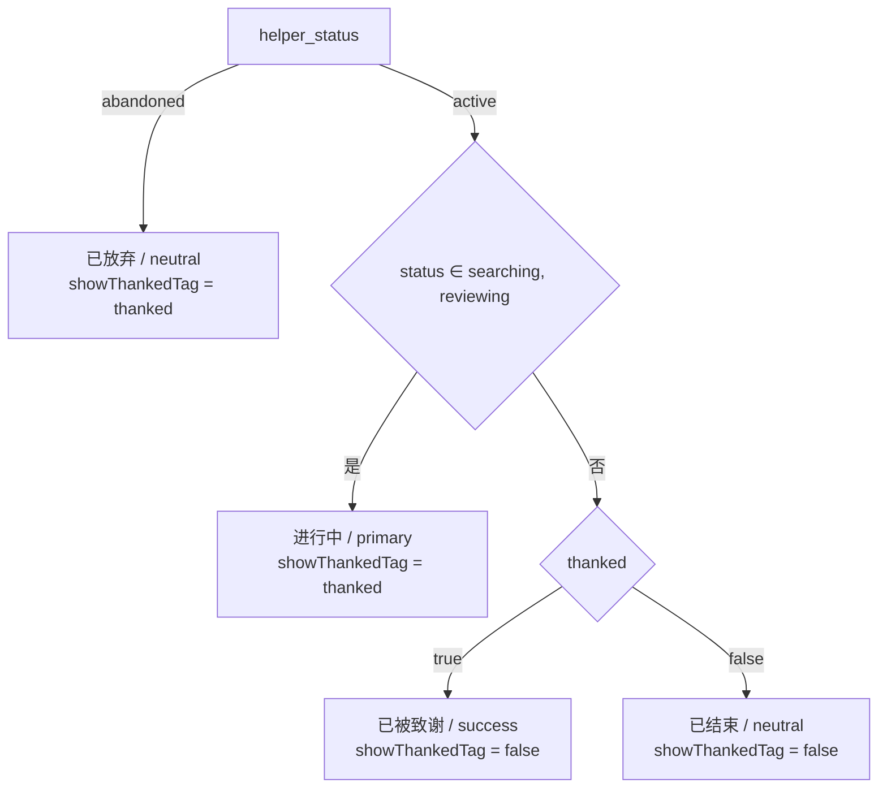

组合真值表（`helper_status=active`）：

| 帖子状态 | `thanked` | 状态标签 | tone | 独立「已被致谢」 |
|---|---|---|---|---|
| searching | true | 进行中 | `primary` | 显示 |
| searching | false | 进行中 | `primary` | 不显示 |
| reviewing | true | 进行中 | `primary` | 显示 |
| reviewing | false | 进行中 | `primary` | 不显示 |
| found | true | 已被致谢 | `success` | 不显示 |
| found | false | 已结束 | `neutral` | 不显示 |
| withdrawn | true | 已被致谢 | `success` | 不显示 |
| withdrawn | false | 已结束 | `neutral` | 不显示 |
| pending / returned（不可达） | true | 已被致谢 | `success` | 不显示 |
| pending / returned（不可达） | false | 已结束 | `neutral` | 不显示 |

`helper_status=abandoned`：任意帖子状态 + 任意 `thanked` → 状态标签「已放弃」（`neutral`）；仅 `thanked=true` 时额外显示「已被致谢」。

**渲染规则**

1. `renderRow` 的 `kind === 'helping'` 分支只调用一次 `helperBadge(item)`，用返回值渲染状态 `Tag`、可选的独立致谢 `Tag` 与「接取于 YYYY/M/D」。
2. **去重规则落在函数内部**：标签文案为「已被致谢」时 `showThankedTag` 恒为 `false`；独立标签只由 `showThankedTag` 控制。两者同源同函数，**结构上不可能重复渲染**，不依赖渲染顺序或字符串比较。
3. 「已被致谢」文案只保留一个模块常量，状态标签与独立标签共用，避免文案漂移导致去重失效。
4. 不改 `helperStatusLabels`（仍用于「进行中/已放弃」两档），不新增类型、不新增接口字段、不在前端维护状态表（6.19.2 约束）。
5. 防御性：`status` 为 `pending/returned` 时走 `thanked` 分支，不抛错、不丢行；类型上 `status: ItemStatus` 已覆盖全部取值。
6. 排序、分页、`ItemCard.extra` 位置不变；`taken_at` 文案与格式不变。

**文件规模**：`MeList.tsx` 当前 228 行，新增常量、接口、函数约 24 行、`renderRow` 内替换约 6 行，预计 ≤ 260 行，满足单文件 300 行约束。

#### 2.27.2.3 前端明确不做

- 不改 `Item`/`HelpingItem` 类型字段，不改 `api/me.ts`。
- 不改 `ItemDetail` 的地点三元分支（即使它不回退到 `location_area` 的「未知」文案）。
- 不为状态标签新增 CSS 或内联样式；颜色沿用 `Tag` 的 `primary/success/neutral`。
- 不新增前端状态管理或缓存。

### 2.27.3 后端设计

#### 2.27.3.1 模型声明（`backend/app/models/item_helper.py`）

```python
from sqlalchemy import Boolean, DateTime, ForeignKey, UniqueConstraint, func

class ItemHelper(Base):
    __tablename__ = "item_helper"
    __table_args__ = (UniqueConstraint("item_id", "user_id", name="uq_item_helper_item_user"),)
```

要点：

1. 约束名 `uq_item_helper_item_user` 与迁移中的名称**必须逐字一致**，`alembic check` 才能判定无差异；命名沿用 `uq_item_like_item_user`、`uq_item_favorite_item_user` 的既有风格。
2. 只新增表级约束：不改列类型、不改可空性、不改 `status`/`thanked` 默认值、不动既有 `item_id`/`user_id` 索引。
3. 模型不写业务方法；约束仅表达「同一用户对同一帖子最多一条记录」，状态语义仍由 service 负责。

#### 2.27.3.2 迁移设计（`backend/alembic/versions/20261020_f14_helper_unique.py`，已存在，本次修改去重排序）

| 项 | 内容 |
|---|---|
| revision | `20261020_f14_uniq` |
| down_revision | `20261018_v2_inc`（当前唯一 head） |
| 文件命名 | `20261020_f14_helper_unique.py`，与 `20261018_v2_incremental.py` 的日期前缀风格一致 |
| docstring | 必须写明：升级会**删除**同组多余记录且**不可恢复**；保留优先级为「active 优先 → `created_at` 最早 → `id` 最小」；**同组同时存在 active 与 abandoned 时，abandoned 行会被删除**（用户失去该帖的「已放弃」历史，仅保留一条进行中记录）；降级只删约束，不恢复数据 |
| 适用库 | SQLite（测试/本地）与 PostgreSQL 共用同一份 SQL；`status` 在 `SAEnum(native_enum=False)` 下两种库都以字符串落库（`active`/`abandoned`），无需分支写法 |

**升级步骤（同一迁移、同一事务）**

**步骤 1：清理重复。** 按 `(item_id, user_id)` 分组，**每组优先保留 `status='active'` 的行**；同组无 active 时保留 `created_at` 最早的一条；`created_at` 并列时保留 `id` 字典序最小的一条；删除其余。

```sql
DELETE FROM item_helper
WHERE id IN (
    SELECT id FROM (
        SELECT id, ROW_NUMBER() OVER (
            PARTITION BY item_id, user_id
            ORDER BY CASE WHEN status = 'active' THEN 0 ELSE 1 END,
                     created_at ASC,
                     id ASC
        ) AS rn
        FROM item_helper
    ) ranked
    WHERE rn > 1
)
```

**SQL 跨库说明**

| 库 | `status` 实际类型与取值 | `CASE WHEN status = 'active'` 的比较方式 | 备注 |
|---|---|---|---|
| SQLite | `VARCHAR(16)` + CHECK，存字符串 `active` / `abandoned`（`HelperStatus` 的 `name` 与 `value` 相同） | 普通字符串等值比较，大小写敏感 | 窗口函数需 SQLite ≥ 3.25（既有迁移已使用 `ROW_NUMBER`，环境已满足） |
| PostgreSQL | `VARCHAR(16)` + CHECK（`native_enum=False`，不是 PG 原生 enum 类型） | 与字符串字面量比较，无需 `::text` 转换、无需 `CAST` | 未用 `create_type`，所以不存在 enum 类型转换差异 |

- 两种库都**不能**直接写 `ORDER BY status`：字符串序 `abandoned < active` 会与「active 优先」相反，必须用 `CASE` 显式映射。
- 若未来把 `SAEnum` 换成 `native_enum=True`，PostgreSQL 下需改为 `CASE WHEN status = 'active'::helperstatus ...`；当前设计不依赖该前提。
- `created_at` 在 SQLite 以 `'YYYY-MM-DD HH:MM:SS.ffffff'` 字符串存储，字典序等价时间序；PostgreSQL 为 `timestamptz` 原生比较，两种库的 `ORDER BY created_at` 语义一致。
- `id` 为 UUID：SQLite 存 32 位无连字符字符串，PostgreSQL 存 uuid 类型，`ORDER BY id` 在各自库内均为确定性全序，满足「字典序最小」的并列裁决。

**步骤 2：加唯一约束**（SQLite 重建表 / PostgreSQL 原生 ALTER）：

```python
with op.batch_alter_table("item_helper") as batch_op:
    batch_op.create_unique_constraint("uq_item_helper_item_user", ["item_id", "user_id"])
```

**降级步骤**

```python
with op.batch_alter_table("item_helper") as batch_op:
    batch_op.drop_constraint("uq_item_helper_item_user", type_="unique")
```

**设计决策与依据**

| 决策 | 选择 | 理由 |
|---|---|---|
| 清理时机 | 加约束之前、同一迁移内 | 先删后加；任一步失败由迁移事务整体回滚，不出现「已清理未加约束」的中间状态（6.19.3 异常条款） |
| 去重实现 | 单条窗口函数 `DELETE` | 一条语句内完成分组与删除，避免应用层逐行判断；`ROW_NUMBER` 在 SQLite 3.25+ 与 PostgreSQL 均可用；`ORDER BY CASE WHEN status='active' THEN 0 ELSE 1 END, created_at, id` 可精确表达三级保留优先级，无需按库分支 |
| 保留优先级 | active > abandoned | 口径 B 下同一组合只应有一条记录，active 代表当前仍有效的委托；若无 active 才保留最早一条 abandoned，使 `/me/helping` 的「已放弃」历史尽量保留一条 |
| 表结构变更 | `batch_alter_table` | SQLite 不支持 `ALTER TABLE ADD CONSTRAINT`，batch 走临时表重建；PostgreSQL 下等价原生 `ALTER TABLE`（6.19.3 明确要求） |
| 约束名 | 与模型同名 | `alembic check` 以名称+列集合比对，同名才无 diff（6.19.3） |
| 降级 | 只 `drop_constraint` | 6.19.3 明确不恢复已删数据；降级后再 `upgrade` 仍可成功（空重复集） |
| 索引 | 不显式处理 | batch 反射会保留既有 `ix_item_helper_item_id`、`ix_item_helper_user_id`；本设计已用 Alembic 1.20 + SQLAlchemy 2.1 在临时 SQLite 库上验证 add/drop 后两条索引均保留 |
| 积分 | 不触碰 `point_record` | 6.19.3 要求不新增积分、不改总额；历史 `thank` 记录保留，`ref_id` 指向的重复行被删也不影响积分明细 |

**同组同时存在 active 与 abandoned 的后果（必须写入 docstring）**

- 迁移后该组只留 active 行，abandoned 行被删除；用户在该帖的「已放弃」历史消失，`/me/helping` 只显示 1 条「进行中」。
- 该行为与口径 B 一致：口径 B 下同一用户同一帖只可能有一条记录，`abandoned` 只是同一行的中间状态，重复行属于旧实现遗留，保留 active 更贴近当前事实。
- 迁移**不**新增/修改 `point_record`，被删行对应的历史致谢积分明细保留（见 2.27.7 R6）。

**已在本沙箱验证的可行性（仅探针，未执行项目迁移）**

- SQLite 反射可取得命名唯一约束（`UniqueConstraint.name == 'uq_item_helper_item_user'`），因此 downgrade 的 `drop_constraint` 能按名删除。
- `ROW_NUMBER()` 去重语句在 SQLite 上可用；本次只在其 `ORDER BY` 前增加 `CASE WHEN status='active' THEN 0 ELSE 1 END` 排序键，语句形态（子查询 + `rn > 1`）与已验证版本一致。本次**未**在沙箱执行新 SQL（不建库、不跑迁移），故不给出执行结果，由 2.27.8 的 `alembic check` 与迁移往返在用户本地验证。
- `batch_alter_table` 完成 add/drop 后，表上的两个业务索引均保留。

#### 2.27.3.3 接取接口的冲突捕获与「放弃后重接」恢复（`backend/app/services/helper_service.py`）

改造 `take_helper`（当前 88-104 行），保持函数签名 `(db: Session, user: User, item_id: uuid.UUID) -> dict`、前置校验顺序与成功返回体不变；新增一个全状态查询私有函数，并加入 abandoned 记录的原地恢复分支。

**最终代码形态（签名 + 分支顺序）**

```python
from datetime import UTC, datetime


def _any_helper(db: Session, item_id: uuid.UUID, user_id: uuid.UUID) -> ItemHelper | None:
    # 唯一约束保证最多一条；用 first() 而非 one_or_none()，未迁移的旧库出现重复时也不抛 500
    return db.query(ItemHelper).filter(ItemHelper.item_id == item_id, ItemHelper.user_id == user_id).first()


def take_helper(db: Session, user: User, item_id: uuid.UUID) -> dict:
    item = _ensure_item(db, item_id)
    if item.owner_user_id == user.id:
        raise ApiError(403, "FORBIDDEN", "不能接取自己发布的委托")
    if item.direction != Direction.lost or item.status not in (ItemStatus.searching, ItemStatus.reviewing):
        raise ApiError(409, "STATE_CONFLICT", "该记录当前不可接取")
    helper = _any_helper(db, item_id, user.id)
    if helper is not None and helper.status == HelperStatus.active:
        raise ApiError(409, "STATE_CONFLICT", _TAKEN_MESSAGE)
    if helper is not None:
        # 口径 B：放弃后重接复用原行，既避开唯一约束，也保证 /me/helping 只有一条记录
        helper.status = HelperStatus.active
        helper.thanked = False
        helper.created_at = datetime.now(UTC)
        db.commit()
    else:
        db.add(ItemHelper(item_id=item_id, user_id=user.id, status=HelperStatus.active))
        try:
            db.commit()
        except IntegrityError:
            # 并发重复接取会绕过上层检查命中唯一约束，响应与串行分支保持一致
            db.rollback()
            raise ApiError(409, "STATE_CONFLICT", _TAKEN_MESSAGE) from None
    count = db.query(ItemHelper).filter(ItemHelper.item_id == item_id, ItemHelper.status == HelperStatus.active).count()
    return {"helper_count": count, "is_helper": True}
```

**分支顺序（不可调整）**

1. `_ensure_item`：记录不存在 → 404（既有）。
2. 本人发布 → 403（既有）。
3. `direction != lost` 或 `status ∉ {searching, reviewing}` → 409「该记录当前不可接取」；**该前置校验必须早于恢复逻辑**，帖子已离开寻找中/核验中时不得因存在 abandoned 行而恢复（spec 6.19.3、6.19.3 已知影响）。
4. 全状态查询有记录且为 `active` → 409「已接取该委托」。
5. 全状态查询有记录且为 `abandoned` → 原地恢复（UPDATE 路径，不 INSERT）。
6. 无记录 → INSERT，`IntegrityError` 捕获行为保持不变。

**要点**

1. **捕获位置只包 INSERT 后的 `commit`**：恢复是 UPDATE，不会触发唯一约束；若把两个 `commit` 都放进 `except`，UPDATE 期间的连接异常会被误报成 409。
2. **文案单一来源**：`_TAKEN_MESSAGE` 同时被串行分支与 INSERT 冲突分支使用，保证响应逐字一致（6.19.3）。
3. **两条路径返回体同构**：都落到最后的 active 计数查询，`helper_count` 为当前 active 行数，`is_helper` 恒为 `True`。
4. **一次业务只 `commit` 一次**：两个分支互斥，各自提交一次；失败路径的 `rollback` 不产生业务提交。
5. **不改 `abandon_helper`、`thank_helpers`、`list_my_helping`、`stats_for_items`**；`abandon_helper` 仍用 `_active_helper`，致谢积分去重仍依赖 `point_record` 既有唯一约束。
6. 行宽 ≤ 120，通过 `ruff check` / `ruff format --check`；`from datetime import UTC, datetime` 加在文件顶部 import 区（与 `claim_service.py` 一致），不引入新依赖。

**私有函数职责边界**

| 函数 | 语义 | 调用方 | 查询条件 | 为何不合并 |
|---|---|---|---|---|
| `_active_helper`（既有，22-27 行） | 「该用户在该帖上**进行中**的委托」 | `abandon_helper`、原 `take_helper` | `item_id AND user_id AND status == active` | 语义是「可放弃的委托」，`abandon_helper` 只需 active；改名会扩散到允许范围外的调用点 |
| `_any_helper`（新增） | 「该用户在该帖上的**唯一**记录（active 或 abandoned）」 | 仅 `take_helper` | `item_id AND user_id` | 恢复分支必须先看到 abandoned，`_active_helper` 查不到它；`take_helper` 用这一条全状态查询即可同时判定 409 与恢复，避免「先查 active 再查 abandoned」的两次 SELECT |

- `take_helper` 不再调用 `_active_helper`，接取路径的查询次数不变（原 1 次 → 现 1 次），不产生重复查询。
- 两个函数都只做单条查询、不含业务判断；状态分支留在 `take_helper`，符合分层规范。

**恢复时的时间取值：`datetime.now(UTC)`，不用 `func.now()`**

| 维度 | `datetime.now(UTC)`（选中） | `func.now()`（未选） |
|---|---|---|
| 与既有代码一致 | `claim_service.py:180,209` 写 `reviewed_at`/`completed_at` 已用该写法 | 项目中 `func.now()` 只出现在 `server_default`/`onupdate`，没有作为 ORM 赋值值使用 |
| 赋值后能否立即断言 | 赋值即为 Python 值，`commit` 后测试可直接读 `created_at` | 赋值为 SQL 表达式，需 `refresh` 或重新查询才能取回实际值，多一次往返 |
| 时区语义 | 显式 UTC，与 `DateTime(timezone=True)` 的意图一致 | 由数据库时钟决定：SQLite 的 `CURRENT_TIMESTAMP` 是 UTC，PostgreSQL 的 `now()` 带会话时区 |
| SQLite 落库表现 | 方言绑定处理器按字段取值、丢弃 `tzinfo`，存入 UTC 墙上时间 `'YYYY-MM-DD HH:MM:SS.ffffff'`，与 `server_default=func.now()` 生成的值同量纲 | 存 `'YYYY-MM-DD HH:MM:SS'`（秒级精度），与 Python 写入的微秒级字符串混用，同一秒内的先后依赖字符串长度比较 |
| PostgreSQL 落库表现 | `timestamptz` 保存带偏移的时刻，读回 aware datetime | 同左，精度由列定义决定 |

- **禁止 `datetime.now()`（无时区）**：在 UTC+8 的开发机上会写入本地时间，与既有以 UTC 落库的行相差 8 小时，`/me/helping` 的 `ORDER BY created_at DESC` 会把恢复后的记录排到错误位置。这是本设计唯一需要主动规避的写法。
- **SQLite 下读回是 naive**：测试断言避免 tz-aware 与 naive 直接比较（会抛 `TypeError`），改为比较两次读到的 `created_at` 先后（见 2.27.5）。
- 恢复后 `taken_at`（`me.py:40` 取 `helper.created_at`）变为本次接取时间，列表按最新置顶，符合「重新接取」的直觉。

**并发边界（已有 abandoned 行时的重接）**

- 两个并发请求都可能读到同一条 abandoned 记录，随后各自 `UPDATE` 同一行：不触发唯一约束，**两次请求都返回 200**，库中仍是同一行、`helper_count=1`。
- 该行为**可接受**：结果幂等（同一行被置为 active，`created_at` 取两次中较晚的一次），无重复行、无 500、无计数偏差；与「同时 INSERT」场景的差别仅在于后者失败方返回 409。
- **测试不覆盖真并发**：`TestClient` 是同步调用；文件型 SQLite 上开两个线程同时写会先撞 `database is locked`，无法稳定复现目标路径（见 2.27.5）。并发正确性由「唯一约束 + 单行 UPDATE」的结构保证；真并发验证列入 2.27.7 R2，由用户在 PostgreSQL 上手工确认。
- 并发下仍可能出现 409 的只剩「两个请求都无记录 → 都 INSERT」路径，由既有 `IntegrityError` 捕获兜底，行为不变。

**接取请求的最终判定顺序**

```mermaid
flowchart TD
  A[POST /items/{id}/helpers] --> B{记录存在}
  B -->|否| C[404 NOT_FOUND]
  B -->|是| D{本人发布}
  D -->|是| E[403 FORBIDDEN]
  D -->|否| F{lost 且 searching/reviewing}
  F -->|否| G[409 该记录当前不可接取]
  F -->|是| H{全状态记录存在}
  H -->|无记录| I[INSERT + commit]
  H -->|status=active| J[409 已接取该委托]
  H -->|status=abandoned| K["UPDATE 原行：status=active、thanked=False、created_at=now(UTC) + commit"]
  I -->|唯一冲突| L[rollback → 409 已接取该委托]
  I -->|成功| M[200 helper_count/is_helper]
  K -->|成功| M
```

#### 2.27.3.4 裁决结论：`abandoned` 记录与「放弃后可再次接取」（已采纳口径 B）

**结论（已生效）**：采纳**口径 B——原地恢复原记录**。`spec.md` 4.5 与 6.19.3 已按 B 修订；本节不再保留「待裁决」状态，2.27.3.3 的 UPDATE 分支即最终实现形态。

**口径对比与选择理由**

| 口径 | 行为 | 与 spec 4.5「已放弃 → 进行中」 | 数据结果 | 判定 |
|---|---|---|---|---|
| A：放弃后重接返回 409 | INSERT 命中唯一约束 → 409「已接取该委托」 | 不可达，功能缺失 | 1 行（仍为 abandoned） | 不采纳 |
| **B：放弃后重接原地恢复** | 查到 abandoned → UPDATE 为 active、刷新 `created_at`、`thanked=False` → 200 | 可达，状态机闭环 | 1 行（变为 active） | **采纳** |

选择 B 的三条依据：

1. **需求直接要求**：4.5 的状态表与状态图明确「已放弃 → 进行中（再次接取）」，6.19.3 进一步规定「不新增记录，返回与新建相同的成功响应」。A 使该转换在唯一约束下永远无法完成。
2. **数据模型成本最低**：唯一约束已覆盖 `(item_id, user_id)`，B 只改一行的三列，不新增表、不新增迁移、不改索引；A 若想保留「新建一条」的语义则必须放宽约束（与 6.19.3 第一条冲突）。
3. **列表契约不变**：`/me/helping` 仍按 `created_at` 倒序，恢复后自然置顶，`taken_at` 表示「本次接取时间」，与 6.18 的展示约定一致。

**已确认的副作用（写入 spec 6.19.3「已知影响」）**

- 恢复时 `thanked` 置为 `false`：原委托的致谢标记被清除，但已发放的 `point_record` 致谢积分**不回收**、用户积分总额不变（6.19.3 明确要求不改积分）。
- 帖子必须仍处于 `searching/reviewing`：帖子已找回/已撤销时放弃后重接返回 409「该记录当前不可接取」，不因 B 放宽前置校验。
- 既有 `test_take_helper_duplicate_insert_returns_conflict` 的断言前提（「预置 abandoned → 重接 → 409」）在 B 下不再成立，必须同步调整；这是需求驱动的测试语义更新，处理方式与理由见 2.27.5，需在交付说明中列明。

**与 4.5 的一致性**：不新增第二行，语义上等价于「重新建立一条进行中的委托」；`/me/helping` 中该行从「已放弃」变回「进行中」，「接取于」显示本次时间。

### 2.27.4 数据迁移步骤与回滚

**执行前检查（只读，建议在目标库先跑）**

```sql
-- 1. 有多少组重复，以及各组 active / abandoned 的构成
SELECT item_id, user_id, COUNT(*) AS n,
       SUM(CASE WHEN status = 'active' THEN 1 ELSE 0 END) AS active_n,
       SUM(CASE WHEN status = 'abandoned' THEN 1 ELSE 0 END) AS abandoned_n
FROM item_helper
GROUP BY item_id, user_id
HAVING COUNT(*) > 1;

-- 2. 迁移后会被删除的行（与迁移中窗口函数逐字等价）
SELECT id, item_id, user_id, status, created_at
FROM (
    SELECT id, item_id, user_id, status, created_at,
           ROW_NUMBER() OVER (
               PARTITION BY item_id, user_id
               ORDER BY CASE WHEN status = 'active' THEN 0 ELSE 1 END,
                        created_at ASC,
                        id ASC
           ) AS rn
    FROM item_helper
) ranked
WHERE rn > 1;
```

两条查询只读，不修改数据；结果用于评估影响面与留档。第 1 条中 `active_n >= 1 AND abandoned_n >= 1` 的组，升级后 abandoned 行会被删除（spec 允许且已在 2.27.3.2 写明），执行前应先向相关用户说明「已放弃」历史将并入进行中记录。

**升级步骤**

| 步骤 | 操作 | 预期 |
|---|---|---|
| 1 | 备份目标库（或至少备份 `item_helper`） | 具备人工恢复手段（迁移自身不备份） |
| 2 | `cd backend && .venv/Scripts/python -m alembic upgrade head` | 执行 `20261020_f14_uniq`：先删重复，再加约束 |
| 3 | `cd backend && .venv/Scripts/python -m alembic check` | 输出无待生成变更（模型与迁移一致） |
| 4 | 重复查询复查 | `HAVING COUNT(*) > 1` 返回 0 行 |
| 5 | 抽查约束 | 直连 SQL 对同一 `(item_id, user_id)` 插入第二行返回唯一冲突；接口层在口径 B 下不会走到 INSERT（已有行时走 UPDATE 恢复） |

**失败与回滚**

- 迁移在单个事务内执行：清理 SQL 与 `batch_alter_table` 任一失败即整体回滚，目标库保持迁移前状态，不会出现「已清理、未加约束」的中间态（6.19.3 异常条款）。
- `If` 存在其他违反约束的脏数据（例如清理后仍有同组未删净）：加约束失败 → 整次回滚；此时应先人工排查重复定义外的脏数据，再重跑迁移。
- `If` 表为空或无重复：两条语句均为 no-op，迁移正常完成。

**降级**

```bash
cd backend && .venv/Scripts/python -m alembic downgrade -1
```

- 只删除 `uq_item_helper_item_user`；`item_id`/`user_id` 索引与其他列保持不变。
- **不可逆点（必须写入迁移 docstring）**：升级阶段删除的重复记录不会随降级恢复；降级后数据库允许再次出现同组多行。**同组同时存在 active 与 abandoned 时，被删除的是 abandoned 行**——该「已放弃」历史无法通过降级找回。
- 降级后再次 `upgrade head` 仍可成功（重复集为空时清理为 no-op）。
- SQLite 下的 batch 删除以重建表实现；已在沙箱验证：命名唯一约束可反射并按名删除，重建后两个业务索引仍在。

**测试库说明**：`backend/tests/conftest.py` 使用 `Base.metadata.create_all`，测试库不执行迁移；模型声明唯一约束后，测试库自动具备约束。因此 pytest 通过**不能**替代 `alembic upgrade` 的验证，两者需分别执行（见 2.27.8）。

### 2.27.5 测试用例设计（`backend/tests/test_helpers.py`）

**新增辅助（不改既有 `auth`/`register`/`create_item`）**

```python
from app.database import SessionLocal
from app.models import HelperStatus, ItemHelper

def helper_rows(item_id: str, user_id: str) -> list[ItemHelper]:
    with SessionLocal() as db:
        return (
            db.query(ItemHelper)
            .filter(ItemHelper.item_id == uuid.UUID(item_id), ItemHelper.user_id == uuid.UUID(user_id))
            .all()
        )
```

- `SessionLocal` 与 `conftest.py` 共享同一个测试 engine（`DATABASE_URL` 在 conftest 导入时已指向 `sqlite:///./test_pytest.db`），读到的是同一份数据。
- 查询条件必须传 `uuid.UUID` 对象；测试库中 UUID 以 32 位字符串存储，直接传带连字符的 `str` 匹配不到。

**用例一：`test_take_helper_twice_keeps_single_record`（正常 + 状态冲突，保持原样）**

| 步骤 | 操作 | 断言 |
|---|---|---|
| 1 | 注册 owner/helper，owner 发布 lost 帖 | 200 |
| 2 | helper 第一次 `POST /items/{id}/helpers` | 200；`{"helper_count": 1, "is_helper": true}` |
| 3 | helper 第二次同接口 | 409；`code == "STATE_CONFLICT"`；`message == "已接取该委托"` |
| 4 | 直连数据库按 `(item_id, user_id)` 查询 | 恰好 1 条；`status == HelperStatus.active`；`thanked is False` |
| 5 | helper 请求 `GET /me/helping` | `total == 1`；`items[0]["helper_count"] == 1`；`is_helper is True` |
| 6 | owner 请求帖子详情 | `helper_count == 1`；`helpers` 长度 1 |

覆盖 6.19.3「接取两次只有一条记录」「人数按 1 计」与 6.19.5「只保留一条委托记录」。口径 B 只影响 `abandoned` 分支，本用例断言不变。

**用例二（改写）：`test_item_helper_unique_constraint_rejects_duplicate_row`（唯一约束存在性 + 会话可用）**

原 `test_take_helper_duplicate_insert_returns_conflict` 的前提是「预置 abandoned 行 → 再次接取走 INSERT → 命中唯一约束 → 409」。口径 B 下该路径已改为 UPDATE，原断言不再成立，因此**改写为直接验证约束本身**，而不是删除校验：

| 步骤 | 操作 | 断言 |
|---|---|---|
| 1 | owner/helper 建帖，helper 接取一次 | 200 |
| 2 | `SessionLocal` 直接 `add(ItemHelper(同 item_id + user_id, status=abandoned))` | `commit()` 抛 `IntegrityError` |
| 3 | `db.rollback()` 退出会话 | 会话可继续使用，不抛 `PendingRollbackError` |
| 4 | 直连按组合查询 | 仍为 1 行，`status == HelperStatus.active`（未被第二条覆盖） |
| 5 | 同一 client `GET /me/helping` | 200；`total == 1` |

- 需要新增导入：`pytest`、`sqlalchemy.exc.IntegrityError`（均为既有依赖，不新增第三方包）。
- 该用例把「唯一约束」从接口行为解耦出来，仍覆盖 6.19.3「同一用户同一帖子最多一条」与 6.19.5「唯一约束冲突后会话可继续使用」。
- **改写理由与影响**：这是需求口径变更（A → B）导致的断言前提失效，不是放宽测试；修改点与新增点会在交付说明中单列，供验收核对。

**用例三（新增，用户指定）：`test_take_helper_after_abandon_restores_record`（接取 → 放弃 → 再次接取成功）**

| 步骤 | 操作 | 断言 |
|---|---|---|
| 1 | 注册 owner/helper，owner 发布 lost 帖 | 200 |
| 2 | helper `POST /items/{id}/helpers` | 200；`{"helper_count": 1, "is_helper": true}` |
| 3 | 记录 `before = helper_rows(...)[0]` | 1 行；`before.status == active`；保存 `before.id`、`before.created_at` |
| 4 | helper `DELETE /items/{id}/helpers` | 200；`{"helper_count": 0, "is_helper": false}`；库中该行 `status == abandoned` |
| 5 | helper 再次 `POST /items/{id}/helpers` | **200**（不是 409）；响应体与新建逐字一致：`{"helper_count": 1, "is_helper": true}` |
| 6 | `after = helper_rows(...)` | **恰好 1 条**；`after[0].id == before.id`（原记录被复用，未新建）；`status == HelperStatus.active`；`thanked is False`；`after[0].created_at > before.created_at` |
| 7 | owner `GET /items/{id}` | `helper_count == 1`；`helpers` 长度 1，`display_name == "rejoin_helper"` |
| 8 | helper `GET /me/helping` | `total == 1`；`items[0]["helper_status"] == "active"`；`helper_count == 1`；`is_helper is True` |
| 9 | helper 再次 `DELETE` | 200，证明恢复后的行确实可继续走放弃流程 |

- `created_at` 断言用「两次读取的值比较大小」：SQLite 下 `created_at` 读回是 naive，与 `datetime.now(UTC)` 写入的微秒值同量纲；**不要**与 `datetime.now(UTC)`（aware）直接比较，否则 `TypeError`。
- `after[0].id == before.id` 是「原地恢复」最直接的证据，也防止实现退化成「删旧建新」。
- 步骤 9 只用于证明状态回到 active，不改变前面断言。

**用例四（新增边界）：`test_take_helper_after_abandon_rejects_closed_item`（前置状态校验优先于恢复）**

| 步骤 | 操作 | 断言 |
|---|---|---|
| 1 | 建 lost 帖，helper 接取后 `DELETE` 放弃 | 200；库中 1 行 `abandoned` |
| 2 | owner `POST /items/{id}/mark-found` | 200 |
| 3 | helper 再次 `POST /items/{id}/helpers` | 409；`message == "该记录当前不可接取"`（**不是**「已接取该委托」） |
| 4 | 直连查询 | 仍 1 行；`status` 仍为 `abandoned`（未被恢复） |

覆盖 6.19.3「帖子已离开寻找中/核验中时返回 409 且不恢复」，同时锁定 `2.27.3.3` 的分支顺序。

**为什么真并发不纳入测试**：

- `TestClient` 是同步调用；文件型 SQLite 上两个线程同时写，先遇到的是 `database is locked`，无法稳定复现唯一约束路径，用例会变成偶发失败。
- 口径 B 下「已有 abandoned 行」的并发重接走 UPDATE，本就不会产生冲突（见 2.27.3.3 并发边界），无法用并发用例区分正确与错误实现；真正需要并发的只剩「两个请求都无记录 → 都 INSERT」，由 `IntegrityError` 捕获兜底，已在 2.27.7 R2 交由 PostgreSQL 手工验证。
- 因此本次以「确定性单线程用例 + 唯一约束直连验证」覆盖，不引入 flaky 用例。

**测试约定**

- `test_take_and_abandon_helper`、`test_take_helper_permissions_and_states`、`test_thank_awards_points_once`、`test_thank_rejects_invalid_helper_selection` 四条既有用例**断言不动**；仅 `test_take_helper_duplicate_insert_returns_conflict` 因口径变更改写（见用例二）。
- 不修改 `conftest.py`、不新增 fixture、不引入新依赖。
- 新增内容追加在文件末尾，保持 LF 换行；单函数不超过 50 行（用例三步骤较多，可拆为「恢复断言」与「列表/详情断言」两个私有 helper，但不新增 fixture）。

### 2.27.6 改动文件清单

| # | 文件 | 动作 | 改动内容 |
|---|---|---|---|
| 1 | `frontend/src/types.ts` | 修改 | `placeLabel` 入参增加 `location_area`；新增 `trimmed` 私有函数与回退分支；不改 `Item`/`DraftPost` |
| 2 | `frontend/src/pages/MeList.tsx` | 修改 | 新增 `ONGOING_STATUS`、`THANKED_LABEL`、`HelperBadge`、`helperBadge()`；`renderRow` 的 helping 分支改用派生结果 |
| 3 | `backend/app/models/item_helper.py` | 修改 | 新增 `__table_args__`：`UniqueConstraint("item_id", "user_id", name="uq_item_helper_item_user")` |
| 4 | `backend/app/services/helper_service.py` | 修改 | 新增 `_any_helper`（全状态单条查询）；`take_helper` 增加 abandoned → 原地恢复分支（`status/thanked/created_at`）；INSERT 路径的 `IntegrityError` 捕获保持不变；新增 `datetime` 导入 |
| 5 | `backend/alembic/versions/20261020_f14_helper_unique.py` | 修改（已存在） | 去重 `ORDER BY` 改为 `CASE WHEN status='active' THEN 0 ELSE 1 END, created_at, id`；docstring 补充「active 优先」「同组 active+abandoned 时删除 abandoned」；batch 加约束与降级不变 |
| 6 | `backend/tests/test_helpers.py` | 修改 | 新增 `helper_rows` 辅助、用例三（放弃后重接恢复）、用例四（帖子关闭时拒绝恢复）；用例二改写为唯一约束直连验证；其余既有断言不动 |

**明确不改**：`ItemDetail.tsx`、`ItemCard.tsx`/`.module.css`、`AiPage.tsx`、`api/me.ts`、`schemas/*`、`api/v1/me.py`、`points_service.py`、`reaction_service.py`、`conftest.py`、`spec.md`、`tasks.md`、`/me/helping` 的字段与分页契约；不新增迁移、不改表结构（唯一约束与列定义已在既有迁移与模型中）。

### 2.27.7 风险与已裁决事项

| # | 风险/待确认 | 影响 | 处置 |
|---|---|---|---|
| R1 | ~~待用户裁决~~ **已裁决：口径 B**。唯一约束覆盖 `abandoned`，放弃后重接改为原地恢复 | 若按 A 实现，4.5「已放弃 → 进行中」不可达，验收判功能缺失 | 已采纳 B 并落地到 2.27.3.3；`spec.md` 由需求方修订，本设计不改 spec |
| R2 | 真并发用例在 SQLite 上不稳定（锁竞争先于唯一约束）；且 B 下 abandoned 重接走 UPDATE，本就不会冲突 | 强行加入会造成偶发失败，且测不出目标行为 | 本次不写真并发；并发验证留待 PostgreSQL 手工（两个请求同时重接，断言两次 200、库中 1 行） |
| R3 | 迁移删除重复行不可逆，且 active+abandoned 并存时删的是 abandoned 行 | 降级无法恢复「已放弃」历史 | 迁移 docstring 写明；2.27.4 提供只读排查 SQL（含 active_n/abandoned_n）并建议备份 |
| R4 | SQLite batch 重建表会重排列与外键顺序 | 结构比对/人工 diff 可能出现顺序差异 | 已验证列、外键、两个业务索引与命名约束均保留；`alembic check` 按集合比对，不因顺序报 diff；若仍出现 diff，人工核对而非 `--autogenerate` 覆盖 |
| R5 | 目标库可能存在清理逻辑未覆盖的脏数据，导致加约束失败 | 整次迁移回滚 | 由迁移事务整体回滚；按 2.27.4 排查后重跑，不手工跳过约束 |
| R6 | 被删除的重复行可能是历史 `point_record.ref_id` 指向的对象 | 积分明细仍保留这些记录（无外键） | 符合 6.19.3「不新增积分、不改总额」；在验收说明中备注，不修改积分数据 |
| R7 | `alembic check` 需要连到真实数据库 | 未启动 PostgreSQL 时命令直接失败，容易被误判为迁移有问题 | 2.27.8 注明先确保 `DATABASE_URL` 可用；测试库（SQLite）不跑迁移 |
| R8 | 前端 `npm run lint` 整仓挂起 | 无法作为门禁 | 改为 `npx eslint` 指定 `types.ts`、`MeList.tsx` + `npm run build`（含 `tsc -b` 类型检查） |
| R9 | 新增 Python 文件若为 CRLF，`ruff format --check` 会误报 | 验证失败或产生无关 diff | 迁移与测试文件保存为 LF；提交前执行两条 ruff 命令确认 |
| R10 | `ItemDetail` 建筑名为空时仍显示 `location_area \|\| '未知'`，未复用新回退 | 验收可能误认为地点回退未覆盖详情页 | 6.19.1「展示范围约束」明确该分支不在范围；2.27.9 手工检查中单独标注 |
| R11 | 「已结束」与卡片上的帖子状态标签（如「已找回」）同时出现 | 视觉上出现两个状态语义 | 按 6.19.2 保留，二者位置不同（卡片标签区 / 底部 extra）；不改 `ItemCard` |

### 2.27.8 验证命令（由用户本地按顺序执行）

沙箱限制：本阶段**未执行**以下任何命令（不跑迁移、不跑 pytest、不装依赖），因此不报告结果。`alembic` 与 `ruff` 位于 `backend/.venv`，可直接调用。

```bash
# 1. 迁移一致性（需可连接的 DATABASE_URL）
cd backend && .venv/Scripts/python -m alembic check

# 2. 迁移往返（可选；在含重复数据的开发库上更有意义）
cd backend && .venv/Scripts/python -m alembic downgrade -1
cd backend && .venv/Scripts/python -m alembic upgrade head

# 3. 后端静态检查（格式检查同时能暴露 CRLF）
cd backend && .venv/Scripts/python -m ruff check .
cd backend && .venv/Scripts/python -m ruff format --check .

# 4. 后端测试（先跑受影响文件，再跑全量）
cd backend && .venv/Scripts/python -m pytest tests/test_helpers.py -q
cd backend && .venv/Scripts/python -m pytest tests/ -q

# 5. 前端（逐文件 eslint + 构建即类型检查）
cd frontend && npx eslint src/types.ts src/pages/MeList.tsx
cd frontend && npm run build
```

**通过标准**

- `alembic check`：无待生成变更。
- 迁移往返：`downgrade -1` 与再次 `upgrade head` 均成功；升级后重复分组查询为 0。
- `ruff check` / `ruff format --check`：无告警、无格式差异。
- `pytest tests/test_helpers.py`：既有 4 条 + 新增 2 条（用例三、用例四）全部通过，其中用例二已按口径 B 改写；全量 `pytest tests/` 无回归。
- 指定文件 eslint 无错误；`npm run build` 成功（`tsc -b` 覆盖 `placeLabel` 新签名与 `MeList` 派生函数）。

### 2.27.9 手工检查清单

1. **地点回退**：只填了 `location_area` 的寻物帖，在 `/hall`、`/me/posts`、`/me/helping`、`/me/favorites`、AI 寻物推荐下拉中均显示该地点原文，不显示「未指定地点」。
2. **建筑名优先**：`building_name=图书馆`、`floor=3` → 「图书馆 3F」；`floor` 为空 → 「图书馆」；`building_name` 为空但 `floor=3` → 只显示 `location_area`，不出现「3F」。
3. **都为空**：`building_name` 与 `location_area` 均为空/空白 → 「未指定地点」。
4. **详情页保持原样**：`/hall/{id}` 的地点行仍走原分支（建筑名为空时显示 `location_area || 未知`），不因本次改动变形（6.19.1 展示范围约束）。
5. **委托标签真值**：找一个「寻找中」帖（进行中）、一个已找回并被致谢的帖（状态标签「已被致谢」，且只有 1 个同名标签）、一个已撤销且未致谢的帖（已结束）、一个放弃记录（已放弃）。
6. **放弃 + 已致谢**：`abandoned` 且 `thanked=true` → 「已放弃」+ 独立「已被致谢」两个标签。
7. **重复接取**：同一用户对同一帖连续接取两次 → 第二次提示「已接取该委托」，列表中仍只有一条，接取人数为 1。
8. **放弃后重接（口径 B）**：接取 → 放弃 → 再次接取应返回成功；`/me/helping` 该行变回「进行中」且「接取于」显示本次日期；数据库该组合仍 1 行、`status=active`、`thanked=false`；接取人数保持 1。
9. **帖子已关闭时重接**：帖子改为「已找回」后再点接取 → 提示「该记录当前不可接取」，`/me/helping` 仍为「已放弃」，库中记录未被改回 active。
10. **迁移后数据**：在开发库升级后刷新 `/me/helping` 与帖子详情的协助者人数，数值不因清理重复而异常增大或重复；若某组原本同时有 active 与 abandoned，升级后只应看到「进行中」那一条。
11. **375px**：`/me/helping` 标签换行正常、无横向滚动；标签与「接取于 …」同一区域，点击仍进入帖子详情。
---

# 四、X2a 双视图地图与素材导入设计（spec 6.20 增量实现方案）

## 2.28 X2a 双视图地图与素材导入

### 2.28.0 文档信息与范围

| 项 | 内容 |
|---|---|
| 需求来源 | `spec.md` 6.20（6.20.1–6.20.16） |
| 目标 | 地图改为「室外平面图 + 室内 2.5D 选楼图」双视图；建立一条可重复执行的素材导入命令 |
| 数据基准 | `backend/app/data/campus_buildings.json`（137 栋，含 flat/iso 两套几何与 2×3 矩阵）、`campus_roads.json`（4 个校门节点）、`campus_floors.json`（当前 `floors: []`）、`storage/campus_flat.webp`（1899×2400）、`storage/campus_25d.webp`（2400×1842） |
| 硬约束 | 除种子编号 16、17、19、21 与图层名外，代码与测试不得写死建筑名、编号、坐标、图片尺寸；图层名只作新建时的展示名，不参与幂等键（按 `kind`，见 2.28.6.3）；位置数据一律室外平面图坐标；替换素材只执行一条导入命令 |
| 不在范围 | 认领、核验、归还、协助工单、积分、权限的既有逻辑；上传与 AI 对话链路；新增第三方依赖 |
| 影响既有章节 | 2.3.3（layer 字段）、2.6（图层体系与坐标公式）、2.18.3（新增列）、2.22.2（组件清单）、2.22.3（坐标契约）——已同步，本节为准 |

### 2.28.1 需求与存量功能关系分析

#### 2.28.1.1 已实现功能（可直接复用）

| 需求功能 | 存量功能 | 代码位置 | 匹配度 |
|---|---|---|---|
| 单底图浏览、缩放、点击取归一化坐标 | `CampusMap` 用 `CRS.Simple` + `ImageOverlay`，`fitBounds`、`setMaxBounds`、点击回调 `latLngToNorm` | `frontend/src/components/CampusMap/CampusMap.tsx:43-84` | 100% |
| 坐标换算（左下角原点） | `normToLatLng`/`latLngToNorm` 与 `LayerDims` 窄接口 | `frontend/src/components/CampusMap/coords.ts:6-18` | 100% |
| 建筑点击与推荐取建筑位置 | `pointInRegion`/`buildingAt`/`buildingCenter`，基于 `click_region` 与 `label_position` | `frontend/src/components/CampusMap/BuildingLayer.tsx:33-76` | 100%（几何来源换为平面轮廓，算法不变） |
| 建筑列表与详情（含进行中帖子数、是否有楼层图） | `building_service.list_buildings/get_building` 聚合 `active_item_count`、`has_floor_map` | `backend/app/services/building_service.py:66-109` | 100% |
| 楼层图层与建筑关联 | `layer.building_id` + `layer.floor`，`FloorSwitcher` 切换 | `backend/app/models/layer.py:13-22`、`frontend/src/components/CampusMap/FloorSwitcher.tsx` | 100% |
| 帖子标点、路线、求助点写入 | `set_map_anchor`、`create_route`、`POST /layers/{id}/simulated-points` | `backend/app/services/item_service.py:263-293`、`backend/app/api/v1/layers.py:105-127` | 75%（仅校验图层存在，缺 kind 校验） |
| 规则推荐与模型解释降级 | `advice_service.recommend`、`_score`、`_template_reason`、`_model_reasons` | `backend/app/services/advice_service.py:110-260` | 75%（无建筑排除、无米数） |
| 比例尺门控与米数 | `layer.pixels_per_meter` + `scale_calibrated`，前端仅显示是否已标定 | `backend/app/models/layer.py:20-21`、`frontend/src/pages/MapView.tsx:155-162` | 50%（未参与推荐距离） |
| 图层底图读取（jpg/png/webp） | `GET /layers/{id}/image` 按扩展名给 media type | `backend/app/api/v1/layers.py:33-47` | 100%（webp 已支持） |
| 演示数据 | `seed_demo` 固定 60 条，按建筑轮转、坐标取标签附近 | `backend/scripts/seed_demo.py:52-95` | 50%（不按类别加权、不保证在轮廓内、不先清空） |
| 建筑导入 | 读 `buildings.json`（8 栋），按 code 新增或更新 | `backend/app/services/building_service.py:13-64` | 50%（结构不同、无删除与警告） |
| 建筑卡片 | 名称、类别、层数、进行中数、查看帖子、进入楼层 | `frontend/src/components/CampusMap/BuildingCard.tsx` | 75%（缺「在室外地图定位」与按楼层过滤） |
| 图层开关与点位层过滤 | `LayerToggles` + `HelpPointsLayer`/`MonitorPointsLayer`（按 `kind`、`is_public`） | `frontend/src/components/CampusMap/LayerToggles.tsx`、`backend/app/api/v1/layers.py:71-86` | 100% |

#### 2.28.1.2 需要扩展的功能

| 需求功能 | 存量功能 | 差异说明 | 扩展方向 |
|---|---|---|---|
| 室外/室内/楼层三视图 | 单一图层下拉框 + 楼层切换条；`outdoor` 仅以 `building_id is null` 判定 | 输入：视图由「图层是否存在 building_id」推断；输出：无视图类型；边界：2.5D 图层会被误判为「室外」并允许标点 | `layer.kind` 显式区分图层类型；前端新增 `view` 状态（`flat`/`iso`/`floor`），视图切换控件置于地图页顶部；`MapView` 中所有「outdoor 才显示」的开关改为按 `kind` 判定 |
| 建筑几何两套 | 仅 `click_region` + `label_position` | 输入：素材提供 flat 与 iso 两套几何；输出：需两套命中与标签；边界：2.5D 命中重叠 | 原两列继续存平面几何，新增 `iso_hit_area`/`iso_label_position`/`draw_order`/`entrance_node`；前端命中函数按视图选择几何 |
| 图层类型校验 | 三个写入入口只校验图层存在 | 输入：`layer.kind`；输出：400 中文提示；边界：楼层一致性 | `building_service` 提供统一校验函数，`item_service` 与 `layers.py` 调用；错误文案集中在服务层常量 |
| 推荐距离与实际米数 | 归一化距离 → 「距离较近/中/远」 | 输入：`pixels_per_meter`、图层宽高；输出：整数米；边界：未标定不输出米数 | `_score` 增加米数字段（不改评分权重），`_template_reason` 输出「距你圈选的范围约 N 米」；模型解释改为追加句，距离句由服务端保证 |
| 建筑导入可替换、可删除 | 读扁平数组，按 code upsert | 输入：素材顶层容器 + 建筑数组；输出：统计与警告；边界：旧建筑被引用 | 新增素材模型与转换层；导入返回 `created/updated/deleted/skipped/warnings`；仅演示引用则先删演示再删建筑 |
| 演示数据确定性重建 | 追加式生成，`exists` 判重 | 输入：固定种子、类别权重、轮廓；输出：每次恰好 60 条 | 先清空演示帖及其互动，再配对抽样生成；坐标拒绝采样，兜底取轮廓顶点 |
| 初始图层 | 3 个硬编码图层、旧底图名 | 输入：素材 flat/iso 尺寸与比例尺；输出：flat + iso + 3 个占位楼层 | `seed.py` 复用导入模块的 `sync_layers`/`import_floors`/`sync_points`，不再持有坐标常量 |
| 楼层房间名 | 无房间信息 | 输入：楼层素材 `rooms`；输出：`layer.rooms` JSON + 地图标签 | `layer` 新增 `rooms` 列；`BuildingLayer` 增可选 `rooms` 渲染（复用 divIcon，不新增依赖） |
| 楼名开关与阈值 | 建筑标签无条件渲染 | 输入：开关 + 缩放级别；输出：阈值以上才显示 | `LayerToggles` 增「显示楼名」（默认关）；阈值常量集中在 `coords.ts`；两个建筑层组件监听 `zoomend` |
| 建筑卡片按钮 | 查看帖子 / 进入楼层（禁用态文案） | 输入：当前视图；输出：三个按钮的显示条件 | `BuildingCard` 增 `mode`、`onLocateOutdoor`、`filterFloor`；无楼层图层时按钮不渲染而非禁用 |

#### 2.28.1.3 需要新增的功能或接口

**后端**

1. `GET /map/meta`：返回 `{flat_layer_id, iso_layer_id, flat_to_iso}`，登录用户均可访问；缺图层 404、未登录 401。查询逻辑在 `building_service.get_map_meta`。
2. `LayerKind` 枚举与 `layer.kind`/`layer.rooms`、`building` 四列（2.28.2）。
3. 素材转换与导入模块（`building_service` 内的 `load_asset`/`convert_buildings`/`import_buildings`/`import_floors`/`sync_layers`/`sync_points`），供 `seed.py`、三个脚本、测试共用。
4. `scripts/import_map_assets.py`：一条命令完成建筑→楼层→图层→点位→演示数据，打印统计，可重复执行。
5. 位置写入校验：`iso` 拒绝、`floor` 一致性（2.28.3）。

**前端**

1. `api/layers.ts` 的 `getMapMeta`、`api/buildings.ts` 的 `listAllBuildings`（分页循环取全量，137 栋 > 单页上限 100）。
2. `types.ts` 的 `LayerKind`、`MapMeta`、`Room`、`FlatToIsoMatrix`，以及 `Building`/`Layer` 新字段。
3. `IsoBuildingLayer.tsx` + 样式：2.5D 命中、选中/推荐高亮、数量角标、楼名。
4. `coords.ts` 新纯函数：`flatToIso`、`pointInRegion`、`flatBuildingAt`、`isoBuildingAt`、`BUILDING_LABEL_MIN_ZOOM`。
5. `MapView` 三视图状态机与视图切换控件；`BuildingCard` 第三按钮与楼层过滤；`LayerToggles` 新选项；`FloorSwitcher` 增加「返回室外」语义（已有按钮，补视图回调）。

#### 2.28.1.4 存量约束与依赖

| 约束 | 具体表现 | 对设计的影响 |
|---|---|---|
| 单页上限 100 | `GET /buildings` 的 `limit` 上限 100，其余接口同 | 137 栋必须分页取全量；`listAllBuildings` 在 `api/` 内循环，页面不感知分页 |
| 帖子列表上限 100 | 地图点位与角标基于 `listItems({limit:100})` | 角标为「已加载进行中帖子」的数量，与现状一致；不改接口、不新增参数（范围控制），在文案与总结中说明 |
| `layer.name` 唯一 | 楼层图层按建筑名 + 楼层命名 | 楼层图层以 `(building_id, floor, kind=floor)` 为身份，`name` 仅展示；改名时同步更新，冲突时保留旧名并警告。`flat`/`iso` 的幂等键只用 `kind`，`name` 同样只作展示（2.28.6.3） |
| 枚举用 `SAEnum(native_enum=False)` | 现有 `SimulatedPointKind` 等为 VARCHAR 存储 | `kind` 沿用同一写法，迁移为 VARCHAR + 默认值，不需要 PG 原生类型 |
| 坐标左下角、x/y 像素尺度不同 | flat 为 1899×2400，非正方形 | 米数必须用 `dx*width, dy*height` 求像素距离再除 `pixels_per_meter`，不能直接用归一化距离乘单一比例 |
| 素材几何质量 | `flat.footprint` 首尾不闭合、存在相邻重复点与回折；`floors` 存在 0 | 多边形闭合由算法自行首尾相连；`floors` 允许 0；演示取点用拒绝采样并设兜底 |
| 建筑编号非规范 | 空编号 15 个、重复编号 `N` 2 个、单字母编号多个 | 转换规则必须先统计再改写，且保证导入后 `code` 唯一 |
| `ItemForm` 不在允许改动范围 | 发帖时 `building_id`/`floor` 在创建请求中，位置在 `map-anchor` 中 | 楼层标点的建筑/楼层一致性由后端用 `item.building_id`/`item.floor` 校验，前端不需要新增请求字段 |
| `CampusMap`/`MapContext`/`AIRecommendLayer` 不在允许改动范围 | 室内推荐高亮与房间名不能改这两个组件 | 推荐高亮放进 `IsoBuildingLayer`；房间名由 `BuildingLayer` 的可选 `rooms` 承担；监控点坐标在 `MapView` 内先用矩阵换算再传给原组件 |
| Docker 镜像排除 storage | `backend/.dockerignore` 仅放行 `storage/outdoor.jpg` | 需同步放行新底图与楼层图，否则 `docker compose` 下底图 404（见 2.28.13.4） |

### 2.28.2 数据模型与迁移

#### 2.28.2.1 模型变更

**`LayerKind` 枚举**（`backend/app/models/enums.py`）

| 值 | 含义 | 允许写位置数据 | 底图 |
|---|---|---|---|
| `flat` | 室外平面图 | 是（默认位置基准） | `campus_flat.webp` |
| `iso` | 2.5D 选楼图 | 否 | `campus_25d.webp` |
| `floor` | 楼层图 | 是（需建筑+楼层一致） | `storage/floors/*` 或空 |

**`building` 表**（`backend/app/models/building.py`）

| 列 | 类型 | 约束 | 用途 |
|---|---|---|---|
| `click_region` | JSON | NULLABLE（不变） | 语义改为室外平面轮廓 `flat.footprint`，`[{x,y}]` |
| `label_position` | JSON | NULLABLE（不变） | 语义改为室外标签 `flat.label_anchor`，`{x,y}` |
| `iso_hit_area` | JSON | NULLABLE | 2.5D 命中区域，`[{x,y}]` |
| `iso_label_position` | JSON | NULLABLE | 2.5D 标签与角标位置，`{x,y}` |
| `draw_order` | int | NOT NULL, default 0 | 2.5D 命中重叠时取最大；素材含负值，允许 |
| `entrance_node` | int | NULLABLE | 路网入口节点编号，仅存档 |

**`layer` 表**（`backend/app/models/layer.py`）

| 列 | 类型 | 约束 | 用途 |
|---|---|---|---|
| `kind` | LayerKind | NOT NULL, default `flat`, index | 决定视图与写入权限；`/map/meta` 与前端视图切换依据 |
| `rooms` | JSON | NULLABLE | 楼层房间 `[{"name", "x", "y"}]`；仅 `kind=floor` 有值 |

**schemas**（`backend/app/schemas/building.py`、`layer.py`）

| 模型 | 变更 |
|---|---|
| `BuildingOut` | 增 `iso_hit_area: list[dict] \| None`、`iso_label_position: dict \| None`、`draw_order: int`、`entrance_node: int \| None` |
| `LayerOut` | 增 `kind: LayerKind`、`rooms: list[RoomOut] \| None`；`RoomOut` 为 `{name: str, x: float, y: float}` |
| `MapMetaOut`（新增） | `flat_layer_id: uuid.UUID`、`iso_layer_id: uuid.UUID`、`flat_to_iso: list[list[float]]` |
| `MapAnchorRequest` | 不改字段；校验使用请求体外的 `item.building_id/floor` |

`BuildingOut` 的既有字段（`code/name/category/floors/active_item_count/has_floor_map`）保持不变，避免影响 `/hall`、`/ai` 等既有页面。

#### 2.28.2.2 数据归属与不变量

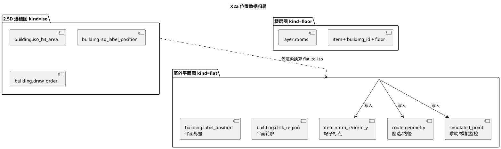

不变量：

1. 帖子标点允许 `flat`/`floor`；路线、求助点、演示数据只允许 `flat`。`iso` 上不保存任何位置数据，写入接口一律 400。
2. 楼层帖（`layer.kind=floor`）同时满足 `item.building_id = layer.building_id` 且 `item.floor = layer.floor`；在室外地图上按该建筑的 `label_position` 显示，不暴露楼层内坐标（沿用 6.20.6）。
3. 建筑的位置语义只由 flat 几何决定；`iso_*` 仅参与渲染与命中。
4. `kind=flat` 与 `kind=iso` 在库中各只保留一条，幂等键**仅为 `kind`**，名称不参与匹配。导入时若该 `kind` 已有记录，就在原记录上更新名称、图片路径、宽高与比例尺（`pixels_per_meter`/`scale_calibrated`），保留原 `id`，不新建记录。若已有多条同 `kind`：保留 `created_at` 最早（并列取 `id` 最小）的一条作为更新目标；其余图层在 `item.layer_id`、`route.layer_id`、`simulated_point.layer_id` 均无引用时删除，有引用时保留并输出警告。`kind=floor` **不在**「各只保留一条」范围内，按 `(building_id, floor)` 区分，同一自然键只允许一条。

#### 2.28.2.3 Alembic 迁移设计

**新迁移文件**：`backend/alembic/versions/20261020_x2a_map_views.py`
**revision**：`20261020_x2a_map`；**down_revision**：`20261020_f14_uniq`（当前 head）

| 顺序 | 操作 | 说明 |
|---|---|---|
| 1 | `layer` 增加 `kind` VARCHAR(16) NOT NULL DEFAULT `'flat'` | 与 `SAEnum(native_enum=False, length=16)` 对齐，不建 PG 原生类型 |
| 2 | `UPDATE layer SET kind='floor' WHERE floor IS NOT NULL` | 既有楼层图（旧「综合楼 1F/2F」「图书馆 1F」）回填 |
| 3 | `UPDATE layer SET kind='flat' WHERE floor IS NULL AND building_id IS NULL` | 既有室外图层（旧「校园 2.5D 底图」，实际是旧平面图副本）标记为 flat；默认值已覆盖，本步显式保证语义 |
| 4 | `layer` 增加 `rooms` JSON NULLABLE | 仅新图层使用 |
| 5 | `layer.kind` 建索引 `ix_layer_kind` | `/map/meta`、楼层查询按 kind 过滤 |
| 6 | `building` 增加 `iso_hit_area` JSON NULLABLE、`iso_label_position` JSON NULLABLE | 不回填；由导入命令写入 |
| 7 | `building` 增加 `draw_order` INTEGER NOT NULL DEFAULT 0 | 服务端默认，避免历史行 NULL |
| 8 | `building` 增加 `entrance_node` INTEGER NULLABLE | 仅存档 |

**降级**：按相反顺序删列（`entrance_node` → `draw_order` → `iso_label_position` → `iso_hit_area` → `rooms` → 索引 → `kind`）。

**不可逆点**（写入迁移 docstring）：

- 降级删除 `kind` 后无法区分室外/2.5D/楼层，再次升级只能按 `floor`/`building_id` 重新推断。
- 降级删除 `iso_hit_area`/`iso_label_position` 后需重新执行素材导入才能恢复 2.5D 命中与角标。
- 本迁移不改动任何 `item`/`route`/`simulated_point` 坐标，也不删除旧底图文件；旧 `storage/campus-2.5d.jpg` 由任务中的文件删除处理。

**重复图层**：本迁移只回填 `kind`，不合并同 `kind` 的重复记录（旧「校园 2.5D 底图」被标为 `flat` 后，可能与已有 `flat` 并存）；合并与去重由首次执行 `sync_layers` 完成，规则见 2.28.6.3。

**迁移与模型一致性**：`alembic check` 必须无待生成变更；模型默认值（`default=0`/`default=LayerKind.flat`）与迁移 `server_default` 保持一致，避免 autogenerate 反复检测。

**测试库**：`tests/conftest.py` 通过 `Base.metadata.create_all` 建表，不跑迁移；因此模型定义必须覆盖全部新列（迁移正确性由 `alembic check` 与本机 `upgrade head` 验证）。
### 2.28.3 图层类型与位置写入校验

#### 2.28.3.1 校验矩阵

| 写入动作 | 入口 | `flat` | `floor` | `iso` |
|---|---|---|---|---|
| 帖子标点 | `POST /items/{id}/map-anchor` → `item_service.set_map_anchor` | 允许 | 允许，需 `item.building_id`/`item.floor` 与图层一致 | 400 `2.5D 图仅用于选楼，请在室外地图上标注` |
| 创建路线 | `POST /items/{id}/route` → `item_service.create_route` | 允许 | 400「楼层图仅支持标点，绘制请返回室外地图」 | 400 同左（iso 文案见上） |
| 创建求助点 | `POST /layers/{id}/simulated-points` → `layers.py` | 允许（staff/admin） | 400「求助点仅在室外平面图创建」 | 400 同上 |
| 建筑导入（写建筑几何） | `building_service.import_buildings` | 不涉及图层 | 不涉及 | 不涉及 |
| 演示数据 | `rebuild_demo_items` | 强制使用 flat 图层 id | — | — |

判定顺序（每次写入）：图层存在 → 400/404 之前先 404；`kind=iso` → 400；`kind=floor` 且动作为帖子标点 → 建筑与楼层一致性 → 400；`kind=floor` 且动作为路线/求助点 → 400；任何一步失败都不得写入部分字段（先校验，后赋值，最后一次 `commit`）。

#### 2.28.3.2 服务层接口与文案

放 `building_service`（建筑与图层的几何/类型规则同属一层，避免 `api` 里写业务判断）：

| 函数签名 | 职责 | 异常 |
|---|---|---|
| `def get_layer_or_404(db: Session, layer_id: uuid.UUID) -> Layer` | 取图层，不存在即报错 | 404 `NOT_FOUND`「图层不存在」 |
| `def ensure_position_layer(db: Session, layer_id: uuid.UUID) -> Layer` | 取图层并拒绝 `iso`；楼层是否允许由调用方继续判断 | 404、400 `VALIDATION`「2.5D 图仅用于选楼，请在室外地图上标注」 |
| `def ensure_flat_layer(db: Session, layer_id: uuid.UUID, action: Literal["route", "help_point"]) -> Layer` | 仅供路线与求助点：取图层并要求 `kind=flat`（内部先调 `ensure_position_layer`） | 400：路线「楼层图仅支持标点，绘制请返回室外地图」；求助点「求助点仅在室外平面图创建」 |
| `def ensure_floor_anchor(layer: Layer, building_id: uuid.UUID \| None, floor: int \| None) -> None` | `kind=floor` 时校验建筑与楼层 | 400 `VALIDATION`，文案见下表 |
| `def active_position_layer_id(db: Session) -> uuid.UUID` | 演示数据与点位同步取 flat 图层 id；多条时取 `(created_at, id)` 最小的一条，与 `/map/meta`、`sync_layers` 的保留规则一致 | 404「尚未创建室外平面图图层」 |
| `def get_map_meta(db: Session) -> dict` | `/map/meta` 查询 | 404（缺 flat/iso 图层或素材文件） |

`MapAnchorRequest` 不改字段；`set_map_anchor` 在调用 `ensure_position_layer` 后，用 `item.building_id`、`item.floor` 调 `ensure_floor_anchor`。`create_route` 与 `create_simulated_point` 改调 `ensure_flat_layer`，不进入楼层一致性校验。楼层一致性文案：

| 条件 | 文案 |
|---|---|
| `item.building_id` 为空或 `item.floor` 为空 | 「在楼层图标点需要先选择建筑与楼层」 |
| `item.building_id != layer.building_id` | 「建筑与当前楼层图不一致」 |
| `item.floor != layer.floor` | 「楼层与当前楼层图不一致」 |

#### 2.28.3.3 调用点与分层

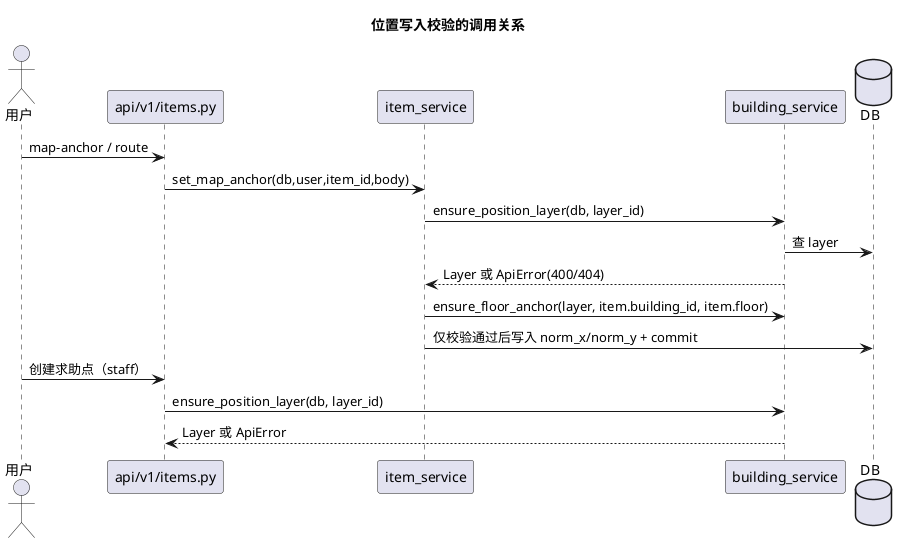

- `item_service` 只负责「帖子是否可写」与字段落库；图层类型与楼层一致性规则集中在 `building_service`，便于 `/map/meta`、求助点入口复用。
- 错误统一 `ApiError(400, "VALIDATION", 中文)`，不抛 `HTTPException`；失败时不 `commit`，`set_map_anchor` 保持「先校验、后赋值」的顺序。
- 前端在室内视图不渲染绘制工具、不提供「创建求助点」入口；但后端校验仍是唯一权限边界（业务红线：前端隐藏不算权限控制）。

### 2.28.4 建筑素材导入

#### 2.28.4.1 素材结构

`campus_buildings.json`（顶层对象，非数组）：

| 字段 | 类型 | 用途 |
|---|---|---|
| `version` | int | 记录到导入输出的素材版本号（不落库） |
| `flat.image` / `flat.width` / `flat.height` | str/int | 写入 flat 图层的 `image_path`/`width`/`height` |
| `flat.meters_per_pixel` | float | `pixels_per_meter = round(1 / meters_per_pixel, 4)`，`scale_calibrated=true` |
| `iso.image` / `iso.width` / `iso.height` | str/int | 写入 iso 图层 |
| `flat_to_iso` | 2×3 数组 | `/map/meta` 返回；前端换算 |
| `campus_outline` | 对象 | 本任务不导入（不需要校园边界）；解析时忽略 |
| `buildings[]` | 数组 | 建筑列表 |

单栋建筑字段（素材可能附带 `entrances`/`units`/`iso.footprint` 等额外字段，一律忽略）：

| 字段 | 类型 | 转换后 |
|---|---|---|
| `id` | str | 编号为空时的兜底编号；也用于编号去重后缀 |
| `code` | str \| null | `building.code`（按 2.28.4.3 规则改写） |
| `name` | str | `building.name`（`named=false` 时替换） |
| `category` | str | `building.category`（英文→中文） |
| `floors` | int | `building.floors`（允许 0） |
| `named` | bool | 仅参与名称判定 |
| `draw_order` | int | `building.draw_order`（允许负值） |
| `entrance_node` | int | `building.entrance_node` |
| `flat.footprint` | `[x,y][]` | `building.click_region`（`[{x,y}]`） |
| `flat.label_anchor` | `[x,y]` | `building.label_position` |
| `iso.hit_area` | `[x,y][]` | `building.iso_hit_area` |
| `iso.label_anchor` | `[x,y]` | `building.iso_label_position` |

#### 2.28.4.2 模块划分与函数签名

素材转换与导入全部放 `backend/app/services/building_service.py`（替换现有 8 栋配置读取逻辑），`scripts/` 只做编排与打印，不重复业务规则。

```python
# 素材模型：只保留本任务用到的字段
@dataclass(frozen=True)
class MapAsset:
    version: int
    flat_image: str
    flat_width: int
    flat_height: int
    meters_per_pixel: float
    iso_image: str
    iso_width: int
    iso_height: int
    flat_to_iso: tuple[tuple[float, float, float], tuple[float, float, float]]
    buildings: tuple[Mapping[str, Any], ...]

@dataclass(frozen=True)
class BuildingData:
    code: str
    name: str
    category: str
    floors: int
    click_region: list[dict[str, float]] | None
    label_position: dict[str, float] | None
    iso_hit_area: list[dict[str, float]] | None
    iso_label_position: dict[str, float] | None
    draw_order: int
    entrance_node: int | None

@dataclass
class BuildingImportResult:
    created: int
    updated: int
    deleted: int
    skipped: int
    warnings: list[str]

@dataclass
class LayerSyncResult:
    created: int
    updated: int
    removed: int
    warnings: list[str]

def load_asset(path: Path | None = None) -> MapAsset
def convert_buildings(asset: MapAsset) -> tuple[list[BuildingData], list[str]]
def import_buildings(db: Session, asset: MapAsset) -> BuildingImportResult
def load_floor_specs(path: Path | None = None) -> list[FloorSpec]
def import_floors(db: Session, asset: MapAsset, specs: list[FloorSpec]) -> FloorImportResult
def sync_layers(db: Session, asset: MapAsset) -> LayerSyncResult
def sync_points(db: Session, asset: MapAsset, roads_path: Path | None = None) -> PointSyncResult
def get_map_meta(db: Session) -> dict
```

- `sync_layers` 只维护 `flat`/`iso` 两类（按 `kind` 幂等，规则见 2.28.6.3），楼层图层一律由 `import_floors` 负责，两者不交叉。

- `load_asset` 默认路径为 `app/data/campus_buildings.json`，测试通过参数指向 `tests/fixtures/`；不写死建筑数据，只写死文件名。
- 现有 `load_config()` 与扁平数组格式一并移除，调用点（`seed.py`、`scripts/import_buildings.py`、`scripts/seed_demo.py`、测试）全部改为 `load_asset` + `import_buildings`。
- `import_buildings` 内部只在最后 `commit` 一次；异常向上抛，由脚本以非零状态退出。

#### 2.28.4.3 转换规则

| 规则 | 判定 | 结果 | 输出 |
|---|---|---|---|
| 坐标 | 素材点为 `[x, y]`，两个值均为 0~1 的数字 | `{"x": round(x, 8), "y": round(y, 8)}`；多边形 `[{x,y}, …]` | 越界或非数字：整栋跳过 + 警告（不中断） |
| 编号·空 | `code` 为 null/空白 | 直接用素材 `id`（如 `b001`） | 计入「编号为空」提示 |
| 编号·唯一 | 非空且该值在素材中只出现一次 | 原样使用 | — |
| 编号·重复 | 非空且在素材中出现 ≥2 次 | `f"{code}-{id}"`（如 `N-b011`） | 警告一次，列出重复编号 |
| 编号·长度 | 结果超过 32 字符 | 截断到 32 | 警告 |
| 名称 | `named=false` 或 `name` 去空白后为空 | `未命名建筑` | — |
| 类别 | `teaching/library/dorm/historic/admin/sports/track/court/park/bridge/gate` | 对应中文（教学楼/图书馆/宿舍/历史建筑/行政/体育馆/运动场/球场/园林/天桥/校门） | — |
| 类别·life | 名称包含「食堂」或「餐厅」 | `食堂` | 否则 `生活服务` |
| 类别·未知 | 不在上表 | `其他` | 警告：编号 + 原类别，不报错 |
| 层数 | `floors` 为整数 | `0 ≤ floors ≤ 200`，越界截断 | 截断时警告 |
| 轮廓 | `flat.footprint` 点数 ≥3 | 写入 `click_region` | 否则 `None` + 警告（该建筑不参与点击与演示取点） |
| 标签 | `flat.label_anchor` 存在且合法 | 写入 `label_position` | 缺失时取轮廓顶点均值；两者皆无 → `None` + 警告 |
| 2.5D 命中 | `iso.hit_area` 点数 ≥3 | 写入 `iso_hit_area` | 否则 `None` + 警告（该建筑在室内不可点） |
| 2.5D 标签 | `iso.label_anchor` 合法 | 写入 `iso_label_position` | 缺失时用 `label_position` 经矩阵换算兜底 |
| 绘制层级 | `draw_order` 为整数 | 原值（允许负数） | 非整数 → 0 + 警告 |
| 入口节点 | `entrance_node` 为整数 | 原值 | 否则 `None` + 警告 |

**幂等键**：`Building.code`（唯一索引）。同一素材重复导入时全部走更新分支，`created=0`、`updated=总数`。

#### 2.28.4.4 旧建筑清理

素材中已不存在的旧建筑按下列顺序处理，保证「先删演示数据，再删建筑」且不误删用户数据：

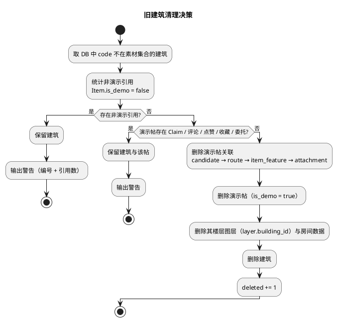

- 引用检查覆盖 `item.building_id`、`layer.building_id`；求助点/监控点不引用建筑，无需处理。
- 「非演示引用」包括用户发布的帖子、任何 `is_demo=false` 的帖子；只要有引用，建筑保留，素材与库的差异写入警告，由维护者人工处理。
- 删除演示帖的关联顺序：`candidate`（lost/found 两侧）→ `route` → `item_feature` → `attachment` → `item`；演示帖按设计不生成评论、点赞、认领，若历史库中存在这些记录则保留建筑并警告（不级联删除用户互动）。

#### 2.28.4.5 输出契约

`import_buildings` 返回 `BuildingImportResult`，脚本统一格式打印：

```
[1/5] 建筑：素材 137 栋，新增 137，更新 0，删除 0，跳过 0，警告 0
```

警告逐条打印，格式 `警告：建筑 {code} {原因}`；类别未知、轮廓缺失、编号重复必须出现在警告中。素材文件缺失或 JSON 解析失败时抛 `ValueError`，由脚本打印失败步骤并以非零状态退出，**不写入任何数据**（先解析、后开事务）。

### 2.28.5 楼层素材导入

#### 2.28.5.1 素材契约

`app/data/campus_floors.json`：

| 字段 | 类型 | 说明 |
|---|---|---|
| `version` | int | 素材版本 |
| `floors[]` | 数组 | 楼层列表 |
| `floors[].building_code` | str | 关联 `building.code`；不存在则跳过 + 警告 |
| `floors[].floor` | int | 楼层号，与 `layer.floor` 一致 |
| `floors[].name` | str | 图层展示名；缺省用 `{建筑名} {floor}F` |
| `floors[].image` | str \| null | `storage/floors/` 下的文件名；为空表示无底图 |
| `floors[].width` / `height` | int | 画布尺寸；缺省 `1000×1000`（占位常量） |
| `floors[].rooms` | 数组 \| null | `[{"name": str, "x": float, "y": float}]`；`x/y` 为归一化房间中心 |

当前素材 `floors` 为空，因此初始化只会创建 2.28.5.2 的 3 个占位楼层。

#### 2.28.5.2 模块与函数签名

```python
@dataclass(frozen=True)
class FloorSpec:
    building_code: str
    floor: int
    name: str | None
    image: str | None
    width: int
    height: int
    rooms: tuple[dict[str, Any], ...]

@dataclass
class FloorImportResult:
    created: int
    updated: int
    skipped: int
    warnings: list[str]

FLOOR_IMAGE_DIR = Path("floors")          # 相对 file_storage_dir
DEFAULT_FLOOR_LAYERS = ((21, 1), (21, 2), (17, 1))
PLACEHOLDER_FLOOR_SIZE = (1000, 1000)

def load_floor_specs(path: Path | None = None) -> list[FloorSpec]
def import_floors(db: Session, asset: MapAsset, specs: list[FloorSpec]) -> FloorImportResult
```

`DEFAULT_FLOOR_LAYERS` 中的 21、17 是本任务明确允许写死的种子编号；建筑名、图层尺寸、房间信息全部来自数据。

#### 2.28.5.3 导入规则

1. **文件缺失**：`campus_floors.json` 不存在 → `specs=[]` + 警告「未找到楼层素材，仅创建占位楼层」，继续执行。
2. **文件损坏**：存在但 JSON 无法解析 → 抛 `ValueError`，脚本非零退出（避免静默用错数据）。
3. **重复楼层**：同一 `(building_code, floor)` 出现多次 → 只保留最后一条 + 警告。
4. **建筑不存在**：跳过 + 警告，不创建孤立图层。
5. **图片**：`image` 只取文件名（拒绝 `..` 与路径分隔符）；`storage/floors/{image}` 不存在 → `image_path=None` + 警告，按「无底图」处理。
6. **图片尺寸**：优先用素材 `width/height`；图片存在但未给尺寸 → 占位尺寸 + 警告。
7. **房间**：`name` 去空白且长度 ≤32、`x/y ∈ [0,1]`，否则丢弃该房间 + 警告；`rooms` 为空时存 `None`。
8. **占位楼层**：文件与占位集合合并后，对 `DEFAULT_FLOOR_LAYERS` 中每个 `(code, floor)`：若素材未提供该楼层 → 创建 `kind=floor`、`image_path=None`、占位尺寸的图层；若素材提供 → 以素材为准（含无底图）。
9. **身份与更新**：以 `(building_id, floor, kind=floor)` 查找；存在则更新 `name/image_path/width/height/rooms`，不存在则新建。楼层图层**不参与** 2.28.6.3 的「同 `kind` 各只保留一条」收敛：不同 `(building_id, floor)` 各自一条互不冲突，只有同一自然键才视为同一条记录。`name` 冲突（另一行同名）时保留旧名 + 警告。
10. **不删除**：素材中消失的楼层图层保留（可能是用户在页面上使用过的楼层），只在输出的 `skipped` 中体现，不写警告噪音。

#### 2.28.5.4 房间数据

- 存储：`layer.rooms` JSON 数组，元素 `{"name": str, "x": float, "y": float}`，坐标为该楼层图归一化坐标（左下角原点，与该图层 `width/height` 对应）。
- 使用：前端 `types.ts` 的 `Room`；`BuildingLayer` 的可选 `rooms` 在房间中心渲染 `divIcon` 文本；无底图占位楼层也允许显示房间名（若素材提供）。
- 权限：房间信息随 `GET /layers` 返回给所有登录用户，不含帖子、联系方式或监控内容。
### 2.28.6 可重复导入流程（`scripts/import_map_assets.py`）

#### 2.28.6.1 步骤与依赖

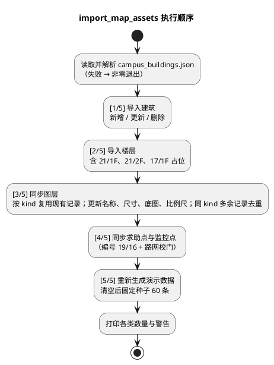

顺序理由：楼层依赖建筑编号；图层同步在楼层之后（楼层名依赖建筑名）；点位依赖建筑的 flat 标签；演示数据依赖建筑、flat 图层与演示用户。

#### 2.28.6.2 入口与统计

```python
@dataclass
class ImportSummary:
    asset_version: int
    buildings: BuildingImportResult
    floors: FloorImportResult
    layers: LayerSyncResult
    points: PointSyncResult
    demo_created: int
    warnings: list[str]

def run(
    db: Session,
    *,
    asset_path: Path | None = None,
    floors_path: Path | None = None,
    roads_path: Path | None = None,
    demo_count: int = 60,
) -> ImportSummary

def main() -> None   # 打印统计；异常时打印失败步骤并 sys.exit(1)
```

- `run` 是唯一编排入口，`main` 只负责打开 `SessionLocal`、调用 `run`、打印、退出码；测试直接调 `run` 断言两次结果一致。
- 统计逐项打印：`建筑：新增/更新/删除/跳过`、`楼层：新增/更新/跳过`、`图层：新建/更新/删除`、`点位：求助/监控/删除`、`演示数据：60（寻物 30 / 拾获 30）`、`警告：N 条`。
- 最后打印一行 `素材版本：{version}`，便于替换最终素材后核对。

#### 2.28.6.3 幂等保证

| 步骤 | 幂等键 | 第二次执行的预期 |
|---|---|---|
| 建筑 | `building.code` | `created=0`，`updated=总数`，数量不变 |
| 楼层 | `(building_id, floor, kind=floor)` | `created=0`，`updated=总数`，数量不变 |
| 图层 | `kind`（`flat`/`iso` 各一条，**名称不参与**） | 命中则原记录更新名称/图片/宽高/比例尺，`id` 不变；第二次 `created=0`、`updated=2`、`removed=0` |
| 求助点/监控点 | `(layer_id, label)` | 只更新坐标/说明，不新增 |
| 演示数据 | 先删 `is_demo=true` 再按固定种子生成 | 每次恰好 60 条，内容一致 |

**同 `kind` 图层收敛规则**（`sync_layers`，`flat`/`iso` 各执行一次）：

1. **取目标**：按 `kind` 查出全部记录，按 `(created_at, id)` 升序；第一条为更新目标，其余为多余记录。
2. **多余记录优先处理**：逐条检查 `item.layer_id`、`route.layer_id`、`simulated_point.layer_id`；三者均无引用则删除并计入 `removed`，任一有引用则保留并输出警告「图层 {name}（{id}）存在引用，未删除」。
3. **更新目标**：在原记录上更新 `name`、`image_path`、`width`、`height`、`pixels_per_meter`、`scale_calibrated`，保留原 `id`；`version` 沿用原值，不由素材覆盖。先删除多余记录再改名，避免它们占用 `layer.name` 唯一约束。
4. **名称冲突**：仍有其他记录（被引用而保留下来的）占用了素材规定的名称时，保留原名称并输出警告，不中断导入，也不影响幂等键。
5. **无目标**：以素材规定的名称新建一条，`created += 1`；新建后仍满足「每个 `kind` 一条」。
6. **边界**：`kind=floor` 不进入本规则，由 `import_floors` 按 `(building_id, floor)` 维护，不同楼层数量不受「各只保留一条」限制。
7. **原因**：本地已存在名为「校园 2.5D 底图」、实际却是平面图的 `flat` 图层；若继续按名称匹配，会再建一条 `flat`，`/map/meta` 与前端图层列表都会出现两个平面底图。改为只按 `kind` 后，该记录被复用并改名，`id` 保持不变。

「数量不变」的判定口径：建筑、楼层、图层（flat/iso 各 1 条，楼层按自然键）、求助点、监控点、演示帖的计数在两次执行后逐项相等；`flat`/`iso` 图层的 `id` 必须与首次一致（幂等更新而非重建）；演示帖的 `id` 会变化（删除后重建），测试只断言数量、方向分布、建筑分布与坐标范围，不断言 `id`。

#### 2.28.6.4 失败策略

- 素材解析失败：第 0 步即退出，不写库。
- 单栋建筑转换失败：跳过并警告（不中断），保证其余可用数据能导入。
- 数据库写入异常：交回调用方，脚本打印「失败步骤：[n/5] 名称」并以非零状态退出，不静默继续后续步骤。
- 脚本不捕获并吞掉异常，不使用 `except Exception: pass`。

#### 2.28.6.5 `seed.py` 与 `seed_demo.py` 的复用

| 文件 | 做法 |
|---|---|
| `backend/seed.py` | 保留管理员创建；依次调用 `import_buildings` → `sync_layers` → `import_floors` → `sync_points`（不生成演示数据）；最后打印图层、建筑、楼层、求助点、监控点、演示数据数量。删除 `_LAYER_SPECS`/`_POINT_SPECS`/`_LEGACY_LAYER_NAMES` 中写死的坐标与尺寸。 |
| `backend/scripts/seed_demo.py` | 只保留 `seed_demo(db, *, count=60, seed_value=…)` 与 `main`；内部调用 `building_service` 的素材/图层查询与 2.28.9 的重建逻辑，不重复实现加权规则。 |
| `backend/scripts/import_buildings.py` | 保留为单步入口：`load_asset` + `import_buildings`，额外打印 `deleted/skipped/warnings`。 |
| `backend/scripts/import_map_assets.py` | 新增，完整五步 + 统计（见上）。 |

`seed.py` 直接 `from scripts.import_map_assets import ...` 复用同一批函数，避免两处维护同一套图层规格；`seed.py` 位于 `backend/`，运行时 `sys.path` 已含该目录，无需改启动方式。

### 2.28.7 `GET /map/meta` 接口契约

#### 2.28.7.1 接口定义

| 项 | 内容 |
|---|---|
| 方法与路径 | `GET /api/v1/map/meta` |
| 鉴权 | 登录即可（`get_current_user`），不区分角色 |
| 响应模型 | `MapMetaOut` |
| 业务逻辑 | `building_service.get_map_meta(db)`：按 `kind` 取记录，多条时取 `(created_at, id)` 最小的一条，与 `sync_layers` 的保留规则一致 |
| 稳定性 | 稳定（新增，后续只增字段） |

**响应体**

| 字段 | 类型 | 说明 |
|---|---|---|
| `flat_layer_id` | UUID | `kind=flat` 的图层 id |
| `iso_layer_id` | UUID | `kind=iso` 的图层 id |
| `flat_to_iso` | `number[2][3]` | 素材 `flat_to_iso`，行优先；`iso_x = m00*flat_x + m01*flat_y + m02`，`iso_y = m10*flat_x + m11*flat_y + m12` |

**响应示例**（当前正式素材矩阵，仅作文档示例，代码与测试不得引用该具体数值）

```json
{
  "flat_layer_id": "6f0c1c1e-0d1a-4a1b-9a9e-2d6f0f6a1b11",
  "iso_layer_id": "9b3a2f5c-7d64-4f0e-9a86-3c5d2e1f7a22",
  "flat_to_iso": [[0.905975, -0.159694, 0.082007], [0.095489, 0.865271, -0.033368]]
}
```

**错误**

| 条件 | 状态码 | 代码 | 文案 |
|---|---|---|---|
| 未登录 | 401 | `UNAUTH` | 沿用现有鉴权文案 |
| 缺 `flat` 图层 | 404 | `NOT_FOUND` | 「缺少室外平面图图层，请先初始化地图数据」 |
| 缺 `iso` 图层 | 404 | `NOT_FOUND` | 「缺少 2.5D 选楼图层，请先初始化地图数据」 |
| 素材文件缺失/无法解析 | 404 | `NOT_FOUND` | 「地图素材文件缺失，请执行素材导入」 |

**调用示例**（前端，`api/layers.ts`）

```ts
const meta = await getMapMeta()
const isoPoint = flatToIso({ x: building.label_position.x, y: building.label_position.y }, meta.flat_to_iso)
// isoPoint 用于在 2.5D 图上定位标签/角标；不得写回后端
```

#### 2.28.7.2 路由注册

`/map/meta` 与图层同源（都读 `layer` 表），实现放在 `api/v1/layers.py`：

```python
map_router = APIRouter(tags=["map"])

@map_router.get("/meta", response_model=MapMetaOut)
def get_map_meta(db: Session = Depends(get_db), user: User = Depends(get_current_user)):
    return building_service.get_map_meta(db)
```

`api/v1/router.py` 增加一行 `api_router.include_router(layers.map_router, prefix="/map")`。该文件已获用户批准纳入本次改动清单（见 2.28.13.1），只新增这一行注册，不改动任何既有路由。

### 2.28.8 推荐算法改动（`advice_service`）

#### 2.28.8.1 排除规则

推荐候选在查询阶段收窄（不改变返回结构、`MAX_LOCATIONS=5`、排序与降级矩阵）：

| 排除项 | 判定 |
|---|---|
| 天桥 | `Building.category == "天桥"` |
| 校门 | `Building.category == "校门"` |
| 未命名建筑 | `Building.name == "未命名建筑"` |

实现为在既有查询上追加 `filter(*recommendable_building_clauses())`，排序仍 `(-score, code)`。被排除的建筑在 `/buildings` 列表中仍可见、仍可被点击选中，只是不进入推荐结果。

排除判定集中在 `building_service`，供 `advice_service` 与 `seed_demo.py` 共用，禁止两处各写一份：

| 函数 | 形态 | 使用方 |
|---|---|---|
| `EXCLUDED_BUILDING_CATEGORIES = frozenset({"天桥", "校门"})`、`UNNAMED_BUILDING = "未命名建筑"` | 模块常量（唯一来源） | 两个函数都由它们派生 |
| `def recommendable_building_clauses() -> tuple[ColumnElement[bool], ...]` | 查询条件，交给调用方既有查询（`db.query(Building).filter(*clauses)`） | `advice_service` 收窄候选 |
| `def is_recommendable_building(building: Building) -> bool` | 纯函数，内存判定 | `seed_demo.py` 过滤候选建筑 |

两者语义必须一致：`category ∉ EXCLUDED_BUILDING_CATEGORIES` 且 `name != UNNAMED_BUILDING`。测试用同一组夹具分别验证查询过滤与内存过滤结果相同。

#### 2.28.8.2 建筑类别提示词补充

| 建筑类别 | 物品提示 |
|---|---|
| 体育馆 | 水杯、耳机、钥匙、衣物、校园卡 |
| 运动场 | 水杯、耳机、钥匙、衣物、校园卡 |
| 球场 | 水杯、耳机、钥匙、衣物、校园卡 |
| 生活服务 | 校园卡、钱包、雨伞 |
| 图书馆/食堂/教学楼/宿舍 | 沿用现有映射，不修改 |

匹配函数 `_category_hint` 不变（`hint in category or category in hint`）。

#### 2.28.8.3 距离换米

- 取 flat 图层：`kind=flat` 的 `width/height/pixels_per_meter/scale_calibrated`；`scale_calibrated=false` 或 `pixels_per_meter IS NULL` → 米数为 `None`。
- 归一化距离是「圈选点 → 建筑标签点」的最小值；换算必须考虑 x/y 像素尺度：

| 步骤 | 公式 |
|---|---|
| 归一化差 | `dx = x_point - x_building`、`dy = y_point - y_building` |
| 像素差 | `px = dx * flat_layer.width`、`py = dy * flat_layer.height` |
| 像素距离 | `p = sqrt(px² + py²)` |
| 米数 | `round(p / pixels_per_meter)` |

- 当前素材：`meters_per_pixel = 0.520366` ⇒ `pixels_per_meter ≈ 1.9217`；测试夹具用整数比例（如 `meters_per_pixel=0.5`），断言可手算。
- `_score` 增加 `meters` 字段（`int | None`）：**评分仍用现有归一化 `distance`**，不改权重、不改排序，降低对 6.9 推荐流程的回归风险；`meters` 只用于理由文案与模型上下文。
- 未标定比例尺：理由退回「距离较近/中/远」，不出现「米」（沿用 6.14 比例尺门控）。

#### 2.28.8.4 理由生成

| 来源 | 规则 |
|---|---|
| 规则（`source=rule`） | `_template_reason` 输出距离句 + 历史句 + 同类句 + 类型匹配句；距离句为「距你圈选的范围约 N 米」（`meters` 非空且存在圈选几何时），否则「距离较近/中/远」 |
| 模型（`source=model`） | 模型解释作为**追加句**拼接在模板距离句之后，总长 ≤200；模板距离句始终保留，保证「米」一定出现且不被模型改写 |
| 模型不可用/超时/解析失败 | 完全走规则，`degraded=true`，行为与现状一致 |

模型上下文新增 `distance_meters`（整数），不发送精确坐标、联系方式、认领证据；提示词继续禁止编造联系方式与监控内容。

**理由示例**（正式素材、已标定）：

> 距你圈选的范围约 80 米；历史寻物 12 条、拾获 4 条；建筑类型与类别匹配。

#### 2.28.8.5 对既有测试的影响

- `tests/test_search_advice.py` 用夹具素材重写：断言推荐建筑均来自夹具、不含天桥/校门/未命名、理由含「米」。
- 模型解释用例的断言从「理由等于模型返回」改为「理由包含模型片段」，避免与追加句策略冲突。

### 2.28.9 演示数据生成（`seed_demo.py` 重写）

#### 2.28.9.1 删除范围与顺序

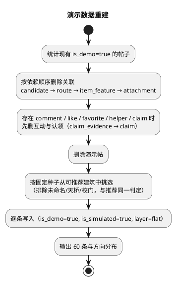

- 演示帖一律无照片、无认领、无工单；重建时若历史库中演示帖被认领或评论，先删关联再删帖，输出删除条数，避免外键失败。
- 演示用户 `demo_poster` 保留（无密码可用，不参与登录）。

#### 2.28.9.2 建筑加权与物品映射

| 建筑类别 | 权重 | 物品类别池 |
|---|---|---|
| 食堂 | 5 | 校园卡、雨伞、水杯、钱包、餐具 |
| 图书馆 | 5 | 书、笔记本电脑、校园卡、耳机、充电宝 |
| 教学楼 | 5 | 手机、笔记本电脑、耳机、眼镜、充电宝、雨伞 |
| 宿舍 | 2 | 钥匙、校园卡、衣物、钱包、耳机、雨伞 |
| 体育馆 / 运动场 / 球场 | 2 | 水杯、耳机、钥匙、衣物、校园卡 |
| 生活服务 | 1 | 校园卡、钱包、雨伞、钥匙 |
| 其他 / 历史建筑 / 行政 / 园林 | 1 | 沿用现有 10 类物品 |

- **候选建筑排除未命名建筑、天桥、校门**（已确认）：该过滤与 2.28.8.1 的推荐过滤共用同一套判定——统一调用 `building_service.is_recommendable_building`（或等价的 `recommendable_building_clauses`），不在此处另写类别字符串或名称判断。
- 演示数据另有自身约束：`floors < 1`、`click_region` 点数 <3（这两项不属于推荐排除，只影响演示取点）。
- 无可用建筑 → 抛 `RuntimeError`「没有可用于演示数据的建筑」，脚本非零退出（不生成空数据）。
- 物品类别池在 `seed_demo.py` 内以常量映射维护；不在 `advice_service` 中，避免推荐与演示耦合。

#### 2.28.9.3 抽样与坐标算法

| 环节 | 规则 |
|---|---|
| 固定种子 | `random.Random(20261020)`；不使用全局 `random` |
| 建筑抽样 | `choices(buildings, weights, k=30)`，同一次抽样生成一对（寻物 + 拾获），共 60 条；每对同楼，满足「每栋被选中的楼混合」 |
| 方向 | 每对固定一条 `lost`、一条 `found` ⇒ 总数 30/30；顺序打乱后写入，避免整屏同向 |
| 物品 | 按建筑类别从对应池中随机取 |
| 坐标 | 在轮廓包围盒内均匀采样，用射线法判定落在多边形内（多边形按首尾相连闭合）；最多 200 次 |
| 兜底 | 200 次失败 → 取轮廓第一个顶点（在边界上，属轮廓内）+ 警告；仍无轮廓 → 该建筑已被排除 |
| 楼层 | `random.randint(1, max(1, building.floors))`；`location_area = f"{building.name}{floor}F"`，与建筑一致 |
| 图层 | flat 图层 id（来自 `active_position_layer_id`） |
| 状态 | 沿用现有 `_status`：约 1/3 进行中，其余已结束 |
| 文本 | 标题 `演示：{建筑名}{物品}{寻物/拾获}记录{序号:02d}`；描述标注演示用途；`is_demo=true`、`is_simulated=true` |

#### 2.28.9.4 输出与测试口径

- 返回 `DemoResult(created=60, lost=30, found=30, buildings=去重建筑数, warnings=[...])`。
- 测试断言：总数 60、重复执行仍 60、每条坐标在所属建筑 `click_region` 内、`direction` 两种均存在、图层为 flat。
- 不依赖正式素材：测试用夹具 3~5 栋建筑，权重与类别映射按夹具类别生效。
### 2.28.10 `seed.py` 初始化数据

#### 2.28.10.1 图层规格

图层名是允许写死的常量，但只用于新建记录时的展示名，**不参与幂等匹配**；图片名、尺寸、比例尺全部来自素材。

| 图层 | `kind` | 底图 | 尺寸 | 比例尺 | 建筑/楼层 |
|---|---|---|---|---|---|
| 校园室外地图 | `flat` | 素材 `flat.image`（`campus_flat.webp`） | 素材 `flat.width/height` | `scale_calibrated=true`，`pixels_per_meter = round(1/meters_per_pixel, 4)` | — |
| 校园 2.5D 选楼图 | `iso` | 素材 `iso.image`（`campus_25d.webp`） | 素材 `iso.width/height`（当前 2400×1842） | `false`，`pixels_per_meter=NULL` | — |
| 综合楼 1F / 2F | `floor` | 无（素材未提供） | 占位 1000×1000 | `false` | 编号 21、楼层 1/2 |
| 图文信息中心 1F | `floor` | 无 | 占位 1000×1000 | `false` | 编号 17、楼层 1 |

`sync_layers` 的查找顺序：**只按 `kind`** 取 `flat`/`iso` 各一条（`created_at` 最早，并列取 `id` 最小），命中则更新名称、图片、尺寸与比例尺并保留原 `id`；未命中才按常量名新建。迁移后旧「校园 2.5D 底图」的 `kind` 已是 `flat`，`sync_layers` 会把它改名为「校园室外地图」并把底图换成 `campus_flat.webp`，不会因名称不同另建记录；旧楼层图层由 `import_floors` 按 `(building_id, floor)` 认领，不产生重复。同 `kind` 多余记录按 2.28.6.3 收敛（保留最早、无引用则删除、有引用则警告）。

#### 2.28.10.2 求助点与模拟监控点

| 点位 | 图层 | 位置来源 | 公开 | 说明 |
|---|---|---|---|---|
| 保卫处 | flat | 编号 19 的 `label_position` | 是 | 24 小时值班，可协助查询监控与登记失物 |
| 失物招领处 | flat | 编号 19 的 `label_position`，`x = min(1, x + 0.01)`，`y` 不变 | 是 | 集中保管拾获物品；说明固定为「设于保卫处，位置待核实」 |
| 校园服务台 | flat | 编号 16 的 `label_position` | 是 | 提供咨询与失物登记指引 |
| `{校门名}监控（模拟）` ×4 | flat | `campus_roads.json` 中带 `gate` 字段的节点 `x/y` | 否 | `kind=monitor_point`、`is_simulated=true`；说明「模拟监控点位，仅工作人员可见」 |

- 校门节点读取：只读顶层 `nodes`，筛选 `gate` 非空；标签为 `f"{gate}监控（模拟）"`（素材 gate 名已含「校门」，不重复拼接）。
- 编号 19/16 在素材缺失或 `label_position` 为空时：跳过该点位 + 警告（不阻断 seed）。
- 幂等：按 `(flat 图层, kind, label)` upsert；本次集合之外的种子点删除，条件是 `is_simulated=true` 且 `created_by IS NULL`；工作人员手工创建（`created_by` 非空）的点保留并警告。
- 无校门节点：不创建监控点 + 警告，其余初始化继续（6.20.11 异常分支）。

### 2.28.11 前端设计

#### 2.28.11.1 三视图状态划分

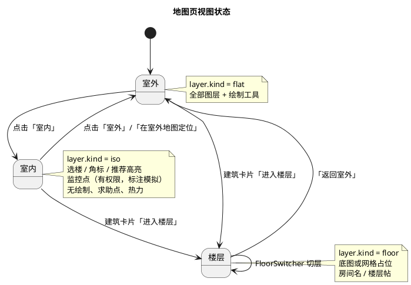

`MapView` 状态（全部 `useState`，不写 URL、不持久化视图）：

| 状态 | 类型 | 初始值 | 说明 |
|---|---|---|---|
| `view` | `'flat' \| 'iso' \| 'floor'` | `'flat'` | 每次进入地图页默认室外（6.20.1）；不写入 sessionStorage |
| `flatLayerId` / `isoLayerId` | `string \| null` | 来自 `/map/meta` | 缺 meta 时退回 `layers.kind` 推断 |
| `activeLayerId` | `string \| null` | `flatLayerId` | 当前底图图层：flat/iso/floor 三选一 |
| `selectedBuildingId` | `string \| null` | `null` | 两视图共用 |
| `showLabels` | `boolean` | `false` | 楼名开关 |
| 既有开关 | 同现状 | 同现状 | `showItems/showHelp/showMonitor/showAdvice/showHeatmap/showBuildings`；视图切换只影响渲染条件，不改数据 |

派生：

| 派生值 | 规则 |
|---|---|
| `activeLayer` | `layers.find(id === activeLayerId)` |
| `flatLayer` / `isoLayer` | 按 `kind` 从 `layers` 取，meta 优先 |
| `floorLayersOf(building)` | `kind==='floor' && building_id === building.id`，按 `floor` 升序 |
| `activeCounts` | 进行中帖子按 `building_id` 计数，仅用于角标 |
| `recommendedCodes` | `advice.locations.map(l => l.building_code)` |
| `canDraw` | `view !== 'iso' && !(view === 'floor' && !activeLayer.image_path)` |
| `canSeeMonitor` | `role === 'staff' \|\| 'admin'`（不变） |

视图与图层的一致性：`view` 是唯一真值，`activeLayerId` 由视图推导（进入楼层时用所选楼层 id）；`FloorSwitcher` 切层只改 `activeLayerId`，不改 `view`。

#### 2.28.11.2 组件与文件职责

| 文件 | 改动 | 职责 |
|---|---|---|
| `types.ts` | 扩展 | `LayerKind`、`FlatToIsoMatrix`、`Room`、`MapMeta`；`Building` 增 4 字段；`Layer` 增 `kind`/`rooms` |
| `api/layers.ts` | 扩展 | `getMapMeta(): Promise<MapMeta>`；其余不变 |
| `api/buildings.ts` | 扩展 | `listAllBuildings(): Promise<Building[]>`：先取第 1 页，按 `total` 循环 `offset` 取完，单页 `limit=100` |
| `components/CampusMap/coords.ts` | 扩展 | 保留现有两个换算；新增 `flatToIso`、`pointInRegion`、`flatBuildingAt`、`isoBuildingAt`、`BUILDING_LABEL_MIN_ZOOM` |
| `components/CampusMap/BuildingLayer.tsx` + `.module.css` | 改造 | 平面视图：`click_region` 命中（`flatBuildingAt`）、默认不画轮廓、选中高亮、推荐高亮、楼名阈值、可选 `rooms` |
| `components/CampusMap/IsoBuildingLayer.tsx` + `.module.css` | 新增 | 2.5D：`iso_hit_area` 高亮选中、推荐高亮（矩阵换算）、数量角标、楼名阈值；`canSeeMonitor` 时用 `flatToIso` 渲染监控点并标注「模拟」，求助点不渲染 |
| `components/CampusMap/BuildingCard.tsx` + `.module.css` | 改造 | 三按钮（查看帖子 / 进入楼层仅在有楼层图层时渲染 / 在室外地图定位仅室内）；`filterFloor` 支持楼层过滤 |
| `components/CampusMap/LayerToggles.tsx` + `.module.css` | 小幅 | 无结构改动（选项由 `MapView` 传入），补「显示楼名」选项；保持 44px 点击区 |
| `components/CampusMap/FloorSwitcher.tsx` + `.module.css` | 小幅 | 「返回室外」改为回调 `onExit`（切回 flat）；楼层按钮展示 `{floor}F`；「楼层图整理中」提示不在此组件 |
| `pages/MapView.tsx` + `.module.css` | 改造 | 三视图状态、视图切换、图层与数据编排、楼层占位遮罩、详情与错误态 |
| `hooks/useCampusMapLayers.ts` | 改（已批准，见 2.28.13.4） | 将 `listBuildings({limit:100})` 改为 `listAllBuildings()`，全量加载约 137 栋，不再按现有切片/上限截断；`MapView` 继续复用该 hook，不另起数据获取逻辑 |

#### 2.28.11.3 坐标换算（`coords.ts`）

```ts
export type FlatToIsoMatrix = [[number, number, number], [number, number, number]]
export interface NormalizedPoint { x: number; y: number }

// 平面归一化坐标 → 2.5D 归一化坐标（2×3 仿射，行优先）
export function flatToIso(point: NormalizedPoint, matrix: FlatToIsoMatrix): NormalizedPoint

// 多边形命中（射线法，首尾自动闭合；点数 <3 返回 false）
export function pointInRegion(point: NormalizedPoint, region: NormalizedPoint[]): boolean

// 平面视图按轮廓取建筑；室内视图按 iso 命中区取建筑，多个命中取 draw_order 最大
export function flatBuildingAt(point: NormalizedPoint, buildings: Building[]): Building | null
export function isoBuildingAt(point: NormalizedPoint, buildings: Building[]): Building | null

// 楼名显示缩放阈值：集中配置，两个建筑层组件共用
export const BUILDING_LABEL_MIN_ZOOM = 0.5
```

- `flatToIso` 不写死矩阵，参数来自 `/map/meta`；只用于渲染，不写回后端。
- `isoBuildingAt` 的确定性：先收集全部命中，按 `(draw_order 降序, code 升序)` 取第一条；`draw_order` 相同也有稳定结果，不依赖 Leaflet 图层添加顺序。
- 阈值取值理由：`CampusMap` 的 `minZoom=-3`、`maxZoom=3`，`fitBounds` 初始通常在 -1~0 之间；`0.5` 约相当于放大 3~4 档，130+ 楼名不会同时铺满。阈值只在 `coords.ts` 定义，组件不重复数字。
- 既有 `buildingAt`（发布时反查建筑）保留在 `BuildingLayer.tsx`，内部改为调用 `pointInRegion`，避免两份实现；导出签名不变，`MapView` 的 `publish` 不变。

#### 2.28.11.4 命中与选中

| 视图 | 点击判定 | 高亮 | 说明 |
|---|---|---|---|
| flat | `flatBuildingAt`：`click_region` 命中，未命中取 0.08 内最近标签 | 选中建筑画 `click_region` 描边 + 低透明度填充；推荐建筑画描边 + 序号标签 | 默认不绘制任何轮廓（6.20.2） |
| iso | `isoBuildingAt`：`iso_hit_area` 命中，`draw_order` 最大 | 选中建筑画 `iso_hit_area` 描边 + 浅填充；推荐建筑画描边 + 序号 | 默认不绘制轮廓（6.20.3） |
| floor | 不选建筑（当前建筑固定为楼层所属建筑） | 楼层底图 | 房间名走 `rooms` |

实现方式：`BuildingLayer` 与 `IsoBuildingLayer` 的命中多边形 `interactive=false`，点击统一由 `MapView` 传给 `CampusMap` 的 `onMapClick` 处理（`flat` 取建筑、`iso` 取建筑、`floor` 清空选中），避免依赖 Leaflet 的「后添加者优先」。绘制模式下（`flat`/`floor`）`onMapClick` 只清空选中，不抢绘制工具的点击。

#### 2.28.11.5 楼名与数量角标

| 元素 | 显示条件 | 位置 | 样式 |
|---|---|---|---|
| 楼名 | `showLabels=true` 且 `map.getZoom() >= BUILDING_LABEL_MIN_ZOOM` 且名称 ≠「未命名建筑」 | flat：`label_position`；iso：`iso_label_position` | `divIcon` 文本 + 浅底色，`pointer-events: none`，不遮挡点击 |
| 数量角标 | `activeCounts[building.id] > 0`（仅 iso） | `iso_label_position` 上方偏移 | `--color-danger` 圆角胶囊，文本 `N`，`aria-label="{楼名}进行中 N 条"` |
| 未命名建筑 | 永不显示楼名 | — | 避免 130+ 标签堆叠（6.20.5） |

两个组件都在 `map.on('zoomend')` 里同步 `zoom` 状态（与 `ItemPointsLayer` 相同的写法），缩小到阈值以下自动隐藏，不需要用户再次操作开关。

#### 2.28.11.6 建筑卡片

```ts
interface BuildingCardProps {
  building: Building
  mode: 'flat' | 'iso' | 'floor'
  floorLayers: Layer[]
  filterFloor?: number | null
  onClose: () => void
  onEnterFloor: (layerId: string) => void
  onLocateOutdoor: () => void
}
```

| 按钮 | 显示条件 | 行为 |
|---|---|---|
| 查看这栋楼的帖子 | 始终 | 首次点击拉取 `listItems({building_id, limit:5})`；`filterFloor` 非空时前端按 `floor` 过滤；空态文案「该建筑暂无相关帖子」 |
| 进入楼层 | `floorLayers.length > 0` 才渲染（不渲染禁用态） | 打开 `FloorSwitcher`，默认进入最小楼层；`mode='floor'` 时隐藏该按钮 |
| 在室外地图定位 | `mode === 'iso'` 才渲染 | 调 `onLocateOutdoor`：`view='flat'`、`activeLayerId=flatLayerId`、居中到该建筑轮廓（`MapView` 通过 `focus` 状态驱动，见 2.28.11.9） |

数量为 0 时仍展示「进行中 0 条」，按钮可用并显示空态（6.20.4）。

#### 2.28.11.7 楼层视图

| 条件 | 渲染 |
|---|---|
| 楼层图层有 `image_path` | `CampusMap` 显示楼层底图；有 `rooms` 时在房间中心显示房间名；允许绘制工具（标点/圈范围/画路径） |
| 楼层图层无 `image_path` | 地图区域内覆盖浅色网格遮罩 + 「楼层图整理中」；隐藏绘制工具（无基准坐标，避免产生无意义标点）；`FloorSwitcher` 与帖子列表照常可用 |
| 进入方式 | 建筑卡片「进入楼层」；`FloorSwitcher` 切层；「返回室外」回 flat |
| 帖子列表 | `BuildingCard` 以 `filterFloor=activeLayer.floor` 展示该楼层帖；无帖显示空态 |
| 楼层帖在室外 | 由 `ItemPointsLayer` 按建筑中心聚合显示（沿用现有逻辑），不展示楼层坐标 |

楼层占位遮罩放在 `MapView.module.css`（`position: absolute` 覆盖 `.mapArea` 内地图区），使用 `--color-border`/`--color-bg-2`/`--color-text-2` 画网格与文案，不写具体颜色值；`pointer-events: none` 让地图仍可平移缩放。

#### 2.28.11.8 样式与 375px

- 新增/修改的样式文件：`IsoBuildingLayer.module.css`（高亮、角标、楼名）、`BuildingLayer.module.css`（推荐高亮、楼名、房间名）、`BuildingCard.module.css`（三按钮换行）、`FloorSwitcher.module.css`（仅补强制换行）、`MapView.module.css`（`viewSwitch`、`floorPlaceholder`）。
- 视图切换：两个 `button`，`min-height: 44px`、`flex-wrap: wrap`、`gap: var(--space-2)`；选中态用 `--color-primary`/`--color-text-inverse`，未选中 `--color-bg-1`；`aria-pressed` 标记当前视图。
- 所有颜色、间距、圆角、字号只引用 `tokens.css` 变量；不新增内联 `style`。
- 375px：视图切换、图层开关、绘制工具条均 `flex-wrap`；建筑卡片按钮纵向排列；地图高度保持现有 560px，不产生横向滚动。

#### 2.28.11.9 数据获取与三态

| 数据 | 来源 | 加载 | 出错 | 空 |
|---|---|---|---|---|
| 图层 | `useLayers` | 现有骨架 | `ErrorNotice`「图层加载失败」 | 「暂无图层，请先初始化地图数据」 |
| 元数据 | `useAsync(getMapMeta)` | 视图切换按钮可用前不阻塞地图（flat 图层可从 `layers` 兜底） | `ErrorNotice`「地图元数据加载失败，室内视图不可用」；禁用「室内」按钮 | — |
| 建筑（全量） | `listAllBuildings` | 地图占位 | `ErrorNotice` | 「暂无建筑数据」 |
| 进行中帖子 | `listItems({limit:100})` | 不阻塞 | `ErrorNotice` | 无角标/无点位 |
| 点位（求助/监控） | `listLayerPoints(flatLayerId)` | 不阻塞 | `ErrorNotice` | 空层 |
| AI 推荐 | `useSearchAdvice`（既有） | 按钮 `loading` | `ErrorNotice` | 无推荐层 |

- **`/map/meta` 缺失时的降级**：`flat` 视图仍可用（`layers.find(kind==='flat')`）；`iso` 视图禁用并提示，不静默回退错误底图（6.20.1 异常）。
- **定位到楼**：`MapView` 维护 `focus` 状态 `{buildingId, nonce}`；`CampusMap` 以 `key={activeLayer.id}` 重挂载后，由 `BuildingLayer` 在 `focus` 变化时调用 `map.fitBounds(建筑轮廓)`，`nonce` 保证重复点击同一楼也会重新居中。该逻辑不改 `CampusMap.tsx`。
- **视图切换不清数据**：`selectedBuildingId`、绘制结果、已加载帖子在切换时保留；切到 `iso` 时若绘制工具处于激活态，先 `tool.clear()` 并退出绘制模式（避免隐藏工具后仍有未提交的坐标）。
### 2.28.12 测试设计

#### 2.28.12.1 夹具组织

测试不读取 `app/data/campus_buildings.json`、`campus_roads.json` 等正式素材，全部使用 `backend/tests/fixtures/` 下的固定小素材；`conftest.py` 只新增路径与导入夹具，不改现有 `clean_db`/`client` 行为。

| 文件 | 内容 | 关键取值 |
|---|---|---|
| `tests/fixtures/map_asset.json` | 5 栋建筑 + flat/iso 元数据 | flat 800×600、`meters_per_pixel=0.5`（⇒ 2 px/m）、iso 1000×800、`flat_to_iso` 为单位矩阵 |
| `tests/fixtures/map_floors.json` | 1 个楼层规格 | `T1` / 1F / 自习室，房间 1 间 |
| `tests/fixtures/map_roads.json` | 1 个校门节点 | `gate=1`、名称「测试校门」 |

夹具建筑刻意覆盖边界，且**不含**正式素材中的名称、编号、137 等数字：

| 建筑 id | code | name | category | 设计意图 |
|---|---|---|---|---|
| `f001` | `T1` | 测试教学楼 | teaching | 正常楼，含 flat 轮廓/标签、iso 命中/标签、`draw_order=1`、`floors=3` |
| `f002` | `T2` | 测试食堂 | life（名称含「食堂」） | 正常楼，iso 命中与 T1 重叠且 `draw_order=9`（验证上层优先） |
| `f003` | `DUP` | 测试图书馆 | library | 与 `f004` 编号重复，验证改写为 `DUP-f003`/`DUP-f004` |
| `f004` | `DUP` | null（`named=false`） | `unknown` | 验证未命名 + 未知类别 → 「其他」+ 警告 |
| `f005` | null | 测试天桥 | bridge | 空编号改用 `b005`；只用于「推荐排除」与「不作为演示取点」 |

`conftest.py` 新增夹具（只增不改）：

```python
@pytest.fixture
def map_asset_path() -> Path
@pytest.fixture
def map_floors_path() -> Path
@pytest.fixture
def map_roads_path() -> Path
@pytest.fixture
def map_asset(map_asset_path: Path) -> MapAsset
@pytest.fixture
def import_map(map_asset: MapAsset) -> BuildingImportResult   # 调 import_buildings
@pytest.fixture
def seeded_map(import_map, map_floors_path, map_roads_path)   # 建筑 + 楼层 + 图层/点位
```

- 夹具只做「调用服务 + 断言返回类型」，不在夹具里写业务规则；需要统计的用例自行查库。
- `seeded_map` 返回 `MapAsset` 与 `BuildingImportResult`，便于用例复用素材中的尺寸/比例尺。

#### 2.28.12.2 用例矩阵

新增 `tests/test_map_assets.py`（素材转换、导入、楼层、图层收敛、演示数据）与 `tests/test_map_layers.py`（元数据、位置校验、推荐），共 26 条：

| 编号 | 文件 | 场景 | 关键断言 |
|---|---|---|---|
| T01 | test_map_assets | 正常转换 | 类别 teaching→教学楼、life→食堂；轮廓/标签/iso 字段点数正确 |
| T02 | test_map_assets | 空编号与未命名 | `b005`；`f004` 名称为「未命名建筑」 |
| T03 | test_map_assets | 未知类别 | 类别为「其他」，警告含 `f004` 与原类别 |
| T04 | test_map_assets | 重复编号 | 两栋均存在，编号为 `DUP-f003`、`DUP-f004`，警告只出现一次 |
| T05 | test_map_assets | 轮廓/标签缺失 | 无轮廓楼跳过或 `click_region=None` 且警告；标签用顶点均值兜底 |
| T06 | test_map_assets | 楼层占位 | `import_floors` 创建 `T1`/1F 等占位；重复执行 `created=0`；无 `image_path` |
| T07 | test_map_assets | 建筑导入幂等 | 首次 5 新增、0 更新；再次 0 新增、5 更新，总数仍 5 |
| T08 | test_map_assets | 删除旧建筑（无用户引用） | 预置 `OLD1` + 演示帖，导入后 `OLD1` 与演示帖均消失，`deleted=1` |
| T09 | test_map_assets | 旧建筑有用户引用 | 预置非演示帖引用 `OLD1`，导入后建筑保留、警告含编号与引用数 |
| T10 | test_map_assets | `seed.py` 幂等 | 两次 `sync_layers`/`sync_points`，图层 5 个（flat/iso + 3 楼层）、点位数量不变；flat/iso 各 1 条且 `id` 与首次一致 |
| T11 | test_map_layers | `/map/meta` 正常 | 200；`flat_layer_id`/`iso_layer_id` 与库中 flat/iso 图层一致；`flat_to_iso` 为 2×3 且等于素材矩阵 |
| T12 | test_map_layers | `/map/meta` 未登录 | 401 + `UNAUTH` |
| T13 | test_map_layers | `/map/meta` 缺图层 | 删除 iso 后 404 + `NOT_FOUND`，文案含「2.5D 选楼图层」 |
| T14 | test_map_layers | iso 帖子标点 | `POST /items/{id}/map-anchor` 指定 iso 图层 → 400 + `VALIDATION` |
| T15 | test_map_layers | iso/floor 路线 | `POST /items/{id}/route` 指定 iso 或 floor 图层 → 400 |
| T16 | test_map_layers | iso/floor 求助点 | `POST /layers/{iso}/simulated-points`、floor 图层 → 400 |
| T17 | test_map_layers | 楼层缺参 | 缺 `floor` 或 `building_id` → 400，错误信息指明缺失字段 |
| T18 | test_map_layers | 楼层不匹配 | 帖子 `building_id=T2`，标点到 T1 的楼层图层 → 400 |
| T19 | test_map_layers | 楼层成功 | 图层 `rooms` 出现在 `GET /layers`；iso 图层不返回 `rooms` |
| T20 | test_map_layers | 推荐排除 | 结果不含天桥、校门、未命名；`MAX_LOCATIONS` 仍 ≤5 |
| T21 | test_map_layers | 米数换算 | x 方向 0.05 归一化差 → 800×0.05=40px ⇒ 20m；理由含「米」 |
| T22 | test_map_layers | 模型降级 | 超时 → `source=rule`、`degraded=true`、理由仍含距离句 |
| T23 | test_map_layers | 序列化字段 | `BuildingOut` 含 `iso_hit_area`/`iso_label_position`/`draw_order`/`entrance_node`，与素材一致 |
| T24 | test_map_assets | 同名旧 `flat` 图层复用 | 预置 `name="校园 2.5D 底图"`、`kind=flat`、旧底图的图层；`sync_layers` 后 `kind=flat` 仍只有 1 条，`id` 等于预置 id，名称/图片/宽高/比例尺已更新为素材值（不新建第二条） |
| T25 | test_map_assets | 多条同 `kind` 图层·无引用 | 预置两条 `flat`（`created_at` 不同），后一条无帖子/路线/求助点引用；导入后只保留最早一条，`removed=1`，库里 `kind=flat` 计数为 1 |
| T26 | test_map_assets | 多条同 `kind` 图层·有引用 | 预置两条 `flat`，较晚一条被演示帖或求助点引用；导入后两条都保留，`removed=0`，警告含该图层名称与 id，`/map/meta` 仍返回最早一条 |

- T24–T26 归属 `test_map_assets`，编号追加在末尾以保持既有编号稳定；三条都不使用 `seeded_map`（该夹具会预先创建 flat/iso），改为直接建图层后调用 `sync_layers`，避免夹具与被测数据互相干扰。
- T20–T22 复用 `tests/test_ai_draft.py` 的假客户端工具，不新增网络依赖。
- 所有用例通过服务层或 HTTP 断言，不直接读 `app/data/`；涉及比例尺的断言只用夹具的 0.5。

#### 2.28.12.3 既有测试修改

| 文件 | 修改 |
|---|---|
| `tests/test_buildings.py` | `import_config()` 改为 `import_buildings(db, load_asset(map_asset_path))`；总数 8→5、`B01`→`T1`、食堂名称/层数/标签断言改为夹具值；`test_import_rejects_invalid_config` 改为「素材缺 flat 元数据 → `ValueError`」，不再依赖「缺 category 报错」；`load_config` 相关断言删除 |
| `tests/test_demo_seed.py` | 用例增加 `seeded_map` 依赖；断言 `DemoResult`：`created=60`、`lost=30`、`found=30`；重复执行为 0；每对同楼；坐标落在对应 `click_region`；图层 kind 为 flat；不再断言 8 栋 |
| `tests/test_search_advice.py` | 用例增加 `seeded_map` 依赖；`CIRCLE` 中心改为夹具 T2 标签；`B02` 改为 `T2`（食堂，分最高）；模型解释断言改为「包含」模型片段 |
| `tests/test_layer_points.py` | 保持通过；若显式创建图层，补 `kind=LayerKind.flat`；新增的 400 场景放 `test_map_layers.py` |
| `tests/test_acceptance.py`、`tests/test_ai_draft.py` | 不改；回归验证权限、私密字段、归还唯一性、降级 |

- `conftest.py` 的 `clean_db` 仍用 `create_all`，因此模型列必须与迁移一致；新列需有 Python 侧默认，避免 `create_all` 后插入失败。
- 测试不得依赖执行顺序：每个用例自行 `seeded_map` 或导入，未使用的用例不共享可变状态。

#### 2.28.12.4 不依赖正式素材的保证

1. 正式素材只出现在 `app/data/` 与运行脚本的默认参数中，测试通过显式路径覆盖。
2. 断言中不出现正式建筑名、137、1899×2400、0.520366、矩阵具体值。
3. 夹具用单位矩阵与整数比例尺，坐标换算可手算；避免浮点误差导致的脆弱断言。
4. 演示数据使用固定种子，连续两次执行结果一致；测试只断言结构与范围，不断言具体抽样序列。
### 2.28.13 改动文件清单

#### 2.28.13.1 后端

| 文件 | 动作 | 说明 |
|---|---|---|
| `app/models/enums.py` | 改 | 新增 `LayerKind`（flat/iso/floor） |
| `app/models/building.py` | 改 | 新增 `iso_hit_area`、`iso_label_position`、`draw_order`、`entrance_node` |
| `app/models/layer.py` | 改 | 新增 `kind`、`rooms`；`image_path` 缺失允许 |
| `app/schemas/building.py` | 改 | `BuildingOut` 暴露 4 个新字段；写入校验拒绝越界坐标 |
| `app/schemas/layer.py` | 改 | `LayerOut` 增加 `kind`、`rooms`；`image_path` 可空 |
| `app/services/building_service.py` | 改 | 素材模型、转换、导入、楼层/图层/点位同步、`get_map_meta` 替代旧配置读取 |
| `app/services/advice_service.py` | 改 | 排除规则、类别提示词、米数换算、理由追加 |
| `app/services/item_service.py` | 改 | 仅在创建标点/路线时复用图层校验（不改变业务规则） |
| `app/api/v1/buildings.py` | 改 | 返回新字段；分页上限不变 |
| `app/api/v1/layers.py` | 改 | 楼层参数校验、iso/floor 写入拒绝、`rooms` 输出；新增 `map_router` 提供 `GET /map/meta` |
| `app/api/v1/router.py` | 改（已批准） | 注册 `layers.map_router`（prefix `/map`），只新增一行，不改既有路由 |
| `alembic/versions/20261020_x2a_map_views.py` | 新增 | revision `20261020_x2a_map`，`down_revision=20261020_f14_uniq` |
| `seed.py` | 改 | 从素材同步图层（flat/iso + 3 占位楼层）与点位 |
| `scripts/import_buildings.py` | 改 | 改为 `load_asset` + `import_buildings`，只导入建筑，保留旧入口 |
| `scripts/import_map_assets.py` | 新增 | 5 步编排、统计打印、非零退出 |
| `scripts/seed_demo.py` | 改 | 清空重建、30 对、固定种子、坐标落在轮廓内 |
| `app/data/buildings.json` | 删除 | 旧 8 栋扁平配置，由 `campus_buildings.json` 取代 |
| `storage/campus-2.5d.jpg` | 删除 | 旧底图，由 `campus_25d.webp` + `campus_flat.webp` 取代 |

#### 2.28.13.2 前端

| 文件 | 动作 | 说明 |
|---|---|---|
| `src/types.ts` | 改 | `LayerKind`、`MapMeta`、`Building` 新字段、`Room` |
| `src/api/layers.ts` | 改 | 新增 `getMapMeta`，返回类型显式声明，不用 `any` |
| `src/api/buildings.ts` | 改 | 新增 `listAllBuildings`（按 limit 分页累加） |
| `src/components/CampusMap/coords.ts` | 改 | 新增 `flatToIso`、`pointInRegion`、`flatBuildingAt`、`isoBuildingAt` |
| `src/components/CampusMap/BuildingLayer.tsx` + `.module.css` | 改 | 楼名阈值、推荐高亮、房间名、focus 定位 |
| `src/components/CampusMap/IsoBuildingLayer.tsx` + `.module.css` | 新增 | 2.5D 命中多边形、上层优先、楼名与角标 |
| `src/components/CampusMap/BuildingCard.tsx` + `.module.css` | 改 | 「进入楼层」「定位」「关闭」三按钮 |
| `src/components/CampusMap/LayerToggles.tsx` + `.module.css` | 改 | 楼名开关，移动端换行 |
| `src/components/CampusMap/FloorSwitcher.tsx` + `.module.css` | 改 | 楼层列表来自图层，强制换行 |
| `src/pages/MapView.tsx` + `.module.css` | 改 | 三视图状态、视图切换、楼层占位、绘制禁用、数据三态 |
| `src/hooks/useCampusMapLayers.ts` | 改（已批准） | `listAllBuildings` 全量加载约 137 栋，不再按现有切片/上限截断 |

- `CampusMap.tsx`、`MapContext.tsx`、`AIRecommendLayer.tsx`、`ItemPointsLayer.tsx` 不改；新增逻辑通过 props 或图层组件完成。

#### 2.28.13.3 资源、文档与测试

| 文件 | 动作 | 说明 |
|---|---|---|
| 根 `.gitignore` | 改 | 在 `backend/storage/*` 下增加 `!backend/storage/campus_flat.webp`、`!backend/storage/campus_25d.webp`、`!backend/storage/floors/` |
| `backend/.dockerignore` | 改（已批准） | 保留 `!storage/outdoor.jpg`，在 `storage/*` 白名单中新增 `!storage/campus_flat.webp`、`!storage/campus_25d.webp`、`!storage/floors/`，否则容器内新底图与楼层图 404 |
| `README.md` | 改 | 新增素材导入命令、双视图说明、迁移命令 |
| `tests/conftest.py` | 改 | 新增 6 个夹具，不改 `clean_db`/`client` |
| `tests/fixtures/map_asset.json` | 新增 | 5 栋夹具建筑 |
| `tests/fixtures/map_floors.json` | 新增 | 1 个楼层规格 |
| `tests/fixtures/map_roads.json` | 新增 | 1 个校门节点 |
| `tests/test_map_assets.py` | 新增 | T01–T10、T24–T26（图层同步与同 kind 收敛） |
| `tests/test_map_layers.py` | 新增 | T11–T23 |
| `tests/test_buildings.py` 等 4 个既有测试 | 改 | 见 2.28.12.3 |

#### 2.28.13.4 已批准并纳入改动文件清单（原越界项）

以下 3 处原不在 `spec.md` 6.20 的允许修改清单内，**用户已批准**，现已分别列入 2.28.13.1 / 2.28.13.2 / 2.28.13.3，按最小改动执行：

| 文件 | 不改的后果 | 最小改法 | 状态 |
|---|---|---|---|
| `app/api/v1/router.py` | `/map/meta` 无法访问 | 增加 1 行 `api_router.include_router(layers.map_router, prefix="/map")` | 已批准，纳入 2.28.13.1 |
| `backend/.dockerignore` | 新底图与楼层图不进入镜像，容器内 404 | 在 `storage/*` 白名单新增 `!storage/campus_flat.webp`、`!storage/campus_25d.webp`、`!storage/floors/`（保留 `!storage/outdoor.jpg`） | 已批准，纳入 2.28.13.3 |
| `frontend/src/hooks/useCampusMapLayers.ts` | 接口上限 100，137 栋只加载前 100 栋，室内缺楼 | 将 `listBuildings({limit:100})` 改为 `listAllBuildings()`，全量加载约 137 栋 | 已批准，纳入 2.28.13.2 |

三项均不改变业务规则与公共契约，只补齐接线；`useCampusMapLayers` 的改动只替换建筑数据来源，帖子仍为 `listItems({limit:100})`（既有分页限制，见 2.28.14 范围外问题第 3 条），不扩大该 hook 的职责。

### 2.28.14 风险与裁决

| 编号 | 风险 | 影响 | 裁决 |
|---|---|---|---|
| R1 | SQLite 降级删除列需重建表 | `alembic downgrade` 失败 | 迁移用 `batch_alter_table`；降级只删新增列，不恢复旧数据 |
| R2 | 旧图层 `kind` 回填错误 | `/map/meta` 找不到 flat 或把楼层当 flat | 回填规则：`building_id IS NULL` → `flat`；`building_id IS NOT NULL` → `floor`；**不**按名称猜 `iso` |
| R3 | 建筑接口上限 100 | 137 栋缺 37 栋 | 前端 `listAllBuildings` 分页；后端上限不变，避免影响其他调用方 |
| R4 | 重复编号改写后仍可能冲突 | 唯一索引报错导致整批失败 | 截断/改写后再查重，仍冲突则追加 `id` 后缀；最终冲突整栋跳过并警告 |
| R5 | 素材质量（12 栋未命名、15 栋空编号、2 栋重复、`draw_order=-1`、`floors=0`、轮廓首尾不闭合） | 前端显示异常或点击命中失败 | 转换层逐条兜底（2.28.4.3）；渲染层闭合多边形；`floors=0` 不生成楼层入口 |
| R6 | 旧 `storage/campus-2.5d.jpg` 被旧图层引用 | 删文件后图片 404 | 导入脚本更新 flat/iso 的 `image_path`；seed 幂等覆盖；旧文件删除前先在测试库验证无引用 |
| R7 | 删除旧建筑误删用户数据 | 数据丢失 | 仅删 `is_demo=true` 且无认领/评论的帖；有非演示引用则保留建筑并警告 |
| R8 | 五步导入顺序错误 | 楼层找不到建筑、点位找不到图层 | 固定顺序：建筑 → 楼层 → 图层 → 点位 → 演示；整批一个事务，失败回滚 |
| R9 | 2.5D 命中区重叠 | 点选命中小楼 | 命中候选按 `draw_order` 降序，最大者优先；无 `draw_order` 用 0 |
| R10 | 推荐改动引入回归 | 6.9 排序/降级行为变化 | 仅增加排除与 `meters`，评分权重与排序键不变；保留既有降级矩阵测试 |
| R11 | 视图切换后残留绘制状态 | 在 iso 提交无意义坐标 | 切到 iso 先 `tool.clear()` 并退出绘制；iso 不渲染绘制工具 |
| R12 | 并行开发产生多个 Alembic head | `upgrade head` 报错 | 迁移 `down_revision` 固定为 `20261020_f14_uniq`；合并前执行 `alembic heads` 检查单头 |
| R13 | 历史库存在同 `kind` 多条图层（如旧「校园 2.5D 底图」与新建 flat 并存） | `/map/meta` 选错图层、地图出现两个平面底图 | 幂等键只用 `kind`；复用 `created_at` 最早记录的 `id`，其余无引用删除、有引用保留并警告（2.28.6.3） |

**发现但不在本次范围的问题**（不修改，交付时说明）：

1. 素材含 OSM `attribution`，前端当前没有展示；6.20 未要求，建议后续在页脚补充版权声明。
2. 2.15.6 对地图底色的文字描述与 `tokens.css` 实际变量相反；本次只引用变量，不改文档与变量。
3. 地图帖子列表固定 `limit=100`，超过 100 条时地图点位与角标可能少计；属既有分页限制，本次不改。
4. `20261018_v2_incremental.py` 未执行文档所述的 `1 - ny` 坐标转换；当前前端与素材按左下角语义一致，但历史库若按左上角写入需单独校正，X2a 不处理。

### 2.28.15 验证与手工检查

#### 2.28.15.1 命令清单

在项目根目录按顺序执行（Windows Git Bash / cmd 均可）。首次执行 `seed.py` 前需在 `backend/.env` 配置 `ADMIN_PASSWORD`，并确保数据库已迁移：

```bash
cd backend
.venv/Scripts/python -m alembic upgrade head
.venv/Scripts/python -m alembic check
.venv/Scripts/python -m ruff check .
.venv/Scripts/python -m ruff format --check .
.venv/Scripts/python seed.py
.venv/Scripts/python scripts/import_map_assets.py
.venv/Scripts/python scripts/import_map_assets.py
.venv/Scripts/python -m pytest tests/ -q
cd ../frontend
npm run lint
npm run build
```

| 命令 | 通过标准 |
|---|---|
| `alembic upgrade head` | 无报错；`alembic current` 为 `20261020_x2a_map` |
| `alembic check` | 输出「No new upgrade operations detected」 |
| `ruff check` / `ruff format --check` | 0 错误、0 待格式化文件 |
| `seed.py` | 输出图层与点位写入统计；重复执行不新增，flat/iso 图层 `id` 不变 |
| `import_map_assets.py` 第一次 | 建筑 137、楼层 3、图层 flat 1 / iso 1、警告逐条列出；退出码 0 |
| `import_map_assets.py` 第二次 | 建筑新增 0、更新 137；楼层新增 0；图层新建 0、删除 0，flat/iso 的 `id` 与首次一致；退出码 0 |
| `pytest` | 全部通过，无 skip 掩盖新增用例 |
| `npm run lint` | 无 error；warning 需说明来源 |
| `npm run build` | TypeScript 编译通过，产物生成 |

#### 2.28.15.2 浏览器手工检查

启动后端（先 `seed.py`）与前端，使用学生账号与工作人员账号各检查一次：

1. 登录进入地图，默认 flat 视图，底图比例正确、无拉伸，楼名在缩放阈值以上显示。
2. 切换「室内」显示 2.5D 底图，楼名位置与建筑轮廓一致；缩放低于阈值时楼名隐藏。
3. 点击 2.5D 图两栋命中区重叠处，命中绘制层级更高的一栋，卡片名称与编号正确。
4. 切回 flat，之前选中的建筑仍高亮，列表与卡片不丢失。
5. 建筑卡片「定位」让地图居中该楼；重复点击仍重新居中。
6. 有楼层图的建筑「进入楼层」显示底图与房间名；无楼层图的建筑显示网格占位与「楼层图整理中」。
7. 楼层视图「返回室外」回到 flat；楼层切换器只显示该楼楼层。
8. 在 iso 视图绘制工具不可用；从 flat 带绘制结果切到 iso 时绘制状态被清空。
9. 375px 宽度下视图切换、图层开关、卡片按钮不溢出，点击目标不小于 44px。
10. AI 推荐结果不含天桥/校门/未命名建筑，理由出现「约 N 米」；断开模型后仍返回规则结果。
11. 连续执行两次导入脚本后刷新页面，建筑、楼层、演示帖数量不变；图层列表中室外平面图与 2.5D 选楼图各只有一条且 `id` 不变；旧底图请求无 404。

#### 2.28.15.3 交付说明要求

- 写明迁移文件名 `20261020_x2a_map_views.py`、revision `20261020_x2a_map`、`down_revision`。
- 写明 2.28.13.4 三项已批准改动的实际落点（路由注册、镜像素材白名单、前端全量加载），并说明均已纳入改动文件清单。
- 未执行的命令一律标注「未执行」，不得用设计推演代替真实测试结果。
- 设计文档只描述架构、契约与规则，不粘贴实现代码；实现阶段以本设计为准。
---

## 2.29 修复批次 R1–R3：AI 对话测试夹具、后端格式收敛、地图控件避让（2026-10-23）

### 2.29.1 本轮输入与边界

| 项 | 内容 |
|---|---|
| 上游输入 | 用户本轮修复请求 + 上一阶段已确认要点 R1/R2/R3；`spec.md` 不再修改 |
| 任务性质 | 测试可重复性修复、代码质量门禁收敛、375px 触控可用性修复；不含业务功能变更 |
| 已落地且不重复处理 | 冲突标记清除、迁移单 head、两种数据库升级与导入、前端构建通过、浏览器双视图切换正常 |
| 允许修改 | `backend/tests/test_ai_chat.py`、`backend/` 下 ruff 格式化与拆行涉及的 Python 文件、`frontend/src/components/CampusMap/CampusMap.tsx`、`frontend/src/pages/MapView.module.css` |
| 明确不修改 | `spec.md`、`tasks.md`、`backend/pyproject.toml`、任何表结构/迁移、任何接口契约、抽屉与图层行为、`tokens.css` |
| 新增依赖 | 无（后端 httpx/Pillow、前端依赖均不变） |
| 数据模型与接口 | **本轮不新增、不修改任何接口与数据模型**；无 Alembic 迁移 |
| 执行边界 | 本阶段只做设计与只读调研；不执行 `ruff format .`、`ruff check --fix`、`npm run build`、`pytest` 等会写入工作区的命令 |

### 2.29.2 需求与存量功能关系分析

#### 2.29.2.1 已实现功能（可直接复用）

| 需求功能 | 存量功能 | 代码位置 | 匹配度 |
|---|---|---|---|
| 测试素材路径与导入夹具 | `map_asset_path` / `map_asset` / `import_map` 三个 pytest 夹具，按用例建库并导入 fixture 素材 | `backend/tests/conftest.py:47-75` | 100% |
| 模型桩与请求捕获写法 | `configure_model`、`FakeResponse`、`install_fake_client`，含超时与异常注入 | `backend/tests/test_ai_draft.py:13-52` | 100% |
| 测试素材的建筑编码来源 | `f003` 的 `code=DUP` 与 `f004` 重码，`_resolve_code` 追加素材 id 得到 `DUP-f003`/`DUP-f004` | `backend/tests/fixtures/map_asset.json`、`backend/app/services/building_service.py:314-356` | 100% |
| 规则分支的建筑匹配 | `_match_building` 用 `building.name in text` 或编码匹配数据库建筑 | `backend/app/services/ai_service.py:109-114` | 100% |
| ruff 行宽与规则集 | `line-length=120`、`select=["E","F","I","UP","B"]`、排除 `.venv`/`alembic` | `backend/pyproject.toml:1-9` | 100% |
| Leaflet 地图实例 | `L.map` 单一实例、`minZoom=-3`/`maxZoom=3`、`fitBounds`、`maxBounds` | `frontend/src/components/CampusMap/CampusMap.tsx:63-128` | 75%（控件位置与命中区需扩展） |
| 抽屉收起高度 | 移动端 `bottom:60px`、`height:190px`；桌面 `bottom:0`、`height:220px` | `frontend/src/components/CampusMap/MapDrawer.module.css:1-45`、`MapDrawer.tsx:26-33` | 100%（作为避让基准） |
| 触控尺寸基线 | 分段按钮 `min-width:72px`、`min-height:44px` | `frontend/src/components/CampusMap/MapTopBar.module.css:10-35` | 100% |
| 设计变量 | 间距 `--space-*`、字号 `--font-*`、层级 `--z-sticky` | `frontend/src/styles/tokens.css` | 100% |

#### 2.29.2.2 需要扩展的功能

| 需求功能 | 存量功能 | 差异说明 | 扩展方向 |
|---|---|---|---|
| `test_ai_chat.py` 4 个模型/规则用例使用隔离素材 | 4 个用例调用 `import_config()`（定义在 `test_buildings.py:13`，必填 `map_asset_path`） | 入参差异：无参调用 → `TypeError`；数据差异：断言依赖正式素材的 `B02`/`图书馆3F`，测试库为空时模型与规则分支都无法回填建筑 | 删除 `import_config` 导入与调用，4 个用例签名增加 `import_map` 夹具；编码常量与断言改为 `DUP-f003`；规则分支用例的输入文案改用素材建筑名 |
| 地图缩放控件避让 | Leaflet 默认 `zoomControl` 位于左上角，按钮 26/30px | 位置差异：与左上角「室外/室内」分段切换重叠；尺寸差异：命中区不足 44×44 | 控件改右下角并抬升到抽屉收起上沿之上；按钮覆盖为 44×44；层级低于抽屉 |
| 后端格式门禁 | 22 个文件未格式化、6 处 E501、1 处 F401 | 仅格式与未使用导入，无逻辑差异 | 自动格式化 + 自动修复 F401 + 6 处手工拆行 |

#### 2.29.2.3 需要新增的功能或接口

- **无新增接口、无新增表、无新增配置项。**
- 新增的仅是：`CampusMap` 内缩放控件定位选项（`zoomControl: false` + `bottomright`）、`MapView.module.css` 中两条 Leaflet 控件覆盖规则、以及测试文件的夹具接入方式。

#### 2.29.2.4 存量约束（设计必须遵守）

1. `conftest.py` 的 `clean_db` 为 autouse，每个用例重建全部表；素材只有在用例参数中显式请求 `import_map` 时才导入。
2. 测试默认 `model_disabled=True`（`conftest.py:31-39`），模型用例必须在函数内用 `configure_model` 重新打开，并保持既有桩写法。
3. `_match_building` 按 `Building.code` 升序遍历，且用建筑全名做子串匹配；素材建筑名为「测试图书馆」，输入「图书馆」不含该全名，规则分支不会命中。
4. Leaflet 版本为 `^1.9.4`，控件容器类为 `.leaflet-bottom.leaflet-right`，按钮默认尺寸规则为 `.leaflet-bar a` 与 `.leaflet-touch .leaflet-bar a`。
5. 抽屉收起高度在 CSS 与 `MapDrawer.tsx` 的 `drawerAnchors()` 中各有一份（190/220），避让偏移必须与这两处保持一致，不能只改其中一处。
6. 前端样式只允许 `.module.css` + `tokens.css` 变量，禁止内联 `style`；不得改 `tokens.css` 与抽屉拖拽逻辑。

### 2.29.3 R1 设计：`test_ai_chat.py` 改用测试素材夹具

#### 2.29.3.1 失败根因

| 失败用例 | 当前调用 | 根因 |
|---|---|---|
| `test_chat_returns_locked_json_and_strips_markdown` | `import_config()`（第 46 行） | `import_config` 声明为 `def import_config(map_asset_path)`（`test_buildings.py:13`），缺少位置参数直接 `TypeError`，用例在发请求前中断 |
| `test_chat_degrades_on_model_timeout` | `import_config()`（第 91 行） | 同上；且规则分支断言 `building_code == "B02"`，测试库无该建筑时永远为 `None` |
| `test_chat_form_patch_skips_unmentioned_fields` | `import_config()`（第 165 行） | 同上 |
| `test_chat_draft_action_forces_extraction` | `import_config()`（第 193 行） | 同上 |

同时，`CHAT_MODEL_JSON` 中的 `building_code="B02"` 依赖正式素材；在隔离测试库中 `_chat_form_patch` 查不到该编码，`building_code` 会被置空，断言必然失败。

#### 2.29.3.2 依赖关系

```mermaid
flowchart LR
  T[pytest 用例] -->|请求 import_map| C[conftest.import_map]
  C --> A[building_service.load_asset<br/>tests/fixtures/map_asset.json]
  C --> B[building_service.import_buildings]
  B --> D[(测试库 building 表)]
  T -->|POST /api/v1/ai/chat| S[ai_service._chat_form_patch / _rule_chat]
  S -->|按 building_code 查 Building| D
  S --> R[响应 form_patch: DUP-f003 / floor=3]
```

#### 2.29.3.3 改动点（精确到行）

| 位置 | 现状 | 改为 |
|---|---|---|
| `backend/tests/test_ai_chat.py:5` | `from tests.test_buildings import import_config` | 删除该导入（改为使用 `import_map` 夹具参数，无需导入） |
| `CHAT_MODEL_JSON`（第 10-11 行） | `"location_area":"图书馆3F","building_code":"B02"` | `"location_area":"测试图书馆3F","building_code":"DUP-f003"` |
| 第 45 行函数签名 | `test_chat_returns_locked_json_and_strips_markdown(client, monkeypatch)` | 追加 `import_map` 参数 |
| 第 46 行 | `import_config()` | 删除 |
| 第 68 行断言 | `body["form_patch"]["building_code"] == "B02"` | `"DUP-f003"`（断言强度不变） |
| 第 90 行函数签名 | `test_chat_degrades_on_model_timeout(client, monkeypatch)` | 追加 `import_map` 参数 |
| 第 91 行 | `import_config()` | 删除 |
| 第 99 行请求文案 | `"图书馆3楼丢了一把雨伞"` | `"测试图书馆3楼丢了一把雨伞"`（规则分支需命中素材建筑全名） |
| 第 110 行断言 | `== "B02"` | `== "DUP-f003"` |
| 第 164 行函数签名 | `test_chat_form_patch_skips_unmentioned_fields(client, monkeypatch)` | 追加 `import_map` 参数 |
| 第 165 行 | `import_config()` | 删除 |
| 第 191 行函数签名 | `test_chat_draft_action_forces_extraction(client, monkeypatch)` | 追加 `import_map` 参数 |
| 第 193 行 | `import_config()` | 删除 |

> 行号为**修改前基线**（删除第 5 行导入后，其下所有行号顺移 1；删除 4 处 `import_config()` 调用后继续顺移）。执行时按内容定位，不要只按行号改动。

补充说明：

- `DUP-f003` 不是手写常量，而是素材 `f003(code=DUP)` 与 `f004(code=DUP)` 重码后由 `_resolve_code` 生成的确定值（`counts[DUP]=2` → `DUP-f003`）；与 `test_ai_draft.py` 既有断言一致。
- 第 54 行（locked 用例）的输入文案建议同步改为「今天下午三点在测试图书馆3楼靠窗位置丢了一把蓝色折叠伞」，与素材建筑名一致；该用例走模型分支，改与不改都不影响断言，但可避免文案与素材脱节。
- 保留 `import_config` 在 `test_buildings.py` 中的定义，其他测试仍在使用，**不删除、不改签名**。

#### 2.29.3.4 断言强度守恒

| 用例 | 保留的强断言 | 变更的断言值 | 强度结论 |
|---|---|---|---|
| locked JSON | 响应键集合、`intent`、`source`、`degraded`、Markdown 剥离、`reply` 前缀、`actions == ["prefill_form"]`、`timeout == 10` | `building_code: B02 → DUP-f003` | 不变（仍为具体值，不是 `is not None`） |
| timeout 降级 | `intent`、`source == "rule"`、`degraded is True`、`reply` 非空、`floor == 3`、`actions` | `building_code: B02 → DUP-f003` | 不变 |
| 未提及字段 | `building_code`/`location_area`/`floor`/`time_occurred` 均为 `None`、`actions`、`source` | 无 | 不变 |
| draft 动作 | `intent`、`source`、`category`、`title`、system 提示含「整理草稿」 | 无 | 不变 |

不使用 `pytest.skip`、`xfail`、`or True` 等放宽手段；不删除任何断言。

#### 2.29.3.5 用例与夹具矩阵

| 用例 | 是否需要模型桩 | 是否需要 `import_map` | 素材依赖点 |
|---|---|---|---|
| `test_chat_returns_locked_json_and_strips_markdown` | 是 | 是 | 模型返回 `DUP-f003`，需查库回填 |
| `test_chat_degrades_on_model_timeout` | 是（注入超时） | 是 | 规则分支按建筑名匹配 |
| `test_chat_form_patch_skips_unmentioned_fields` | 是 | 是 | 夹具保证与真实运行环境一致（该用例本身不依赖建筑） |
| `test_chat_draft_action_forces_extraction` | 是 | 是 | 同上 |
| 其余 chat 用例（plain/vague/private/greeting/action 校验） | 视用例 | 否 | 不涉及建筑回填，保持现状 |
### 2.29.4 R2 设计：后端格式收敛

#### 2.29.4.1 基线（本阶段只读实测）

| 检查 | 实测结果 |
|---|---|
| `ruff check .` | 7 errors：6 处 `E501` + 1 处 `F401`（`tests/test_prompt_eval.py` 未使用的 `pytest` 导入） |
| `ruff format --check .` | `22 files would be reformatted, 95 files already formatted` |

22 个待格式化文件（执行后用于核对，路径相对 `backend/`）：

| 分组 | 文件 |
|---|---|
| `app/api/v1/`（5） | `admin.py`、`announcements.py`、`comments.py`、`praises.py`、`router.py` |
| `app/models/`（4） | `__init__.py`、`announcement.py`、`praise.py`、`user.py` |
| `app/schemas/`（4） | `announcement.py`、`comment.py`、`praise.py`、`stats.py` |
| `app/services/`（6） | `announcement_service.py`、`comment_service.py`、`item_service.py`、`praise_service.py`、`stats_service.py`、`user_service.py` |
| `tests/`（3） | `test_admin_features.py`、`test_content_modules.py`、`test_prompt_eval.py` |

变化性质：ruff format 只做括号内换行合并/拆分、空行与尾随逗号调整。实测样例：`tests/test_content_modules.py:118-119` 的三行 `client.post(...)` 会合并为一行；`tests/test_praise` 相关断言会由三行合并为一行。均为布局变化，不改变表达式、字符串内容或控制流。

#### 2.29.4.2 执行顺序（避免二次抖动）

| 步骤 | 命令/动作 | 目的 |
|---|---|---|
| 1 | 完成 R1 的 `test_ai_chat.py` 修改 | 避免格式化后再改测试产生二次 diff |
| 2 | `ruff check . --fix` | 只自动删除 `test_prompt_eval.py` 的未使用导入，其余 6 处 E501 不可自动修复 |
| 3 | `ruff format .` | 收敛 22 个文件的格式 |
| 4 | 重新 `ruff check .` | 获取格式化后的真实 E501 行号与数量（部分长行可能已被 format 拆分） |
| 5 | 按 2.29.4.3 手工拆行 | 只处理第 4 步仍报 E501 的位置 |
| 6 | `ruff format .` → `ruff check .` → `ruff format --check .` | 确认手工拆行不会被 format 合并回超长行 |

说明：第 4 步若发现某处 E501 已被 format 消除（例如 `stats_service.py:80`），**跳过该处**，不重复改动，避免制造无意义 diff。

#### 2.29.4.3 E501 手工拆行策略（当前基线 6 处）

| 文件:行 | 当前长度 | 拆法 | 注意 |
|---|---|---|---|
| `app/services/announcement_service.py:80` | 124 | `return _serialize(...)` 的 4 个实参各占一行，右括号独占一行并保留尾随逗号 | 不改调用顺序与参数表达式 |
| `app/services/praise_service.py:10` | 123 | `_serialize` 函数签名的 5 个参数各占一行，`-> dict:` 另起一行 | 保持类型标注原样 |
| `app/services/stats_service.py:80` | 122 | 列表推导内的字典展开为 3 个键各占一行并加尾随逗号，`for status in _STATUS_ORDER` 另起一行 | 若 format 已自动拆分则跳过 |
| `tests/test_admin_features.py:185` | 130 | 先赋值 `response = client.patch(` 三参数多行，再 `assert response.status_code == 409` | 断言目标仍为 409 |
| `tests/test_admin_features.py:186` | 132 | 先赋值 `peer_response = client.patch(` 三参数多行，再 `assert peer_response.status_code == 409` | 与上一条使用不同变量名，避免覆盖 |
| `tests/test_content_modules.py:39` | 121 | `r = client.post(` 三参数多行，再 `assert r.status_code == 200, r.text` | 保留 `r.text` 失败信息 |

拆行原则：只在括号/参数边界换行，使用尾随逗号让 ruff format 保持多行；不引入中间变量改变逻辑（除上表为缩短 assert 行而先赋值响应对象，该做法与仓库既有风格一致，且不改变断言）。**禁止**使用 `# noqa: E501`、不要改 `line-length`、不要改 `pyproject.toml`。

#### 2.29.4.4 自动修复与禁止项

| 项 | 处置 |
|---|---|
| `tests/test_prompt_eval.py` 的 F401 | 由 `ruff check . --fix` 删除未使用导入；文件仅剩模块 docstring，属预期结果，不补测试、不删除文件 |
| `pyproject.toml` | 不改（行宽保持 120，规则集不变） |
| `alembic/` 与 `.venv/` | 已在 exclude 中，不参与检查，不格式化 |
| 逻辑 | 不改任何条件、返回值、字符串内容、异常类型、请求参数 |
| 测试 | 不删除、不跳过、不放宽断言；R2 涉及的测试文件只做格式与拆行 |

#### 2.29.4.5 预期结果

| 检查 | 预期 |
|---|---|
| `ruff check .` | `All checks passed!` |
| `ruff format --check .` | `0 files would be reformatted`（总数以实际扫描为准） |
| `git diff --stat` | 本轮仅涉及 22 个格式化文件中的实际变更 + R1 的 `test_ai_chat.py` + R3 两个前端文件；`pyproject.toml` 不在 diff 中 |

### 2.29.5 R3 设计：Leaflet 缩放控件移右下并避让抽屉

#### 2.29.5.1 现状与重叠定位

- `CampusMap.tsx:65` 创建地图时未传 `zoomControl`，Leaflet 默认在左上角生成 `.leaflet-top.leaflet-left` 控件。
- `MapTopBar.module.css` 的 `.overlayTop` 为 `top: var(--space-3); left: var(--space-3)`（12px），`.segment` 左对齐、按钮 `min-width:72px`、`min-height:44px`。
- 375px 宽度下：缩放控件约 `x=10..40`、`y=10..72`（触屏 30px×2，加控件边框）；分段切换约 `x=12..170`、`y=12..56`。两者在左上角重叠，缩放按钮被压住，无法完整点击。

#### 2.29.5.2 方案选择

| 方案 | 结论 | 理由 |
|---|---|---|
| A. 缩放控件移右下角 + 抬升到抽屉收起上沿之上（**采用**） | 采用 | 一次性解决遮挡；左上角完整留给视图切换；不改变分段切换的视觉基线 |
| B. 室外/室内切换整体右移 | 不采用（仅作回滚备选） | 右移后与搜索框、卡片的左对齐关系被破坏；窄屏（320px）仍可能与控件相邻过近；且未解决缩放控件压住地图内容的问题 |
| C. 隐藏缩放控件、只保留双指缩放 | 不采用 | 桌面鼠标用户失去缩放入口，属功能退化 |

采用方案 A 后不改动分段切换的尺寸与位置，因此 `MapTopBar.tsx` / `MapTopBar.module.css` 不在改动范围。

#### 2.29.5.3 几何计算（关键）

抽屉收起时上沿相对地图容器底部的距离：

| 视口 | 地图容器（`.mapWrap`）高 | 抽屉参数 | 抽屉上沿相对容器底 | 控件 `bottom` | 控件实际底边（含 10px margin） |
|---|---|---|---|---|---|
| 375×667（safe=0） | `667 - 76 = 591` | `bottom:60`、`height:190` | `60 + 190 - 76 = 174` | `174px` | `184px` |
| 375×568（safe=0） | `568 - 76 = 492` | 同上 | `174` | `174px` | `184px` |
| ≥768 宽 | `100vh` | `bottom:0`、`height:220` | `220` | `220px` | `230px` |

`safe-area-inset-bottom` 在「抽屉 bottom」与「地图容器高度」中同时出现，相减时抵消，因此偏移量无需按机型调整。

控件可点击区域（375×667）：

| 元素 | 水平范围 | 垂直范围（距容器顶） | 与分段切换是否重叠 |
|---|---|---|---|
| 分段切换 | `12..170` | `12..56` | — |
| 缩放控件（44×44 ×2） | `321..365` | `319..407` | 否（垂直间隔 ≥263px） |

375×568 时控件垂直范围为 `220..308`，仍与 `12..56` 无交集；横屏 375 高时控件约 `27..115`，与分段切换垂直相交，但水平范围相隔 ≥151px，仍不重叠。

#### 2.29.5.4 改动点

| 文件 | 位置 | 改动 | 约束 |
|---|---|---|---|
| `frontend/src/components/CampusMap/CampusMap.tsx` | 第 65 行地图创建 | 选项增加 `zoomControl: false`；创建实例后调用 `L.control.zoom({ position: 'bottomright' }).addTo(map)` | 必须同时关闭默认控件，否则出现两个缩放控件；`minZoom/maxZoom` 不变；清理逻辑仍由 `map.remove()` 负责 |
| `frontend/src/pages/MapView.module.css` | 文件末尾新增规则 | `.mapWrap :global(.leaflet-bottom.leaflet-right)`：`bottom:174px`、`z-index:calc(var(--z-sticky) - 100)`；`@media (min-width:768px)` 下 `bottom:220px` | 只影响地图页；偏移量加注释说明来自抽屉 190/220 与底栏 60 |
| 同上 | 文件末尾新增规则 | `.mapWrap :global(.leaflet-control-zoom a)` 与 `.mapWrap :global(.leaflet-touch .leaflet-bar a)`：`width/height/line-height:44px`、`font-size:var(--font-xl)` | 用更高特异性覆盖 Leaflet 的 26/30px；不改控件配色与图标 |

样式合规说明：

- 使用 `.module.css` + `:global(...)` 覆盖第三方类，不新增内联 `style`。
- 字号引用 `var(--font-xl)`，层级引用 `var(--z-sticky)`；`44px` 为触控最小尺寸，与 `MapTopBar.module.css` 的既有写法一致。
- 不为抽屉高度新增 token：190/220 已存在于 `MapDrawer.module.css` 与 `MapDrawer.tsx`，本轮只做避让，不重构该常量来源（重构会扩大范围并影响抽屉行为）。

#### 2.29.5.5 层级与遮挡关系

| 元素 | z-index | 与缩放控件关系 |
|---|---|---|
| 缩放控件（覆盖后） | `calc(var(--z-sticky) - 100)` = 700 | 基准 |
| 建筑卡片 | `--z-dropdown` = 500 | 控件在上 |
| 顶部悬浮区 / 底部抽屉 | `--z-sticky` = 800 | 控件在下：抽屉展开时覆盖控件，不出现穿透 |
| 绘制工具层 | `--z-overlay` = 1100 | 保持原行为；本轮**不**给 `.mapWrap` 加 `isolation`，避免改变绘制层与抽屉的既有层级 |

抽屉三态下的表现：

| 抽屉状态 | 控件可见性 | 说明 |
|---|---|---|
| 收起（190/220） | 完整可见、可点击 | 控件底边距抽屉上沿 10px |
| 半展（40vh/45vh） | 被抽屉覆盖 | 抽屉 800 > 控件 700，无穿透；双指缩放仍可用 |
| 展开（68vh/72vh） | 被抽屉覆盖 | 同上；符合「抽屉展开时不占用地图操作区」的既有设计 |

#### 2.29.5.6 不改项

- 不改 `minZoom=-3`、`maxZoom=3`、`fitBounds`、`maxBounds`、`panTo` 逻辑。
- 不改「室外/室内」切换的逻辑、禁用条件与按钮尺寸。
- 不改抽屉的拖拽、吸附、三态高度与 DOM 结构。
- 不改图层叠加顺序、绘制工具、点击坐标换算。
- 不引入新的前端依赖，不改 `tokens.css`。
### 2.29.6 改动文件清单

| 文件 | 改动 | 类型 |
|---|---|---|
| `backend/tests/test_ai_chat.py` | 删除 `import_config` 导入；`CHAT_MODEL_JSON` 改用 `DUP-f003`；4 个用例增加 `import_map` 夹具并删除无参调用；超时用例输入改素材建筑名；2 处断言值改为 `DUP-f003` | 测试 |
| `backend/tests/test_prompt_eval.py` | ruff 自动删除未使用的 `pytest` 导入；格式化空行 | 格式 |
| `backend/app/api/v1/{admin,announcements,comments,praises,router}.py` | 仅 ruff format 布局调整 | 格式 |
| `backend/app/models/{__init__,announcement,praise,user}.py` | 仅 ruff format 布局调整 | 格式 |
| `backend/app/schemas/{announcement,comment,praise,stats}.py` | 仅 ruff format 布局调整 | 格式 |
| `backend/app/services/{announcement,comment,item,praise,stats,user}_service.py` | ruff format 布局调整；另含 3 处 E501 手工拆行（`announcement_service.py:80`、`praise_service.py:10`、`stats_service.py:80`，以 format 后复检结果为准） | 格式 |
| `backend/tests/test_admin_features.py` | ruff format 布局调整；2 处 E501 手工拆行（第 185-186 行） | 格式 |
| `backend/tests/test_content_modules.py` | ruff format 布局调整；1 处 E501 手工拆行（第 39 行） | 格式 |
| `frontend/src/components/CampusMap/CampusMap.tsx` | `L.map` 增加 `zoomControl: false`；创建 `bottomright` 缩放控件；缩放范围不变 | 功能（仅控件位置） |
| `frontend/src/pages/MapView.module.css` | 新增 Leaflet 右下控件抬升、层级与 44×44 命中区规则（含桌面 media query） | 样式 |

**不修改**：`backend/pyproject.toml`、`backend/alembic/`、`frontend/src/components/CampusMap/MapDrawer.*`、`MapTopBar.*`、`frontend/src/styles/tokens.css`、`spec.md`、`tasks.md`、`README.md`。

### 2.29.7 实现步骤（按序执行）

1. **R1**：编辑 `backend/tests/test_ai_chat.py`，按 2.29.3.3 的 13 个点位修改；保存后用 `grep -n "import_config" backend/tests/test_ai_chat.py` 确认无残留。
2. **R2 自动修复**：`cd backend && .venv/Scripts/python -m ruff check . --fix`，确认只剩 6 处 E501（或更少）。
3. **R2 格式化**：`.venv/Scripts/python -m ruff format .`，确认 22 个文件被格式化。
4. **R2 复检**：`.venv/Scripts/python -m ruff check .`，记录仍存在的 E501 行号。
5. **R2 手工拆行**：按 2.29.4.3 逐处拆行；每处仅调整换行与尾随逗号。
6. **R2 收敛**：再次执行 `ruff format .`、`ruff check .`、`ruff format --check .`，三者均须通过。
7. **R3**：编辑 `CampusMap.tsx` 的地图创建段（关闭默认控件 + 添加 bottomright 控件），再在 `MapView.module.css` 追加 2.29.5.4 的规则。
8. **R3 自检**：`cd frontend && npm run lint && npm run build`。
9. **整体复核**：`git diff --stat` 与 `git status --short` 核对改动文件均在 2.29.6 清单内；**不提交**。

### 2.29.8 风险与回滚

| 编号 | 风险 | 影响 | 处置/回滚 |
|---|---|---|---|
| K1 | 断言值 `DUP-f003` 依赖素材重码去重规则 | 素材调整后测试失效 | 编码来源写入测试注释；回滚：恢复 `B02` 与 `import_config` 调用（不推荐，会重现 TypeError） |
| K2 | 规则分支未命中素材建筑名 | `building_code` 为 `None`，用例失败 | 输入文案改为「测试图书馆3楼…」；若素材改名需同步 |
| K3 | `ruff format .` 产生大面积 diff | 影响 code review 与 blame | 纯布局变化；用 `git diff -w` 复核无逻辑差异；回滚见 K7 |
| K4 | 手工拆行改变表达式语义 | 行为变化或语法错误 | 每处只动换行/尾随逗号；由 `ruff check` + 全量 pytest 兜底；逐处人工对照原表达式 |
| K5 | `:global` 选择器被 Leaflet 内部样式覆盖 | 控件仍为 30px 或仍在左上 | 选择器使用 `.mapWrap :global(.leaflet-touch .leaflet-bar a)` 提高特异性；浏览器实测 44×44 |
| K6 | 避让偏移与抽屉高度耦合 | 抽屉改高后控件被遮 | CSS 注释标注 190/60/220 来源；后续改抽屉高度须同步 `bottom` |
| K7 | 回滚误伤工作区其他未提交改动 | 丢失既有未提交成果 | **禁止** `git checkout -- backend` 或 `git checkout -- frontend`；回滚前先 `git diff -- <file> > rollback-<file>.patch`，再 `git apply -R`，仅作用于本轮文件 |
| K8 | 抽屉展开时控件不可点被误判为缺陷 | 验收争议 | 设计明确三态矩阵：收起可点、半展/展开被覆盖；双指缩放仍可用 |

回滚顺序：先删 `MapView.module.css` 新增块 → 恢复 `CampusMap.tsx` 单行 `L.map` 调用 → 恢复 `test_ai_chat.py` → 对格式文件使用格式化前的补丁反向应用。回滚后重跑 2.29.9.2 的全部检查。

### 2.29.9 验证清单

#### 2.29.9.1 本阶段已执行（只读）

| 命令 | 实际结果 |
|---|---|
| `cd backend && .venv/Scripts/python -m ruff check . --output-format=concise` | 7 errors（6 × E501 + 1 × F401） |
| `cd backend && .venv/Scripts/python -m ruff format --check .` | `22 files would be reformatted, 95 files already formatted` |
| 代码检索（grep/sed/read） | 已确认 4 处无参 `import_config()`、`B02` 断言、Leaflet 默认控件、抽屉高度常量 |

**未执行**（按任务要求不修改工作区）：`ruff format .`、`ruff check . --fix`、`pytest`、`npm run lint`、`npm run build`。因此本轮不声称任何测试或构建已通过。

#### 2.29.9.2 用户本地命令（按顺序）

```bash
cd backend
.venv/Scripts/python -m ruff check . --fix
.venv/Scripts/python -m ruff format .
.venv/Scripts/python -m ruff check .
.venv/Scripts/python -m ruff format --check .
.venv/Scripts/python -m pytest tests/test_ai_chat.py tests/test_ai_draft.py -q
.venv/Scripts/python -m pytest tests/ -q

cd ../frontend
npm run lint
npm run build
```

如需手工复现 R1 的单文件验证，可先只跑：

```bash
cd backend
.venv/Scripts/python -m pytest tests/test_ai_chat.py -q
```

#### 2.29.9.3 通过标准

| 命令 | 通过标准 |
|---|---|
| `ruff check .` | `All checks passed!`，0 error、0 warning |
| `ruff format --check .` | 无 `would be reformatted` |
| `pytest tests/test_ai_chat.py -q` | 全部通过；4 个目标用例不再出现 `TypeError: import_config() missing 1 required positional argument` |
| `pytest tests/ -q` | 全部通过，无新增 skip/xfail |
| `npm run lint` | 无 error |
| `npm run build` | TypeScript 编译与 Vite 构建成功 |
| `git diff --stat` | 仅 2.29.6 清单内文件 |

#### 2.29.9.4 浏览器手工检查（375px）

1. 打开 `/map`，缩放控件位于右下角，抽屉收起时 `+`/`-` 完整可见。
2. `+` 与 `-` 各点击一次，缩放生效且范围仍为 `-3..3`。
3. 「室外」「室内」两个按钮完整可见、无遮挡，点击可切换；按钮命中区不小于 44×44。
4. 缩放按钮命中区实测不小于 44×44（DevTools 元素尺寸）。
5. 展开抽屉，缩放控件被抽屉覆盖，不出现按钮穿透抽屉可点击的情况。
6. 页面无横向滚动；控制台无 Leaflet/React 报错。
7. 768px 及以上宽度复查：控件仍位于右下角、位于抽屉上沿之上。

#### 2.29.9.5 交付说明要求

- 本轮无表结构变更，**无新增 Alembic 迁移**；不得声称执行过迁移。
- 只报告实际执行的命令与真实输出；未执行项标注「未执行」。
- 不提交（按用户要求）；提交信息建议：`fix(backend): 修复 AI 对话测试夹具并收敛 ruff 格式`、`fix(frontend): 地图缩放控件移至右下并避让抽屉`（按任务拆分提交时使用）。