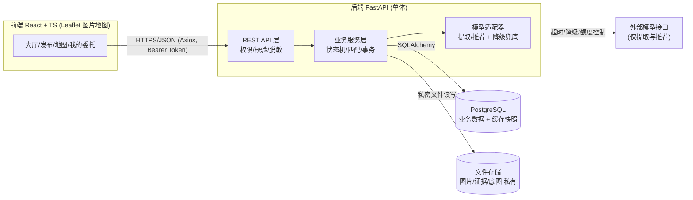
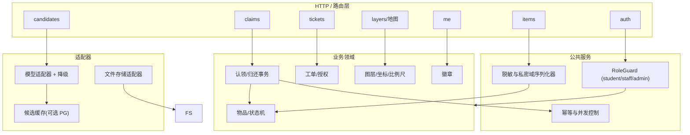
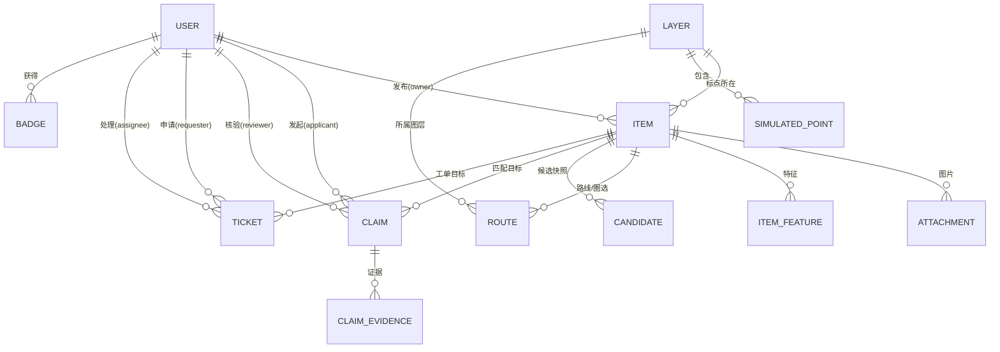
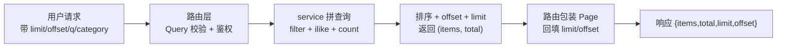

# 校园寻物局 · 阶段2架构设计说明书（v1.0）

## 0. 文档信息

| 项 | 内容 |
|---|---|
| 项目 | 校园寻物局（校园失物协作平台） |
| 阶段 | 阶段2：架构与开发准备（仅设计，不实现） |
| 特性名 | `campus_lost_found` |
| 写入路径 | `.codeartsdoer/specs/campus_lost_found/design.md` |
| 上游输入 | 已确认需求规格 `spec.md` v1.0（2026-10-03） |
| 状态 | v1.0（2026-10-03） |
| 图表约定 | mermaid |

**边界声明**：本项目为参赛作品，当前仓库为空目录（0 源文件），从零搭建。本文不实现产品功能，不产生业务代码、开发记录与测试结果。所有需求依据来自已确认的 `spec.md`，未证实判断沿用其 `[假设]` 标记。

---

# 一、需求与存量功能关系分析

## 1.1 存量资产盘点

| 资产 | 说明 | 约束 |
|---|---|---|
| 源码仓库 | 空目录，无既有业务代码 | 全部功能为新增 |
| 需求规格 `spec.md` | 阶段1已确认 v1.0 | 四套状态机、权限边界、10 条假设、EARS 验收为设计唯一依据 |
| 规划文档 `competition-plan/` | README、阶段提示词、评分验收清单、记录模板、Rules/Skill 设计稿 | Rules/Skill 原文依据 |
| 码道配置 | `rule/metadata.properties` 仅 `projectExpert=[]` | Rules/Skill 由团队按官方文档配置 |

**结论**：本次为纯增量设计，不涉及存量和存量改造。

---

# 二、增量设计方案

## 2.1 总体架构关系

### 2.1.1 架构原则

- **单体架构**（前后端分离）：一个 FastAPI 后端、一个 React 前端、一个 PostgreSQL，不引入微服务、独立向量数据库、消息队列、真实视频。
- **后端为唯一权威**：权限、状态机、脱敏、比例尺门控、事务全部后端强制。
- **AI 为旁路增强**：特征提取与候选推荐可整体降级为手动/规则，故障不阻断主流程。
- **分层可增量落地**：先业务闭环（阶段3），再加地图（阶段4）与 AI（阶段5），工单协作（阶段6）。

### 2.1.2 上下文视图



| 组件 | 职责 | 关键约束 |
|---|---|---|
| 前端 React | 渲染大厅/地图/表单/委托页 | 不放密钥；不自行判断权限 |
| 后端 FastAPI | 认证鉴权、状态机、事务、脱敏、比例尺门控、幂等 | 权限判断在服务端；私密字段不进公共响应 |
| PostgreSQL | 业务实体 + 文件元数据 + 候选缓存快照 | 事务保证同一物品仅一次归还 |
| 文件存储 FS | 图片、认领证据、底图 | 受控接口发放，不暴露目录 |
| 模型适配器 AIHW | 特征提取 + 候选推荐 | 仅提取与推荐，超时降级 |

## 2.2 服务/组件总体架构

### 2.2.1 后端分层模块



| 模块 | 职责 | 归属 |
|---|---|---|
| `auth`、`RoleGuard` | 注册、登录、JWT、角色权限 | B |
| `items` | 发布、筛选、详情脱敏 | B |
| `layers/map` | 图层版本、归一化坐标、比例尺标定、点位 | B/A |
| `claims` | 认领、核验、交接、归还事务、幂等 | B |
| `tickets` | 工单状态机、接单、授权、反馈 | B |
| `candidates/feature` | 特征提取、候选匹配、来源标识、降级 | C |
| `me/badges` | 我的委托聚合、徽章去重 | B |
| 前端 map/leaflet | 渲染、坐标换算、画圈/路线、米数门控 | A |
| 前端交互 | 表单、筛选、状态展示、权限提示 | A |
| 评估/证据/演示 | 匹配评估、证据卡、演示脚本 | C |

### 2.2.2 模型接口适配（旁路，可降级）

| 能力 | 输入 | 输出 | 失败行为 |
|---|---|---|---|
| 特征提取 | 图片（可选）+ 文字 | 结构化标签/描述片段 | 留空，允许手动描述继续 |
| 候选推荐 | 已确认特征 + 候选库 | ≤3 候选 + 解释 + 来源标识 | 降级规则推荐或空候选 |

| 模型故障场景 | 系统行为 | 阻断主流程 |
|---|---|---|
| 未配置 Key | 跳过，来源标"规则推荐/空" | 否 |
| 超时 | 返回规则推荐或空候选 | 否 |
| 解析失败/额度耗尽 | 同上 + 记录告警 | 否 |
| 结果含他者私密信息 | 后端过滤 | 否 |
| 模型尝试批准/归还 | 接口层拒绝（模型无写路由） | — |

## 2.3 数据模型

### 2.3.1 设计目标
支撑四套状态机 + 双向匹配 + 工单协作 + 私密域隔离；术语与 spec.md 严格一致；并发可闭合、可幂等、可溯源。私密字段公开序列化时剥离。

### 2.3.2 实体关系图



### 2.3.3 实体与字段
主键统一 UUID，时间戳 `created_at/updated_at`。私密字段：联系方式、精确位置、证据、路线。

**① `user`**：`id` UUID PK；`username` varchar(64) UNIQUE；`password_hash` text（哈希）；`role` enum(student/staff/admin)；`display_name` varchar(64)；`contact` text（私密）；`created_at`。注册接口强制拒绝 `role≠student`。

**② `layer`**：`id`；`name` varchar(64) UNIQUE；`image_path` text；`version` varchar(32)；`width/height` int；`scale_calibrated` boolean DEFAULT false；`pixels_per_meter` numeric（仅标定后）。未标定 ⇒ `pixels_per_meter IS NULL` ⇒ 不输出米数。

**③ `item`**：`id`；`direction` enum(lost/found)；`category` varchar(32)；`title` varchar(128)；`description` text（公开）；`location_area` varchar(128)（楼层级脱敏公开）；`precise_location` text（私密）；`time_occurred` timestamptz NULLABLE；`status` enum；`owner_user_id` FK→user；`layer_id` FK→layer NULLABLE；`norm_x/norm_y` numeric [0,1]；`is_simulated` boolean（模拟点位标识）；`source` enum(manual/rule/cache/model)；`created_at/updated_at`。
status：lost=`寻找中/核验中/已找回/已撤销`；found=`待认领/核验中/已归还/已撤销`。

**④ `attachment`**：`id/item_id`；`file_path` text；`is_evidence` boolean；`created_at`。

**⑤ `item_feature`**：`id/item_id`；`labels` jsonb；`extracted_text` text；`source` enum(manual/model)；`confirmed` boolean（确认后参与匹配）；`confidence` numeric（仅展示）。

**⑥ `route`**：`id/item_id/layer_id`；`kind` enum(polyline/circle)；`geometry` jsonb（归一化点序列 或 `{cx,cy,r}`）；`floor_segments` jsonb（分层路线）；`is_private` boolean 默认 true；`authorized` boolean。

**⑦ `simulated_point`**：`id/layer_id`；`label` varchar(64)；`norm_x/norm_y` numeric；`is_simulated` boolean 恒 true；`description` text；`created_by` FK→user。

**⑧ `claim`**：`id`；`found_item_id` FK→item；`lost_item_id` FK→item NULLABLE；`applicant_user_id` FK→user；`reviewer_user_id` FK→user NULLABLE；`status` enum(待审核/已通过/已拒绝/已完成)；`idempotency_key` varchar(64) UNIQUE；`reviewed_at/completed_at` timestamptz NULLABLE。

**⑨ `claim_evidence`**：`id/claim_id`；`kind` enum(image/text)；`content` text；`created_at`。仅发布者本人 + 该单处理 staff 可见。

**⑩ `ticket`**：`id/item_id`；`requester_user_id` FK→user（仅本人申请）；`assignee_user_id` FK→user NULLABLE；`status` enum(待接单/处理中/已反馈)；`route_authorized` boolean DEFAULT false；`result` text；时间戳。

**⑪ `badge`**：`id/user_id`；`kind` varchar(32)；`awarded_at`。`UNIQUE(user_id, kind)` 防重复。

**⑫ `candidate`**：`id/lost_item_id/found_item_id`；`score` numeric（仅排序）；`explanation` text；`source` enum(simulated/rule/cache/model)；时间戳。

## 2.4 核心接口清单

### 2.4.1 约定
基路径 `/api/v1`；`Authorization: Bearer <JWT>`；错误结构 `{code, message, details?}`；`RoleGuard` 后端注入；脱敏由序列化器统一执行。

| 状态码 | code | 语义 |
|---|---|---|
| 400 | VALIDATION | 参数缺失 |
| 401 | UNAUTH | 未登录 |
| 403 | FORBIDDEN | 越权 |
| 404 | NOT_FOUND | 不存在 |
| 409 | STATE_CONFLICT | 非法流转/重复归还 |
| 422 | PRECONDITION | 前置不满足（未标定比例尺） |
| 503 | MODEL_UNAVAILABLE | 模型降级（不阻断） |

### 2.4.2 接口分组

**A. 认证用户**：`GET /auth/me`；`POST /auth/register`（禁止 role 字段，带 staff/admin⇒403）；`POST /auth/login`；`POST /admin/staff`（仅 admin）。

**B. 发布筛选**：`POST /items`（权限 student；后置 lost→寻找中/found→待认领）；`GET /items`（筛选，脱敏概览，绝不含 precise_location/contact/evidence/route）；`GET /items/{id}`（公开字段，本人或授权 staff 追加私密字段）。

**C. 地图**：`GET /layers`（含 version）；`GET /layers/{id}/image`；`GET /layers/{id}/points`（is_simulated 必标记）；`POST /items/{id}/map-anchor`（仅发布者本人）；`POST /layers/{id}/calibrate`（仅 admin）。

**D. 特征与候选（AI，实验）**：`POST /items/{id}/extract`（模型不可用返回空 + 503）；`GET /items/{id}/candidates`（≤3 条，source 四类，仅发布者本人，降级规则/空）。

**E. 核验归还**：`POST /claims`（证据必填，幂等键）；`POST /claims/{id}/review`（仅 staff）；`POST /claims/{id}/complete`（仅 staff；后置 claim已完成/lost已找回/found已归还；同一物品仅一次，重复⇒409）。

**F. 工单**：`POST /tickets`（仅本人）；`POST /tickets/{id}/assign`（仅 staff）；`POST /tickets/{id}/authorize-route`（仅发布者本人）；`GET /tickets/{id}/route`（发布者或已授权已分配 assignee，否则 403）；`POST /tickets/{id}/feedback`（仅 assignee）。

**G. 我的委托与徽章**：`GET /me/items`、`GET /me/claims`、`GET /me/tickets`、`GET /me/badges`。

### 2.4.3 权限矩阵速查

| 接口 | student | staff | admin |
|---|---|---|---|
| 发布/认领申请/转工单 | ✓（本人） | ✓（本人） | ✓ |
| 核验/归还/接单/反馈 | ✗ | ✓ | ✓ |
| 创建 staff / 标定比例尺 | ✗ | ✗ | ✓ |
| 查看他人私密 | ✗ | 仅授权+分配 | ✓ |

## 2.5 模块任务表与三人责任

| 序号 | 模块任务 | 前置 | 责任 |
|---|---|---|---|
| T1 | 后端骨架：FastAPI+SQLAlchemy+Alembic+Pydantic | — | B |
| T2 | 认证鉴权 + 角色守卫 + 脱敏序列化 | T1 | B |
| T3 | 物品发布/列表/详情 + 状态机骨架 | T2 | B |
| T4 | 认领提交/核验/归还事务 + 幂等 | T3 | B |
| T5 | 前端工程 + 通用组件 | T2 | A |
| T6 | 大厅/发布/认领/我的委托页 | T3,T5 | A |
| T7 | 图层/底图/归一化坐标/标定/点位后端 | T1 | B |
| T8 | Leaflet 图片地图 + 缩放/标点/画圈/分层路线 | T7 | A |
| T9 | 特征提取适配器 + 降级兜底 | T3 | C |
| T10 | 候选匹配 + 四类来源标识 + 候选缓存 | T9 | C |
| T11 | 工单状态机 + 接单/授权/反馈后端 | T1 | B |
| T12 | 工单协作 UI + 模拟点位 + 核查清单 | T11,T8 | A |
| T13 | 徽章发放去重 + 我的委托聚合 | T4,T11 | B |
| T14 | 匹配评估 + 证据卡 | T10 | C |
| T15 | Docker Compose dev/demo/deploy + 密钥后端化 | T1 | B |
| T16 | Rules/Skill 配置 + 阶段验收 | T1–T15 | C |

关键路径：`T1 → T2 → (T3 → T4) → T5/T6 → T7 → T8 → T9 → T10 → T14 → T11 → T12 → T13 → T15 → T16`。

## 2.6 地图技术约定
1. 3 个固定图层：室外示意图、楼1F、楼2F。
2. `layer.version` 统一，变更递增，前端做缓存失效。
3. 以图片左上角为原点 (0,0)，norm = 像素/尺寸，归一化 [0,1]。
4. 圆形范围：中心 (cx,cy) + 半径 r（归一化）。
5. 分层路线：`floor_segments` 跨层多段线。
6. 比例尺门控：未标定 ⇒ 不返回/不渲染米数，后端返回 422。
7. 模拟点位恒标记"模拟点位"，不宣称真实坐标/覆盖。
8. 版本一致性：地图状态持久化回后端。

## 2.7 归还事务、重复请求与状态冲突
以 `found_item.status` 为闭合点，事务 + 行锁 + CAS：

```
事务开始
1. SELECT ... FOR UPDATE（行锁）
2. 校验 found 且 status='核验中'
3. 校验 claim.status='已通过'
4. UPDATE item SET status='已归还' WHERE id AND status='核验中'（CAS）
5. 关联 lost_item CAS 置 '已找回'
6. UPDATE claim SET status='已完成'
7. 提交；影响行数=0 ⇒ 回滚 409
事务结束
```

幂等：`claim.idempotency_key UNIQUE`；`claim.completed_at` 已存在⇒幂等返回；`badge UNIQUE(user_id,kind)` 去重。四套状态机统一守卫函数校验合法流转，非法流转 409。

## 2.8 开发、演示与部署配置
- `.env.example`/后端 `.env`：密钥仅存后端，`.env` 入 `.gitignore`。
- `docker-compose.dev.yml`（热更新）、`docker-compose.demo.yml`（种子数据+模拟点位+稳定降级）、`docker-compose.prod.yml`（生产镜像+受控卷）。
- 密钥：`DATABASE_URL`、DB 密码、`JWT_SECRET`、`MODEL_API_KEY` 仅存后端；私密证据/联系/路线不进公共接口。
- 演示默认 `MODEL_DISABLED=true` 或降超时，验证模型故障不阻断。

## 2.9 码道项目级 Rules 设计

```text
# 校园寻物局项目约束

技术栈：React＋TypeScript、FastAPI、PostgreSQL、Docker Compose、Leaflet 图片地图，单体架构。

- 工作人员权限在后端检查，不能自行注册获取。
- 公开接口不返回联系方式、私密特征、认领证据或路线。
- 路线默认本人可见，主动授权且工单分配后处理人员可见。
- AI 只提取与推荐，用户确认特征，工作人员核验所有权。
- 同一物品只完成一次归还；相关状态更新具有事务和重复请求处理。
- 模拟点位、规则推荐、缓存结果和实时模型分别标明来源。
- 点位距离不代表覆盖范围，无比例尺的地图不显示米数。
- 密钥只存后端，不出现在代码、日志、截图或对话中。
- 不把私密证据、联系方式或路线作为模型输入。
- 模型故障不阻断手动发布、筛选、核验和归还。
- 不接入真实视频，不增加无关框架、商城、3D或自动追踪。
- 修改业务状态同步检查权限、异常与回归场景。
- 只报告实际执行结果；真实、模拟、目标和未验证项分别标记。
- 需求来自场景分析，未证实判断标为假设；团队模拟不代表真实用户认可。
- 每次任务限定范围，输出改动、实际验证、未解决项和证据索引。
```

## 2.10 "校园业务验收" Skill 设计

**名称**：`校园业务验收`
**触发时机**：变更角色、公开/私密字段、状态、地图保存、模型降级、工单或准备阶段交付时。
**输入**：`spec.md`、验收清单、本次代码差异、可用测试命令及环境。
**输出**：检查表、实际测试结果、可复现问题、未执行原因、最小修复建议。
**流程**：读规格与差异 → 映射验收场景 → 检查权限/状态/事务/图层/模型来源/故障行为 → 执行检查并保留输出 → 失败提供复现与最小修复 → 输出通过/不通过/未执行/不适用（阶段是否通过由人工决定）。

**重点检查矩阵**：

| 范围 | 场景 |
|---|---|
| 权限 | 学生越权、他生读私密、未授权 staff 读路线 |
| 归还 | 未核验即归还、重复提交、多申请、状态冲突 |
| 地图 | 保存刷新、楼层切换、跨层片段、无比例尺 |
| 模型 | 未配置、超时、解析失败、额度耗尽、来源标识 |
| 工单 | 本人申请、分配授权、结果反馈、重复徽章 |
| 真实性 | 目标冒充结果、假设冒充结论、模拟冒充真实 |

**边界**：仅引用已确认清单，不新增业务规则，不自动购买/发布/提交。
---

## 2.11 数据库迁移基线与索引设计（阶段3 · T02 细化）

> 本小节为阶段3编码任务「建立 Alembic 迁移基线，并为常用查询列补索引」的增量设计，对应 `tasks.md` 的 T02。上游依据：`spec.md` 3.3 资源依赖（Alembic）、本 `design.md` 2.3 数据模型与 2.5 T1/T02。硬约束：不改表名/列名/列类型；不改 `backend/tests/conftest.py`（测试继续 `create_all`）。

### 2.11.1 需求与存量功能对比

**本任务开始前的存量现状**：

| 存量项 | 位置 | 说明 |
|---|---|---|
| 12 个 SQLAlchemy 模型 | `backend/app/models/*.py` | user / badge / item / attachment / item_feature / route / candidate / layer / simulated_point / claim / claim_evidence / ticket，均已定义 |
| Alembic 环境 | `backend/alembic/env.py` | `target_metadata = Base.metadata`，连接取自 `get_settings().database_url`；但 `versions/` 无任何迁移版本，schema 无版本追踪 |
| 建表方式 | `seed.py`、`tests/conftest.py` | 依赖 `Base.metadata.create_all` 建表，不产生可回放的迁移历史 |
| 索引现状 | 各模型文件 | 仅个别外键列带 `index=True`，未系统覆盖本任务清单 |

**需求功能对比**：

| 需求功能 | 存量匹配情况 | 判定 |
|---|---|---|
| 8 组常用查询列补索引 | 部分列已带 `index=True`，需系统补齐 17 个索引 | 需扩展 |
| 生成初始迁移基线（12 表 + 全部索引） | `versions/` 为空，无迁移版本 | 需新增 |
| `seed.py` 仅写管理员与图层种子数据 | 现依赖 `create_all` 建表后再写种子 | 需改造 |
| Dockerfile 启动命令「迁移→种子→启动」 | 当前无迁移步骤 | 需改造 |
| README 本地运行步骤增加 `alembic upgrade head` | 当前无迁移步骤 | 需改造 |

### 2.11.2 索引设计

**索引清单（17 个，按表分组）**：

| 表 | 列 | 索引用途 |
|---|---|---|
| item | owner_user_id | 按发布者反查「我的委托」 |
| item | direction | 寻物/拾获方向筛选 |
| item | status | 状态筛选（大厅列表） |
| item | created_at | 列表按时间倒序 |
| claim | found_item_id | 按拾获物品反查认领 |
| claim | lost_item_id | 按寻物物品反查认领 |
| claim | applicant_user_id | 按申请人反查认领 |
| claim | status | 认领状态筛选 |
| claim_evidence | claim_id | 按认领反查证据 |
| ticket | item_id | 按物品反查工单 |
| ticket | requester_user_id | 按申请人反查工单 |
| ticket | assignee_user_id | 按处理人反查工单 |
| ticket | status | 工单状态筛选 |
| route | item_id | 按物品反查路线 |
| simulated_point | layer_id | 按图层反查模拟点位 |
| item_feature | item_id | 按物品反查特征 |
| attachment | item_id | 按物品反查附件 |

**选择依据**：17 列均为「外键列（关联/反查）」或「高频筛选列（status/direction）」或「列表排序列（created_at）」。外键列与常用筛选列加索引是项目代码规范要求（见 `docs/代码规范.md`「外键列和常用筛选列加索引」）。

**实现方式与约束**：仅在对应模型 `mapped_column(...)` 上追加 `index=True`，索引名由 SQLAlchemy 默认生成 `ix_<表>_<列>`（Alembic 用 `op.f()` 规范化）。不新增显式 `Index` 对象，不改列定义、不改表名/列名/列类型。
### 2.11.3 迁移基线设计

**基线形态**：单一初始迁移 `backend/alembic/versions/xxxx_initial_schema.py`，`down_revision = None`。`upgrade()` 按依赖顺序执行 12 张表的 `op.create_table` 与全部 `op.create_index`；`downgrade()` 逆序 `op.drop_index` 与 `op.drop_table`。

**枚举跨库兼容（关键决策）**：模型侧所有枚举列使用 `SAEnum(..., native_enum=False, length=N)`；迁移侧对应生成 `sa.Enum('...', name='...', native_enum=False, length=N)`。效果：

- SQLite（无原生 ENUM）与 PostgreSQL（显式禁用原生 ENUM）下均落为 `VARCHAR(N)` 字符串存储，两种数据库 DDL 行为一致。
- 避免 PostgreSQL 原生 ENUM 类型在 SQLite 下不可用，以及枚举值后续变更需 `ALTER TYPE` 的兼容成本。
- 保证 `alembic check` 判定模型与迁移一致（模型 `SAEnum` 与迁移 `sa.Enum` 参数匹配）。

**主键与默认值**：

- 主键 `sa.Uuid()`：PostgreSQL 落 native UUID，SQLite 落 `CHAR(32)`，由 SQLAlchemy 类型适配，跨库一致。
- 时间戳 `server_default=sa.text('(CURRENT_TIMESTAMP)')`：PostgreSQL 与 SQLite 均支持，与模型 `func.now()` 对齐。

**迁移命令与生命周期**：

| 命令 | 作用 | 使用时机 |
|---|---|---|
| `alembic upgrade head` | 建库/升级到最新版本 | 新环境初始化、容器启动 |
| `alembic downgrade -1` | 回退一步 | 排错 |
| `alembic check` | 校验模型与迁移脚本一致 | 验收 / CI |

**schema 一致性保证**：模型仅追加 `index=True`（不改表名/列名/列类型），因此 `create_all` 与迁移脚本生成相同 schema。测试链路（`conftest.py` 继续 `create_all`）与迁移建库互不冲突，且迁移不依赖数据库外键报错（建表仅声明约束，业务写入前仍由 service 校验引用存在）。

### 2.11.4 启动流程改造

- 改造前：`seed.py`（`create_all` + 写种子）→ 启动服务。
- 改造后：`alembic upgrade head`（建表/升级）→ `python seed.py`（仅写种子）→ `uvicorn`（启动服务）。


**各文件改动边界**：

| 文件 | 改动 |
|---|---|
| `backend/seed.py` | 移除 `create_all`，仅保留幂等种子写入（管理员按 username 存在则跳过；图层按 name 幂等 upsert） |
| `backend/Dockerfile` | `CMD` 改为 `alembic upgrade head && python seed.py && uvicorn app.main:app ...` |
| `README.md` | 本地运行步骤在 `seed.py` 之前插入 `alembic upgrade head` |

### 2.11.5 验收方案

| # | 验收项 | 期望结果 |
|---|---|---|
| 1 | 删除 `backend/demo.db` → `alembic upgrade head` → `python seed.py` → 启动 → 访问 `/api/v1/health` | 全链路成功，health 返回 ok |
| 2 | 再次执行 `alembic upgrade head` | 幂等，不报错（无待应用迁移） |
| 3 | 执行 `alembic check` | 报告模型与迁移一致，无差异 |
| 4 | `pytest tests/ -q` | 后端测试结果不变（`conftest.py` 继续 `create_all`） |

> 说明：`backend/demo.db` 为本地 SQLite 演示库（`scripts/configure_local.py` 生成 `DATABASE_URL=sqlite:///./demo.db`）；`backend/test_pytest.db` 为测试库，二者互不影响，验收仅针对前者。
---

## 2.12 服务层下沉重构设计（阶段3 · T20）

> 本小节为阶段3编码任务「将路由文件中的业务逻辑下沉至服务层」的增量设计，对应 `tasks.md` 的 T20。上游依据：本 `design.md` 2.2.1 后端分层模块（HTTP/路由层与业务领域分离）、`docs/代码规范.md`「分层」一节。目标为纯重构：接口地址、参数、返回内容、状态码、错误信息全部保持不变。

### 2.12.1 现状与目标

**存量现状**：`app/api/v1/` 下路由函数混杂业务判断、查询拼装与事务提交（`db.query`/`db.add`/`db.commit`），违反「路由层只做取参数、鉴权、调用、返回」的分层约定。

**目标结构**：

| 层 | 职责 | 本次改动 |
|---|---|---|
| `app/api/v1/` | 解析请求、鉴权依赖、调用 service、返回 schema | 移除业务逻辑，仅保留路由职责 |
| `app/services/` | 业务规则、状态流转、事务 | 新增，承接下沉逻辑 |

### 2.12.2 服务划分

| 新建文件 | 承接来源 | 职责 |
|---|---|---|
| `item_service.py` | `items.py` | 物品创建/列表/详情/标点/路线/特征提取/候选获取 |
| `claim_service.py` | `claims.py` | 认领创建/审核/完成三段逻辑及辅助函数 |
| `ticket_service.py` | `tickets.py` | 工单列表/创建/接单/授权路线/查路线/反馈 |
| `matching_service.py` | `items.py` 候选打分 | 导出 `find_candidates`，输入寻物记录返回 ≤3 候选 |
| `user_service.py` | `auth.py` + `admin.py` | 合并「检查用户名存在并创建用户」 |

### 2.12.3 关键约束

- `claim_service.py` 中 `serialize_claim_mutation`、`lock_items`、`replay`、`restore_unclaimed`、`editable_claim` 及创建/审核/完成逻辑原样搬移，加锁顺序、flush/commit 位置、条件更新语句不变。
- 不改 `tests/`、`models/`、`schemas/`；不新增依赖；不顺手优化其他问题。
- 验收：测试仍 18 通过 1 跳过；`ruff check` 无报错；五个路由文件不再出现 `db.query`/`db.add`/`db.commit`。
---

## 2.13 接口响应模型、列表分页与大厅搜索设计

> 本小节为「给所有接口补响应模型、列表接口分页、大厅关键词搜索」任务的增量设计。上游依据：`docs/代码规范.md`「接口」一节（列表接口统一 `limit`/`offset`、返回 `items/total/limit/offset`、每个接口声明 `response_model`）、`spec.md` 3.1 大厅功能（按类别/地点/时间/状态筛选）。本任务会改变列表接口返回结构，前端调用与测试同步适配。硬约束：`precise_location` 仅对发布者本人返回；分页参数越界返回 400（而非 FastAPI 默认 422）。

### 2.13.1 需求与存量功能对比

| 需求功能 | 存量实现 | 代码位置 | 匹配度 |
|---|---|---|---|
| 泛型分页模型 Page | `Page[T]`（items/total/limit/offset） | `backend/app/schemas/common.py:4` | 100% |
| GET /items 分页 + limit/offset | `response_model=Page[ItemPublic]`，`Query(20, ge=1, le=100)`、`Query(0, ge=0)` | `backend/app/api/v1/items.py:22` | 100% |
| GET /claims 分页 | `response_model=Page[ClaimOut]`，仅 staff | `backend/app/api/v1/claims.py:16` | 100% |
| GET /tickets 分页 | `response_model=Page[TicketOut]` | `backend/app/api/v1/tickets.py:16` | 100% |
| GET /me/items、/me/claims、/me/tickets 分页 | 三接口均 `Page[...]` | `backend/app/api/v1/me.py:17/28/39` | 100% |
| GET /items 关键词 q | `ilike` 匹配 title/description/category | `backend/app/services/item_service.py:56` | 100% |
| category 改模糊匹配 | `Item.category.ilike(f"%{category}%")` | `backend/app/services/item_service.py:61` | 100% |
| 8 个接口补齐 response_model | 均已声明 | 见 2.13.5 清单 | 100% |
| precise_location 仅发布者可见 | 详情按 owner 判断，非本人置 None | `backend/app/services/item_service.py:99` | 100% |
| 前端读取 items、types Page | 页面读 `.data.items`；`Page<T>` 已定义 | `frontend/src/types.ts:5`、各页面 | 100% |
| 测试适配与新增 | `test_pagination.py` 4 用例；`test_acceptance.py` 读 items | `backend/tests/` | 100% |

**结论**：本任务所有改动点已在代码中落地，本节作为该实现方案的归档设计，记录关键决策与接口契约，便于后续回归与评审，不新增实现工作。

### 2.13.2 分页模型设计

**泛型模型** `Page[T]`（`backend/app/schemas/common.py`）：

| 字段 | 类型 | 说明 |
|---|---|---|
| `items` | `list[T]` | 当前页数据，T 由各列表接口指定（ItemPublic/ClaimOut/TicketOut） |
| `total` | `int` | 满足筛选条件的总条数（供前端未来翻页） |
| `limit` | `int` | 本次请求每页条数，回显 |
| `offset` | `int` | 本次请求偏移量，回显 |

**设计要点**：
- 采用 Pydantic v2 泛型（`class Page[T](BaseModel)`，项目 pydantic 2.13 支持 PEP 695 语法），`items` 元素类型由 T 在声明处静态确定，杜绝 `Any` 与手写字典。
- `total` 在应用 offset/limit **之前**用 `query.count()` 计算，是「过滤后全集条数」而非「当前页条数」；`limit/offset` 回显请求值，便于前端与日志定位分页状态。
- 分页排序统一 `created_at` 倒序（claims 追加 `id` 作稳定二级排序），保证翻页稳定、不重不漏。

### 2.13.3 列表接口分页改造

| 接口 | 返回 | limit/offset | 排序 |
|---|---|---|---|
| GET /items | Page[ItemPublic] | Query(20, ge=1, le=100) / Query(0, ge=0) | created_at desc |
| GET /claims | Page[ClaimOut] | 同上 | created_at desc, id |
| GET /tickets | Page[TicketOut] | 同上 | created_at desc |
| GET /me/items | Page[ItemPublic] | 同上 | created_at desc |
| GET /me/claims | Page[ClaimOut] | 同上 | created_at desc |
| GET /me/tickets | Page[TicketOut] | 同上 | created_at desc |



**校验与错误**：
- `limit` 超出 1~100、`offset` 小于 0 由 FastAPI `Query(ge=..., le=...)` 触发 `RequestValidationError`；`app/errors.py:42` 的处理器统一转为 **400 / VALIDATION**，满足代码规范「参数错 400」，避免默认 422。
- 列表接口均保留鉴权（`get_current_user`）；claims 列表仍仅 staff/admin（`require_role(Role.staff)`）；tickets 列表对非 staff 在服务层按 `requester_user_id` 自动过滤。

**服务层签名**：`list_items/list_claims/list_tickets/list_my_*` 统一返回 `tuple[list[T], int]`（数据 + total），路由层负责包装为 `Page` 并回填 limit/offset，职责边界与「路由只取参/鉴权/调用/返回」分层约定一致。

### 2.13.4 大厅关键词搜索

GET /items 新增 `q` 参数，`category` 由精确匹配改为模糊匹配：

| 参数 | 匹配方式 | 匹配字段 |
|---|---|---|
| `q` | `ilike`（不区分大小写） | title、description、category（OR 关系） |
| `category` | `ilike`（模糊） | category |
| `location_area` | `ilike`（模糊） | location_area |

**设计要点**：
- 用 SQLAlchemy `ilike(f"%{kw}%")` 实现不区分大小写包含匹配；多字段用 `or_` 组合。
- `q` 与 `direction/status` 等筛选为 AND 关系，可叠加。
- 关键词为空串时跳过该条件（`if q:`），不产生空匹配子句。
- 搜索仅作用于公开概览字段（title/description/category），不触及 precise_location 等私密字段，符合隐私约束。

### 2.13.5 响应模型补齐清单

为原先直接返回字典的接口声明 `response_model`，字段与现有返回完全一致：

| 接口 | 响应模型 | 关键字段 |
|---|---|---|
| GET /items/{id} 物品详情 | `ItemDetail` | 公开字段 + is_owner + norm/layer + precise_location（仅 owner 非空） |
| POST /items/{id}/map-anchor 设置标点 | `MapAnchorOut` | ok |
| POST /items/{id}/route 创建路线 | `RouteOut` | id、kind、is_private |
| GET /items/{id}/route 查询路线 | `list[RouteDetail]` | id、kind、geometry、floor_segments、is_private、authorized |
| POST /items/{id}/extract 特征提取 | `FeatureExtractionOut` | labels、extracted_text、confidence、source、degraded |
| GET /items/{id}/candidates 候选列表 | `list[CandidateOut]` | found_item_id、score、explanation、source、title、category、location_area |
| GET /me/badges 我的徽章 | `list[BadgeOut]` | id、kind、awarded_at |
| GET /tickets/{id}/route 工单路线 | `list[TicketRouteOut]` | id、kind、geometry、floor_segments |

**设计要点**：
- 服务层返回 dict 中枚举字段以 `.value` 字符串传出，Pydantic 校验时还原为对应枚举，响应 JSON 仍是字符串值，对外契约不变。
- `precise_location` 在 `get_item_detail` 按 `item.owner_user_id == user.id` 判断：非发布者恒为 `null`，发布者返回原文；`is_owner` 字段独立表达归属，二者解耦，便于前端展示。
- 列表模型 `ItemPublic` **不含** `precise_location` 字段，公开列表永不泄露精确位置。

### 2.13.6 前端适配

| 改动 | 位置 |
|---|---|
| 新增泛型 `Page<T>` 类型 | `frontend/src/types.ts:5` |
| 大厅读 `.data.items` + q 搜索输入 | `frontend/src/pages/Home.tsx` |
| 我的委托读三接口 `.data.items` | `frontend/src/pages/MyDelegations.tsx` |
| 认领审核读 `.data.items` | `frontend/src/pages/StaffClaims.tsx` |
| 工单页读 `.data.items` + Page 断言 | `frontend/src/pages/Tickets.tsx` |

**设计要点**：
- 本任务不做翻页 UI，页面仍一次取默认 limit=20 的结果，仅将读取位置从数组改为 `.items`，保证现有功能不变。
- 前端类型与后端 schema 对齐：`Item` 增加可选 `precise_location`、`is_owner`；`Page<T>` 字段与后端一致。

### 2.13.7 测试设计

**现有用例适配**：`test_acceptance.py` 中读取列表的断言由 `r.json()[0]` 改为 `r.json()["items"][0]`（如 `test_private_fields_not_in_public_list`），断言内容不变。

**新增用例**（`backend/tests/test_pagination.py`）：

| 用例 | 覆盖要求 |
|---|---|
| test_list_items_pagination_applies_limit_and_offset | limit/offset 生效，total 正确，越界页返回空 items |
| test_list_items_limit_over_100_returns_400 | limit=101 返回 400 |
| test_list_items_keyword_search_matches_title_description_category | q 命中标题/描述/类别，且不区分大小写 |
| test_item_detail_precise_location_hidden_from_non_owner | 发布者可见 precise_location，他人为 null |

### 2.13.8 验收方案

| # | 验收项 | 期望 |
|---|---|---|
| 1 | 后端 `pytest tests/ -q` | 全部通过（含新增 4 用例）；PostgreSQL 并发用例按环境跳过 |
| 2 | 后端 `ruff check .` | 无报错 |
| 3 | 前端 `npm run lint` 与 `npm run build` | 通过 |
| 4 | 打开 `/docs` | 上述接口均展示 Page 响应结构与 8 个补齐的响应模型 |