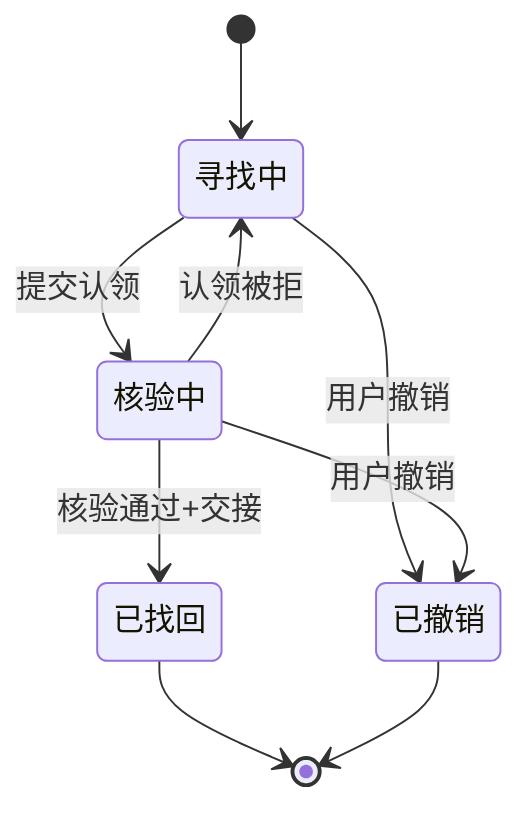
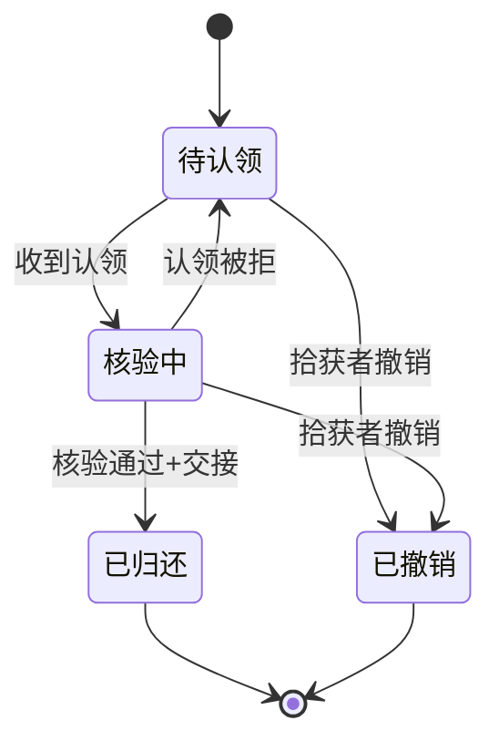
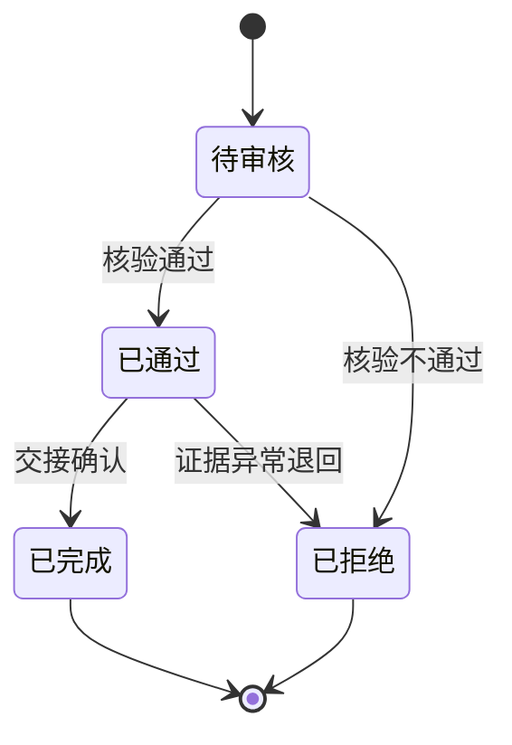
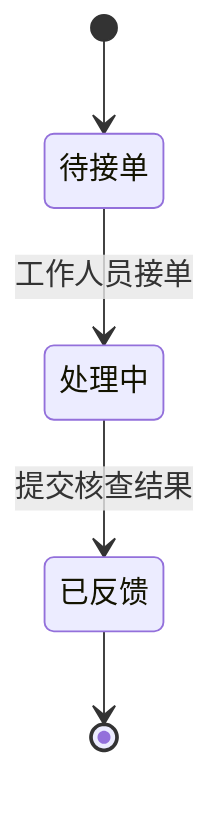

# 校园寻物局 · 阶段1需求规格说明书（已确认 v1.0）

## 0. 文档信息与约定

| 项 | 内容 |
|---|---|
| 项目 | 校园寻物局（校园失物协作平台） |
| 阶段 | 阶段1：需求规格设计（仅规格，不实现） |
| 特性名 | `campus_lost_found` |
| 写入路径 | `.codeartsdoer/specs/campus_lost_found/spec.md` |
| 状态 | 已确认 v1.0（2026-10-03） |

**EARS 约定**：触发关键字与固定短语保持英文（`When`/`While`/`If`/`Where`/`The … shall`），事件、前置条件、响应等可变部分本地化为中文；默认主语为 `the 系统`，必要时替换为具体模块名。

**假设与证据约定**：
- 全文以 `[假设]` 标记未证实内容；团队推断不得改写为真实用户结论。
- 团队角色模拟仅验证内部流程，不代表真实用户试用或校方认可；外部人员参与不作为阶段前置条件。
- 不接入真实监控，不编造需求依据、开发记录、使用记录与测试结果。

---

## 1. 需求假设表

| 编号 | 假设 | 设计依据 | 对应功能 | 验证方式 | 剩余不确定性 |
|---|---|---|---|---|---|
| A1 | 地图点位为「模拟点位」，非真实校园坐标 [假设] | 约束5、7 | 地图标点、协助工单核查清单 | 点位数据带「模拟」标识并在界面明示 | 模拟点位与真实校园布局的映射精度 |
| A2 | 候选匹配不训练模型，仅调用/规则推荐 [假设] | 「不训练模型、不增加独立向量数据库」 | 发布与匹配 | 候选来源可标识；无训练环节 | 模型外部接口的可用性与响应时延 |
| A3 | 学生可自助注册，工作人员账号须由管理员创建 [假设] | 约束「工作人员角色不能自行注册获取」 | 注册、角色、权限 | 以工作人员身份自助注册被拒绝 | 初始管理员账号的产生与发放方式 |
| A4 | 比例尺仅在用户完成标定后启用，未标定不显示米数 [假设] | 约束6 | 地图圈选、路线距离 | 未标定地图上不出现米数 | 标定动作由谁触发（管理员/发布者） |
| A5 | 图片/文字提取仅用于候选生成，不参与审批决策 [假设] | 约束3 | 发布与匹配 | 提取结果仅作候选，审批仍由工作人员执行 | 提取质量偏低时的兜底策略 |
| A6 | 缓存与实时模型结果须在界面区分标识 [假设] | 约束5 | 候选推荐列表 | 候选条目带来源标识 | 缓存失效策略（暂缓/待定） |
| A7 | 认领证据与联系信息存于后端私密域，不进入公共接口 [假设] | 约束2 | 认领归还、私密证据 | 公共接口响应不含证据与联系方式 | 证据存储加密级别 |
| A8 | 「同一物品只能归还一次」以物品标识为闭合依据 [假设] | 约束4 | 认领归还、关闭记录 | 对已完成物品再次归还被拒绝 | 多份同类物品（多把雨伞）的区分方式 |
| A9 | 路线默认私密，仅在发布者主动授权且工单分配后可见 [假设] | 约束9 | 协助工单、授权线索 | 未授权时处理人员无法访问路线 | 授权的撤销粒度与时机 |
| A10 | 模型故障降级为手动流程，不阻断主流程 [假设] | 约束8 | 发布、筛选、归还 | 模型不可用时手动发布/筛选/归还仍可完成 | 降级提示文案与超时阈值 |

---

## 2. 现状分析

### 2.1 现有信息发布与查找流程可能存在的问题（未证实判断均标为假设）

1. 失物信息分散于线下登记、公告栏、群聊，缺乏统一入口，时效差、检索难 [假设]。
2. 寻物与拾获分属两套信息流，缺乏双向匹配，靠人工比对效率低、易漏 [假设]。
3. 认领缺乏私密证据核验机制，存在冒领风险，且无法追踪核对记录 [假设]。
4. 归还状态缺少闭环，物品是否归还、认领是否完成无据可查 [假设]。
5. 缺乏地图定位与路线线索，无法通过"经过路线"缩小查找范围 [假设]。
6. 联系信息与认领证据无权限隔离，未经授权即可被查看，隐私保护不足 [假设]。
7. 权限控制未在服务端强制，易被前端绕过 [假设]。

### 2.2 四类典型场景

> 每场景按「角色 / 输入 / 操作 / 结果 / 异常 / 隐私要求」六要素描述。

#### 场景一：明确知道丢失地点
- **角色**：学生（失主）
- **输入**：丢失物品图片、文字描述、地点（如"图书馆2F 自习室"）、大致时间
- **操作**：发布寻物 → 系统提取图片/文字 → 失主确认 → 系统按地点匹配拾获候选 → 查看候选 → 提交认领证据 → 工作人员核验 → 交接归还
- **结果**：寻物置「已找回」、拾获置「已归还」、认领置「已完成」，记录关闭
- **异常**：无候选 → 引导转协助工单；认领被拒 → 寻物回到「寻找中」
- **隐私要求**：证据与联系方式仅失主本人和该单处理人员可见；地点按楼层级脱敏公开

#### 场景二：只记得经过路线
- **角色**：学生（失主）
- **输入**：经过路线（途经点）、时间段、物品描述
- **操作**：在地图上绘制经过路线 → 系统记录分层路线 → 匹配途经区域的拾获记录 → 生成候选 → 提交认领
- **结果**：有候选则进入认领闭环；无候选则转协助工单
- **异常**：路线区域未标比例尺 → 不输出米数；点位存在偏移
- **隐私要求**：路线默认私密，仅失主可见；**仅当失主主动授权且工单分配后**，处理人员方可访问

#### 场景三：已拾获等待认领
- **角色**：学生（拾获者）
- **输入**：拾获物品图片、地点、时间
- **操作**：发布拾获 → 系统反向匹配寻物候选 → 拾获者等待 → 失主提交认领 → 工作人员核验 → 归还交接
- **结果**：拾获记录置「已归还」、寻物置「已找回」
- **异常**：长时间无人认领 → 保持「待认领」；证据不符 → 认领被拒绝
- **隐私要求**：拾获者联系方式私密不公开；物品概览（类别+脱敏地点）公开

#### 场景四：直接匹配失败需要协助
- **角色**：学生（发布者）触发，工作人员处理
- **输入**：发布内容 + "匹配失败/无候选"结果
- **操作**：系统引导转协助工单 → 工单「待接单」→ 工作人员接单「处理中」→ 失主授权路线 → 查看模拟点位与核查清单 → 现场核查 → 反馈结果
- **结果**：工单「已反馈」；若发现物品则回归认领归还闭环
- **异常**：无人接单 → 保持「待接单」；核查无果 → 反馈"未找到"
- **隐私要求**：授权范围最小化，路线/模拟点位仅授权后的处理人员可见

---

## 3. 需求规格

### 3.1 必做功能（第一版范围）

| 模块 | 内容 |
|---|---|
| 注册与角色 | 学生自助注册；工作人员由管理员创建（不可自注册）；权限后端强制 |
| 大厅 | 寻物/拾获列表；按类别、地点、时间、状态筛选；条目关联地图 |
| 地图 | 一个室外示意图 + 一栋楼两层；缩放、标点、室外画圈、分层路线 |
| 发布 | 寻物/拾获发布；图片与文字提取；用户确认 |
| 匹配 | 最多三个候选及解释；来源标识（模拟点位/规则推荐/缓存/实时模型结果） |
| 认领归还 | 私密证据提交；工作人员核验；交接确认；关闭记录；同一物品仅归还一次 |
| 协助工单 | 接单、授权线索、模拟点位、核查清单、结果反馈 |
| 我的委托 | 本人发布/申请/协助进度；轻量协助徽章 |
| 状态机 | 寻物/拾获/认领/工单四套状态及合法流转（见第4章） |
| 权限与隐私 | 后端强制执行；路线默认私密；证据与联系方式不进入公共接口；AI仅提取与推荐 |

### 3.2 暂缓功能（本阶段不纳入）
真实视频、人脸识别、自动追踪、3D 校园、全校楼层、开放聊天、积分商城。

### 3.3 资源依赖
- 从头搭建前后端（当前为空目录）。
- **固定技术栈**：React＋TypeScript、FastAPI、PostgreSQL、Docker Compose、Leaflet 图片地图；单体架构，不训练模型、不增加独立向量数据库。
- **模型依赖**：仅调用/规则推荐，不训练；外部模型接口可用性为依赖项（见 A2）。
- **底图依赖**：一栋楼两层示意图需自备，不依赖真实监控/真实地图。
- 工作人员账号由管理员分配（见 A3）；比例尺由标定动作启用（见 A4）。

---

## 4. 状态定义与状态机

### 4.1 寻物（Lost）
状态集：`寻找中`（初始）、`核验中`、`已找回`（终）、`已撤销`（终）

| 源状态 | 目标状态 | 触发事件 |
|---|---|---|
| 寻找中 | 核验中 | 提交认领申请进入核验 |
| 寻找中 | 已撤销 | 用户主动撤销（未闭环） |
| 核验中 | 已找回 | 核验通过 + 归还交接完成 |
| 核验中 | 寻找中 | 核验不通过（认领被拒） |
| 核验中 | 已撤销 | 用户主动撤销（无已通过认领） |
| 已找回 / 已撤销 | — | 终态，不可再变 |

### 4.2 拾获（Found）
状态集：`待认领`（初始）、`核验中`、`已归还`（终）、`已撤销`（终）

| 源状态 | 目标状态 | 触发事件 |
|---|---|---|
| 待认领 | 核验中 | 收到认领申请 |
| 待认领 | 已撤销 | 拾获者撤销 |
| 核验中 | 已归还 | 核验通过 + 交接完成 |
| 核验中 | 待认领 | 认领被拒，回到待认领 |
| 核验中 | 已撤销 | 拾获者撤销（无已通过认领） |
| 已归还 / 已撤销 | — | 终态，不可再变 |

### 4.3 认领（Claim）
状态集：`待审核`（初始）、`已通过`、`已拒绝`（终）、`已完成`（终）

| 源状态 | 目标状态 | 触发事件 |
|---|---|---|
| 待审核 | 已通过 | 工作人员核验通过 |
| 待审核 | 已拒绝 | 工作人员核验不通过 |
| 已通过 | 已完成 | 归还交接确认 |
| 已通过 | 已拒绝 | 交接前发现证据异常（异常兜底） |
| 已拒绝 / 已完成 | — | 终态，不可再变 |

### 4.4 工单（Ticket）
状态集：`待接单`（初始）、`处理中`、`已反馈`（终）

| 源状态 | 目标状态 | 触发事件 |
|---|---|---|
| 待接单 | 处理中 | 工作人员接单 |
| 处理中 | 已反馈 | 提交核查结果 |
| 已反馈 | — | 终态，不可再变（第一版支持顺向流转，不支持工单撤销） |

---

## 5. 角色权限与信息可见性

### 5.1 角色

| 角色 | 获取方式 | 核心权限 |
|---|---|---|
| 学生 | 自助注册 | 发布寻物/拾获、发起认领、申请协助、查看本人委托、授权路线 |
| 工作人员 | 管理员创建（**禁止自助注册**） | 接单、授权后查看线索、核验认领、确认归还、关闭记录、反馈工单 |
| 管理员（假设） | 系统初始化/引导创建 [假设] | 创建工作人员账号、标定地图比例尺 [假设] |

### 5.2 权限边界（后端强制）
- 学生与工作人员权限必须在后端执行，前端仅做展示，前端越权请求后须被拒绝。
- 模型（AI）只能**提取与推荐**，**禁止**批准认领、禁止确认归还。

### 5.3 公开信息
任一已登录用户可见：
- 寻物/拾获概览：物品类别、楼层级脱敏地点、时间段、状态。
- 物品外观简述（不含精确位置、联系方式、证据）。

### 5.4 私密信息（不进入公共接口）
| 信息 | 可见范围 |
|---|---|
| 认领证据（图片/文字） | 仅发布者本人 + 处理该单的工作人员 |
| 联系信息 | 仅相关处理人员，且仅在授权后 |
| 经过路线 | 默认私密；授权且工单分配后，处理人员可见 |
| 工单核查清单/模拟点位 | 仅处理人员 + 工单发布者本人 |

---

## 6. 核心功能验收场景（EARS）

### 6.1 注册与角色
- **正常**：`When` 学生完成注册，`the 系统 shall` 创建学生账号并赋予「学生」角色。
- **正常**：`When` 管理员创建工作人员账号，`the 系统 shall` 赋予「工作人员」角色。
- **权限**：`If` 用户尝试以「工作人员」身份自助注册，`the 系统 shall` 拒绝并提示须由管理员分配。
- **权限**：`While` 用户为学生，`the 系统 shall` 不授予核验、接单、确认归还权限。

### 6.2 发布（寻物/拾获）
- **正常**：`When` 学生提交寻物发布（含类别/地点/时间/描述），`the 系统 shall` 创建寻物记录，状态为「寻找中」。
- **正常**：`When` 学生提交拾获发布，`the 系统 shall` 创建拾获记录，状态为「待认领」。
- **正常**：`When` 发布含图片，`the 系统 shall` 提取图片与文字用于候选生成（仅提取与推荐）。
- **异常**：`If` 必填字段缺失，`the 系统 shall` 拒绝发布并提示补齐。
- **异常**：`If` 模型提取失败，`the 系统 shall` 允许手动填写描述继续发布（不阻断）。
- **权限**：`While` 用户未登录，`the 系统 shall` 拒绝发布请求。

### 6.3 匹配推荐
- **正常**：`When` 寻物发布完成，`the 系统 shall` 生成最多三个拾获候选及解释。
- **正常**：`When` 候选产生，`the 系统 shall` 以「模拟点位/规则推荐/缓存/实时模型结果」分别标识来源。
- **正常**：`When` 用户查看候选，`the 系统 shall` 展示依据但不含他人私密证据与联系信息。
- **异常**：`If` 无候选，`the 系统 shall` 提示可转协助工单。
- **异常**：`If` 模型返回超时，`the 系统 shall` 降级为规则推荐或空候选，不阻断发布。
- **异常**：`If` 模型结果含他者私密信息，`the 系统 shall` 过滤且不展示。
- **权限**：`While` 候选未确认，`the 系统 shall` 不自动批准认领或确认归还。

### 6.4 认领提交
- **正常**：`When` 失主对某拾获记录提交认领，`the 系统 shall` 创建认领申请，状态为「待审核」。
- **正常**：`When` 认领提交含私密证据，`the 系统 shall` 将证据存储于私密域。
- **异常**：`If` 证据缺失，`the 系统 shall` 拒绝提交（证据必填）。
- **权限**：`While` 提交者非该拾获记录发布者，`the 系统 shall` 仍允许提交，但须附证据由工作人员判断。

### 6.5 核验与归还
- **正常**：`When` 工作人员核验通过认领申请，`the 系统 shall` 将认领置为「已通过」并进入交接。
- **正常**：`When` 交接完成确认，`the 系统 shall` 将认领置「已完成」、寻物置「已找回」、拾获置「已归还」。
- **正常**：`When` 一件物品完成一次归还，`the 系统 shall` 关闭该记录并禁止再次归还。
- **异常**：`If` 工作人员核验不通过，`the 系统 shall` 将认领置为「已拒绝」。
- **异常**：`If` 对已完成物品再次发起归还，`the 系统 shall` 拒绝。
- **权限**：`While` 用户为已授权工作人员，`the 系统 shall` 允许核验与确认归还。
- **权限**：`While` 用户为学生，`the 系统 shall` 不授予核验/确认归还权限。
- **权限**：`If` 模型（AI）尝试直接批准认领或确认归还，`the 系统 shall` 禁止（模型无审批权）。

### 6.6 协助工单
- **正常**：`When` 匹配失败或无候选时学生提交协助，`the 系统 shall` 创建工单，状态为「待接单」。
- **正常**：`When` 工作人员接单，`the 系统 shall` 将工单置为「处理中」。
- **正常**：`When` 发布者授权路线，`the 系统 shall` 允许处理人员查看路线与模拟点位（仅授权后）。
- **正常**：`When` 工作人员提交核查结果，`the 系统 shall` 将工单置为「已反馈」。
- **异常**：`If` 长时间无人接单，`the 系统 shall` 保持「待接单」并提示。
- **权限**：`While` 路线未授权，`the 系统 shall` 不向处理人员展示路线。
- **权限**：`While` 工单未分配，`the 系统 shall` 不向任何处理人员暴露路线与线索。

### 6.7 地图交互
- **正常**：`When` 用户缩放/标点，`the 系统 shall` 更新对应图层。
- **正常**：`When` 用户室外画圈，`the 系统 shall` 记录圈选范围。
- **正常**：`When` 用户绘制经过路线，`the 系统 shall` 记录分层路线。
- **异常**：`If` 地图未标定比例尺，`the 系统 shall` 不输出实际米数。
- **标识**：`When` 标点含模拟点位，`the 系统 shall` 标记为「模拟点位」。

### 6.8 我的委托
- **正常**：`When` 用户查看「我的委托」，`the 系统 shall` 展示本人发布/申请/协助的进度。
- **正常**：`When` 用户完成协助贡献，`the 系统 shall` 发放轻量协助徽章。
- **权限**：`While` 用户查看他人委托详情，`the 系统 shall` 仅展示公开信息。

---

## 7. 需求与比赛评分维度对应表

| 评分维度（权重） | 对应需求 | 满足说明 |
|---|---|---|
| **功能完备度（30）** | 大厅、发布匹配、认领归还、协助工单、我的委托、四套状态机、四类场景 | 覆盖"发布→匹配→认领→核验→归还→关闭"主流程闭环及无候选的协助分叉 |
| **码道深度使用（25）** | SDD 分层（spec/design/tasks）、EARS 验收标准、mermaid 状态机建模、模板合规 | 以 CodeArts 规范交付、EARS 可测验收、状态机形式化描述 |
| **专业贴合与创新（25）** | 私密证据核验、路线默认私密+最小授权、AI 仅推荐不决策、四类来源标识、比例尺门控 | 针对校园失物的隐私与信任设计，防冒领、防越权、防模型越界 |
| **技术架构与工程质量（15）** | 固定技术栈、单体架构、权限后端强制、同一物品仅归还一次的并发一致性约束 | 后端强校验、状态闭合保证数据一致性 |
| **交付规范性（5）** | 假设表、来源声明、EARS 格式、版本与路径标注 | 团队推断标 `[假设]`，不伪造依据/记录/测试结果 |