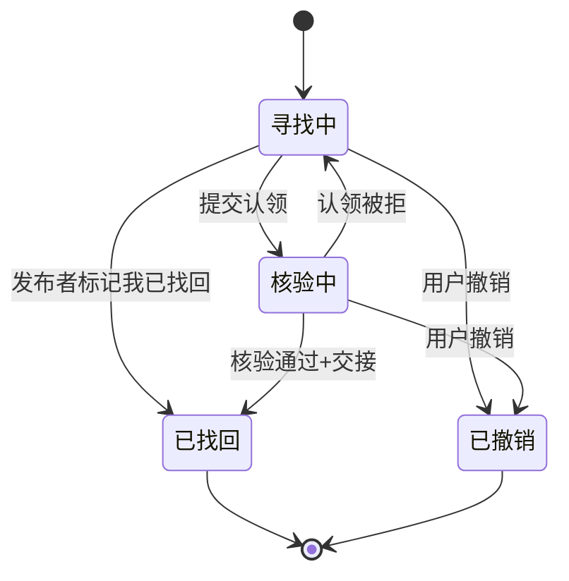
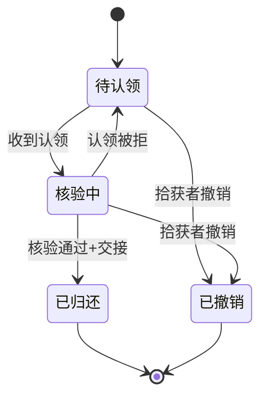
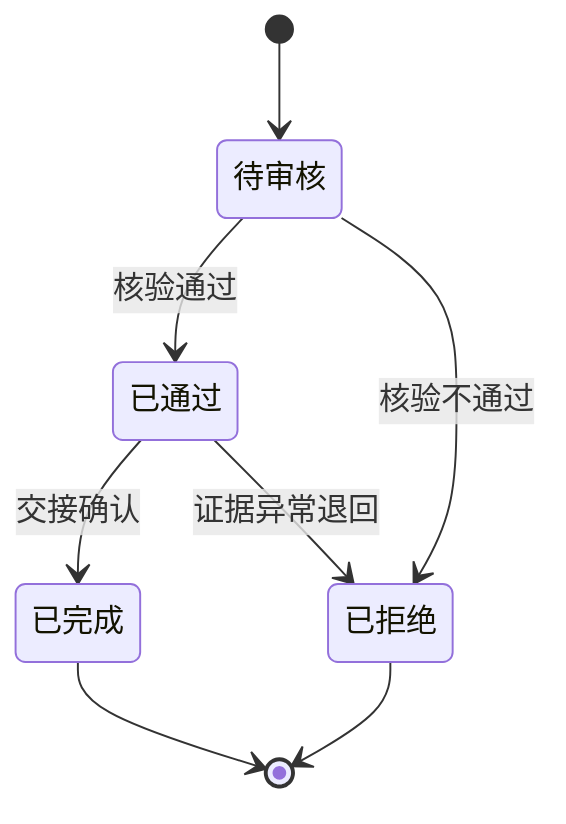
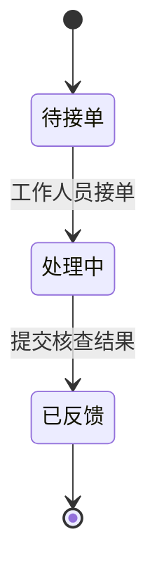
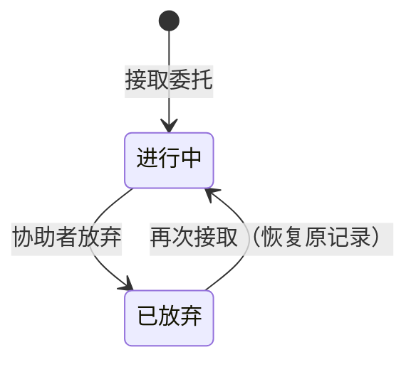
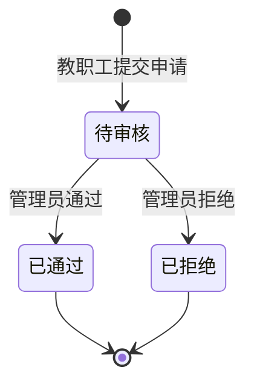

# 校园寻物局 · 需求规格说明书（v2.0 已确认，X2a 待确认，X2a 修复待确认）

## 0. 文档信息与约定

| 项 | 内容 |
|---|---|
| 项目 | 校园寻物局（校园失物协作平台） |
| 阶段 | 阶段1：需求规格设计（仅规格，不实现） |
| 特性名 | `campus_lost_found` |
| 写入路径 | `.codeartsdoer/specs/campus_lost_found/spec.md` |
| 状态 | 已确认 v2.0（2026-10-14）；F14 验收细化待确认（2026-10-20）；X2a 双视图地图与素材导入待确认（2026-10-20）；X2a 验收修复待确认（2026-10-21） |

**EARS 约定**：触发关键字与固定短语保持英文（`When`/`While`/`If`/`Where`/`The … shall`），事件、前置条件、响应等可变部分本地化为中文；默认主语为 `the 系统`，必要时替换为具体模块名。

**假设与证据约定**：
- 全文以 `[假设]` 标记未证实内容；团队推断不得改写为真实用户结论。
- 团队角色模拟仅验证内部流程，不代表真实用户试用或校方认可；外部人员参与不作为阶段前置条件。
- 不接入真实监控，不编造需求依据、开发记录、使用记录与测试结果。

---

## v1.0 → v2.0 变更记录

本版本在 v1.0 已确认的「发布→匹配→认领→核验→归还→协助工单」闭环之上叠加新功能，不删除、不改变既有认领、核验、归还、协助工单与规则候选匹配行为。逐条变更如下：

| # | 变更点 | v1.0 现状 | v2.0 调整 |
|---|---|---|---|
| 1 | 角色体系 | 学生自助注册；工作人员仅管理员创建 | 新增教职工自助申请（工号 4~20 位字母/数字），管理员审核通过后获工作人员权限；管理员保留直接创建工作人员能力 |
| 2 | 身份与称号展示 | 仅昵称 | 昵称旁显示身份（学生/教职工/教职工审核中）与称号 |
| 3 | 页面结构 | 顶部导航 | 手机优先：底部四标签（大厅/地图/AI/我的），≥768px 改左侧导航；375px 完整可用，可点击区域 ≥44px |
| 4 | 大厅卡片 | 概览列表 | 增补首图缩略图、建筑名与楼层、点赞/评论/接取人数；分页改「加载更多」 |
| 5 | 发布 | 图片+文字提取+标点+圈范围+分层路线 | 照片最多 6 张（jpg/png/webp、单张 ≤5MB、前端压缩长边 ≤1600px、后端去位置信息）；支持标点/圈范围/画路径；点选建筑与楼层自动带出 |
| 6 | 照片可见性 | 无区分 | 寻物帖照片公开；拾获帖照片仅发布者与工作人员可见，他人见「为防冒领，照片已隐藏」 |
| 7 | 评论 | 无 | 登录用户可评论（1~500 字、最多 3 图、仅一层回复、软删除显示「该评论已删除」） |
| 8 | 点赞/收藏 | 无 | 一人一次可取消；列表与详情显示数量及「我是否已点赞/收藏」 |
| 9 | 接取委托 | 无 | 非发布者登录用户可接取「寻找中/核验中」寻物帖成为协助者，可放弃；展示协助者人数与名单 |
| 10 | 发布者操作 | 仅撤销 | 增补「我已找回」（寻找中且无有效认领）、致谢最多 3 名协助者 |
| 11 | 地图底图 | 室外示意图 | 更换为 2.5D 立体校园示意图；建筑数据由配置文件导入数据库 |
| 12 | 地图图层 | 固定 3 图层 | 可独立开关：建筑层、帖子点位层（聚合）、求助点位层、监控点位层（模拟、仅工作人员）、AI 推荐层、热力层 |
| 13 | 楼层图 | 一栋楼两层 | 有平面图的建筑可进楼层图切换，首批 1~2 栋 |
| 14 | 绘制工具 | 标点/圈范围/画路径 | 新增「发布到大厅」入口带入位置与建筑；圈选范围默认公开、路径默认私密 |
| 15 | AI | 提取 + 候选推荐 | 对话式界面：智能整理发帖（生成草稿）+ 寻物地点推荐（最多 5 个地点与理由）；规则打分 + 模型解释，超时 10 秒降级 |
| 16 | 积分与称号 | 轻量协助徽章 | 新增积分事件（致谢 +20、归还 +15、工单反馈 +10）与称号体系，阈值集中配置，保留协助徽章 |
| 17 | 演示数据 | 无 | 一键生成约 60 条历史记录，标记「演示」，用于 AI 推荐与热力图演示 |
| 18 | 非功能 | 本地存储 | 图片存本地 storage 目录、存储接口抽象预留 OBS；部署华为云 ECS + Nginx |

### v2.0 → v2.1（X2a）变更记录

本版本在不改变认领、核验、归还、协助工单与规则候选匹配既有行为的前提下，把地图从单一 2.5D 底图升级为「室外平面图 + 室内 2.5D 选楼图」双视图，并以真实素材文件作为唯一数据来源。逐条变更如下：

| # | 变更点 | v2.0 现状 | v2.1（X2a）调整 |
|---|---|---|---|
| 1 | 地图底图 | 仅 2.5D 立体校园示意图 | 增加室外平面图；地图页顶部「室外 / 室内」切换，默认室外 |
| 2 | 坐标基准 | 以 2.5D 图坐标为准 | 帖子位置、圈选范围、路径、求助点、演示数据一律使用室外平面图坐标；2.5D 图仅用于浏览和选楼 |
| 3 | 建筑数据来源 | 8 栋虚构建筑 | 以真实素材文件为准（当前 137 栋）；名称、编号、坐标、图片尺寸不得写死在代码中（种子数据明确指定的编号除外） |
| 4 | 建筑几何 | 单一点击区域与标签位置 | 建筑同时具有室外平面图几何与 2.5D 几何，另含绘制层级与校门入口节点 |
| 5 | 图层类型 | 室外图层与楼层图层 | 区分室外平面图、2.5D 图、楼层图三类；2.5D 图禁止写入任何位置数据 |
| 6 | 楼层图 | 首批 1~2 栋，无图不提供入口 | 增加无底图占位；楼层标点必须与楼层图层所属建筑和楼层一致 |
| 7 | 推荐 | 规则打分 + 模型解释 | 补充类别提示；排除天桥、校门和未命名建筑；距离改为按比例尺换算的实际米数 |
| 8 | 演示数据 | 约 60 条 | 固定 60 条；按建筑类别加权，坐标落在建筑平面轮廓内，寻物与拾获各约一半 |
| 9 | 素材替换 | 手工导入 | 提供一条可重复执行的素材导入命令，统一完成建筑、楼层、图层尺寸、点位与演示数据导入 |

### v2.1（X2a）验收修复记录

X2a 首次验收发现以下缺陷。修复不改变 v2.1 已确认的地图业务规则，只修正实现与验收口径：

| # | 缺陷 | 修复口径 |
|---|---|---|
| 1 | 从「室内」切回「室外」时整页白屏 | 地图实例记录所属图层；实例与当前图层不一致时不向子图层提供地图；子图层随图层整体重挂载；地图区域增加错误边界，出错时显示「地图加载出错」与「重试」 |
| 2 | 素材导入需要分多次手工执行 | 一条命令依次完成建筑、楼层、图层、点位、演示数据五步，并分别打印数量；初始化脚本复用同一套函数，只执行前四步，不生成演示数据 |
| 3 | 室外建筑层绘制建筑中心点 | 建筑层默认不绘制任何图形；只绘制选中建筑高亮轮廓、AI 推荐建筑虚线轮廓、开启楼名且达到缩放阈值后的楼名 |
| 4 | 用已保存路线或标点请求推荐时理由没有米数 | 只要得到用于计算的点且该点位于已标定比例尺的室外图层，理由即输出米数；标点用「距你标记的位置约 N 米」，范围或路线用「距你圈选的范围约 N 米」 |
| 5 | 换算矩阵在请求时读取素材文件 | 矩阵随素材导入写入图层表；`/map/meta` 只读数据库；2.5D 图层没有矩阵时返回 404「尚未导入地图素材」 |
| 6 | 测试依赖正式素材 | AI 草稿测试改用测试素材夹具；地图元数据断言测试素材中的单位矩阵 |

修复后的验收场景见 6.21。

---

## 1. 需求假设表

| 编号 | 假设 | 设计依据 | 对应功能 | 验证方式 | 剩余不确定性 |
|---|---|---|---|---|---|
| A1 | 地图点位为「模拟点位」，非真实校园坐标 [假设] | 约束5、7 | 地图标点、监控点位、协助工单核查清单 | 点位带「模拟」标识并在界面明示 | 模拟点位与真实校园布局的映射精度 |
| A2 | 候选推荐与 AI 生成不训练模型，仅调用外部接口/规则推荐 [假设] | 「不训练模型、不增加独立向量数据库」 | 匹配推荐、智能整理发帖、地点推荐 | 来源可标识；无训练环节 | 模型外部接口的可用性与响应时延 |
| A3 | 教职工自助申请，管理员审核通过后成为工作人员；审核通过前按学生权限使用 [假设] | 约束1「教职工审核通过前按学生权限处理」 | 注册、角色、权限、教职工审核 | 教职工自助申请进入「待审核」；待审核期间越权被拒 | 初始管理员账号的产生与发放方式 |
| A4 | 比例尺仅在用户完成标定后启用，未标定不显示米数 [假设] | 约束6 | 地图圈选、路线距离 | 未标定地图上不出现米数 | 标定动作由谁触发（管理员/发布者） |
| A5 | 图片/文字提取仅用于候选与草稿生成，不参与审批决策 [假设] | 约束3 | 发布、AI 整理、匹配 | 提取结果仅作候选/草稿，审批仍由工作人员执行 | 提取质量偏低时的兜底策略 |
| A6 | 缓存、规则推荐与实时模型结果须在界面区分标识 [假设] | 约束5 | 候选推荐、AI 输出 | 候选条目与 AI 输出带来源标识 | 缓存失效策略（暂缓/待定） |
| A7 | 认领证据、联系方式、精确位置存于后端私密域，不进入公共接口 [假设] | 约束2 | 认领归还、私密证据、拾获帖照片 | 公共接口响应不含证据/联系方式/精确位置 | 证据存储加密级别 |
| A8 | 「同一物品只能归还一次」以物品标识为闭合依据 [假设] | 约束4 | 认领归还、关闭记录 | 对已完成物品再次归还被拒绝 | 多份同类物品（多把雨伞）的区分方式 |
| A9 | 圈选范围默认公开、路径默认私密；私密内容仅本人及授权工单处理人员可见 [假设] | 约束9 | 地图绘制、协助工单、授权线索 | 未授权时处理人员无法访问私密内容 | 授权的撤销粒度与时机 |
| A10 | 模型故障降级为手动/规则流程，不阻断主流程 [假设] | 约束8 | 发布、AI、筛选、归还 | 模型不可用时手动/规则仍可完成 | 降级提示文案与超时阈值 |
| A11 | 教职工工号格式为 4~20 位字母或数字，部门选填；审核前按学生权限、审核通过获工作人员权限 [假设] | 约束1 | 教职工注册、审核 | 非法工号被拒；待审核越权被拒 | 工号与校方系统是否校验一致性 |
| A12 | 建筑数据（编号、名称、类别、层数、平面轮廓、2.5D 点击区域、标签位置）由素材文件导入数据库，编号与名称按固定规则归一 [假设] | 需求四.1、X2a | 建筑层、建筑卡片、楼层图、导入脚本 | 导入后建筑数量与素材一致、可查询、可点选；重复导入不产生重复数据 | 最终素材的字段细节与后续版本兼容性 |
| A13 | 室外平面图、2.5D 选楼图与楼层平面图由团队自备，非真实测绘/真实监控；2.5D 图仅用于浏览与选楼 [假设] | 约束7、X2a | 地图底图、楼层图 | 底图与楼层图正确渲染；2.5D 图上不产生位置数据 | 底图制作精度与楼层覆盖范围 |
| A14 | 模型通过 OpenAI 兼容接口调用（可配置华为云 ModelArts Studio 或其他服务），外部服务可用性为依赖 [假设] | 需求五.6 | 智能整理发帖、地点推荐 | 配置后调用成功；未配置走降级 | 外部服务时延与额度 |
| A15 | 演示数据固定 60 条并标记为「演示」，按建筑类别加权生成、坐标落在建筑平面轮廓内，仅用于 AI 推荐与热力图演示 [假设] | 需求八、X2a | 演示数据脚本、热力层 | 演示数据带「演示」标签；重复执行仍为 60 条 | 演示数据与真实数据的隔离 |
| A16 | 积分只增不减、同一事件对同一人只计一次；称号阈值与名称集中配置 [假设] | 需求七 | 积分与称号 | 重复事件不重复计分；阈值可配置 | 积分事件边界与防刷 |

---

## 2. 现状分析

### 2.1 现有信息发布与查找流程可能存在的问题（未证实判断均标为假设）

1. 失物信息分散于线下登记、公告栏、群聊，缺乏统一入口，时效差、检索难 [假设]。
2. 寻物与拾获分属两套信息流，缺乏双向匹配，靠人工比对效率低、易漏 [假设]。
3. 认领缺乏私密证据核验机制，存在冒领风险，且无法追踪核对记录 [假设]。
4. 归还状态缺少闭环，物品是否归还、认领是否完成无据可查 [假设]。
5. 缺乏地图定位与路线线索，无法通过"经过路线"缩小查找范围 [假设]。
6. 联系信息与认领证据无权限隔离，未经授权即可被查看，隐私保护不足 [假设]。
7. 权限控制未在服务端强制，易被前端绕过 [假设]。

### 2.2 四类典型场景

> 每场景按「角色 / 输入 / 操作 / 结果 / 异常 / 隐私要求」六要素描述。

#### 场景一：明确知道丢失地点
- **角色**：学生（失主）
- **输入**：丢失物品图片、文字描述、地点（如"图书馆2F 自习室"）、大致时间
- **操作**：发布寻物 → 系统提取图片/文字（或 AI 整理草稿）→ 失主确认 → 系统按地点匹配拾获候选 → 查看候选 → 提交认领证据 → 工作人员核验 → 交接归还
- **结果**：寻物置「已找回」、拾获置「已归还」、认领置「已完成」，记录关闭
- **异常**：无候选 → 引导转协助工单；认领被拒 → 寻物回到「寻找中」
- **隐私要求**：证据与联系方式仅失主本人和该单处理人员可见；地点按楼层级脱敏公开

#### 场景二：只记得经过路线
- **角色**：学生（失主）
- **输入**：经过路线（途经点）、时间段、物品描述
- **操作**：在地图上绘制经过路线（或现场绘制后请求地点推荐）→ 系统记录分层路线 → 匹配途经区域的拾获记录 → 生成候选 / 推荐优先寻找地点 → 提交认领
- **结果**：有候选则进入认领闭环；无候选则转协助工单
- **异常**：路线区域未标比例尺 → 不输出米数；点位存在偏移；模型不可用 → 规则推荐 + 模板解释
- **隐私要求**：路线默认私密，仅失主可见；**仅当失主主动授权且工单分配后**，处理人员方可访问

#### 场景三：已拾获等待认领
- **角色**：学生（拾获者）
- **输入**：拾获物品图片、地点、时间
- **操作**：发布拾获 → 系统反向匹配寻物候选 → 拾获者等待 → 失主提交认领 → 工作人员核验 → 归还交接
- **结果**：拾获记录置「已归还」、寻物置「已找回」
- **异常**：长时间无人认领 → 保持「待认领」；证据不符 → 认领被拒绝
- **隐私要求**：拾获者联系方式私密不公开；物品概览（类别+脱敏地点）公开；**拾获帖照片仅发布者与工作人员可见**

#### 场景四：直接匹配失败需要协助
- **角色**：学生（发布者）触发，工作人员处理
- **输入**：发布内容 + "匹配失败/无候选"结果
- **操作**：系统引导转协助工单 → 工单「待接单」→ 工作人员接单「处理中」→ 失主授权路线 → 查看模拟点位与核查清单 → 现场核查 → 反馈结果
- **结果**：工单「已反馈」；若发现物品则回归认领归还闭环
- **异常**：无人接单 → 保持「待接单」；核查无果 → 反馈"未找到"
- **隐私要求**：授权范围最小化，路线/模拟点位仅授权后的处理人员可见

---

## 3. 需求规格

### 3.1 必做功能（v2.0 范围）

| 模块 | 内容 |
|---|---|
| 注册与角色 | 学生自助注册即生效；教职工自助申请（工号 4~20 位字母/数字）→ 管理员审核通过后获工作人员权限，审核前按学生权限；管理员系统初始化创建并保留直接创建工作人员能力；权限后端强制 |
| 页面结构 | 手机优先：底部四标签「大厅/地图/AI/我的」，≥768px 改左侧导航；375px 完整可用，可点击区域 ≥44px；工作人员/管理员专属功能从「我的」页进入 |
| 大厅 | 寻物/拾获卡片列表（首图缩略图、类型、标题、状态、建筑名+楼层、发布时间、点赞/评论/接取人数）；关键词/类型/类别/状态/建筑筛选；分页「加载更多」 |
| 发布 | 寻物/拾获发布；照片最多 6 张（jpg/png/webp、单张 ≤5MB、前端压缩长边 ≤1600px、后端去除位置信息）；可标点、圈范围、画路径；点选建筑与楼层自动带出；AI 整理草稿确认后发布 |
| 互动 | 评论（1~500 字、最多 3 图、一层回复、软删除）；点赞/收藏（一人一次可取消）；接取委托（非发布者可接取「寻找中/核验中」寻物帖、可放弃） |
| 发布者操作 | 寻找中/待认领可撤销；寻物帖在寻找中且无有效认领可「我已找回」；已找回后可致谢最多 3 名协助者 |
| 匹配与 AI | 规则候选匹配（保留）；智能整理发帖；寻物地点推荐（最多 5 个地点 + 理由 + 建议顺序）；来源标识（模拟点位/规则推荐/缓存/实时模型结果） |
| 地图 | 室外平面图 + 室内 2.5D 选楼图双视图（默认室外）；可开关图层（建筑/帖子点位/求助点位/监控点位/AI 推荐/热力/楼名）；楼层图（含无底图占位）；绘制工具仅室外可用；位置数据统一使用室外坐标 |
| 认领归还 | 私密证据提交；工作人员核验；交接确认；关闭记录；同一物品仅归还一次（保留） |
| 协助工单 | 接单、授权线索、模拟点位、核查清单、结果反馈（保留） |
| 我的 | 个人信息（昵称/身份/称号/积分及进度）；我的发布/收藏/点赞/评论/认领/接取委托/工单/积分明细；工作人员入口（认领审核、工单处理）、管理员入口（教职工审核） |
| 积分与称号 | 致谢协助者 +20、拾获归还 +15、工单反馈 +10；同一事件只计一次、只增不减；称号 0/20/60/150/300 集中配置；保留协助徽章 |
| 演示数据 | 一键生成恰好 60 条历史记录（删除旧演示数据后重建），标记「演示」；按建筑类别加权选楼，坐标落在建筑平面轮廓内，用于 AI 推荐与热力图演示 |
| 状态机 | 寻物/拾获/认领/工单/接取委托/教职工申请六套状态及合法流转（见第4章） |
| 权限与隐私 | 后端强制；路线默认私密、圈选范围默认公开；拾获帖照片仅发布者与工作人员可见；证据/联系方式/精确位置不进入公共接口；AI 仅提取、推荐、生成草稿 |

### 3.2 暂缓功能（v2.0 不纳入）

真实监控接入、人脸识别、实时聊天或私信、积分商城、全校所有楼层的室内图、原生 App。

### 3.3 资源依赖
- 在 v1.0 前后端基础上增量开发，保留既有功能与测试。
- **固定技术栈**：React＋TypeScript、FastAPI、PostgreSQL、Docker Compose、Leaflet 图片地图；单体架构，不训练模型、不增加独立向量数据库；后端仅新增 httpx、Pillow，前端不新增依赖。
- **模型依赖**：OpenAI 兼容接口（可配置华为云 ModelArts Studio 或其他服务），仅调用/规则推荐，不训练；外部模型接口可用性为依赖项（见 A2、A14）。
- **底图依赖**：室外平面图、2.5D 选楼图与楼层平面图需自备，不依赖真实监控/真实地图（见 A13）；建筑、路网与楼层数据以素材文件为准（见 A12）。
- **建筑数据**：由素材文件导入数据库（见 A12）；替换素材后通过一条可重复执行的导入命令完成更新，不在代码中写死建筑名称、编号、坐标与图片尺寸。
- **存储依赖**：图片存本地 storage 目录，存储接口抽象，预留华为云 OBS 切换。
- **部署目标**：华为云 ECS + Docker Compose，前端构建后由 Nginx 提供。
- 教职工账号由管理员审核（见 A3、A11）；比例尺由标定动作启用（见 A4）；演示数据脚本一键生成（见 A15）。

---

## 4. 状态定义与状态机

### 4.1 寻物（Lost）
状态集：`寻找中`（初始）、`核验中`、`已找回`（终）、`已撤销`（终）

| 源状态 | 目标状态 | 触发事件 |
|---|---|---|
| 寻找中 | 核验中 | 提交认领申请进入核验 |
| 寻找中 | 已找回 | 发布者自行标记「我已找回」（寻找中且无有效认领） |
| 寻找中 | 已撤销 | 用户主动撤销（未闭环） |
| 核验中 | 已找回 | 核验通过 + 归还交接完成 |
| 核验中 | 寻找中 | 核验不通过（认领被拒） |
| 核验中 | 已撤销 | 用户主动撤销（无已通过认领） |
| 已找回 / 已撤销 | — | 终态，不可再变 |



### 4.2 拾获（Found）
状态集：`待认领`（初始）、`核验中`、`已归还`（终）、`已撤销`（终）

| 源状态 | 目标状态 | 触发事件 |
|---|---|---|
| 待认领 | 核验中 | 收到认领申请 |
| 待认领 | 已撤销 | 拾获者撤销 |
| 核验中 | 已归还 | 核验通过 + 交接完成 |
| 核验中 | 待认领 | 认领被拒，回到待认领 |
| 核验中 | 已撤销 | 拾获者撤销（无已通过认领） |
| 已归还 / 已撤销 | — | 终态，不可再变 |



### 4.3 认领（Claim）
状态集：`待审核`（初始）、`已通过`、`已拒绝`（终）、`已完成`（终）

| 源状态 | 目标状态 | 触发事件 |
|---|---|---|
| 待审核 | 已通过 | 工作人员核验通过 |
| 待审核 | 已拒绝 | 工作人员核验不通过 |
| 已通过 | 已完成 | 归还交接确认 |
| 已通过 | 已拒绝 | 交接前发现证据异常（异常兜底） |
| 已拒绝 / 已完成 | — | 终态，不可再变 |



### 4.4 工单（Ticket）
状态集：`待接单`（初始）、`处理中`、`已反馈`（终）

| 源状态 | 目标状态 | 触发事件 |
|---|---|---|
| 待接单 | 处理中 | 工作人员接单 |
| 处理中 | 已反馈 | 提交核查结果 |
| 已反馈 | — | 终态，不可再变（支持顺向流转，不支持工单撤销） |



### 4.5 接取委托（Helper）
状态集：`进行中`（初始）、`已放弃`（可再次接取）

| 源状态 | 目标状态 | 触发事件 |
|---|---|---|
| 进行中 | 已放弃 | 协助者主动放弃 |
| 已放弃 | 进行中 | 协助者再次接取；原地恢复原记录，刷新接取时间，`thanked` 置 `false`，不新建记录 |



### 4.6 教职工申请（StaffApplication）
状态集：`待审核`（初始）、`已通过`（终）、`已拒绝`（终）

| 源状态 | 目标状态 | 触发事件 |
|---|---|---|
| 待审核 | 已通过 | 管理员审核通过（role 由 student 转为 staff） |
| 待审核 | 已拒绝 | 管理员拒绝并填写理由 |
| 已通过 / 已拒绝 | — | 终态，不可再变 |



---

## 5. 角色权限与信息可见性

### 5.1 角色

| 角色 | 获取方式 | 核心权限 |
|---|---|---|
| 学生 | 自助注册即生效 | 发布寻物/拾获、发起认领、申请协助、接取委托、评论/点赞/收藏、查看本人信息、授权路线 |
| 教职工（审核中） | 自助申请（必填工号 4~20 位字母/数字，选填部门） | 审核通过前**按学生权限使用**；可查看本人申请结果与理由 |
| 工作人员 | 教职工申请经管理员审核通过，或管理员直接创建 | 接单、授权后查看线索、核验认领、确认归还、关闭记录、反馈工单、查看监控点位（模拟）、删除任意评论 |
| 管理员 | 系统初始化创建 | 审核教职工申请、直接创建工作人员账号、标定地图比例尺；可执行工作人员全部操作 |

### 5.2 权限边界（后端强制）
- 学生、教职工（审核中）、工作人员、管理员的权限必须在后端执行，前端仅做展示，前端越权请求后须被拒绝。
- 教职工审核通过前 `role` 保持 student，按学生权限处理；审核通过时 `role` 转为 staff。
- 模型（AI）只能**提取、推荐、生成草稿**，**禁止**批准认领、禁止确认归还、禁止替用户发布；AI 输出经用户确认后才保存。

### 5.3 公开信息
任一已登录用户可见：
- 寻物/拾获概览：物品类别、楼层级脱敏地点、时间段、状态、评论/点赞/收藏/接取人数。
- 物品外观简述（不含精确位置、联系方式、证据）。
- 寻物帖照片（公开）。
- 求助点位（保卫处、服务台、失物招领处，所有人可见）。

### 5.4 私密信息（不进入公共接口）
| 信息 | 可见范围 |
|---|---|
| 认领证据（图片/文字） | 仅发布者本人 + 处理该单的工作人员 |
| 联系信息 | 仅相关处理人员，且仅在授权后 |
| 精确位置 | 仅发布者本人（公共接口脱敏） |
| 经过路线 | 默认私密；授权且工单分配后，处理人员可见 |
| 圈选范围 | 默认公开，可改为私密；私密时仅本人及授权处理人员可见 |
| 拾获帖照片 | 仅发布者本人 + 工作人员；其他人见「为防冒领，照片已隐藏」 |
| 监控点位 | 仅模拟数据，仅工作人员可见，界面标注「模拟」 |
| 工单核查清单/模拟点位 | 仅处理人员 + 工单发布者本人 |

---

## 6. 核心功能验收场景（EARS）

### 6.1 注册与角色
- **正常**：`When` 学生完成注册，`the 系统 shall` 创建学生账号并立即赋予「学生」角色生效。
- **正常**：`When` 用户注册时选择「教职工」身份并提交合法工号（4~20 位字母或数字），`the 系统 shall` 创建账号、申请状态为「待审核」、`role` 保持 student。
- **正常**：`When` 管理员通过教职工申请，`the 系统 shall` 将该用户 `role` 由 student 转为 staff 并赋予工作人员权限。
- **正常**：`When` 管理员拒绝教职工申请，`the 系统 shall` 记录拒绝理由，申请人可见结果与理由。
- **正常**：`When` 管理员创建工作人员账号，`the 系统 shall` 直接赋予「工作人员」角色。
- **异常**：`If` 教职工工号为空或不符合 4~20 位字母/数字格式，`the 系统 shall` 拒绝申请并提示修正。
- **异常**：`If` 管理员拒绝申请时未填写理由，`the 系统 shall` 拒绝该拒绝操作并提示填写理由。
- **权限**：`While` 教职工申请处于「待审核」，`the 系统 shall` 不授予核验、接单、确认归还、删除任意评论等工作人员权限。
- **权限**：`While` 用户为学生或教职工（审核中），`the 系统 shall` 不授予教职工审核权限。
- **权限**：`If` 用户尝试以「工作人员」身份自助注册（绕过审核直接成为 staff），`the 系统 shall` 拒绝。

### 6.2 页面结构与导航（手机优先）
- **正常**：`When` 用户在手机宽度访问，`the 系统 shall` 显示底部固定四标签「大厅/地图/AI/我的」。
- **正常**：`When` 屏幕宽度 ≥768px，`the 系统 shall` 将底部标签改为左侧导航。
- **正常**：`When` 用户为工作人员或管理员，`the 系统 shall` 在「我的」页提供认领审核、协助工单处理（管理员额外提供教职工审核）入口。
- **异常**：`If` 375px 宽度下任一功能出现横向滚动或可点击区域小于 44px，`the 系统 shall` 视为未达标（不可用）。
- **权限**：`While` 用户为学生，`the 系统 shall` 不展示工作人员/管理员专属入口（前端隐藏，权限仍后端强制）。

### 6.3 发布（寻物/拾获）
- **正常**：`When` 学生提交寻物发布（含类别/地点/时间/描述），`the 系统 shall` 创建寻物记录，状态为「寻找中」。
- **正常**：`When` 学生提交拾获发布，`the 系统 shall` 创建拾获记录，状态为「待认领」。
- **正常**：`When` 发布含照片，`the 系统 shall` 校验最多 6 张、格式限 jpg/png/webp、单张 ≤5MB；前端压缩长边 ≤1600px；后端去除照片中的位置信息后入库。
- **正常**：`When` 用户在地图上点选建筑与楼层，`the 系统 shall` 自动带出对应建筑与楼层到发布表单。
- **异常**：`If` 必填字段缺失，`the 系统 shall` 拒绝发布并提示补齐。
- **异常**：`If` 照片数量超过 6 张、格式不符或单张超过 5MB，`the 系统 shall` 拒绝并提示具体原因。
- **异常**：`If` 模型提取失败，`the 系统 shall` 允许手动填写描述继续发布（不阻断）。
- **权限**：`While` 用户未登录，`the 系统 shall` 拒绝发布请求。
- **权限**：`When` 发布者上传照片，`the 系统 shall` 在服务端去除照片 EXIF 位置信息，不将原始位置信息入库或返回。

### 6.4 大厅列表、筛选与详情
- **正常**：`When` 用户浏览大厅，`the 系统 shall` 在每张卡片显示首张照片缩略图、寻物/拾获标签、标题、状态、地点（建筑名与楼层）、发布时间、点赞数、评论数、接取人数。
- **正常**：`When` 用户按关键词/类型/类别/状态/建筑筛选，`the 系统 shall` 返回匹配结果。
- **正常**：`When` 用户点击「加载更多」，`the 系统 shall` 追加下一页数据。
- **正常**：`When` 用户查看拾获帖照片且非发布者非工作人员，`the 系统 shall` 显示「为防冒领，照片已隐藏」。
- **异常**：`If` 筛选无结果，`the 系统 shall` 展示空态提示。
- **权限**：`While` 用户非拾获帖发布者且非工作人员，`the 系统 shall` 不返回拾获帖照片内容。

### 6.5 评论
- **正常**：`When` 登录用户对帖子提交评论（1~500 字、最多 3 张图片），`the 系统 shall` 创建评论并展示。
- **正常**：`When` 用户回复评论，`the 系统 shall` 仅支持一层回复。
- **正常**：`When` 本人删除自己的评论，或工作人员/管理员删除任意评论，`the 系统 shall` 软删除并显示「该评论已删除」。
- **异常**：`If` 评论内容为空或超过 500 字，`the 系统 shall` 拒绝并提示。
- **异常**：`If` 评论图片超过 3 张，`the 系统 shall` 拒绝并提示。
- **权限**：`While` 用户未登录，`the 系统 shall` 拒绝评论。
- **权限**：`If` 非本人且非工作人员/管理员尝试删除评论，`the 系统 shall` 拒绝。

### 6.6 点赞与收藏
- **正常**：`When` 登录用户对帖子点赞或收藏，`the 系统 shall` 记录该用户一次点赞/收藏。
- **正常**：`When` 用户再次点赞/收藏已点赞/已收藏的帖子，`the 系统 shall` 取消（一人一次、可取消）。
- **正常**：`When` 展示列表或详情，`the 系统 shall` 显示点赞数、收藏数及「我是否已点赞/收藏」。
- **异常**：`If` 用户点赞/收藏不存在的帖子，`the 系统 shall` 返回「不存在」错误。
- **权限**：`While` 用户未登录，`the 系统 shall` 拒绝点赞/收藏。

### 6.7 接取委托
- **正常**：`When` 除发布者外的登录用户对「寻找中」或「核验中」的寻物帖点击「接取委托」，`the 系统 shall` 将其记为协助者。
- **正常**：`When` 协助者主动放弃，`the 系统 shall` 将委托置为「已放弃」。
- **正常**：`When` 展示帖子，`the 系统 shall` 显示协助者人数与名单（昵称与称号）。
- **异常**：`If` 帖子状态非「寻找中/核验中」，`the 系统 shall` 拒绝接取并提示状态不允许。
- **权限**：`While` 用户为帖子发布者，`the 系统 shall` 拒绝其接取自己的委托。

### 6.8 撤销与「我已找回」
- **正常**：`When` 发布者对「寻找中」或「待认领」帖子撤销，`the 系统 shall` 置为「已撤销」。
- **正常**：`When` 发布者对「寻找中」且无有效认领的寻物帖标记「我已找回」，`the 系统 shall` 置为「已找回」。
- **正常**：`When` 寻物帖已找回（自行找回或经认领归还），`the 系统 shall` 允许发布者从协助者中选择最多 3 人致谢。
- **异常**：`If` 寻物帖存在有效认领（已通过），`the 系统 shall` 拒绝发布者直接标记「我已找回」。
- **异常**：`If` 致谢人数超过 3 人，`the 系统 shall` 拒绝并提示最多 3 人。
- **权限**：`While` 非发布者本人，`the 系统 shall` 拒绝撤销或「我已找回」操作。

### 6.9 匹配推荐与寻物地点推荐
- **正常**：`When` 寻物发布完成，`the 系统 shall` 生成最多三个拾获候选及解释（规则候选匹配保留）。
- **正常**：`When` 用户选择一条寻物帖（使用其圈选范围或路径）或在地图上现场绘制，`the 系统 shall` 推荐最多 5 个优先寻找地点，每个附推荐理由与建议寻找顺序。
- **正常**：`When` 推荐产生，`the 系统 shall` 先由规则算法打分（依据距离、历史寻物/拾获记录数、同类别历史数、建筑类型与类别对应关系），再由模型生成解释文字。
- **正常**：`When` 规则打分使用建筑类别提示，`the 系统 shall` 对体育馆、运动场、球场优先关联水杯、耳机、钥匙、衣物、校园卡，对生活服务类建筑优先关联校园卡、钱包、雨伞。
- **正常**：`When` 生成推荐候选，`the 系统 shall` 只使用建筑素材中真实存在的建筑，并排除天桥、校门和「未命名建筑」。
- **正常**：`When` 室外平面图已标定比例尺，`the 系统 shall` 在推荐理由中给出按比例尺换算的实际距离（取整到米），例如「距你圈选的范围约 80 米」。
- **正常**：`When` 推荐结果生成，`the 系统 shall` 在地图 AI 推荐层高亮显示，并标注「AI 生成，仅供参考」及来源（实时模型或规则）。
- **正常**：`When` 模型不可用，`the 系统 shall` 展示规则打分结果与模板解释。
- **异常**：`If` 无候选，`the 系统 shall` 提示可转协助工单。
- **异常**：`If` 模型返回超时（超过 10 秒），`the 系统 shall` 降级为规则推荐或空候选，不阻断发布。
- **异常**：`If` 模型结果含他者私密信息，`the 系统 shall` 过滤且不展示。
- **权限**：`While` 候选未确认，`the 系统 shall` 不自动批准认领或确认归还。
- **权限**：`When` 发送内容给模型，`the 系统 shall` 不含精确位置、联系方式、认领证据及他人的私密路径。

### 6.10 AI 智能整理发帖
- **正常**：`When` 用户用自然语言描述（如"昨天下午在一食堂二楼丢了蓝色水杯"），`the 系统 shall` 提取类型、类别、标题、描述、地点、时间、建筑，生成发帖草稿。
- **正常**：`When` 用户确认或修改草稿后发布，`the 系统 shall` 才保存帖子并标注「AI 生成」来源。
- **正常**：`When` AI 输出生成，`the 系统 shall` 标注「AI 生成，仅供参考」及来源（实时模型或规则）。
- **异常**：`If` 模型不可用，`the 系统 shall` 提示用户手动填写发帖（不阻断）。
- **权限**：`While` 草稿未经用户确认，`the 系统 shall` 不自动发布帖子（AI 不能替用户发布）。

### 6.11 认领提交
- **正常**：`When` 失主对某拾获记录提交认领，`the 系统 shall` 创建认领申请，状态为「待审核」。
- **正常**：`When` 认领提交含私密证据，`the 系统 shall` 将证据存储于私密域。
- **异常**：`If` 证据缺失，`the 系统 shall` 拒绝提交（证据必填）。
- **权限**：`While` 提交者非该拾获记录发布者，`the 系统 shall` 仍允许提交，但须附证据由工作人员判断。

### 6.12 核验与归还
- **正常**：`When` 工作人员核验通过认领申请，`the 系统 shall` 将认领置为「已通过」并进入交接。
- **正常**：`When` 交接完成确认，`the 系统 shall` 将认领置「已完成」、寻物置「已找回」、拾获置「已归还」。
- **正常**：`When` 一件物品完成一次归还，`the 系统 shall` 关闭该记录并禁止再次归还。
- **异常**：`If` 工作人员核验不通过，`the 系统 shall` 将认领置为「已拒绝」。
- **异常**：`If` 对已完成物品再次发起归还，`the 系统 shall` 拒绝。
- **权限**：`While` 用户为已授权工作人员，`the 系统 shall` 允许核验与确认归还。
- **权限**：`While` 用户为学生，`the 系统 shall` 不授予核验/确认归还权限。
- **权限**：`If` 模型（AI）尝试直接批准认领或确认归还，`the 系统 shall` 禁止（模型无审批权）。

### 6.13 协助工单
- **正常**：`When` 匹配失败或无候选时学生提交协助，`the 系统 shall` 创建工单，状态为「待接单」。
- **正常**：`When` 工作人员接单，`the 系统 shall` 将工单置为「处理中」。
- **正常**：`When` 发布者授权路线，`the 系统 shall` 允许处理人员查看路线与模拟点位（仅授权后）。
- **正常**：`When` 工作人员提交核查结果，`the 系统 shall` 将工单置为「已反馈」。
- **异常**：`If` 长时间无人接单，`the 系统 shall` 保持「待接单」并提示。
- **权限**：`While` 路线未授权，`the 系统 shall` 不向处理人员展示路线。
- **权限**：`While` 工单未分配，`the 系统 shall` 不向任何处理人员暴露路线与线索。

### 6.14 地图与图层
- **正常**：`When` 用户打开地图，`the 系统 shall` 默认显示室外平面图，并在顶部提供「室外 / 室内」切换。
- **正常**：`When` 用户切换到室内，`the 系统 shall` 显示 2.5D 选楼图；2.5D 图仅用于浏览和选楼。
- **正常**：`When` 建筑数据经素材文件导入，`the 系统 shall` 按编号/名称/类别/层数/平面轮廓/2.5D 点击区域/标签位置入库并支持查询。
- **正常**：`When` 用户点击建筑，`the 系统 shall` 弹出建筑卡片（名称、类别、该建筑进行中帖子数、查看相关帖子、进入楼层）。
- **正常**：`When` 用户切换图层，`the 系统 shall` 支持建筑层、帖子点位层、求助点位层、监控点位层、AI 推荐层、热力层与楼名独立开关；楼名默认关闭。
- **正常**：`When` 帖子点位密集，`the 系统 shall` 将寻物/拾获不同图标聚合为数字气泡，点开显示列表。
- **正常**：`When` 建筑存在楼层图层，`the 系统 shall` 允许进入楼层并切换楼层；楼层无底图时仍可进入查看帖子列表。
- **正常**：`When` 地图未标定比例尺，`the 系统 shall` 不输出实际米数。
- **异常**：`If` 图层为 2.5D 图，`the 系统 shall` 拒绝在该图层标点、圈范围、画路径或创建求助点，并提示「2.5D 图仅用于选楼，请在室外地图上标注」。
- **异常**：`If` 建筑没有任何楼层图层，`the 系统 shall` 不显示「进入楼层」按钮。
- **权限**：`While` 用户为工作人员，`the 系统 shall` 展示监控点位层并标注「模拟」；`While` 用户非工作人员，`the 系统 shall` 不展示监控点位层。
- **权限**：`When` 求助点位层渲染，`the 系统 shall` 对所有人可见（保卫处、服务台、失物招领处）。

### 6.15 绘制工具与从地图发帖
- **正常**：`When` 用户在室外平面图使用标点（点一下）、圈范围（点圆心后调整半径）、画路径（依次点击，支持完成/撤销上一步/清空），`the 系统 shall` 支持手指操作并记录几何。
- **正常**：`When` 用户绘制完成后选择「发布到大厅」，`the 系统 shall` 打开发布表单并带入位置与建筑。
- **正常**：`When` 圈选范围默认公开、路径默认私密，`the 系统 shall` 允许用户将圈选范围改为私密、路径改为公开。
- **异常**：`If` 画路径时点数不足（少于 2 点），`the 系统 shall` 拒绝保存路径并提示补齐。
- **异常**：`If` 当前视图为室内 2.5D 图，`the 系统 shall` 不显示绘制工具，且不允许提交任何位置数据。
- **权限**：`While` 内容为私密（圈选范围/路径），`the 系统 shall` 仅本人和经授权的工单处理人员可见（沿用原规则）。

### 6.16 积分与称号
- **正常**：`When` 被失主致谢的协助者，`the 系统 shall` 记 +20 分。
- **正常**：`When` 拾获帖经认领完成归还，`the 系统 shall` 给拾获帖发布者 +15 分。
- **正常**：`When` 工作人员完成工单反馈，`the 系统 shall` 给该工作人员 +10 分。
- **正常**：`When` 累计积分达到阈值，`the 系统 shall` 按 0 见习寻物人 / 20 热心同学 / 60 寻物能手 / 150 校园守护者 / 300 寻物传说 授予称号（阈值与名称集中配置）。
- **正常**：`When` 界面展示，`the 系统 shall` 在昵称旁显示身份与称号，并在「我的」显示积分及距下一称号的进度。
- **异常**：`If` 同一事件对同一人重复触发，`the 系统 shall` 只计一次（唯一约束）。
- **异常**：`If` 发帖、评论、点赞，`the 系统 shall` 不产生积分。
- **权限**：`When` 积分写入，`the 系统 shall` 仅由服务层积分函数写入，禁止其他路径直接改积分。

### 6.17 演示数据
- **正常**：`When` 执行一键生成脚本，`the 系统 shall` 删除既有演示数据后生成恰好 60 条寻物与拾获记录，寻物与拾获各约一半，标记为演示数据。
- **正常**：`When` 选择建筑，`the 系统 shall` 按建筑类别加权（食堂、图书馆、教学楼高；宿舍、体育馆、运动场中；其余低），并排除未命名建筑、天桥和校门。
- **正常**：`When` 生成物品类别，`the 系统 shall` 使其与建筑类别相关。
- **正常**：`When` 生成坐标，`the 系统 shall` 在所属建筑的室外平面轮廓内取随机点，且图层为室外平面图。
- **正常**：`When` 演示数据展示，`the 系统 shall` 显示「演示」标签，并用于 AI 推荐与热力图演示。
- **异常**：`If` 演示数据脚本重复执行，`the 系统 shall` 保持总数仍为 60 条，不产生重复记录。
- **权限**：`When` 展示，`the 系统 shall` 将演示数据与真实数据分别标识来源（沿用来源标识约束）。

### 6.18 我的页面

「我的」页是登录后的个人数据中心，所有列表与计数均限定为当前登录用户本人；F14 在不改变认领、核验、归还、协助工单既有行为的前提下整合该页。

#### 6.18.1 个人卡片
- **正常**：`When` 用户进入「我的」，`the 系统 shall` 在页面顶部显示昵称、身份标签、称号和当前积分。
- **正常**：`While` 用户角色为学生且教职工申请状态为「待审核」，`the 系统 shall` 身份标签显示「教职工审核中」；其余情况分别显示「学生」「工作人员」「管理员」。
- **正常**：`When` 用户未达到最高称号，`the 系统 shall` 显示距下一称号的进度条，并显示「再得 N 分成为 {下一称号}」，其中 N 为下一称号阈值减当前积分。
- **正常**：`When` 用户已达到最高称号，`the 系统 shall` 显示「已达最高称号」，不再显示进度条与加分文案。
- **正常**：`When` 用户点击个人卡片，`the 系统 shall` 进入积分明细页 `/me/points`。
- **异常**：`If` 积分数据加载失败，`the 系统 shall` 显示可重试的失败提示，不得以 0 分或默认称号替代真实数据。

#### 6.18.2 教职工申请结果
- **正常**：`When` 当前用户的教职工申请状态为「已拒绝」，`the 系统 shall` 在个人卡片下方显示拒绝理由与「重新申请」按钮。
- **正常**：`When` 用户点击「重新申请」并成功提交，`the 系统 shall` 将申请状态变为「待审核」，身份标签变为「教职工审核中」，并隐藏拒绝理由与按钮。
- **异常**：`If` 重新申请提交失败，`the 系统 shall` 保留按钮、显示中文错误提示，请求期间按钮不可重复点击。
- **权限**：`While` 申请处于「待审核」或「已通过」，`the 系统 shall` 不显示重新申请入口。

#### 6.18.3 数字入口
- **正常**：`When` 用户查看个人卡片下方，`the 系统 shall` 以一行 4 个入口展示「我的发布」「我接取的」「我的收藏」「我的认领」，并显示各自数量。
- **正常**：`When` 展示数量，`the 系统 shall` 取对应分页接口返回的 `total`，且与进入列表后的总条数一致；不得用当前页条数或本地缓存推算。
- **正常**：`When` 用户点击数字入口，`the 系统 shall` 分别进入 `/me/posts`、`/me/helping`、`/me/favorites`、`/me/claims`。
- **异常**：`If` 某个数量请求失败，`the 系统 shall` 在该入口显示占位符而非错误的 0，其余入口正常展示。

#### 6.18.4 列表入口与专属入口
- **正常**：`When` 用户查看数字入口下方，`the 系统 shall` 提供列表入口：我点赞的（`/me/likes`）、我的评论（`/me/comments`）、我的工单（`/me/tickets`）、我的徽章。
- **正常**：`When` 用户点击「我的徽章」，`the 系统 shall` 在当前页弹出徽章面板，不跳转新页面；无徽章时展示空态。
- **正常**：`While` 用户为工作人员或管理员，`the 系统 shall` 在列表入口下方单独一组展示「认领审核」（`/staff/claims`）与「工单处理」（`/staff/tickets`）。
- **正常**：`While` 用户为管理员，`the 系统 shall` 在同一组内额外展示「教职工审核」（`/admin/staff-applications`）。
- **权限**：`While` 用户为学生或教职工审核中，`the 系统 shall` 不展示工作人员/管理员入口；隐藏入口不替代后端鉴权。
- **正常**：`When` 用户查看页面最底部，`the 系统 shall` 展示退出登录按钮；点击后清除登录态并返回登录页。

#### 6.18.5 通用列表页
- **正常**：`When` 用户访问 `/me/:kind`，`the 系统 shall` 支持 `kind` 取 `posts`、`helping`、`favorites`、`likes`、`claims`、`comments`、`tickets`；其他取值跳回「我的」。
- **正常**：`While` `kind` 为 `posts`、`helping`、`favorites`、`likes`，`the 系统 shall` 复用大厅帖子卡片展示；`helping` 卡片额外显示委托状态（进行中 / 已放弃）和「已被致谢」标签。
- **正常**：`While` `kind` 为 `claims`，`the 系统 shall` 每条显示物品标题、申请状态和申请时间，点击进入该物品详情。
- **正常**：`While` `kind` 为 `comments`，`the 系统 shall` 每条显示评论内容摘要、所属帖子标题和发表时间，点击进入该帖子详情。
- **正常**：`While` `kind` 为 `tickets`，`the 系统 shall` 每条显示工单状态和结果。
- **正常**：`When` 用户点击底部「加载更多」，`the 系统 shall` 追加下一页；数据取完后不再展示「加载更多」。
- **异常**：`If` 列表为空，`the 系统 shall` 展示与该 `kind` 对应的空状态文案。
- **异常**：`If` 列表请求失败，`the 系统 shall` 展示可重试的错误提示，且不清空已加载数据。
- **正常**：`When` 用户进入任一二级页，`the 系统 shall` 使用带返回按钮的页头，返回「我的」。

#### 6.18.6 积分明细页
- **正常**：`When` 用户访问 `/me/points`，`the 系统 shall` 顶部显示与个人卡片一致的称号、积分与进度信息。
- **正常**：`When` 展示积分明细，`the 系统 shall` 每条显示事件说明、分值和时间，并按时间倒序分页加载。
- **正常**：`When` 用户点击「加载更多」，`the 系统 shall` 追加更早的积分记录。
- **异常**：`If` 无积分记录，`the 系统 shall` 展示空状态文案。

#### 6.18.7 后端接口
- **正常**：`When` 登录用户请求 `GET /me/comments`，`the 系统 shall` 返回本人发表且未删除的评论，按发表时间倒序分页，每条包含评论内容、发表时间、所属帖子 id 与标题。
- **正常**：`When` 评论所属帖子已撤销，`the 系统 shall` 照常返回该评论及其帖子信息。
- **正常**：`When` 登录用户请求 `GET /me/helping`，`the 系统 shall` 返回本人接取的委托，按接取时间倒序分页，每条包含与大厅列表一致的帖子概要、委托状态（进行中 / 已放弃）和是否已被致谢。
- **正常**：`When` 两个列表返回分页信息，`the 系统 shall` 返回 `total`、`limit`、`offset`，且 `total` 为满足条件的全部条数。
- **异常**：`If` `limit` 小于 1 或大于 100、`offset` 小于 0，`the 系统 shall` 返回 400 及中文提示。
- **权限**：`While` 用户未登录，`the 系统 shall` 对两个接口返回 401。
- **权限**：`When` 任一登录用户请求，`the 系统 shall` 只返回其本人数据，不接受按他人用户 id 查询。
- **权限**：`While` 返回我的评论与我的委托，`the 系统 shall` 不包含联系方式、认领证据、精确位置和路线等私密字段。

#### 6.18.8 角色差异与移动端
- **正常**：`When` 学生查看「我的」，`the 系统 shall` 只显示个人卡片、数字入口、列表入口和退出登录。
- **正常**：`When` 工作人员查看「我的」，`the 系统 shall` 额外显示认领审核与工单处理入口。
- **正常**：`When` 管理员查看「我的」，`the 系统 shall` 额外显示教职工审核入口。
- **正常**：`When` 页面在 375px 宽度展示，`the 系统 shall` 无横向滚动，所有可点击元素不小于 44px。
- **正常**：`When` 页面展示，`the 系统 shall` 复用现有设计变量与样式文件，不写内联样式。
- **正常**：`When` 列表加载，`the 系统 shall` 处理加载中、出错、空数据三种状态。

#### 6.18.9 回归约束
- **正常**：`When` F14 交付，`the 系统 shall` 保持认领、核验、归还、协助工单的既有行为与既有测试结果不变。
- **正常**：`When` 运行验收，`the 系统 shall` 为两个新接口各覆盖正常、未登录 401、仅返回本人数据、分页参数生效四类用例。

### 6.19 F14 验收修复

本节为 F14 进入验收后确认的三处补充修复，只细化 6.18.1、6.18.5、6.7 已有约定的展示与数据完整性，**不改变**认领、核验、归还、协助工单的既有行为，也不改变 6.16 的积分事件与阈值。

允许修改范围（超出即视为范围蔓延）：`frontend/src/types.ts`、`frontend/src/pages/MeList.tsx`、`backend/app/models/item_helper.py`、`backend/app/services/helper_service.py`、新增一个 Alembic 迁移文件、`backend/tests/test_helpers.py`（仅新增用例）。

#### 6.19.1 地点文案回退

- **正常**：`When` 记录的 `building_name` 非空且 `floor` 非空，`the 系统 shall` 显示「{建筑名} {楼层}F」，与现有行为一致。
- **正常**：`When` 记录的 `building_name` 非空且 `floor` 为空，`the 系统 shall` 只显示建筑名，不追加楼层。
- **正常**：`When` 记录的 `building_name` 为空且 `location_area` 非空，`the 系统 shall` 显示 `location_area` 的原文（去除首尾空白），不追加楼层。
- **正常**：`When` 记录的 `building_name` 与 `location_area` 均为空，`the 系统 shall` 显示「未指定地点」。
- **正常**：`When` 调用地点文案函数，`the 系统 shall` 接受包含 `building_name`、`location_area`、`floor` 三个可空字段的入参；缺少 `location_area` 的调用点必须在 TypeScript 类型检查阶段报错，不得以缺省值静默通过。
- **异常**：`If` `building_name` 为空但 `floor` 非空，`the 系统 shall` 不输出楼层，按 `location_area` 回退规则显示。
- **异常**：`If` `building_name` 或 `location_area` 为 `null`、空字符串或仅含空白字符，`the 系统 shall` 一律视为空。
- **权限**：`When` 展示地点文案，`the 系统 shall` 只使用帖子公开字段，不读取精确位置与路线。

边界场景与期望输出：

| `building_name` | `floor` | `location_area` | 期望输出 |
|---|---|---|---|
| 图书馆 | 3 | 三楼自习区 | 图书馆 3F |
| 图书馆 | `null` | 三楼自习区 | 图书馆 |
| `null` | 3 | 图书馆三楼 | 图书馆三楼 |
| `null` | `null` | 图书馆三楼 | 图书馆三楼 |
| `null` | `null` | `null` / `""` / `"   "` | 未指定地点 |
| 图书馆 | 3 | `null` | 图书馆 3F |

**展示范围约束**：`ItemDetail` 现有的地点展示分支（建筑名为空时直接取 `location_area` 或「未知」）不在本次修改范围，保持原样；其他调用点只随函数入参类型补齐字段，渲染结果不变。

#### 6.19.2 委托状态展示

- **正常**：`When` `helper_status` 为 `abandoned`，`the 系统 shall` 在「我接取的」列表一律显示「已放弃」，与帖子状态、是否被致谢无关。
- **正常**：`When` `helper_status` 为 `active` 且帖子状态为「寻找中」或「核验中」，`the 系统 shall` 显示「进行中」，沿用现有语义与主色标签，并保留「接取于 YYYY/M/D」。
- **正常**：`When` `helper_status` 为 `active`、帖子状态不属于「寻找中/核验中」且 `thanked` 为 `true`，`the 系统 shall` 将状态标签显示为「已被致谢」（成功色）。
- **正常**：`When` `helper_status` 为 `active`、帖子状态不属于「寻找中/核验中」且 `thanked` 为 `false`，`the 系统 shall` 将状态标签显示为「已结束」（中性色）。
- **正常**：`When` 状态标签已为「已被致谢」，`the 系统 shall` 不再重复渲染独立的「已被致谢」标签，避免同一文案出现两次。
- **正常**：`When` `helper_status` 为 `active`、帖子仍在「寻找中/核验中」且 `thanked` 为 `true`，`the 系统 shall` 保留「进行中」标签，并在其旁显示独立「已被致谢」标签（沿用 6.18.5）。
- **正常**：`When` `helper_status` 为 `abandoned` 且 `thanked` 为 `true`，`the 系统 shall` 显示「已放弃」并保留独立「已被致谢」标签。
- **正常**：`When` 渲染委托状态，`the 系统 shall` 只依据后端返回的 `helper_status`、`thanked` 与帖子 `status` 三个字段派生，不新增接口字段、不维护前端状态表、不改变列表分页与排序。
- **异常**：`If` 帖子状态为「待认领」或「已归还」（委托仅对寻物帖，正常数据不可达），`the 系统 shall` 按防御性规则套用上表，不丢弃该行、不报错。

组合真值表（`helper_status=active`）：

| 帖子状态 | `thanked` | 状态标签 | 额外「已被致谢」标签 |
|---|---|---|---|
| 「寻找中」 | `true` | 进行中 | 显示 |
| 「寻找中」 | `false` | 进行中 | 不显示 |
| 「核验中」 | `true` | 进行中 | 显示 |
| 「核验中」 | `false` | 进行中 | 不显示 |
| 「已找回」 | `true` | 已被致谢 | 不显示（避免重复） |
| 「已找回」 | `false` | 已结束 | 不显示 |
| 「已撤销」 | `true` | 已被致谢 | 不显示 |
| 「已撤销」 | `false` | 已结束 | 不显示 |
| 「待认领」〔不可达〕 | `true` | 已被致谢 | 不显示 |
| 「待认领」〔不可达〕 | `false` | 已结束 | 不显示 |
| 「已归还」〔不可达〕 | `true` | 已被致谢 | 不显示 |
| 「已归还」〔不可达〕 | `false` | 已结束 | 不显示 |

`helper_status=abandoned` 时，上述任一帖子状态与任一 `thanked` 取值下状态标签均为「已放弃」（中性色）；仅当 `thanked=true` 时额外显示「已被致谢」。

**语义说明**：「已结束」表示委托记录仍为 `active`，但其所属帖子已离开「寻找中/核验中」，该委托不再可推进；不表示委托已被放弃。

#### 6.19.3 委托唯一约束与数据迁移

- **正常**：`When` 迁移执行完成，`the 系统 shall` 在 `item_helper` 上对 `(item_id, user_id)` 组合施加唯一约束，同一用户对同一帖子最多一条记录。
- **正常**：`When` 迁移执行前存在重复记录，`the 系统 shall` 先按 `(item_id, user_id)` 分组清理：每组**优先保留 `status` 为 `active`（进行中）的记录**；同组无 `active` 记录时保留 `created_at` 最早的一条；`created_at` 并列时保留 `id` 字典序最小的一条；删除同组其余记录。
- **正常**：`When` 执行表结构变更，`the 系统 shall` 使用 `batch_alter_table` 写法，使同一迁移脚本在 SQLite 与 PostgreSQL 上均可执行；SQLite 走重建表路径，PostgreSQL 走原生 `ALTER TABLE`。
- **正常**：`When` 迁移执行完成，`the 系统 shall` 保留 `item_helper` 的既有数据与 `item_id`、`user_id` 索引，不改变 `status`、`thanked`、`created_at` 的取值。
- **正常**：`When` 模型声明表结构，`the 系统 shall` 在模型中同步声明同名唯一约束，使模型与迁移一致，`alembic check` 无差异。
- **正常**：`When` 执行降级，`the 系统 shall` 删除该唯一约束；降级不恢复已清理的重复记录，迁移说明中必须写明该不可逆点。
- **正常**：`When` 同一用户对同一帖子已存在 `active`（进行中）记录并再次请求接取，`the 系统 shall` 返回 409、错误码 `STATE_CONFLICT`、中文提示「已接取该委托」，且不新增、不修改记录（沿用 6.7 与既有接口契约）。
- **正常**：`When` 同一用户对同一帖子仅存在 `abandoned`（已放弃）记录并再次请求接取，`the 系统 shall` 将原记录原地恢复为 `active`、把 `created_at` 刷新为本次接取时间、把 `thanked` 置为 `false`，并返回与新建接取完全相同的成功响应（`helper_count`、`is_helper`），不新增记录。
- **正常**：`When` 帖子已不处于「寻找中/核验中」且该用户对同一帖子存在 `abandoned` 记录，`the 系统 shall` 返回 409「该记录当前不可接取」且不恢复该记录（前置状态校验沿用 6.7，不因恢复口径放宽）。
- **正常**：`When` 并发重复接取导致插入触发唯一约束冲突，`the 系统 shall` 回滚本次事务并返回与串行「已接取」完全一致的 409 结果，不得返回 500，不得写入第二条记录。
- **正常**：`When` 同一用户对同一帖子多次接取（含接取后放弃、再次接取），`the 系统 shall` 使 `item_helper` 中只有一条记录，帖子详情的协助者人数按 1 计，`is_helper` 为 `true`。
- **正常**：`When` 统计我的委托、协助者人数与名单，`the 系统 shall` 以去重后的记录为准，不因历史重复记录重复计数。
- **正常**：`When` 执行数据清理与约束变更，`the 系统 shall` 不新增任何积分记录、不改变任何用户积分总额；致谢积分的去重仍由既有唯一约束保证。
- **异常**：`If` 清理过程中数据库存在其他违反约束的脏数据，`the 系统 shall` 使整次迁移失败并回滚，不留下「已清理未加约束」的中间状态。
- **异常**：`If` 表为空或不存在重复记录，`the 系统 shall` 正常完成迁移，不报错。
- **正常**：`When` 运行迁移测试，`the 系统 shall` 覆盖「同一用户对同一帖子接取两次只有一条记录」：连续两次接取请求中一次成功、一次返回 409，数据库内该组合记录数为 1。

**已知影响与已确认口径（口径 B）**：唯一约束覆盖 `abandoned` 记录，「放弃后再次接取」已按口径 B 解决：不插入第二行，而是原地恢复原记录（`status` 回到「进行中」、刷新接取时间），返回与新建相同的成功响应，不再返回「已接取该委托」。已确认的副作用：恢复时 `thanked` 置为 `false`，历史致谢标记被清除，但已发放的致谢积分**不回收**、用户积分总额不变。帖子已离开「寻找中/核验中」时，放弃后重接仍返回 409「该记录当前不可接取」，该限制沿用 6.7，不因恢复口径放宽。

#### 6.19.4 改动边界

- **正常**：`When` 本次修复交付，`the 系统 shall` 保持认领提交与审核、核验、归还、协助工单的接口、状态流转与既有测试断言不变。
- **正常**：`When` 本次修复交付，`the 系统 shall` 只影响「我接取的」列表的状态标签、地点文案函数与 `item_helper` 表结构，不改大厅、详情页、AI 页、地图页等其他页面的展示与交互。
- **正常**：`When` 本次修复交付，`the 系统 shall` 不新增前后端依赖，不改积分规则、称号阈值与权限矩阵。
- **正常**：`When` 本次修复交付，`the 系统 shall` 不改既有测试断言，只在 `backend/tests/test_helpers.py` 新增用例。
- **正常**：`When` 本次修复交付，`the 系统 shall` 不改 `/me/helping`、`/me/claims`、`/me/comments` 的响应字段与分页契约。

#### 6.19.5 验收场景

**正常**
- **正常**：`When` 帖子仅有 `location_area`，`the 系统 shall` 在列表与卡片中显示该地点文案而非「未指定地点」。
- **正常**：`When` 打开「我接取的」且帖子已找回、已被致谢，`the 系统 shall` 显示「已被致谢」且不再出现第二个「已被致谢」标签。
- **正常**：`When` 打开「我接取的」且帖子仍在寻找中，`the 系统 shall` 仍显示「进行中」。
- **正常**：`When` 同一用户对同一帖子接取两次，`the 系统 shall` 只保留一条委托记录。
- **正常**：`When` 用户接取后放弃、随后再次接取同一帖子，`the 系统 shall` 返回成功，`item_helper` 中该 `(item_id, user_id)` 仅一条记录且状态为「进行中」、`thanked` 为 `false`，帖子详情接取人数为 1。

**边界**
- **正常**：`When` 建筑名与地点区域都为空，`the 系统 shall` 显示「未指定地点」。
- **正常**：`When` 建筑名非空、楼层为空，`the 系统 shall` 只显示建筑名。
- **正常**：`When` 委托已放弃，`the 系统 shall` 显示「已放弃」，不因帖子已找回而改显示「已结束」。
- **正常**：`When` 帖子已撤销且委托未被致谢，`the 系统 shall` 显示「已结束」。

**并发与冲突**
- **异常**：`When` 两个请求同时为同一用户接取同一帖子，`the 系统 shall` 返回一次成功、一次 409「已接取该委托」，数据库仅一条记录，不出现 500。
- **异常**：`When` 唯一约束冲突被捕获，`the 系统 shall` 保证会话可继续使用，后续查询不受影响。

**迁移升级与回滚**
- **正常**：`When` 在含重复数据的库上执行 `alembic upgrade head`，`the 系统 shall` 清理重复并成功建立唯一约束，`alembic check` 无差异。
- **正常**：`When` 执行 `alembic downgrade -1`，`the 系统 shall` 成功移除唯一约束；再次 `alembic upgrade head` 仍可成功。
- **正常**：`When` 在空表上执行迁移，`the 系统 shall` 不报错。

**回归**
- **正常**：`When` 运行既有委托、我的列表、积分用例，`the 系统 shall` 全部通过，既有断言不被修改。

#### 6.19.6 验证命令

以下命令由维护者本地执行；本规格阶段未执行，故不给出结果：

```bash
cd backend && .venv/Scripts/python -m alembic check
cd backend && .venv/Scripts/python -m ruff check .
cd backend && .venv/Scripts/python -m ruff format --check .
cd backend && .venv/Scripts/python -m pytest tests/ -q
cd frontend && npm run lint
cd frontend && npm run build
```

可选迁移往返验证（在含重复数据的开发库上进行）：

```bash
cd backend && .venv/Scripts/python -m alembic downgrade -1 && .venv/Scripts/python -m alembic upgrade head
```

通过标准：`alembic check` 输出无待生成变更；两条 ruff 命令无告警且格式一致；`pytest` 全部通过（含新增的唯一约束用例）；`npm run lint` 无错误；`npm run build` 成功。

---

### 6.20 X2a 双视图地图与素材导入

本节把地图升级为「室外平面图 + 室内 2.5D 选楼图」双视图，并建立可重复执行的素材导入流程。当前素材为草稿版，后续会整体替换为最终版，因此除本节明确列出的种子编号（16、17、19、21）外，代码中不得写死任何建筑名称、编号、坐标或图片尺寸，一切以素材文件为准。本节不改变认领、核验、归还、协助工单的既有行为，也不改变 6.9 的推荐流程结构与 6.16 的积分规则。

#### 6.20.1 视图切换

- **正常**：`When` 用户打开地图页，`the 系统 shall` 默认显示室外平面图视图。
- **正常**：`When` 地图页展示，`the 系统 shall` 在顶部提供「室外 / 室内」切换，当前视图有明确选中态。
- **正常**：`When` 用户切换到室内，`the 系统 shall` 加载 2.5D 选楼图并保留建筑、帖子角标、AI 推荐等适用于室内的图层。
- **正常**：`When` 用户切换视图，`the 系统 shall` 不改变已保存的帖子位置、圈选范围、路径、求助点与演示数据。
- **正常**：`When` 地图实例创建，`the 系统 shall` 记录该实例所属的图层；实例所属图层与当前视图图层不一致时，`the 系统 shall` 不向子图层提供该实例。
- **正常**：`When` 当前视图图层变化，`the 系统 shall` 让子图层随图层整体重挂载，不把上一图层的实例传给新图层的子组件。
- **正常**：`When` 子图层拿不到与当前视图一致的地图实例，`the 系统 shall` 直接返回且不执行任何地图操作，不抛出异常。
- **正常**：`When` 用户在地图区域连续切换「室外 / 室内」10 次，`the 系统 shall` 每次都正常展示对应底图与图层，不出现白屏、不出现报错弹层。
- **正常**：`When` 地图页在 375px 宽度展示，`the 系统 shall` 无横向滚动，切换控件可点击区域不小于 44px。
- **异常**：`If` 某一视图的底图图层不存在，`the 系统 shall` 显示明确的中文错误提示，不白屏、不静默回退到错误底图。
- **异常**：`If` 地图渲染过程抛出异常，`the 系统 shall` 在地图区域内显示「地图加载出错」与可点击的「重试」按钮，页面其余区域仍可使用。
- **异常**：`When` 用户点击「重试」，`the 系统 shall` 重新渲染地图，恢复成功后不保留错误提示。

#### 6.20.2 室外平面图视图

- **正常**：`When` 室外视图加载，`the 系统 shall` 使用室外平面图作为底图，并保留建筑层、帖子点位层、求助点位层、监控点位层、AI 推荐层、热力层与绘制工具。
- **正常**：`When` 用户点击建筑，`the 系统 shall` 以建筑的室外平面轮廓判定点击，不依赖 2.5D 命中区域。
- **正常**：`When` 建筑层渲染，`the 系统 shall` 默认不绘制建筑轮廓或中心点，只高亮当前选中建筑与 AI 推荐建筑。
- **正常**：`When` 建筑层渲染，`the 系统 shall` 只绘制三类图形：选中建筑的实线高亮轮廓、AI 推荐建筑的虚线轮廓、开启楼名且达到缩放阈值后的建筑名称。
- **正常**：`When` 建筑名称为「未命名建筑」，`the 系统 shall` 不在室外视图绘制该建筑的楼名。
- **正常**：`Where` 楼层存在房间信息，`the 系统 shall` 在楼层视图绘制房间名；该绘制不出现在室外与 2.5D 视图。
- **正常**：`When` 已标定比例尺，`the 系统 shall` 允许在室外地图上计算并显示米数；未标定比例尺时不显示米数（沿用 6.14）。
- **正常**：`When` 帖子、求助点、监控点、推荐结果展示，`the 系统 shall` 全部按室外平面图坐标定位。
- **正常**：`When` 用户使用标点、圈范围、画路径，`the 系统 shall` 仅在室外视图提供这些工具。
- **异常**：`If` 用户处于室内视图，`the 系统 shall` 不显示绘制工具与求助点位层，也不显示热力层。

#### 6.20.3 室内 2.5D 视图与选楼

- **正常**：`When` 室内视图加载，`the 系统 shall` 使用 2.5D 图作为底图，该图仅用于浏览和选楼。
- **正常**：`When` 用户点击 2.5D 图上的建筑，`the 系统 shall` 以 2.5D 命中区域判定，多栋建筑同时命中时选中绘制层级最高的一栋。
- **正常**：`When` 建筑在 2.5D 视图渲染，`the 系统 shall` 默认不绘制轮廓，只高亮当前选中的建筑。
- **正常**：`When` 某栋建筑存在进行中的帖子，`the 系统 shall` 在该建筑 2.5D 标签位置显示帖子数量角标。
- **正常**：`When` 用户切换楼名开关并放大到规定级别，`the 系统 shall` 在建筑标签位置显示楼名；缩小到该级别以下时不显示，避免大量楼名重叠。
- **正常**：`When` 室内视图展示 AI 推荐结果，`the 系统 shall` 用平面到 2.5D 矩阵换算推荐建筑位置并高亮，不写死任何建筑坐标。
- **正常**：`When` 室内视图展示，`the 系统 shall` 保留建筑层、帖子数量角标、AI 推荐层、监控点位层（有权限时）与楼名开关。
- **异常**：`If` 用户在 2.5D 图上尝试标点、圈范围、画路径或创建求助点，`the 系统 shall` 拒绝写入位置数据。
- **权限**：`While` 用户为工作人员，`the 系统 shall` 在室内视图展示模拟监控点位并标注「模拟」；`While` 用户非工作人员，`the 系统 shall` 不展示。

#### 6.20.4 建筑卡片

- **正常**：`When` 用户在任一视图选中建筑，`the 系统 shall` 显示同一套建筑卡片（名称、类别、该建筑进行中帖子数）。
- **正常**：`When` 建筑卡片展示，`the 系统 shall` 提供「查看这栋楼的帖子」按钮。
- **正常**：`Where` 该建筑存在楼层图层，`the 系统 shall` 显示「进入楼层」按钮；不存在时不显示。
- **正常**：`When` 用户在室内视图查看建筑卡片，`the 系统 shall` 显示「在室外地图定位」按钮。
- **正常**：`While` 用户处于室外视图，`the 系统 shall` 不显示「在室外地图定位」按钮（已在室外，无需重复定位）。
- **正常**：`When` 用户点击「在室外地图定位」，`the 系统 shall` 切换到室外视图，将该建筑居中并高亮。
- **正常**：`When` 用户点击「查看这栋楼的帖子」，`the 系统 shall` 展示该建筑相关帖子列表。
- **异常**：`If` 建筑无任何进行中帖子，`the 系统 shall` 数量显示为 0，按钮仍可用并展示空数据状态。

#### 6.20.5 楼名显示

- **正常**：`When` 地图页首次加载，`the 系统 shall` 默认关闭楼名显示。
- **正常**：`When` 用户打开「显示楼名」开关并放大地图到规定级别，`the 系统 shall` 在两种视图中显示建筑名称；该缩放阈值集中配置，不散落在组件中。
- **正常**：`When` 地图缩小到规定级别以下，`the 系统 shall` 自动隐藏楼名，不需要用户重复操作开关。
- **正常**：`When` 楼名展示，`the 系统 shall` 使用素材中的建筑名称，不额外拼接编号。
- **异常**：`If` 建筑名称为「未命名建筑」，`the 系统 shall` 不与普通楼名堆叠显示，避免遮挡。

#### 6.20.6 楼层视图

- **正常**：`When` 用户从建筑卡片进入楼层，`the 系统 shall` 显示该建筑的楼层切换与帖子列表。
- **正常**：`Where` 楼层存在底图，`the 系统 shall` 显示楼层图片，并按素材提供的房间信息在房间中心显示房间名。
- **正常**：`Where` 楼层没有底图，`the 系统 shall` 显示浅色网格占位与「楼层图整理中」字样，帖子列表与楼层切换仍可用。
- **正常**：`When` 用户在楼层图上标点，`the 系统 shall` 要求帖子同时携带建筑标识与楼层字段（`building_id`、`floor`），且与该楼层图层所属建筑和楼层一致。
- **正常**：`When` 楼层帖子在室外地图展示，`the 系统 shall` 将其显示在所属建筑的标签位置上，不显示楼层内的具体坐标。
- **异常**：`If` 楼层标点缺少建筑或楼层，`the 系统 shall` 返回 400 并提示需要选择建筑与楼层。
- **异常**：`If` 楼层标点的建筑或楼层与当前楼层图不一致，`the 系统 shall` 返回 400 并提示建筑或楼层不匹配。
- **异常**：`If` 建筑没有楼层图层，`the 系统 shall` 不提供进入楼层入口。

#### 6.20.7 坐标基准与换算

- **正常**：`When` 保存帖子位置、圈选范围、路径、求助点或演示数据，`the 系统 shall` 一律使用室外平面图坐标，原点位于图片左下角。
- **正常**：`When` 推荐或演示数据需要建筑位置，`the 系统 shall` 使用建筑的室外轮廓与室外标签位置，不使用 2.5D 几何作为位置依据。
- **正常**：`When` 需要在 2.5D 图上表达平面坐标（例如高亮 AI 推荐建筑），`the 系统 shall` 使用地图元数据提供的 2×3 仿射矩阵换算。
- **正常**：`When` 导入 2.5D 图层，`the 系统 shall` 把素材中的平面到 2.5D 矩阵写入该图层记录；室外平面图图层不保存矩阵。
- **正常**：`When` 读取地图元数据，`the 系统 shall` 从 2.5D 图层记录读取矩阵，不在请求处理过程中读取素材文件。
- **正常**：`When` 距离以米展示，`the 系统 shall` 使用室外平面图的每像素米数换算并取整。
- **异常**：`If` 图层为 2.5D 图，`the 系统 shall` 不保存任何位置数据，包括帖子标点、圈选范围、路径和求助点。
- **异常**：`If` 室外平面图未标定比例尺，`the 系统 shall` 不输出米数，仅显示相对距离或不显示距离。

#### 6.20.8 建筑素材导入

- **正常**：`When` 执行建筑导入，`the 系统 shall` 读取素材文件的版本、室外图信息、2.5D 图信息、平面到 2.5D 的矩阵以及建筑列表。
- **正常**：`When` 读取建筑坐标，`the 系统 shall` 将归一化点数组转换为系统内部坐标，室外轮廓、室外标签、2.5D 命中区域与 2.5D 标签均按同一规则处理。
- **正常**：`When` 建筑编号非空且在素材中唯一，`the 系统 shall` 直接使用该编号作为建筑编号。
- **正常**：`When` 建筑编号为空，`the 系统 shall` 使用素材中的建筑 id 作为编号。
- **正常**：`When` 建筑编号重复，`the 系统 shall` 使用「编号-素材 id」作为编号，保证导入后编号唯一。
- **正常**：`When` 建筑标注为未命名，`the 系统 shall` 使用「未命名建筑」作为名称。
- **正常**：`When` 建筑类别为英文，`the 系统 shall` 按以下关系转为中文：teaching 教学楼、library 图书馆、dorm 宿舍、historic 历史建筑、admin 行政、sports 体育馆、track 运动场、court 球场、park 园林、bridge 天桥、gate 校门。
- **正常**：`When` 建筑类别为 life，`the 系统 shall` 在名称含「食堂」或「餐厅」时归为食堂，其余归为生活服务。
- **正常**：`When` 遇到未知类别，`the 系统 shall` 归为「其他」并在导入输出中警告，不中断导入。
- **正常**：`When` 素材包含额外字段（如入口列表、单元信息、2.5D 轮廓），`the 系统 shall` 忽略而不报错。
- **正常**：`When` 导入建筑，`the 系统 shall` 按编号新增或更新，重复导入不产生重复建筑。
- **正常**：`When` 素材中已删除某栋旧建筑，`the 系统 shall` 先删除引用它的演示数据，再删除该建筑。
- **异常**：`If` 旧建筑被非演示数据引用，`the 系统 shall` 保留该建筑并在导入输出中警告，不删除用户数据。
- **异常**：`If` 素材文件缺失或无法解析，`the 系统 shall` 以非零状态退出并指出失败原因，不写入部分数据。

#### 6.20.9 图层类型与位置写入校验

- **正常**：`When` 图层初始化或迁移，`the 系统 shall` 区分室外平面图、2.5D 选楼图、楼层图三种类型。
- **正常**：`When` 迁移既有数据，`the 系统 shall` 将已有室外图层标记为室外平面图，将已有楼层图层标记为楼层图。
- **正常**：`When` 用户在室外平面图写位置数据，`the 系统 shall` 允许标点、圈范围、画路径并创建求助点。
- **异常**：`If` 用户在 2.5D 图层标点、创建路线或创建求助点，`the 系统 shall` 返回 400 并提示「2.5D 图仅用于选楼，请在室外地图上标注」。
- **异常**：`If` 用户在楼层图层标点但未满足 6.20.6 的建筑与楼层一致性，`the 系统 shall` 返回 400。

- **权限**：`When` 校验失败，`the 系统 shall` 不写入任何部分位置数据。

#### 6.20.10 地图元数据

- **正常**：`When` 任一登录用户请求 `GET /map/meta`，`the 系统 shall` 返回室外平面图图层 id、2.5D 选楼图图层 id 与平面到 2.5D 的 2×3 矩阵。
- **正常**：`When` 返回矩阵，`the 系统 shall` 使用 2.5D 图层记录中保存的矩阵，不读取素材文件、不在接口中写死矩阵。
- **正常**：`When` 前端渲染 2.5D 俯视标记，`the 系统 shall` 使用该矩阵换算，不在前端写死矩阵。
- **异常**：`If` 缺少室外图层或 2.5D 图层，`the 系统 shall` 返回明确的中文错误，不返回缺省的假 id。
- **异常**：`If` 2.5D 图层没有矩阵或矩阵不是 2×3 数值数组，`the 系统 shall` 返回 404 并提示「尚未导入地图素材」，不返回空矩阵或残缺矩阵。
- **权限**：`While` 用户未登录，`the 系统 shall` 返回 401。
- **权限**：`When` 登录用户请求，`the 系统 shall` 不因角色不同而拒绝访问。

#### 6.20.11 初始化数据

- **正常**：`When` 执行初始化，`the 系统 shall` 创建「校园室外地图」图层：底图为室外平面图，尺寸取自素材，标记为已标定比例尺，每像素米数取素材值的倒数。
- **正常**：`When` 执行初始化，`the 系统 shall` 创建「校园 2.5D 选楼图」图层：底图为 2.5D 图，尺寸取自素材（当前素材为 2400×1842，实际以文件为准）。
- **正常**：`When` 执行初始化，`the 系统 shall` 创建综合楼（编号 21）1F、2F 与图文信息中心（编号 17）1F 三个楼层图层，暂不提供底图。
- **正常**：`When` 创建求助点，`the 系统 shall` 将其放在室外图层：保卫处与失物招领处使用编号 19 的标签位置，失物招领处向右偏移 0.01 并在说明中写「设于保卫处，位置待核实」；校园服务台使用编号 16 的标签位置。
- **正常**：`When` 创建模拟监控点，`the 系统 shall` 读取路网素材中带校门标记的节点（当前 4 个），名称按「某某校门监控（模拟）」生成并放在室外图层。
- **正常**：`When` 初始化完成，`the 系统 shall` 分别打印建筑、楼层、图层与点位的数量，步骤编号与素材导入命令的前四步一致，且不打印演示数据步骤。
- **正常**：`When` 执行初始化，`the 系统 shall` 只执行建筑导入、楼层导入、图层同步与点位同步四步，不生成演示数据。
- **正常**：`When` 执行初始化，`the 系统 shall` 保证管理员账号存在，并在账号已存在时不重复创建、不重置其密码。
- **异常**：`If` 路网素材无校门节点，`the 系统 shall` 不创建监控点并在输出中警告，不阻断其余初始化。
- **异常**：`If` 初始化任一步骤失败，`the 系统 shall` 回滚本次写入并以非零状态退出。

#### 6.20.12 演示数据生成

- **正常**：`When` 生成演示数据，`the 系统 shall` 先删除既有演示数据，再固定随机种子生成恰好 60 条，保证重复执行结果一致。
- **正常**：`When` 选择建筑，`the 系统 shall` 按类别加权：食堂、图书馆、教学楼权重高；宿舍、体育馆、运动场权重中；其余类别权重低。
- **正常**：`When` 选择建筑，`the 系统 shall` 排除未命名建筑、天桥与校门。
- **正常**：`When` 生成物品类别，`the 系统 shall` 使物品类别与建筑类别相关（例如食堂多为餐具、校园卡、雨伞，运动场多为衣物、水杯、耳机）。
- **正常**：`When` 生成帖子类型，`the 系统 shall` 在每栋被选中的建筑上混合生成寻物与拾获，总体各约一半。
- **正常**：`When` 生成坐标，`the 系统 shall` 在所属建筑的室外轮廓内取随机点，并将图层设为室外平面图。
- **正常**：`When` 生成帖子，`the 系统 shall` 标记为演示数据，并写入与建筑一致的建筑名称与楼层。
- **异常**：`If` 某建筑轮廓无法用于取点，`the 系统 shall` 跳过该建筑并在输出中警告，不生成轮廓外的坐标。

#### 6.20.13 楼层素材导入

- **正常**：`When` 楼层素材存在，`the 系统 shall` 按建筑编号与楼层号导入楼层名称、底图、宽高与可选房间列表。
- **正常**：`When` 楼层素材不存在，或某个楼层没有底图，`the 系统 shall` 为综合楼（编号 21）1F、2F 与图文信息中心（编号 17）1F 创建无底图占位楼层。
- **正常**：`If` 楼层素材文件不存在，`the 系统 shall` 在输出中提示「未找到楼层素材，已创建占位楼层」。
- **正常**：`If` 楼层素材文件存在但楼层列表为空，`the 系统 shall` 在输出中提示「楼层素材为空，已创建占位楼层」，与文件缺失提示区分。
- **正常**：`When` 输出楼层素材提示，`the 系统 shall` 同一条提示只出现一次，不在步骤行与警告行重复。
- **正常**：`When` 导入楼层图片，`the 系统 shall` 从 storage 下的 floors 目录读取，图片缺失时按无底图处理。
- **正常**：`When` 同一建筑同一楼层重复导入，`the 系统 shall` 更新而非新增。
- **正常**：`When` 楼层包含房间信息，`the 系统 shall` 保存房间名称与中心位置，供楼层视图展示。
- **异常**：`If` 楼层素材中的建筑编号在建筑表中不存在，`the 系统 shall` 跳过该楼层并在输出中警告。
- **异常**：`If` 同一建筑同一楼层在素材中重复出现，`the 系统 shall` 仅保留最后一条并在输出中警告。

#### 6.20.14 可重复导入流程

- **正常**：`When` 维护者执行素材导入命令，`the 系统 shall` 依次完成建筑导入、楼层导入、图层尺寸与图片同步、求助点与监控点更新、演示数据重新生成，最后打印各类数量。
- **正常**：`When` 执行素材导入命令，`the 系统 shall` 以单条命令完成上述五步，不需要维护者分多次手工执行。
- **正常**：`When` 打印导入结果，`the 系统 shall` 按 `[1/5]` 至 `[5/5]` 标注步骤，并分别给出每一步的新增、更新、删除、跳过与总数。
- **正常**：`When` 前四步完成，`the 系统 shall` 先统一提交再统计数量，保证输出的总数与实际写入一致，不出现点位总数为 0 的假象。
- **正常**：`When` 连续执行两次导入命令，`the 系统 shall` 保证建筑、楼层、求助点、监控点与演示数据数量不变，数据内容一致。
- **正常**：`When` 替换为最终素材，`the 系统 shall` 只需执行该命令即可完成更新，无需手工改代码或逐表修改。
- **正常**：`When` 导入完成，`the 系统 shall` 输出新增、更新、删除、跳过与警告的统计，便于核对素材差异。
- **正常**：`When` 使用素材导入命令，`the 系统 shall` 支持可选的预览模式：只读取并报告素材内容，不写入任何数据。
- **异常**：`If` 任一步骤失败，`the 系统 shall` 回滚本次写入，以非零状态退出并指出失败步骤，不静默跳过后续步骤。

#### 6.20.15 测试要求

- **正常**：`When` 运行素材转换测试，`the 系统 shall` 覆盖坐标格式转换、编号去重、未命名建筑命名、类别映射与未知类别警告。
- **正常**：`When` 运行楼层测试，`the 系统 shall` 覆盖素材缺失时生成 3 个占位楼层、素材存在时按文件导入，以及楼层标点缺少或填错建筑/楼层返回 400。
- **正常**：`When` 连续执行两次导入命令，`the 系统 shall` 断言建筑、楼层、求助点与演示数据数量不变。
- **正常**：`When` 导入完成，`the 系统 shall` 在测试数据仅含演示引用的前提下，断言建筑数量等于测试素材中的建筑数量，且无重复建筑。
- **正常**：`When` 在 2.5D 图层标点或创建路线，`the 系统 shall` 断言返回 400 与指定中文提示。
- **正常**：`When` 请求地图元数据，`the 系统 shall` 断言返回正确的室外图层 id、2.5D 图层 id 与矩阵。
- **正常**：`When` 导入测试素材，`the 系统 shall` 断言 2.5D 图层保存的矩阵等于测试素材中的单位矩阵，室外图层不保存矩阵。
- **正常**：`When` 2.5D 图层缺少矩阵或矩阵非法，`the 系统 shall` 断言地图元数据接口返回 404 与「尚未导入地图素材」。
- **正常**：`When` 生成推荐结果，`the 系统 shall` 断言建筑来自素材、不含天桥/校门/未命名建筑，且理由含「米」。
- **正常**：`When` 生成演示数据，`the 系统 shall` 断言总数为 60、重复执行为 60、每条坐标都在所属建筑轮廓内、寻物与拾获均存在。
- **正常**：`When` 用已保存的圈选范围请求推荐，`the 系统 shall` 断言理由包含「距你圈选的范围约」与「米」。
- **正常**：`When` 用已保存的标点请求推荐，`the 系统 shall` 断言理由包含「距你标记的位置约」与「米」，不错误地表述为圈选范围。
- **正常**：`When` 生成 AI 草稿，`the 系统 shall` 使用测试素材夹具与夹具中的建筑编号，不读取正式素材的具体名称、编号或楼层。
- **正常**：`When` 运行测试，`the 系统 shall` 使用独立的测试素材（3~5 栋建筑、1 个楼层），不依赖正式素材的具体名称、编号或坐标，保证替换最终素材后测试仍通过。
- **正常**：`When` 新增地图元数据接口，`the 系统 shall` 覆盖正常、未登录 401、缺少图层或非法输入三类用例。

#### 6.20.16 交付边界与验收

**交付边界**（超出即视为范围蔓延）：

- 后端：建筑、图层模型与 schema，建筑服务、推荐服务、帖子服务的图层校验，图层与建筑接口，一个数据库变更迁移，初始化脚本、建筑导入脚本、演示数据脚本、新增素材导入脚本，相关测试与测试素材。
- 前端：类型定义、图层与建筑接口封装、地图组件（建筑层、建筑卡片、图层开关、楼层切换、新增 2.5D 建筑层与坐标换算）、地图页与样式。
- 资源与文档：删除旧建筑配置与旧 2.5D 副本底图；放行新底图与楼层图片；更新运行步骤。
- 不改动认领、核验、归还、协助工单、积分与权限的既有逻辑与既有测试断言。

**验证命令**（由维护者本地执行，本节不给出执行结果）：

```bash
cd backend && .venv/Scripts/python -m ruff check .
cd backend && .venv/Scripts/python -m ruff format --check .
cd backend && .venv/Scripts/python -m alembic check
cd backend && .venv/Scripts/python -m pytest tests/ -q
cd frontend && npm run lint
cd frontend && npm run build
```

**浏览器验收步骤**：

1. 打开地图页，确认默认显示室外平面图，顶部有「室外 / 室内」切换。
2. 在室外地图圈选一块范围，触发 AI 推荐，确认推荐给出真实楼名（如第五食堂、图文信息中心、第一教学楼）且理由含「约 N 米」。
3. 切换到室内，依次点击第五食堂、图文信息中心、第一教学楼，确认选中对应建筑并弹出建筑卡片。
4. 确认存在进行中帖子的建筑在 2.5D 图上显示数量角标。
5. 在室内建筑卡片点击「在室外地图定位」，确认切回室外视图并居中高亮该建筑。
6. 打开「显示楼名」并放大，确认显示楼名；缩小后楼名自动隐藏。
7. 进入综合楼或图文信息中心的楼层，确认无底图时显示浅色网格与「楼层图整理中」，帖子列表与楼层切换仍可用。
8. 在 375px 宽度下重复步骤 1~5，确认无横向滚动、按钮可点击区域不小于 44px。
9. 在「室外 / 室内」之间连续切换 10 次，确认每次都能正常渲染对应底图与图层，不出现白屏或错误页。
10. 在室外视图中确认建筑上没有中心点，只看到选中建筑的实线高亮与 AI 推荐建筑的虚线轮廓。
11. 用已保存的圈选范围触发推荐，确认理由为「距你圈选的范围约 N 米」；用已保存的标点触发推荐，确认理由为「距你标记的位置约 N 米」。

**交付说明要求**：交付总结须列出本次新增的数据库迁移文件名，并附上述浏览器检查的实际结果；不得把未执行的验证写成通过。

---

### 6.21 X2a 验收修复场景

本节只覆盖 v2.1 首次验收发现、且已在 6.20 中补充口径的六类缺陷，不新增业务能力。每条场景均可独立验收。

#### 6.21.1 视图切换不白屏

- **正常**：`When` 用户从室内切回室外，`the 系统 shall` 展示室外平面图与室外图层，页面不白屏。
- **正常**：`When` 用户连续执行 10 次「室外 → 室内 → 室外」，`the 系统 shall` 每次都正常展示对应底图，不出现控制台报错导致的渲染中断。
- **正常**：`When` 视图切换完成，`the 系统 shall` 不改变已保存的位置数据，帖子、圈选范围、路径与求助点仍按原坐标显示。
- **正常**：`When` 子图层在新视图挂载，`the 系统 shall` 只使用当前视图的地图实例，不复用上一视图已销毁的实例。
- **异常**：`If` 地图渲染抛出异常，`the 系统 shall` 在地图区域内显示「地图加载出错」与「重试」，页面其余区域仍可操作。
- **异常**：`When` 用户点击「重试」，`the 系统 shall` 重新初始化地图；若仍失败，`the 系统 shall` 保留错误提示而不是白屏。

#### 6.21.2 室外建筑层不绘制中心点

- **正常**：`When` 室外视图无选中建筑，`the 系统 shall` 不绘制任何建筑轮廓或中心点。
- **正常**：`When` 用户选中建筑，`the 系统 shall` 只绘制该建筑的实线高亮轮廓。
- **正常**：`When` 存在 AI 推荐建筑，`the 系统 shall` 只绘制推荐建筑的虚线轮廓。
- **正常**：`When` 楼名开关打开且达到缩放阈值，`the 系统 shall` 只绘制建筑名称，名称为「未命名建筑」时不绘制。
- **正常**：`When` 进入楼层视图，`the 系统 shall` 只绘制该楼层的房间名，不在室外或 2.5D 视图显示房间名。

#### 6.21.3 推荐理由输出米数

- **正常**：`When` 请求推荐时提供已保存的圈选范围或路线，`the 系统 shall` 返回「距你圈选的范围约 N 米」。
- **正常**：`When` 请求推荐时提供已保存的标点，`the 系统 shall` 返回「距你标记的位置约 N 米」。
- **正常**：`When` 用于计算的点位于已标定比例尺的室外图层，`the 系统 shall` 输出取整后的实际米数，不使用相对距离代替。
- **正常**：`When` 模型解释可用，`the 系统 shall` 把米数与模型解释组合成一条理由，不丢失米数。
- **异常**：`If` 室外图层未标定比例尺，`the 系统 shall` 不输出米数，理由中不出现「约 N 米」。

#### 6.21.4 换算矩阵持久化

- **正常**：`When` 导入 2.5D 图层，`the 系统 shall` 把素材矩阵写入该图层记录，写入值为 2×3 数值数组。
- **正常**：`When` 导入室外平面图图层，`the 系统 shall` 不写入矩阵。
- **正常**：`When` 请求 `/map/meta`，`the 系统 shall` 从数据库读取矩阵，即使素材文件被移动或替换也不影响本次响应。
- **异常**：`If` 2.5D 图层没有矩阵，`the 系统 shall` 返回 404 与「尚未导入地图素材」。
- **异常**：`If` 矩阵不是 2×3 数值数组，`the 系统 shall` 按缺少矩阵处理并返回同一提示，不返回残缺矩阵。

#### 6.21.5 单命令导入

- **正常**：`When` 维护者执行素材导入命令，`the 系统 shall` 在一次执行内完成建筑、楼层、图层、点位与演示数据五步。
- **正常**：`When` 打印结果，`the 系统 shall` 以 `[1/5]` 至 `[5/5]` 标注步骤并分别输出数量与警告。
- **正常**：`When` 第一次执行，`the 系统 shall` 输出新增数量；`When` 第二次执行，`the 系统 shall` 输出更新数量，两步的建筑、楼层、点位与演示数据总数保持一致。
- **正常**：`When` 楼层素材文件存在但为空，`the 系统 shall` 提示「楼层素材为空，已创建占位楼层」。
- **异常**：`If` 任一步骤抛错，`the 系统 shall` 回滚本次写入，打印失败原因并以非零状态退出。

#### 6.21.6 初始化脚本与测试夹具

- **正常**：`When` 执行初始化脚本，`the 系统 shall` 只完成前四步，不生成演示数据。
- **正常**：`When` 执行初始化脚本，`the 系统 shall` 复用素材导入的同一套函数与输出格式，避免两套实现产生差异。
- **正常**：`When` 运行 AI 草稿测试，`the 系统 shall` 使用测试素材夹具与夹具中的建筑编号，替换正式素材后测试仍通过。
- **正常**：`When` 运行地图元数据测试，`the 系统 shall` 断言测试素材中的单位矩阵被原样返回，并覆盖缺少矩阵返回 404 的用例。
- **正常**：`When` 运行测试，`the 系统 shall` 不读取正式素材的具体名称、编号、坐标或矩阵。

---

## 7. 需求与比赛评分维度对应表

| 评分维度（权重） | 对应需求 | 满足说明 |
|---|---|---|
| **功能完备度（30）** | 大厅、发布匹配、认领归还、协助工单、评论/点赞/收藏/接取委托、积分称号、六套状态机、四类场景、双视图地图 | 覆盖"发布→匹配→认领→核验→归还→关闭"主流程闭环及无候选的协助分叉，叠加互动、委托、积分、AI 辅助与室外/室内地图 |
| **码道深度使用（25）** | SDD 分层（spec/design/tasks）、EARS 验收标准、mermaid 状态机建模、变更记录 | 以 CodeArts 规范交付、EARS 可测验收、状态机形式化描述、v1.0→v2.0→v2.1 变更可追溯 |
| **专业贴合与创新（25）** | 私密证据核验、路线默认私密+最小授权、拾获帖照片防冒领、AI 仅推荐不决策、室外平面图+2.5D 选楼双视图、寻物地点推荐、来源标识、比例尺门控 | 针对校园失物的隐私与信任设计，防冒领、防越权、防模型越界；位置数据统一室外坐标、2.5D 仅选楼，避免坐标体系混用；AI 对话式辅助提升查找效率 |
| **技术架构与工程质量（15）** | 固定技术栈、单体架构、权限后端强制、同一物品仅归还一次、积分唯一约束、存储抽象预留 OBS、可重复素材导入 | 后端强校验、状态闭合保证数据一致性；素材替换不改代码，重复导入结果一致 |
| **交付规范性（5）** | 假设表、来源声明、EARS 格式、版本与路径标注、变更记录 | 团队推断标 `[假设]`，不伪造依据/记录/测试结果 |