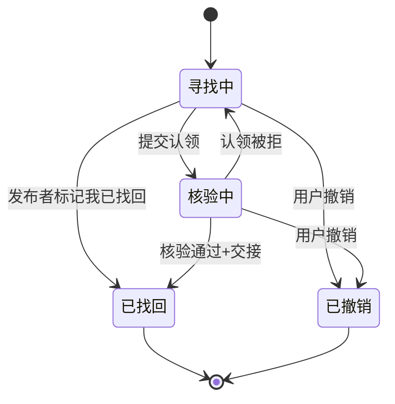
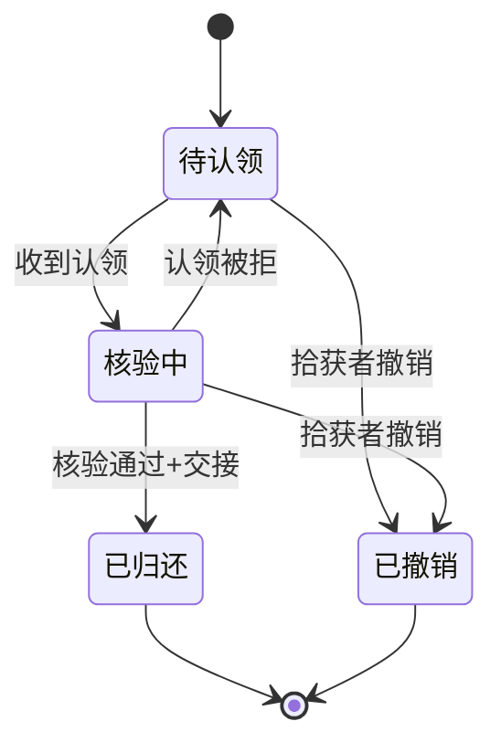
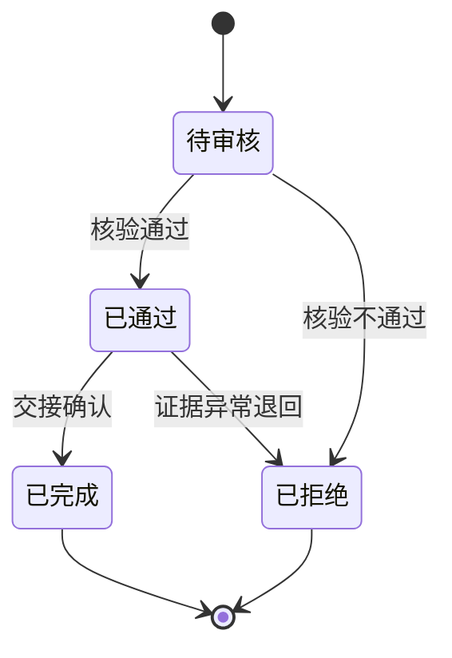
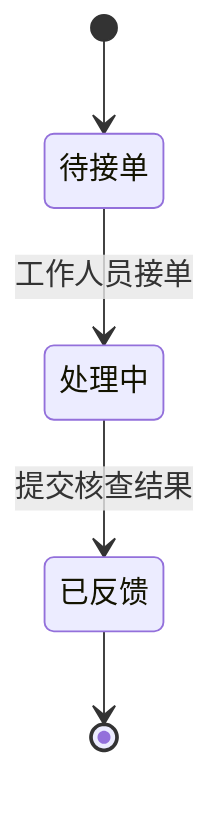
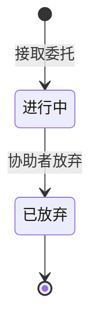
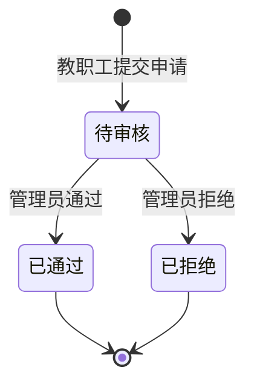

# 校园寻物局 · 需求规格说明书（已确认 v2.0）

## 0. 文档信息与约定

| 项 | 内容 |
|---|---|
| 项目 | 校园寻物局（校园失物协作平台） |
| 阶段 | 阶段1：需求规格设计（仅规格，不实现） |
| 特性名 | `campus_lost_found` |
| 写入路径 | `.codeartsdoer/specs/campus_lost_found/spec.md` |
| 状态 | 已确认 v2.0（2026-10-14） |

**EARS 约定**：触发关键字与固定短语保持英文（`When`/`While`/`If`/`Where`/`The … shall`），事件、前置条件、响应等可变部分本地化为中文；默认主语为 `the 系统`，必要时替换为具体模块名。

**假设与证据约定**：
- 全文以 `[假设]` 标记未证实内容；团队推断不得改写为真实用户结论。
- 团队角色模拟仅验证内部流程，不代表真实用户试用或校方认可；外部人员参与不作为阶段前置条件。
- 不接入真实监控，不编造需求依据、开发记录、使用记录与测试结果。

---

## v1.0 → v2.0 变更记录

本版本在 v1.0 已确认的「发布→匹配→认领→核验→归还→协助工单」闭环之上叠加新功能，不删除、不改变既有认领、核验、归还、协助工单与规则候选匹配行为。逐条变更如下：

| # | 变更点 | v1.0 现状 | v2.0 调整 |
|---|---|---|---|
| 1 | 角色体系 | 学生自助注册；工作人员仅管理员创建 | 新增教职工自助申请（工号 4~20 位字母/数字），管理员审核通过后获工作人员权限；管理员保留直接创建工作人员能力 |
| 2 | 身份与称号展示 | 仅昵称 | 昵称旁显示身份（学生/教职工/教职工审核中）与称号 |
| 3 | 页面结构 | 顶部导航 | 手机优先：底部四标签（大厅/地图/AI/我的），≥768px 改左侧导航；375px 完整可用，可点击区域 ≥44px |
| 4 | 大厅卡片 | 概览列表 | 增补首图缩略图、建筑名与楼层、点赞/评论/接取人数；分页改「加载更多」 |
| 5 | 发布 | 图片+文字提取+标点+圈范围+分层路线 | 照片最多 6 张（jpg/png/webp、单张 ≤5MB、前端压缩长边 ≤1600px、后端去位置信息）；支持标点/圈范围/画路径；点选建筑与楼层自动带出 |
| 6 | 照片可见性 | 无区分 | 寻物帖照片公开；拾获帖照片仅发布者与工作人员可见，他人见「为防冒领，照片已隐藏」 |
| 7 | 评论 | 无 | 登录用户可评论（1~500 字、最多 3 图、仅一层回复、软删除显示「该评论已删除」） |
| 8 | 点赞/收藏 | 无 | 一人一次可取消；列表与详情显示数量及「我是否已点赞/收藏」 |
| 9 | 接取委托 | 无 | 非发布者登录用户可接取「寻找中/核验中」寻物帖成为协助者，可放弃；展示协助者人数与名单 |
| 10 | 发布者操作 | 仅撤销 | 增补「我已找回」（寻找中且无有效认领）、致谢最多 3 名协助者 |
| 11 | 地图底图 | 室外示意图 | 更换为 2.5D 立体校园示意图；建筑数据由配置文件导入数据库 |
| 12 | 地图图层 | 固定 3 图层 | 可独立开关：建筑层、帖子点位层（聚合）、求助点位层、监控点位层（模拟、仅工作人员）、AI 推荐层、热力层 |
| 13 | 楼层图 | 一栋楼两层 | 有平面图的建筑可进楼层图切换，首批 1~2 栋 |
| 14 | 绘制工具 | 标点/圈范围/画路径 | 新增「发布到大厅」入口带入位置与建筑；圈选范围默认公开、路径默认私密 |
| 15 | AI | 提取 + 候选推荐 | 对话式界面：智能整理发帖（生成草稿）+ 寻物地点推荐（最多 5 个地点与理由）；规则打分 + 模型解释，超时 10 秒降级 |
| 16 | 积分与称号 | 轻量协助徽章 | 新增积分事件（致谢 +20、归还 +15、工单反馈 +10）与称号体系，阈值集中配置，保留协助徽章 |
| 17 | 演示数据 | 无 | 一键生成约 60 条历史记录，标记「演示」，用于 AI 推荐与热力图演示 |
| 18 | 非功能 | 本地存储 | 图片存本地 storage 目录、存储接口抽象预留 OBS；部署华为云 ECS + Nginx |

---

## 1. 需求假设表

| 编号 | 假设 | 设计依据 | 对应功能 | 验证方式 | 剩余不确定性 |
|---|---|---|---|---|---|
| A1 | 地图点位为「模拟点位」，非真实校园坐标 [假设] | 约束5、7 | 地图标点、监控点位、协助工单核查清单 | 点位带「模拟」标识并在界面明示 | 模拟点位与真实校园布局的映射精度 |
| A2 | 候选推荐与 AI 生成不训练模型，仅调用外部接口/规则推荐 [假设] | 「不训练模型、不增加独立向量数据库」 | 匹配推荐、智能整理发帖、地点推荐 | 来源可标识；无训练环节 | 模型外部接口的可用性与响应时延 |
| A3 | 教职工自助申请，管理员审核通过后成为工作人员；审核通过前按学生权限使用 [假设] | 约束1「教职工审核通过前按学生权限处理」 | 注册、角色、权限、教职工审核 | 教职工自助申请进入「待审核」；待审核期间越权被拒 | 初始管理员账号的产生与发放方式 |
| A4 | 比例尺仅在用户完成标定后启用，未标定不显示米数 [假设] | 约束6 | 地图圈选、路线距离 | 未标定地图上不出现米数 | 标定动作由谁触发（管理员/发布者） |
| A5 | 图片/文字提取仅用于候选与草稿生成，不参与审批决策 [假设] | 约束3 | 发布、AI 整理、匹配 | 提取结果仅作候选/草稿，审批仍由工作人员执行 | 提取质量偏低时的兜底策略 |
| A6 | 缓存、规则推荐与实时模型结果须在界面区分标识 [假设] | 约束5 | 候选推荐、AI 输出 | 候选条目与 AI 输出带来源标识 | 缓存失效策略（暂缓/待定） |
| A7 | 认领证据、联系方式、精确位置存于后端私密域，不进入公共接口 [假设] | 约束2 | 认领归还、私密证据、拾获帖照片 | 公共接口响应不含证据/联系方式/精确位置 | 证据存储加密级别 |
| A8 | 「同一物品只能归还一次」以物品标识为闭合依据 [假设] | 约束4 | 认领归还、关闭记录 | 对已完成物品再次归还被拒绝 | 多份同类物品（多把雨伞）的区分方式 |
| A9 | 圈选范围默认公开、路径默认私密；私密内容仅本人及授权工单处理人员可见 [假设] | 约束9 | 地图绘制、协助工单、授权线索 | 未授权时处理人员无法访问私密内容 | 授权的撤销粒度与时机 |
| A10 | 模型故障降级为手动/规则流程，不阻断主流程 [假设] | 约束8 | 发布、AI、筛选、归还 | 模型不可用时手动/规则仍可完成 | 降级提示文案与超时阈值 |
| A11 | 教职工工号格式为 4~20 位字母或数字，部门选填；审核前按学生权限、审核通过获工作人员权限 [假设] | 约束1 | 教职工注册、审核 | 非法工号被拒；待审核越权被拒 | 工号与校方系统是否校验一致性 |
| A12 | 建筑数据（编号、名称、类别、层数、点击区域、标签位置）由配置文件导入数据库 [假设] | 需求四.1 | 建筑层、建筑卡片、楼层图 | 配置导入后建筑可查询、可点选 | 配置文件格式与维护方式 |
| A13 | 2.5D 立体示意图与楼层平面图由团队自备，非真实测绘/真实监控 [假设] | 约束7 | 地图底图、楼层图 | 底图与楼层图正确渲染 | 底图制作精度与楼层覆盖范围 |
| A14 | 模型通过 OpenAI 兼容接口调用（可配置华为云 ModelArts Studio 或其他服务），外部服务可用性为依赖 [假设] | 需求五.6 | 智能整理发帖、地点推荐 | 配置后调用成功；未配置走降级 | 外部服务时延与额度 |
| A15 | 演示数据约 60 条历史记录标记为「演示」，仅用于 AI 推荐与热力图演示 [假设] | 需求八 | 演示数据脚本、热力层 | 演示数据带「演示」标签 | 演示数据与真实数据的隔离 |
| A16 | 积分只增不减、同一事件对同一人只计一次；称号阈值与名称集中配置 [假设] | 需求七 | 积分与称号 | 重复事件不重复计分；阈值可配置 | 积分事件边界与防刷 |

---

## 2. 现状分析

### 2.1 现有信息发布与查找流程可能存在的问题（未证实判断均标为假设）

1. 失物信息分散于线下登记、公告栏、群聊，缺乏统一入口，时效差、检索难 [假设]。
2. 寻物与拾获分属两套信息流，缺乏双向匹配，靠人工比对效率低、易漏 [假设]。
3. 认领缺乏私密证据核验机制，存在冒领风险，且无法追踪核对记录 [假设]。
4. 归还状态缺少闭环，物品是否归还、认领是否完成无据可查 [假设]。
5. 缺乏地图定位与路线线索，无法通过"经过路线"缩小查找范围 [假设]。
6. 联系信息与认领证据无权限隔离，未经授权即可被查看，隐私保护不足 [假设]。
7. 权限控制未在服务端强制，易被前端绕过 [假设]。

### 2.2 四类典型场景

> 每场景按「角色 / 输入 / 操作 / 结果 / 异常 / 隐私要求」六要素描述。

#### 场景一：明确知道丢失地点
- **角色**：学生（失主）
- **输入**：丢失物品图片、文字描述、地点（如"图书馆2F 自习室"）、大致时间
- **操作**：发布寻物 → 系统提取图片/文字（或 AI 整理草稿）→ 失主确认 → 系统按地点匹配拾获候选 → 查看候选 → 提交认领证据 → 工作人员核验 → 交接归还
- **结果**：寻物置「已找回」、拾获置「已归还」、认领置「已完成」，记录关闭
- **异常**：无候选 → 引导转协助工单；认领被拒 → 寻物回到「寻找中」
- **隐私要求**：证据与联系方式仅失主本人和该单处理人员可见；地点按楼层级脱敏公开

#### 场景二：只记得经过路线
- **角色**：学生（失主）
- **输入**：经过路线（途经点）、时间段、物品描述
- **操作**：在地图上绘制经过路线（或现场绘制后请求地点推荐）→ 系统记录分层路线 → 匹配途经区域的拾获记录 → 生成候选 / 推荐优先寻找地点 → 提交认领
- **结果**：有候选则进入认领闭环；无候选则转协助工单
- **异常**：路线区域未标比例尺 → 不输出米数；点位存在偏移；模型不可用 → 规则推荐 + 模板解释
- **隐私要求**：路线默认私密，仅失主可见；**仅当失主主动授权且工单分配后**，处理人员方可访问

#### 场景三：已拾获等待认领
- **角色**：学生（拾获者）
- **输入**：拾获物品图片、地点、时间
- **操作**：发布拾获 → 系统反向匹配寻物候选 → 拾获者等待 → 失主提交认领 → 工作人员核验 → 归还交接
- **结果**：拾获记录置「已归还」、寻物置「已找回」
- **异常**：长时间无人认领 → 保持「待认领」；证据不符 → 认领被拒绝
- **隐私要求**：拾获者联系方式私密不公开；物品概览（类别+脱敏地点）公开；**拾获帖照片仅发布者与工作人员可见**

#### 场景四：直接匹配失败需要协助
- **角色**：学生（发布者）触发，工作人员处理
- **输入**：发布内容 + "匹配失败/无候选"结果
- **操作**：系统引导转协助工单 → 工单「待接单」→ 工作人员接单「处理中」→ 失主授权路线 → 查看模拟点位与核查清单 → 现场核查 → 反馈结果
- **结果**：工单「已反馈」；若发现物品则回归认领归还闭环
- **异常**：无人接单 → 保持「待接单」；核查无果 → 反馈"未找到"
- **隐私要求**：授权范围最小化，路线/模拟点位仅授权后的处理人员可见

---

## 3. 需求规格

### 3.1 必做功能（v2.0 范围）

| 模块 | 内容 |
|---|---|
| 注册与角色 | 学生自助注册即生效；教职工自助申请（工号 4~20 位字母/数字）→ 管理员审核通过后获工作人员权限，审核前按学生权限；管理员系统初始化创建并保留直接创建工作人员能力；权限后端强制 |
| 页面结构 | 手机优先：底部四标签「大厅/地图/AI/我的」，≥768px 改左侧导航；375px 完整可用，可点击区域 ≥44px；工作人员/管理员专属功能从「我的」页进入 |
| 大厅 | 寻物/拾获卡片列表（首图缩略图、类型、标题、状态、建筑名+楼层、发布时间、点赞/评论/接取人数）；关键词/类型/类别/状态/建筑筛选；分页「加载更多」 |
| 发布 | 寻物/拾获发布；照片最多 6 张（jpg/png/webp、单张 ≤5MB、前端压缩长边 ≤1600px、后端去除位置信息）；可标点、圈范围、画路径；点选建筑与楼层自动带出；AI 整理草稿确认后发布 |
| 互动 | 评论（1~500 字、最多 3 图、一层回复、软删除）；点赞/收藏（一人一次可取消）；接取委托（非发布者可接取「寻找中/核验中」寻物帖、可放弃） |
| 发布者操作 | 寻找中/待认领可撤销；寻物帖在寻找中且无有效认领可「我已找回」；已找回后可致谢最多 3 名协助者 |
| 匹配与 AI | 规则候选匹配（保留）；智能整理发帖；寻物地点推荐（最多 5 个地点 + 理由 + 建议顺序）；来源标识（模拟点位/规则推荐/缓存/实时模型结果） |
| 地图 | 2.5D 立体校园示意图 + 建筑数据配置导入；可开关图层（建筑/帖子点位/求助点位/监控点位/AI 推荐/热力）；楼层图（首批 1~2 栋）；绘制工具（标点/圈范围/画路径）与「发布到大厅」 |
| 认领归还 | 私密证据提交；工作人员核验；交接确认；关闭记录；同一物品仅归还一次（保留） |
| 协助工单 | 接单、授权线索、模拟点位、核查清单、结果反馈（保留） |
| 我的 | 个人信息（昵称/身份/称号/积分及进度）；我的发布/收藏/点赞/评论/认领/接取委托/工单/积分明细；工作人员入口（认领审核、工单处理）、管理员入口（教职工审核） |
| 积分与称号 | 致谢协助者 +20、拾获归还 +15、工单反馈 +10；同一事件只计一次、只增不减；称号 0/20/60/150/300 集中配置；保留协助徽章 |
| 演示数据 | 一键生成约 60 条历史记录，标记「演示」，用于 AI 推荐与热力图演示 |
| 状态机 | 寻物/拾获/认领/工单/接取委托/教职工申请六套状态及合法流转（见第4章） |
| 权限与隐私 | 后端强制；路线默认私密、圈选范围默认公开；拾获帖照片仅发布者与工作人员可见；证据/联系方式/精确位置不进入公共接口；AI 仅提取、推荐、生成草稿 |

### 3.2 暂缓功能（v2.0 不纳入）

真实监控接入、人脸识别、实时聊天或私信、积分商城、全校所有楼层的室内图、原生 App。

### 3.3 资源依赖
- 在 v1.0 前后端基础上增量开发，保留既有功能与测试。
- **固定技术栈**：React＋TypeScript、FastAPI、PostgreSQL、Docker Compose、Leaflet 图片地图；单体架构，不训练模型、不增加独立向量数据库；后端仅新增 httpx、Pillow，前端不新增依赖。
- **模型依赖**：OpenAI 兼容接口（可配置华为云 ModelArts Studio 或其他服务），仅调用/规则推荐，不训练；外部模型接口可用性为依赖项（见 A2、A14）。
- **底图依赖**：2.5D 立体示意图与楼层平面图需自备，不依赖真实监控/真实地图（见 A13）。
- **建筑数据**：由配置文件导入数据库（见 A12）。
- **存储依赖**：图片存本地 storage 目录，存储接口抽象，预留华为云 OBS 切换。
- **部署目标**：华为云 ECS + Docker Compose，前端构建后由 Nginx 提供。
- 教职工账号由管理员审核（见 A3、A11）；比例尺由标定动作启用（见 A4）；演示数据脚本一键生成（见 A15）。

---

## 4. 状态定义与状态机

### 4.1 寻物（Lost）
状态集：`寻找中`（初始）、`核验中`、`已找回`（终）、`已撤销`（终）

| 源状态 | 目标状态 | 触发事件 |
|---|---|---|
| 寻找中 | 核验中 | 提交认领申请进入核验 |
| 寻找中 | 已找回 | 发布者自行标记「我已找回」（寻找中且无有效认领） |
| 寻找中 | 已撤销 | 用户主动撤销（未闭环） |
| 核验中 | 已找回 | 核验通过 + 归还交接完成 |
| 核验中 | 寻找中 | 核验不通过（认领被拒） |
| 核验中 | 已撤销 | 用户主动撤销（无已通过认领） |
| 已找回 / 已撤销 | — | 终态，不可再变 |

### 4.2 拾获（Found）
状态集：`待认领`（初始）、`核验中`、`已归还`（终）、`已撤销`（终）

| 源状态 | 目标状态 | 触发事件 |
|---|---|---|
| 待认领 | 核验中 | 收到认领申请 |
| 待认领 | 已撤销 | 拾获者撤销 |
| 核验中 | 已归还 | 核验通过 + 交接完成 |
| 核验中 | 待认领 | 认领被拒，回到待认领 |
| 核验中 | 已撤销 | 拾获者撤销（无已通过认领） |
| 已归还 / 已撤销 | — | 终态，不可再变 |

### 4.3 认领（Claim）
状态集：`待审核`（初始）、`已通过`、`已拒绝`（终）、`已完成`（终）

| 源状态 | 目标状态 | 触发事件 |
|---|---|---|
| 待审核 | 已通过 | 工作人员核验通过 |
| 待审核 | 已拒绝 | 工作人员核验不通过 |
| 已通过 | 已完成 | 归还交接确认 |
| 已通过 | 已拒绝 | 交接前发现证据异常（异常兜底） |
| 已拒绝 / 已完成 | — | 终态，不可再变 |

### 4.4 工单（Ticket）
状态集：`待接单`（初始）、`处理中`、`已反馈`（终）

| 源状态 | 目标状态 | 触发事件 |
|---|---|---|
| 待接单 | 处理中 | 工作人员接单 |
| 处理中 | 已反馈 | 提交核查结果 |
| 已反馈 | — | 终态，不可再变（支持顺向流转，不支持工单撤销） |

### 4.5 接取委托（Helper）
状态集：`进行中`（初始）、`已放弃`（终）

| 源状态 | 目标状态 | 触发事件 |
|---|---|---|
| 进行中 | 已放弃 | 协助者主动放弃 |
| 已放弃 | — | 终态；可再次接取则新建委托记录 |

### 4.6 教职工申请（StaffApplication）
状态集：`待审核`（初始）、`已通过`（终）、`已拒绝`（终）

| 源状态 | 目标状态 | 触发事件 |
|---|---|---|
| 待审核 | 已通过 | 管理员审核通过（role 由 student 转为 staff） |
| 待审核 | 已拒绝 | 管理员拒绝并填写理由 |
| 已通过 / 已拒绝 | — | 终态，不可再变 |

---

## 5. 角色权限与信息可见性

### 5.1 角色

| 角色 | 获取方式 | 核心权限 |
|---|---|---|
| 学生 | 自助注册即生效 | 发布寻物/拾获、发起认领、申请协助、接取委托、评论/点赞/收藏、查看本人信息、授权路线 |
| 教职工（审核中） | 自助申请（必填工号 4~20 位字母/数字，选填部门） | 审核通过前**按学生权限使用**；可查看本人申请结果与理由 |
| 工作人员 | 教职工申请经管理员审核通过，或管理员直接创建 | 接单、授权后查看线索、核验认领、确认归还、关闭记录、反馈工单、查看监控点位（模拟）、删除任意评论 |
| 管理员 | 系统初始化创建 | 审核教职工申请、直接创建工作人员账号、标定地图比例尺；可执行工作人员全部操作 |

### 5.2 权限边界（后端强制）
- 学生、教职工（审核中）、工作人员、管理员的权限必须在后端执行，前端仅做展示，前端越权请求后须被拒绝。
- 教职工审核通过前 `role` 保持 student，按学生权限处理；审核通过时 `role` 转为 staff。
- 模型（AI）只能**提取、推荐、生成草稿**，**禁止**批准认领、禁止确认归还、禁止替用户发布；AI 输出经用户确认后才保存。

### 5.3 公开信息
任一已登录用户可见：
- 寻物/拾获概览：物品类别、楼层级脱敏地点、时间段、状态、评论/点赞/收藏/接取人数。
- 物品外观简述（不含精确位置、联系方式、证据）。
- 寻物帖照片（公开）。
- 求助点位（保卫处、服务台、失物招领处，所有人可见）。

### 5.4 私密信息（不进入公共接口）
| 信息 | 可见范围 |
|---|---|
| 认领证据（图片/文字） | 仅发布者本人 + 处理该单的工作人员 |
| 联系信息 | 仅相关处理人员，且仅在授权后 |
| 精确位置 | 仅发布者本人（公共接口脱敏） |
| 经过路线 | 默认私密；授权且工单分配后，处理人员可见 |
| 圈选范围 | 默认公开，可改为私密；私密时仅本人及授权处理人员可见 |
| 拾获帖照片 | 仅发布者本人 + 工作人员；其他人见「为防冒领，照片已隐藏」 |
| 监控点位 | 仅模拟数据，仅工作人员可见，界面标注「模拟」 |
| 工单核查清单/模拟点位 | 仅处理人员 + 工单发布者本人 |

---

## 6. 核心功能验收场景（EARS）

### 6.1 注册与角色
- **正常**：`When` 学生完成注册，`the 系统 shall` 创建学生账号并立即赋予「学生」角色生效。
- **正常**：`When` 用户注册时选择「教职工」身份并提交合法工号（4~20 位字母或数字），`the 系统 shall` 创建账号、申请状态为「待审核」、`role` 保持 student。
- **正常**：`When` 管理员通过教职工申请，`the 系统 shall` 将该用户 `role` 由 student 转为 staff 并赋予工作人员权限。
- **正常**：`When` 管理员拒绝教职工申请，`the 系统 shall` 记录拒绝理由，申请人可见结果与理由。
- **正常**：`When` 管理员创建工作人员账号，`the 系统 shall` 直接赋予「工作人员」角色。
- **异常**：`If` 教职工工号为空或不符合 4~20 位字母/数字格式，`the 系统 shall` 拒绝申请并提示修正。
- **异常**：`If` 管理员拒绝申请时未填写理由，`the 系统 shall` 拒绝该拒绝操作并提示填写理由。
- **权限**：`While` 教职工申请处于「待审核」，`the 系统 shall` 不授予核验、接单、确认归还、删除任意评论等工作人员权限。
- **权限**：`While` 用户为学生或教职工（审核中），`the 系统 shall` 不授予教职工审核权限。
- **权限**：`If` 用户尝试以「工作人员」身份自助注册（绕过审核直接成为 staff），`the 系统 shall` 拒绝。

### 6.2 页面结构与导航（手机优先）
- **正常**：`When` 用户在手机宽度访问，`the 系统 shall` 显示底部固定四标签「大厅/地图/AI/我的」。
- **正常**：`When` 屏幕宽度 ≥768px，`the 系统 shall` 将底部标签改为左侧导航。
- **正常**：`When` 用户为工作人员或管理员，`the 系统 shall` 在「我的」页提供认领审核、协助工单处理（管理员额外提供教职工审核）入口。
- **异常**：`If` 375px 宽度下任一功能出现横向滚动或可点击区域小于 44px，`the 系统 shall` 视为未达标（不可用）。
- **权限**：`While` 用户为学生，`the 系统 shall` 不展示工作人员/管理员专属入口（前端隐藏，权限仍后端强制）。

### 6.3 发布（寻物/拾获）
- **正常**：`When` 学生提交寻物发布（含类别/地点/时间/描述），`the 系统 shall` 创建寻物记录，状态为「寻找中」。
- **正常**：`When` 学生提交拾获发布，`the 系统 shall` 创建拾获记录，状态为「待认领」。
- **正常**：`When` 发布含照片，`the 系统 shall` 校验最多 6 张、格式限 jpg/png/webp、单张 ≤5MB；前端压缩长边 ≤1600px；后端去除照片中的位置信息后入库。
- **正常**：`When` 用户在地图上点选建筑与楼层，`the 系统 shall` 自动带出对应建筑与楼层到发布表单。
- **异常**：`If` 必填字段缺失，`the 系统 shall` 拒绝发布并提示补齐。
- **异常**：`If` 照片数量超过 6 张、格式不符或单张超过 5MB，`the 系统 shall` 拒绝并提示具体原因。
- **异常**：`If` 模型提取失败，`the 系统 shall` 允许手动填写描述继续发布（不阻断）。
- **权限**：`While` 用户未登录，`the 系统 shall` 拒绝发布请求。
- **权限**：`When` 发布者上传照片，`the 系统 shall` 在服务端去除照片 EXIF 位置信息，不将原始位置信息入库或返回。

### 6.4 大厅列表、筛选与详情
- **正常**：`When` 用户浏览大厅，`the 系统 shall` 在每张卡片显示首张照片缩略图、寻物/拾获标签、标题、状态、地点（建筑名与楼层）、发布时间、点赞数、评论数、接取人数。
- **正常**：`When` 用户按关键词/类型/类别/状态/建筑筛选，`the 系统 shall` 返回匹配结果。
- **正常**：`When` 用户点击「加载更多」，`the 系统 shall` 追加下一页数据。
- **正常**：`When` 用户查看拾获帖照片且非发布者非工作人员，`the 系统 shall` 显示「为防冒领，照片已隐藏」。
- **异常**：`If` 筛选无结果，`the 系统 shall` 展示空态提示。
- **权限**：`While` 用户非拾获帖发布者且非工作人员，`the 系统 shall` 不返回拾获帖照片内容。

### 6.5 评论
- **正常**：`When` 登录用户对帖子提交评论（1~500 字、最多 3 张图片），`the 系统 shall` 创建评论并展示。
- **正常**：`When` 用户回复评论，`the 系统 shall` 仅支持一层回复。
- **正常**：`When` 本人删除自己的评论，或工作人员/管理员删除任意评论，`the 系统 shall` 软删除并显示「该评论已删除」。
- **异常**：`If` 评论内容为空或超过 500 字，`the 系统 shall` 拒绝并提示。
- **异常**：`If` 评论图片超过 3 张，`the 系统 shall` 拒绝并提示。
- **权限**：`While` 用户未登录，`the 系统 shall` 拒绝评论。
- **权限**：`If` 非本人且非工作人员/管理员尝试删除评论，`the 系统 shall` 拒绝。

### 6.6 点赞与收藏
- **正常**：`When` 登录用户对帖子点赞或收藏，`the 系统 shall` 记录该用户一次点赞/收藏。
- **正常**：`When` 用户再次点赞/收藏已点赞/已收藏的帖子，`the 系统 shall` 取消（一人一次、可取消）。
- **正常**：`When` 展示列表或详情，`the 系统 shall` 显示点赞数、收藏数及「我是否已点赞/收藏」。
- **异常**：`If` 用户点赞/收藏不存在的帖子，`the 系统 shall` 返回「不存在」错误。
- **权限**：`While` 用户未登录，`the 系统 shall` 拒绝点赞/收藏。

### 6.7 接取委托
- **正常**：`When` 除发布者外的登录用户对「寻找中」或「核验中」的寻物帖点击「接取委托」，`the 系统 shall` 将其记为协助者。
- **正常**：`When` 协助者主动放弃，`the 系统 shall` 将委托置为「已放弃」。
- **正常**：`When` 展示帖子，`the 系统 shall` 显示协助者人数与名单（昵称与称号）。
- **异常**：`If` 帖子状态非「寻找中/核验中」，`the 系统 shall` 拒绝接取并提示状态不允许。
- **权限**：`While` 用户为帖子发布者，`the 系统 shall` 拒绝其接取自己的委托。

### 6.8 撤销与「我已找回」
- **正常**：`When` 发布者对「寻找中」或「待认领」帖子撤销，`the 系统 shall` 置为「已撤销」。
- **正常**：`When` 发布者对「寻找中」且无有效认领的寻物帖标记「我已找回」，`the 系统 shall` 置为「已找回」。
- **正常**：`When` 寻物帖已找回（自行找回或经认领归还），`the 系统 shall` 允许发布者从协助者中选择最多 3 人致谢。
- **异常**：`If` 寻物帖存在有效认领（已通过），`the 系统 shall` 拒绝发布者直接标记「我已找回」。
- **异常**：`If` 致谢人数超过 3 人，`the 系统 shall` 拒绝并提示最多 3 人。
- **权限**：`While` 非发布者本人，`the 系统 shall` 拒绝撤销或「我已找回」操作。

### 6.9 匹配推荐与寻物地点推荐
- **正常**：`When` 寻物发布完成，`the 系统 shall` 生成最多三个拾获候选及解释（规则候选匹配保留）。
- **正常**：`When` 用户选择一条寻物帖（使用其圈选范围或路径）或在地图上现场绘制，`the 系统 shall` 推荐最多 5 个优先寻找地点，每个附推荐理由与建议寻找顺序。
- **正常**：`When` 推荐产生，`the 系统 shall` 先由规则算法打分（依据距离、历史寻物/拾获记录数、同类别历史数、建筑类型与类别对应关系），再由模型生成解释文字。
- **正常**：`When` 推荐结果生成，`the 系统 shall` 在地图 AI 推荐层高亮显示，并标注「AI 生成，仅供参考」及来源（实时模型或规则）。
- **正常**：`When` 模型不可用，`the 系统 shall` 展示规则打分结果与模板解释。
- **异常**：`If` 无候选，`the 系统 shall` 提示可转协助工单。
- **异常**：`If` 模型返回超时（超过 10 秒），`the 系统 shall` 降级为规则推荐或空候选，不阻断发布。
- **异常**：`If` 模型结果含他者私密信息，`the 系统 shall` 过滤且不展示。
- **权限**：`While` 候选未确认，`the 系统 shall` 不自动批准认领或确认归还。
- **权限**：`When` 发送内容给模型，`the 系统 shall` 不含精确位置、联系方式、认领证据及他人的私密路径。

### 6.10 AI 智能整理发帖
- **正常**：`When` 用户用自然语言描述（如"昨天下午在一食堂二楼丢了蓝色水杯"），`the 系统 shall` 提取类型、类别、标题、描述、地点、时间、建筑，生成发帖草稿。
- **正常**：`When` 用户确认或修改草稿后发布，`the 系统 shall` 才保存帖子并标注「AI 生成」来源。
- **正常**：`When` AI 输出生成，`the 系统 shall` 标注「AI 生成，仅供参考」及来源（实时模型或规则）。
- **异常**：`If` 模型不可用，`the 系统 shall` 提示用户手动填写发帖（不阻断）。
- **权限**：`While` 草稿未经用户确认，`the 系统 shall` 不自动发布帖子（AI 不能替用户发布）。

### 6.11 认领提交
- **正常**：`When` 失主对某拾获记录提交认领，`the 系统 shall` 创建认领申请，状态为「待审核」。
- **正常**：`When` 认领提交含私密证据，`the 系统 shall` 将证据存储于私密域。
- **异常**：`If` 证据缺失，`the 系统 shall` 拒绝提交（证据必填）。
- **权限**：`While` 提交者非该拾获记录发布者，`the 系统 shall` 仍允许提交，但须附证据由工作人员判断。

### 6.12 核验与归还
- **正常**：`When` 工作人员核验通过认领申请，`the 系统 shall` 将认领置为「已通过」并进入交接。
- **正常**：`When` 交接完成确认，`the 系统 shall` 将认领置「已完成」、寻物置「已找回」、拾获置「已归还」。
- **正常**：`When` 一件物品完成一次归还，`the 系统 shall` 关闭该记录并禁止再次归还。
- **异常**：`If` 工作人员核验不通过，`the 系统 shall` 将认领置为「已拒绝」。
- **异常**：`If` 对已完成物品再次发起归还，`the 系统 shall` 拒绝。
- **权限**：`While` 用户为已授权工作人员，`the 系统 shall` 允许核验与确认归还。
- **权限**：`While` 用户为学生，`the 系统 shall` 不授予核验/确认归还权限。
- **权限**：`If` 模型（AI）尝试直接批准认领或确认归还，`the 系统 shall` 禁止（模型无审批权）。

### 6.13 协助工单
- **正常**：`When` 匹配失败或无候选时学生提交协助，`the 系统 shall` 创建工单，状态为「待接单」。
- **正常**：`When` 工作人员接单，`the 系统 shall` 将工单置为「处理中」。
- **正常**：`When` 发布者授权路线，`the 系统 shall` 允许处理人员查看路线与模拟点位（仅授权后）。
- **正常**：`When` 工作人员提交核查结果，`the 系统 shall` 将工单置为「已反馈」。
- **异常**：`If` 长时间无人接单，`the 系统 shall` 保持「待接单」并提示。
- **权限**：`While` 路线未授权，`the 系统 shall` 不向处理人员展示路线。
- **权限**：`While` 工单未分配，`the 系统 shall` 不向任何处理人员暴露路线与线索。

### 6.14 地图与图层
- **正常**：`When` 用户打开地图，`the 系统 shall` 显示 2.5D 立体校园示意图底图。
- **正常**：`When` 建筑数据经配置文件导入，`the 系统 shall` 按编号/名称/类别/层数/点击区域/标签位置入库并支持查询。
- **正常**：`When` 用户点击建筑，`the 系统 shall` 弹出建筑卡片（名称、类别、该建筑进行中帖子数、查看相关帖子、进入楼层）。
- **正常**：`When` 用户切换图层，`the 系统 shall` 支持建筑层、帖子点位层、求助点位层、监控点位层、AI 推荐层、热力层独立开关。
- **正常**：`When` 帖子点位密集，`the 系统 shall` 将寻物/拾获不同图标聚合为数字气泡，点开显示列表。
- **正常**：`When` 有平面图的建筑进入楼层图，`the 系统 shall` 支持切换楼层（首批 1~2 栋）。
- **正常**：`When` 地图未标定比例尺，`the 系统 shall` 不输出实际米数。
- **异常**：`If` 楼层图无平面图，`the 系统 shall` 不提供进入楼层入口并提示。
- **权限**：`While` 用户为工作人员，`the 系统 shall` 展示监控点位层并标注「模拟」；`While` 用户非工作人员，`the 系统 shall` 不展示监控点位层。
- **权限**：`When` 求助点位层渲染，`the 系统 shall` 对所有人可见（保卫处、服务台、失物招领处）。

### 6.15 绘制工具与从地图发帖
- **正常**：`When` 用户使用标点（点一下）、圈范围（点圆心后调整半径）、画路径（依次点击，支持完成/撤销上一步/清空），`the 系统 shall` 支持手指操作并记录几何。
- **正常**：`When` 用户绘制完成后选择「发布到大厅」，`the 系统 shall` 打开发布表单并带入位置与建筑。
- **正常**：`When` 圈选范围默认公开、路径默认私密，`the 系统 shall` 允许用户将圈选范围改为私密、路径改为公开。
- **异常**：`If` 画路径时点数不足（少于 2 点），`the 系统 shall` 拒绝保存路径并提示补齐。
- **权限**：`While` 内容为私密（圈选范围/路径），`the 系统 shall` 仅本人和经授权的工单处理人员可见（沿用原规则）。

### 6.16 积分与称号
- **正常**：`When` 被失主致谢的协助者，`the 系统 shall` 记 +20 分。
- **正常**：`When` 拾获帖经认领完成归还，`the 系统 shall` 给拾获帖发布者 +15 分。
- **正常**：`When` 工作人员完成工单反馈，`the 系统 shall` 给该工作人员 +10 分。
- **正常**：`When` 累计积分达到阈值，`the 系统 shall` 按 0 见习寻物人 / 20 热心同学 / 60 寻物能手 / 150 校园守护者 / 300 寻物传说 授予称号（阈值与名称集中配置）。
- **正常**：`When` 界面展示，`the 系统 shall` 在昵称旁显示身份与称号，并在「我的」显示积分及距下一称号的进度。
- **异常**：`If` 同一事件对同一人重复触发，`the 系统 shall` 只计一次（唯一约束）。
- **异常**：`If` 发帖、评论、点赞，`the 系统 shall` 不产生积分。
- **权限**：`When` 积分写入，`the 系统 shall` 仅由服务层积分函数写入，禁止其他路径直接改积分。

### 6.17 演示数据
- **正常**：`When` 执行一键生成脚本，`the 系统 shall` 生成约 60 条历史寻物与拾获记录，分布在各建筑，标记为演示数据。
- **正常**：`When` 演示数据展示，`the 系统 shall` 显示「演示」标签，并用于 AI 推荐与热力图演示。
- **异常**：`If` 演示数据脚本重复执行，`the 系统 shall` 幂等处理，不产生重复记录（或提示已生成）。
- **权限**：`When` 展示，`the 系统 shall` 将演示数据与真实数据分别标识来源（沿用来源标识约束）。

### 6.18 我的页面
- **正常**：`When` 用户进入「我的」，`the 系统 shall` 显示昵称、身份、称号、积分及距下一称号进度。
- **正常**：`When` 用户查看列表，`the 系统 shall` 提供我的发布、我的收藏、我点赞的、我的评论、我的认领、我接取的委托、我的工单、积分明细。
- **正常**：`When` 用户为工作人员，`the 系统 shall` 在「我的」提供认领审核、协助工单处理入口。
- **正常**：`When` 用户为管理员，`the 系统 shall` 提供教职工审核入口。
- **异常**：`If` 用户无任何数据，`the 系统 shall` 各列表展示空态提示。
- **权限**：`While` 用户查看他人详情，`the 系统 shall` 仅展示公开信息。

---

## 7. 需求与比赛评分维度对应表

| 评分维度（权重） | 对应需求 | 满足说明 |
|---|---|---|
| **功能完备度（30）** | 大厅、发布匹配、认领归还、协助工单、评论/点赞/收藏/接取委托、积分称号、六套状态机、四类场景 | 覆盖"发布→匹配→认领→核验→归还→关闭"主流程闭环及无候选的协助分叉，叠加互动、委托、积分与 AI 辅助 |
| **码道深度使用（25）** | SDD 分层（spec/design/tasks）、EARS 验收标准、mermaid 状态机建模、变更记录 | 以 CodeArts 规范交付、EARS 可测验收、状态机形式化描述、v1.0→v2.0 变更可追溯 |
| **专业贴合与创新（25）** | 私密证据核验、路线默认私密+最小授权、拾获帖照片防冒领、AI 仅推荐不决策、2.5D 立体示意图、寻物地点推荐、来源标识、比例尺门控 | 针对校园失物的隐私与信任设计，防冒领、防越权、防模型越界；AI 对话式辅助提升查找效率 |
| **技术架构与工程质量（15）** | 固定技术栈、单体架构、权限后端强制、同一物品仅归还一次、积分唯一约束、存储抽象预留 OBS | 后端强校验、状态闭合保证数据一致性；积分只增不减防刷 |
| **交付规范性（5）** | 假设表、来源声明、EARS 格式、版本与路径标注、变更记录 | 团队推断标 `[假设]`，不伪造依据/记录/测试结果 |