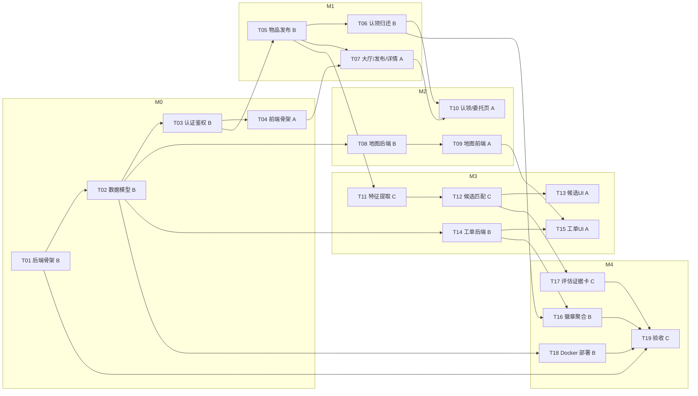

# 校园寻物局 · 阶段3 编码任务规划（tasks.md）

| 项 | 内容 |
|---|---|
| 项目 | 校园寻物局（校园失物协作平台） |
| 阶段 | 阶段3：编码任务规划 |
| 特性名 | `campus_lost_found` |
| 写入路径 | `.codeartsdoer/specs/campus_lost_found/tasks.md` |
| 上游输入 | `spec.md` v1.0 + `design.md` v1.0（含 2.11 T02、2.12 T20、2.13 T21 细化） |
| 状态 | v1.3（2026-10-13，新增 T21 响应模型/列表分页/大厅搜索） |

## 0. 约定与负责人

| 代号 | 负责人 | 职责范围 |
|---|---|---|
| **A** | 前端/地图/交互 | React 工程、Leaflet 图片地图、大厅/发布/认领/委托/工单页 |
| **B** | 后端/权限/数据库/状态/部署 | FastAPI 骨架、认证鉴权、状态机、脱敏、事务、工单、徽章、Docker |
| **C** | AI/评估/证据/演示 | 特征提取、候选匹配、来源标识、评估证据卡、演示脚本、Rules/Skill、验收 |

**后端先行原则**：B 的接口契约是 A/C 的前置。
**目录约定**：`backend/`（FastAPI）、`frontend/`（React+TS）、根目录 `docker-compose*.yml`、`.env`（入 `.gitignore`）。

## 1. 里程碑与交付节奏

| 里程碑 | 时间窗口 | 可运行版本目标 | 主导任务 |
|---|---|---|---|
| **M0 后端可跑** | 第 1–2 天 | `docker compose up` 后后端可 `/health`，12 表迁移成功 | T01–T04 |
| **M1 业务闭环** | 第 3–4 天 | 后端"发布→列表→详情→认领→核验→归还"闭环可 curl | T05–T07 |
| **M2 前端闭环+地图** | 第 5–6 天 | 前端大厅/发布/认领可用，地图标点/圈选/路线渲染 | T08–T10 |
| **M3 AI+工单** | 第 7–8 天 | 候选推荐（含降级）+ 协助工单协作闭环 | T11–T15 |
| **M4 收尾+验收** | 第 9–10 天 | 徽章、评估证据卡、demo 部署、Rules/Skill、EARS 验收 | T16–T19 |

## 2. 任务依赖图

## 3. 任务明细总表

| ID | 标题 | 负责人 | 前置依赖 | 关联接口/实体 | 关联 EARS |
|---|---|---|---|---|---|
| T01 | 后端工程骨架 | B | — | `/health` | — |
| T02 | 12 张实体建模与迁移 | B | T01 | 12 实体 | — |
| T03 | 认证鉴权 + 角色守卫 + 脱敏 | B | T02 | A 组接口；`user` | 6.1 |
| T04 | 前端工程骨架 + 通用组件 | A | T03 | Axios/路由/登录态 | — |
| T05 | 物品发布/列表/详情 + 状态机 | B | T03, T02 | B 组接口 | 6.2 |
| T06 | 认领/核验/归还事务 + 幂等 | B | T05 | E 组接口 | 6.4, 6.5 |
| T07 | 大厅/发布/详情前端页 | A | T04, T05 | B 组接口 | 6.2, 6.8 |
| T08 | 地图后端（图层/标定/点位） | B | T02 | C 组接口 | 6.7 |
| T09 | Leaflet 地图前端交互 | A | T08 | C 组接口 | 6.7 |
| T10 | 认领/我的委托前端页 | A | T06, T07 | E+G 组 | 6.4, 6.8 |
| T11 | 特征提取适配器 + 降级 | C | T05 | D 组 extract | 6.2, 6.3 |
| T12 | 候选匹配 + 来源标识 + 缓存 | C | T11 | D 组 candidates | 6.3 |
| T13 | 候选列表前端 + 来源标识 | A | T12 | D 组 | 6.3 |
| T14 | 工单状态机 + 授权后端 | B | T02 | F 组接口 | 6.6 |
| T15 | 工单协作 UI + 核查清单 | A | T14, T09 | F 组 | 6.6 |
| T16 | 徽章去重 + 我的委托聚合 | B | T06, T14 | G 组接口 | 6.8 |
| T17 | 匹配评估 + 证据卡 + 演示 | C | T12 | `candidate/claim_evidence` | 6.5, 7 |
| T18 | Docker Compose + 密钥后端化 | B | T02 | 3 套 compose | — |
| T19 | Rules/Skill 配置 + 阶段验收 | C | T01–T18 | 全部 | 6.1–6.8 |

## 4. 逐任务详细说明

### T01 后端工程骨架（B）
- **输出**：`backend/` FastAPI 工程，`pyproject.toml`/`requirements.txt`、`app/main.py`、配置加载、`GET /api/v1/health`、CORS、统一错误结构、`.env.example`。
- **验收**：`/api/v1/health` 返回 `{"status":"ok"}`；错误响应 `{code,message,details?}`。

### T02 12 张实体建模与迁移（B）
- **输出**：12 张 SQLAlchemy 模型 + Alembic 首版迁移；枚举严格对齐状态机；`UNIQUE(username)`、`UNIQUE(claim.idempotency_key)`、`UNIQUE(badge.user_id,kind)`。
- **验收**：`alembic upgrade head` 建 12 表；`layer.pixels_per_meter` 为空时不输出米数。

### T03 认证鉴权 + 角色守卫 + 脱敏序列化器（B）
- **输出**：register/login/me/admin/staff 接口；JWT；`RoleGuard(student/staff/admin)`；脱敏序列化器（剥离私密字段）。
- **验收**：见 EARS 6.1；注册禁止 role≠student；公开序列化不含私密字段。

### T04 前端工程骨架 + 通用组件（A）
- **输出**：`frontend/`（Vite+React+TS+Router+Axios interceptor+状态库）、登录/注册页、`<RequireAuth>`、通用组件。
- **验收**：未登录跳登录页；前端不存密钥、不自行判权限。

### T05 物品发布/列表/详情 + 状态机骨架（B）
- **输出**：`POST /items`、`GET /items`（筛选脱敏）、`GET /items/{id}`、`POST /items/{id}/map-anchor`；附件上传。
- **验收**：见 EARS 6.2；列表/详情不含私密字段。

### T06 认领/核验/归还事务 + 幂等（B）
- **输出**：`POST /claims`、`POST /claims/{id}/review`、`POST /claims/{id}/complete`；归还事务（FOR UPDATE+行锁+CAS）；证据私密域。
- **验收**：见 EARS 6.4/6.5；同一物品仅一次归还；学生越权 403。

### T07 大厅/发布/详情前端页（A）
- **输出**：大厅、发布、详情页。
- **验收**：见 EARS 6.2/6.3；模型提取失败可手动继续。

### T08 地图后端（B）
- **输出**：`GET /layers`、`GET /layers/{id}/image`、`GET /layers/{id}/points`、`POST /layers/{id}/calibrate`。
- **验收**：3 图层；未标定不返回米数；模拟点位标记；calibrate 仅 admin。

### T09 Leaflet 地图前端交互（A）
- **输出**：图片图层渲染、缩放/标点/画圈/分层路线、版本缓存失效、米数门控。
- **验收**：见 EARS 6.7；未标定不显示米数；模拟点位标记。

### T10 认领/我的委托前端页（A）
- **输出**：认领提交页；我的委托页。
- **验收**：见 EARS 6.4/6.8。

### T11 特征提取适配器 + 降级兜底（C）
- **输出**：`POST /items/{id}/extract`；模型适配器可选 Key/超时/容错/额度；降级链。
- **验收**：见 EARS 6.2/6.3；模型不可用返回空+503 不阻断。

### T12 候选匹配 + 来源标识 + 缓存（C）
- **输出**：`GET /items/{id}/candidates`（≤3+解释+source四类）；候选缓存；过滤私密。
- **验收**：见 EARS 6.3；来源标识；无候选提示转工单。

### T13 候选列表前端 + 来源标识（A）
- **验收**：见 EARS 6.3；渲染来源标识+解释。

### T14 工单状态机 + 授权后端（B）
- **输出**：tickets 全组接口；authorize-route；route 权限控制。
- **验收**：见 EARS 6.6；未授权/未分配 403。

### T15 工单协作 UI + 核查清单（A）
- **验收**：见 EARS 6.6；模拟点位标记；未授权不渲染路线。

### T16 徽章去重 + 我的委托聚合（B）
- **验收**：见 EARS 6.8；徽章去重。

### T17 匹配评估 + 证据卡 + 演示脚本（C）
- **验收**：仅报告实际结果，来源分别标记。

### T18 Docker Compose + 密钥后端化（B）
- **验收**：`docker compose up` 拉起服务；密钥仅存后端。

### T19 Rules/Skill 配置 + 阶段验收（C）
- **验收**：重点检查矩阵覆盖；不伪造记录。

## 5. 业务约束落地对照表

| # | 硬约束 | 主要落点 | 关键实现 |
|---|---|---|---|
| 1 | 后端强制权限 | T03,T06,T08,T14 | `RoleGuard`；403 |
| 2 | 私密字段不进公共接口 | T03,T05,T06 | 脱敏序列化器 |
| 3 | AI 仅提取与推荐 | T06,T11,T12 | 模型仅读，写路由不暴露 |
| 4 | 同一物品仅一次归还 | T06 | 事务+行锁+CAS |
| 5 | 模型故障降级 | T11,T12,T18 | 降级链+503 |
| 6 | 路线默认私密最小授权 | T08,T14,T15 | `route.is_private` |
| 7 | 四类来源标识 | T12,T13 | `candidate.source` |
| 8 | 无比例尺不显示米数 | T08,T09 | `pixels_per_meter IS NULL` |
| 9 | 模拟点位恒标记 | T04,T08,T09,T15 | `is_simulated` |
| 10 | 密钥仅存后端 | T18 | `.env` 入 `.gitignore` |
| 11 | 真实性声明 | T17,T19 | 分别标记 |

## 6. 验收与测试任务汇总

| 阶段 | 测试任务 | 覆盖 |
|---|---|---|
| M1 | 后端闭环集成测试 | 6.2/6.4/6.5 |
| M2 | 地图保存/楼层/无比例尺 | 6.7 |
| M3 | 模型降级/来源标识/工单授权 | 6.3/6.6 |
| M4 | 权限矩阵全量回归 + EARS 验收 | 6.1–6.8 |

## 7. T02 细化任务：建立 Alembic 迁移基线与索引

> 本清单对应 `design.md` 2.11 节，将 T02 细化为可执行、可勾选的编码任务。硬约束：不改表名/列名/列类型；不改 `backend/tests/conftest.py`（测试继续 `create_all`）；密钥不出现在代码、日志或对话中。

### 7.1 为常用查询列补索引（17 个）
- [ ] 在 `backend/app/models/item.py` 的 `Item` 模型，为 `owner_user_id`、`direction`、`status`、`created_at` 四列追加 `index=True`
- [ ] 在 `backend/app/models/claim.py` 的 `Claim` 模型，为 `found_item_id`、`lost_item_id`、`applicant_user_id`、`status` 四列追加 `index=True`
- [ ] 在 `backend/app/models/claim.py` 的 `ClaimEvidence` 模型，为 `claim_id` 列追加 `index=True`
- [ ] 在 `backend/app/models/ticket.py` 的 `Ticket` 模型，为 `item_id`、`requester_user_id`、`assignee_user_id`、`status` 四列追加 `index=True`
- [ ] 在 `backend/app/models/item.py` 的 `Route` 模型，为 `item_id` 列追加 `index=True`
- [ ] 在 `backend/app/models/layer.py` 的 `SimulatedPoint` 模型，为 `layer_id` 列追加 `index=True`
- [ ] 在 `backend/app/models/item.py` 的 `ItemFeature` 模型，为 `item_id` 列追加 `index=True`
- [ ] 在 `backend/app/models/item.py` 的 `Attachment` 模型，为 `item_id` 列追加 `index=True`
- [ ] 确认未改动任何表名、列名、列类型（仅追加 `index=True`）

### 7.2 生成初始迁移基线
- [ ] 在 `backend/alembic/versions/` 生成初始迁移文件（`down_revision = None`），包含当前全部 12 张表及全部索引
- [ ] 通读迁移文件，确认枚举列以 `sa.Enum(..., native_enum=False, length=N)` 按字符串创建，与模型 `SAEnum` 参数一致
- [ ] 确认主键用 `sa.Uuid()`、时间戳 `server_default=sa.text('(CURRENT_TIMESTAMP)')`，在 SQLite 与 PostgreSQL 下均可执行
- [ ] 确认 `upgrade()` 按依赖顺序建表建索引，`downgrade()` 逆序删除

### 7.3 改造 seed.py
- [ ] 在 `backend/seed.py` 移除 `create_all` 建表调用，仅保留管理员与三个图层的幂等种子写入
- [ ] 确认 `seed.py` 不再负责建表（建表交由 `alembic upgrade head` 完成）

### 7.4 改造 Dockerfile 启动命令
- [ ] 在 `backend/Dockerfile` 将启动命令改为「先 `alembic upgrade head`，再 `python seed.py`，最后启动 uvicorn」
- [ ] 确认命令顺序为 迁移 → 种子 → 启动服务

### 7.5 更新 README 运行步骤
- [ ] 在 `README.md` 的本地运行步骤中，于 `seed.py` 之前插入 `alembic upgrade head`
- [ ] 确认 README 对本地 SQLite 与 Docker PostgreSQL 两种环境的建表方式描述一致

### 7.6 验收与回归测试
- [ ] 删除 `backend/demo.db` 后依次执行 `alembic upgrade head`、`python seed.py`，均成功，并能启动服务访问 `/api/v1/health`
- [ ] 再次执行 `alembic upgrade head`，确认幂等不报错（无待应用迁移）
- [ ] 执行 `alembic check`，确认模型与迁移一致、无差异
- [ ] 执行 `backend` 的 `pytest tests/ -q`，确认后端测试结果不变
## 8. T20 服务层下沉重构（B）

> 对应 `design.md` 2.12 节。纯重构：接口地址、参数、返回内容、状态码、错误信息全部保持不变。

- **目标**：将路由文件中的业务逻辑下沉至 services 层。
- **允许修改**：`backend/app/api/v1/{items,claims,tickets,auth,admin}.py`；新建 `backend/app/services/{item_service,claim_service,ticket_service,matching_service,user_service}.py`。
- **要求**：
  1. 路由函数只保留「取参数、鉴权依赖、调用 service、返回结果」。
  2. `claim_service.py` 原样搬移 `serialize_claim_mutation`、`lock_items`、`replay`、`restore_unclaimed`、`editable_claim` 及创建/审核/完成三段逻辑，加锁顺序、flush/commit 位置、条件更新语句不变。
  3. `matching_service.py` 导出 `find_candidates(db, lost_item)`，返回 ≤3 候选。
  4. `user_service.py` 合并 auth/admin 重复的「检查用户名存在并创建用户」。
  5. 删除 `auth.py` 中未使用的导入。
- **禁止**：不改 `tests/`、`models/`、`schemas/`；不新增依赖；不顺手优化其他问题。
- **验收**：测试 18 通过 1 跳过；`ruff check` 通过；五路由无 `db.query`/`db.add`/`db.commit`。
## 9. T21 接口响应模型、列表分页与大厅搜索（B/A）

> 对应 `design.md` 2.13 节。目标：给所有接口补 `response_model`、6 个列表接口改为分页返回、大厅 `GET /items` 增加关键词搜索。本任务会改变列表接口返回结构，前端调用与测试同步适配。
>
> **允许修改**：`backend/app/schemas/`（可新建 `common.py`）、`backend/app/api/v1/`、`backend/app/services/`、`backend/tests/`、`frontend/src/pages/`（调用列表接口的页面）、`frontend/src/types.ts`。
>
> **硬约束**：`precise_location` 仅对发布者本人返回；分页参数越界返回 400（而非 422）；本任务不做翻页 UI，仅保证现有页面功能不变。

### 9.1 定义泛型分页模型
- [ ] 在 `backend/app/schemas/common.py` 定义泛型模型 `Page[T]`，字段为 `items: list[T]`、`total: int`、`limit: int`、`offset: int`
- [ ] 确认 `Page` 使用 Pydantic v2 泛型语法，`items` 元素类型在声明处由各接口静态确定（不出现 `Any`、不返回手写字典）

### 9.2 六个列表接口改为分页返回
- [ ] 在 `backend/app/api/v1/items.py` 的 `GET /items` 声明 `response_model=Page[ItemPublic]`，新增 `limit: int = Query(20, ge=1, le=100)`、`offset: int = Query(0, ge=0)`，路由层包装 `Page(items=..., total=..., limit=limit, offset=offset)`
- [ ] 在 `backend/app/api/v1/claims.py` 的 `GET /claims` 声明 `response_model=Page[ClaimOut]`，加 `limit/offset`，返回 Page
- [ ] 在 `backend/app/api/v1/tickets.py` 的 `GET /tickets` 声明 `response_model=Page[TicketOut]`，加 `limit/offset`，返回 Page
- [ ] 在 `backend/app/api/v1/me.py` 的 `GET /me/items` 声明 `response_model=Page[ItemPublic]`，加 `limit/offset`，返回 Page
- [ ] 在 `backend/app/api/v1/me.py` 的 `GET /me/claims` 声明 `response_model=Page[ClaimOut]`，加 `limit/offset`，返回 Page
- [ ] 在 `backend/app/api/v1/me.py` 的 `GET /me/tickets` 声明 `response_model=Page[TicketOut]`，加 `limit/offset`，返回 Page
- [ ] 在 `backend/app/services/item_service.py` 将 `list_items` 返回改为 `tuple[list[Item], int]`，`total` 在应用 `offset/limit` 前用 `query.count()` 计算，排序 `created_at` 倒序
- [ ] 在 `backend/app/services/claim_service.py` 将 `list_claims`、`list_my_claims` 返回 `tuple[list[Claim], int]`，排序 `created_at` 倒序（列表追加 `id` 作稳定二级排序）
- [ ] 在 `backend/app/services/ticket_service.py` 将 `list_tickets`、`list_my_tickets` 返回 `tuple[list[Ticket], int]`，排序 `created_at` 倒序
- [ ] 确认 `limit` 越界（>100 或 <1）、`offset<0` 由 `Query(ge=..., le=...)` 触发 `RequestValidationError`，并经 `app/errors.py` 统一转为 400/VALIDATION

### 9.3 大厅关键词搜索
- [ ] 在 `backend/app/api/v1/items.py` 的 `GET /items` 新增可选参数 `q: str | None = None`
- [ ] 在 `backend/app/services/item_service.py` 的 `list_items` 中，`q` 命中时用 `ilike` 对 `title`、`description`、`category` 做不区分大小写模糊匹配（`or_` 组合），空串跳过
- [ ] 将 `category` 筛选由精确匹配改为 `Item.category.ilike(f"%{category}%")` 模糊匹配
- [ ] 确认 `q`/`category`/`location_area` 仅作用于公开概览字段，不触及 `precise_location` 等私密字段

### 9.4 补齐八个接口的响应模型
- [ ] 物品详情 `GET /items/{id}`：声明 `response_model=ItemDetail`，字段与现有返回一致（公开字段 + `is_owner` + `norm_x/norm_y/layer_id` + `precise_location`）
- [ ] 设置地图标点 `POST /items/{id}/map-anchor`：声明 `response_model=MapAnchorOut`（`ok`）
- [ ] 创建路线 `POST /items/{id}/route`：声明 `response_model=RouteOut`（`id/kind/is_private`）
- [ ] 查询路线 `GET /items/{id}/route`：声明 `response_model=list[RouteDetail]`（`id/kind/geometry/floor_segments/is_private/authorized`）
- [ ] 特征提取 `POST /items/{id}/extract`：声明 `response_model=FeatureExtractionOut`（`labels/extracted_text/confidence/source/degraded`）
- [ ] 候选列表 `GET /items/{id}/candidates`：声明 `response_model=list[CandidateOut]`（`found_item_id/score/explanation/source/title/category/location_area`）
- [ ] 我的徽章 `GET /me/badges`：声明 `response_model=list[BadgeOut]`（`id/kind/awarded_at`）
- [ ] 工单路线 `GET /tickets/{id}/route`：声明 `response_model=list[TicketRouteOut]`（`id/kind/geometry/floor_segments`）

### 9.5 precise_location 发布者权限
- [ ] 在 `backend/app/services/item_service.py` 的 `get_item_detail` 中，`precise_location` 仅当 `item.owner_user_id == user.id` 时返回原文，否则恒为 `null`
- [ ] 确认 `ItemPublic`（列表模型）不含 `precise_location` 字段，公开列表永不泄露精确位置
- [ ] 确认 `is_owner` 字段独立表达归属，与 `precise_location` 解耦

### 9.6 前端适配
- [ ] 在 `frontend/src/types.ts` 新增泛型 `Page<T>` 类型（`items/total/limit/offset`），并确认 `Item` 已含可选 `precise_location`、`is_owner`
- [ ] 在 `frontend/src/pages/Home.tsx` 将列表读取改为 `res.data.items`，并保留/接入 `q` 搜索输入（标题/描述/类别）
- [ ] 在 `frontend/src/pages/MyDelegations.tsx` 将 `/me/items`、`/me/claims`、`/me/tickets` 三处读取改为 `.data.items`
- [ ] 在 `frontend/src/pages/StaffClaims.tsx` 将 `/claims` 读取改为 `.data.items`
- [ ] 在 `frontend/src/pages/Tickets.tsx` 将 `/tickets`、`/me/items` 读取改为 `.data.items`（`/me/items` 用 `Page<Item>` 断言）
- [ ] 确认本任务不新增翻页 UI，仅保证现有页面功能不变

### 9.7 测试适配与新增
- [ ] 适配 `backend/tests/test_acceptance.py` 中读取列表的断言：由 `r.json()[0]` 改为 `r.json()["items"][0]`（如 `test_private_fields_not_in_public_list`），断言内容不变
- [ ] 新增 `backend/tests/test_pagination.py` 用例 `test_list_items_pagination_applies_limit_and_offset`（limit/offset 生效、total 正确、越界页返回空 items）
- [ ] 新增用例 `test_list_items_limit_over_100_returns_400`（`limit=101` 返回 400）
- [ ] 新增用例 `test_list_items_keyword_search_matches_title_description_category`（`q` 命中标题/描述/类别，且不区分大小写）
- [ ] 新增用例 `test_item_detail_precise_location_hidden_from_non_owner`（发布者可见、他人为 null）

### 9.8 验收
- [ ] 执行 `cd backend && .venv/Scripts/python -m pytest tests/ -q`，全部通过（PostgreSQL 并发用例按环境跳过），并列出新增用例名
- [ ] 执行 `cd backend && .venv/Scripts/python -m ruff check .`，无报错
- [ ] 执行 `cd frontend && npm run lint` 与 `npm run build`，均通过
- [ ] 打开 `/docs`，确认上述列表接口展示 Page 响应结构、八个补齐接口展示响应模型