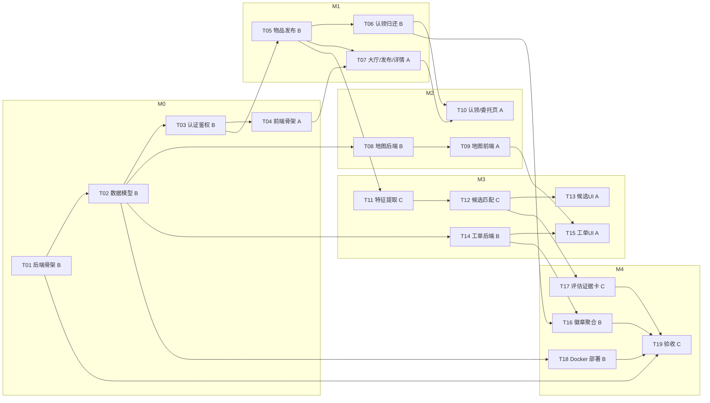
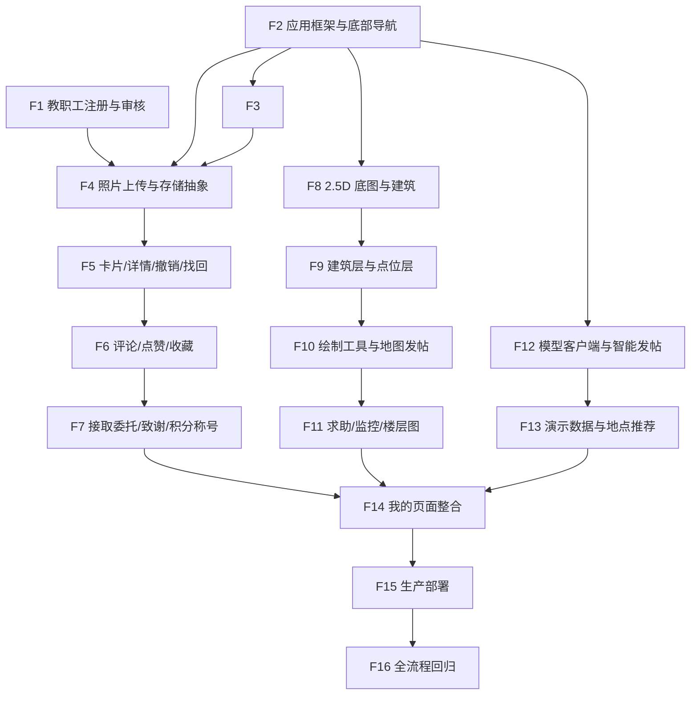
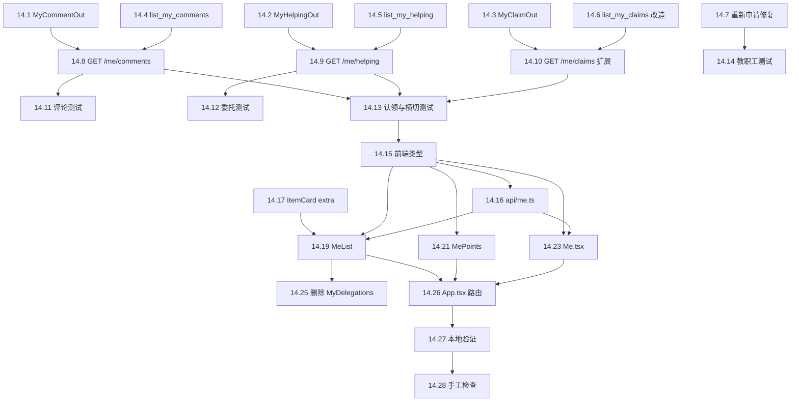

# 校园寻物局 · 阶段3 编码任务规划（tasks.md）

| 项 | 内容 |
|---|---|
| 项目 | 校园寻物局（校园失物协作平台） |
| 阶段 | 阶段3：编码任务规划 |
| 特性名 | `campus_lost_found` |
| 写入路径 | `.codeartsdoer/specs/campus_lost_found/tasks.md` |
| 上游输入 | `spec.md` v2.0 + `design.md` v2.0；v1.0 的 T01–T24 与 2.11–2.16 细化仍作为基线保留 |
| 状态 | v2.0（2026-10-18，新增第 13 章 F1–F16 v2.0 功能任务；v1.0 任务保留） |

> **v1.0 → v2.0 任务变更说明**：第 1–12 章的 T01–T24 是 v1.0 已落地或已细化的基线，继续有效，不重做。第 13 章按 `spec.md` v2.0 与 `design.md` 2.17–2.25 增量拆分为 F1–F16，覆盖教职工、导航重构、上传、互动、积分、地图增强、AI、演示数据、我的页面、生产部署与全流程回归。v1.0 中与 v2.0 冲突的字段/页面（如 `route.is_private`、`Home.tsx`、顶部导航）在第 13 章对应任务内改造，既有认领、核验、归还、协助工单行为与测试不得改变。

## 0. 约定与负责人

| 代号 | 负责人 | 职责范围 |
|---|---|---|
| **A** | 前端/地图/交互 | React 工程、Leaflet 图片地图、大厅/发布/认领/委托/工单页 |
| **B** | 后端/权限/数据库/状态/部署 | FastAPI 骨架、认证鉴权、状态机、脱敏、事务、工单、徽章、Docker |
| **C** | AI/评估/证据/演示 | 特征提取、候选匹配、来源标识、评估证据卡、演示脚本、Rules/Skill、验收 |

**后端先行原则**：B 的接口契约是 A/C 的前置。
**目录约定**：`backend/`（FastAPI）、`frontend/`（React+TS）、根目录 `docker-compose*.yml`、`.env`（入 `.gitignore`）。

## 1. 里程碑与交付节奏

| 里程碑 | 时间窗口 | 可运行版本目标 | 主导任务 |
|---|---|---|---|
| **M0 后端可跑** | 第 1–2 天 | `docker compose up` 后后端可 `/health`，12 表迁移成功 | T01–T04 |
| **M1 业务闭环** | 第 3–4 天 | 后端"发布→列表→详情→认领→核验→归还"闭环可 curl | T05–T07 |
| **M2 前端闭环+地图** | 第 5–6 天 | 前端大厅/发布/认领可用，地图标点/圈选/路线渲染 | T08–T10 |
| **M3 AI+工单** | 第 7–8 天 | 候选推荐（含降级）+ 协助工单协作闭环 | T11–T15 |
| **M4 收尾+验收** | 第 9–10 天 | 徽章、评估证据卡、demo 部署、Rules/Skill、EARS 验收 | T16–T19 |

## 2. 任务依赖图

## 3. 任务明细总表

| ID | 标题 | 负责人 | 前置依赖 | 关联接口/实体 | 关联 EARS |
|---|---|---|---|---|---|
| T01 | 后端工程骨架 | B | — | `/health` | — |
| T02 | 12 张实体建模与迁移 | B | T01 | 12 实体 | — |
| T03 | 认证鉴权 + 角色守卫 + 脱敏 | B | T02 | A 组接口；`user` | 6.1 |
| T04 | 前端工程骨架 + 通用组件 | A | T03 | Axios/路由/登录态 | — |
| T05 | 物品发布/列表/详情 + 状态机 | B | T03, T02 | B 组接口 | 6.2 |
| T06 | 认领/核验/归还事务 + 幂等 | B | T05 | E 组接口 | 6.4, 6.5 |
| T07 | 大厅/发布/详情前端页 | A | T04, T05 | B 组接口 | 6.2, 6.8 |
| T08 | 地图后端（图层/标定/点位） | B | T02 | C 组接口 | 6.7 |
| T09 | Leaflet 地图前端交互 | A | T08 | C 组接口 | 6.7 |
| T10 | 认领/我的委托前端页 | A | T06, T07 | E+G 组 | 6.4, 6.8 |
| T11 | 特征提取适配器 + 降级 | C | T05 | D 组 extract | 6.2, 6.3 |
| T12 | 候选匹配 + 来源标识 + 缓存 | C | T11 | D 组 candidates | 6.3 |
| T13 | 候选列表前端 + 来源标识 | A | T12 | D 组 | 6.3 |
| T14 | 工单状态机 + 授权后端 | B | T02 | F 组接口 | 6.6 |
| T15 | 工单协作 UI + 核查清单 | A | T14, T09 | F 组 | 6.6 |
| T16 | 徽章去重 + 我的委托聚合 | B | T06, T14 | G 组接口 | 6.8 |
| T17 | 匹配评估 + 证据卡 + 演示 | C | T12 | `candidate/claim_evidence` | 6.5, 7 |
| T18 | Docker Compose + 密钥后端化 | B | T02 | 3 套 compose | — |
| T19 | Rules/Skill 配置 + 阶段验收 | C | T01–T18 | 全部 | 6.1–6.8 |
| T24 | 地图逻辑抽取为可复用组件 | A | T09, T23 | C 组接口（前端复用） | 6.7 |

## 4. 逐任务详细说明

### T01 后端工程骨架（B）
- **输出**：`backend/` FastAPI 工程，`pyproject.toml`/`requirements.txt`、`app/main.py`、配置加载、`GET /api/v1/health`、CORS、统一错误结构、`.env.example`。
- **验收**：`/api/v1/health` 返回 `{"status":"ok"}`；错误响应 `{code,message,details?}`。

### T02 12 张实体建模与迁移（B）
- **输出**：12 张 SQLAlchemy 模型 + Alembic 首版迁移；枚举严格对齐状态机；`UNIQUE(username)`、`UNIQUE(claim.idempotency_key)`、`UNIQUE(badge.user_id,kind)`。
- **验收**：`alembic upgrade head` 建 12 表；`layer.pixels_per_meter` 为空时不输出米数。

### T03 认证鉴权 + 角色守卫 + 脱敏序列化器（B）
- **输出**：register/login/me/admin/staff 接口；JWT；`RoleGuard(student/staff/admin)`；脱敏序列化器（剥离私密字段）。
- **验收**：见 EARS 6.1；注册禁止 role≠student；公开序列化不含私密字段。

### T04 前端工程骨架 + 通用组件（A）
- **输出**：`frontend/`（Vite+React+TS+Router+Axios interceptor+状态库）、登录/注册页、`<RequireAuth>`、通用组件。
- **验收**：未登录跳登录页；前端不存密钥、不自行判权限。

### T05 物品发布/列表/详情 + 状态机骨架（B）
- **输出**：`POST /items`、`GET /items`（筛选脱敏）、`GET /items/{id}`、`POST /items/{id}/map-anchor`；附件上传。
- **验收**：见 EARS 6.2；列表/详情不含私密字段。

### T06 认领/核验/归还事务 + 幂等（B）
- **输出**：`POST /claims`、`POST /claims/{id}/review`、`POST /claims/{id}/complete`；归还事务（FOR UPDATE+行锁+CAS）；证据私密域。
- **验收**：见 EARS 6.4/6.5；同一物品仅一次归还；学生越权 403。

### T07 大厅/发布/详情前端页（A）
- **输出**：大厅、发布、详情页。
- **验收**：见 EARS 6.2/6.3；模型提取失败可手动继续。

### T08 地图后端（B）
- **输出**：`GET /layers`、`GET /layers/{id}/image`、`GET /layers/{id}/points`、`POST /layers/{id}/calibrate`。
- **验收**：3 图层；未标定不返回米数；模拟点位标记；calibrate 仅 admin。

### T09 Leaflet 地图前端交互（A）
- **输出**：图片图层渲染、缩放/标点/画圈/分层路线、版本缓存失效、米数门控。
- **验收**：见 EARS 6.7；未标定不显示米数；模拟点位标记。

### T10 认领/我的委托前端页（A）
- **输出**：认领提交页；我的委托页。
- **验收**：见 EARS 6.4/6.8。

### T11 特征提取适配器 + 降级兜底（C）
- **输出**：`POST /items/{id}/extract`；模型适配器可选 Key/超时/容错/额度；降级链。
- **验收**：见 EARS 6.2/6.3；模型不可用返回空+503 不阻断。

### T12 候选匹配 + 来源标识 + 缓存（C）
- **输出**：`GET /items/{id}/candidates`（≤3+解释+source四类）；候选缓存；过滤私密。
- **验收**：见 EARS 6.3；来源标识；无候选提示转工单。

### T13 候选列表前端 + 来源标识（A）
- **验收**：见 EARS 6.3；渲染来源标识+解释。

### T14 工单状态机 + 授权后端（B）
- **输出**：tickets 全组接口；authorize-route；route 权限控制。
- **验收**：见 EARS 6.6；未授权/未分配 403。

### T15 工单协作 UI + 核查清单（A）
- **验收**：见 EARS 6.6；模拟点位标记；未授权不渲染路线。

### T16 徽章去重 + 我的委托聚合（B）
- **验收**：见 EARS 6.8；徽章去重。

### T17 匹配评估 + 证据卡 + 演示脚本（C）
- **验收**：仅报告实际结果，来源分别标记。

### T18 Docker Compose + 密钥后端化（B）
- **验收**：`docker compose up` 拉起服务；密钥仅存后端。

### T19 Rules/Skill 配置 + 阶段验收（C）
- **验收**：重点检查矩阵覆盖；不伪造记录。

## 5. 业务约束落地对照表

| # | 硬约束 | 主要落点 | 关键实现 |
|---|---|---|---|
| 1 | 后端强制权限 | T03,T06,T08,T14 | `RoleGuard`；403 |
| 2 | 私密字段不进公共接口 | T03,T05,T06 | 脱敏序列化器 |
| 3 | AI 仅提取与推荐 | T06,T11,T12 | 模型仅读，写路由不暴露 |
| 4 | 同一物品仅一次归还 | T06 | 事务+行锁+CAS |
| 5 | 模型故障降级 | T11,T12,T18 | 降级链+503 |
| 6 | 路线默认私密最小授权 | T08,T14,T15 | `route.is_private` |
| 7 | 四类来源标识 | T12,T13 | `candidate.source` |
| 8 | 无比例尺不显示米数 | T08,T09 | `pixels_per_meter IS NULL` |
| 9 | 模拟点位恒标记 | T04,T08,T09,T15 | `is_simulated` |
| 10 | 密钥仅存后端 | T18 | `.env` 入 `.gitignore` |
| 11 | 真实性声明 | T17,T19 | 分别标记 |

## 6. 验收与测试任务汇总

| 阶段 | 测试任务 | 覆盖 |
|---|---|---|
| M1 | 后端闭环集成测试 | 6.2/6.4/6.5 |
| M2 | 地图保存/楼层/无比例尺 | 6.7 |
| M3 | 模型降级/来源标识/工单授权 | 6.3/6.6 |
| M4 | 权限矩阵全量回归 + EARS 验收 | 6.1–6.8 |

## 7. T02 细化任务：建立 Alembic 迁移基线与索引

> 本清单对应 `design.md` 2.11 节，将 T02 细化为可执行、可勾选的编码任务。硬约束：不改表名/列名/列类型；不改 `backend/tests/conftest.py`（测试继续 `create_all`）；密钥不出现在代码、日志或对话中。

### 7.1 为常用查询列补索引（17 个）
- [ ] 在 `backend/app/models/item.py` 的 `Item` 模型，为 `owner_user_id`、`direction`、`status`、`created_at` 四列追加 `index=True`
- [ ] 在 `backend/app/models/claim.py` 的 `Claim` 模型，为 `found_item_id`、`lost_item_id`、`applicant_user_id`、`status` 四列追加 `index=True`
- [ ] 在 `backend/app/models/claim.py` 的 `ClaimEvidence` 模型，为 `claim_id` 列追加 `index=True`
- [ ] 在 `backend/app/models/ticket.py` 的 `Ticket` 模型，为 `item_id`、`requester_user_id`、`assignee_user_id`、`status` 四列追加 `index=True`
- [ ] 在 `backend/app/models/item.py` 的 `Route` 模型，为 `item_id` 列追加 `index=True`
- [ ] 在 `backend/app/models/layer.py` 的 `SimulatedPoint` 模型，为 `layer_id` 列追加 `index=True`
- [ ] 在 `backend/app/models/item.py` 的 `ItemFeature` 模型，为 `item_id` 列追加 `index=True`
- [ ] 在 `backend/app/models/item.py` 的 `Attachment` 模型，为 `item_id` 列追加 `index=True`
- [ ] 确认未改动任何表名、列名、列类型（仅追加 `index=True`）

### 7.2 生成初始迁移基线
- [ ] 在 `backend/alembic/versions/` 生成初始迁移文件（`down_revision = None`），包含当前全部 12 张表及全部索引
- [ ] 通读迁移文件，确认枚举列以 `sa.Enum(..., native_enum=False, length=N)` 按字符串创建，与模型 `SAEnum` 参数一致
- [ ] 确认主键用 `sa.Uuid()`、时间戳 `server_default=sa.text('(CURRENT_TIMESTAMP)')`，在 SQLite 与 PostgreSQL 下均可执行
- [ ] 确认 `upgrade()` 按依赖顺序建表建索引，`downgrade()` 逆序删除

### 7.3 改造 seed.py
- [ ] 在 `backend/seed.py` 移除 `create_all` 建表调用，仅保留管理员与三个图层的幂等种子写入
- [ ] 确认 `seed.py` 不再负责建表（建表交由 `alembic upgrade head` 完成）

### 7.4 改造 Dockerfile 启动命令
- [ ] 在 `backend/Dockerfile` 将启动命令改为「先 `alembic upgrade head`，再 `python seed.py`，最后启动 uvicorn」
- [ ] 确认命令顺序为 迁移 → 种子 → 启动服务

### 7.5 更新 README 运行步骤
- [ ] 在 `README.md` 的本地运行步骤中，于 `seed.py` 之前插入 `alembic upgrade head`
- [ ] 确认 README 对本地 SQLite 与 Docker PostgreSQL 两种环境的建表方式描述一致

### 7.6 验收与回归测试
- [ ] 删除 `backend/demo.db` 后依次执行 `alembic upgrade head`、`python seed.py`，均成功，并能启动服务访问 `/api/v1/health`
- [ ] 再次执行 `alembic upgrade head`，确认幂等不报错（无待应用迁移）
- [ ] 执行 `alembic check`，确认模型与迁移一致、无差异
- [ ] 执行 `backend` 的 `pytest tests/ -q`，确认后端测试结果不变
## 8. T20 服务层下沉重构（B）

> 对应 `design.md` 2.12 节。纯重构：接口地址、参数、返回内容、状态码、错误信息全部保持不变。

- **目标**：将路由文件中的业务逻辑下沉至 services 层。
- **允许修改**：`backend/app/api/v1/{items,claims,tickets,auth,admin}.py`；新建 `backend/app/services/{item_service,claim_service,ticket_service,matching_service,user_service}.py`。
- **要求**：
  1. 路由函数只保留「取参数、鉴权依赖、调用 service、返回结果」。
  2. `claim_service.py` 原样搬移 `serialize_claim_mutation`、`lock_items`、`replay`、`restore_unclaimed`、`editable_claim` 及创建/审核/完成三段逻辑，加锁顺序、flush/commit 位置、条件更新语句不变。
  3. `matching_service.py` 导出 `find_candidates(db, lost_item)`，返回 ≤3 候选。
  4. `user_service.py` 合并 auth/admin 重复的「检查用户名存在并创建用户」。
  5. 删除 `auth.py` 中未使用的导入。
- **禁止**：不改 `tests/`、`models/`、`schemas/`；不新增依赖；不顺手优化其他问题。
- **验收**：测试 18 通过 1 跳过；`ruff check` 通过；五路由无 `db.query`/`db.add`/`db.commit`。
## 9. T21 接口响应模型、列表分页与大厅搜索（B/A）

> 对应 `design.md` 2.13 节。目标：给所有接口补 `response_model`、6 个列表接口改为分页返回、大厅 `GET /items` 增加关键词搜索。本任务会改变列表接口返回结构，前端调用与测试同步适配。
>
> **允许修改**：`backend/app/schemas/`（可新建 `common.py`）、`backend/app/api/v1/`、`backend/app/services/`、`backend/tests/`、`frontend/src/pages/`（调用列表接口的页面）、`frontend/src/types.ts`。
>
> **硬约束**：`precise_location` 仅对发布者本人返回；分页参数越界返回 400（而非 422）；本任务不做翻页 UI，仅保证现有页面功能不变。

### 9.1 定义泛型分页模型
- [ ] 在 `backend/app/schemas/common.py` 定义泛型模型 `Page[T]`，字段为 `items: list[T]`、`total: int`、`limit: int`、`offset: int`
- [ ] 确认 `Page` 使用 Pydantic v2 泛型语法，`items` 元素类型在声明处由各接口静态确定（不出现 `Any`、不返回手写字典）

### 9.2 六个列表接口改为分页返回
- [ ] 在 `backend/app/api/v1/items.py` 的 `GET /items` 声明 `response_model=Page[ItemPublic]`，新增 `limit: int = Query(20, ge=1, le=100)`、`offset: int = Query(0, ge=0)`，路由层包装 `Page(items=..., total=..., limit=limit, offset=offset)`
- [ ] 在 `backend/app/api/v1/claims.py` 的 `GET /claims` 声明 `response_model=Page[ClaimOut]`，加 `limit/offset`，返回 Page
- [ ] 在 `backend/app/api/v1/tickets.py` 的 `GET /tickets` 声明 `response_model=Page[TicketOut]`，加 `limit/offset`，返回 Page
- [ ] 在 `backend/app/api/v1/me.py` 的 `GET /me/items` 声明 `response_model=Page[ItemPublic]`，加 `limit/offset`，返回 Page
- [ ] 在 `backend/app/api/v1/me.py` 的 `GET /me/claims` 声明 `response_model=Page[ClaimOut]`，加 `limit/offset`，返回 Page
- [ ] 在 `backend/app/api/v1/me.py` 的 `GET /me/tickets` 声明 `response_model=Page[TicketOut]`，加 `limit/offset`，返回 Page
- [ ] 在 `backend/app/services/item_service.py` 将 `list_items` 返回改为 `tuple[list[Item], int]`，`total` 在应用 `offset/limit` 前用 `query.count()` 计算，排序 `created_at` 倒序
- [ ] 在 `backend/app/services/claim_service.py` 将 `list_claims`、`list_my_claims` 返回 `tuple[list[Claim], int]`，排序 `created_at` 倒序（列表追加 `id` 作稳定二级排序）
- [ ] 在 `backend/app/services/ticket_service.py` 将 `list_tickets`、`list_my_tickets` 返回 `tuple[list[Ticket], int]`，排序 `created_at` 倒序
- [ ] 确认 `limit` 越界（>100 或 <1）、`offset<0` 由 `Query(ge=..., le=...)` 触发 `RequestValidationError`，并经 `app/errors.py` 统一转为 400/VALIDATION

### 9.3 大厅关键词搜索
- [ ] 在 `backend/app/api/v1/items.py` 的 `GET /items` 新增可选参数 `q: str | None = None`
- [ ] 在 `backend/app/services/item_service.py` 的 `list_items` 中，`q` 命中时用 `ilike` 对 `title`、`description`、`category` 做不区分大小写模糊匹配（`or_` 组合），空串跳过
- [ ] 将 `category` 筛选由精确匹配改为 `Item.category.ilike(f"%{category}%")` 模糊匹配
- [ ] 确认 `q`/`category`/`location_area` 仅作用于公开概览字段，不触及 `precise_location` 等私密字段

### 9.4 补齐八个接口的响应模型
- [ ] 物品详情 `GET /items/{id}`：声明 `response_model=ItemDetail`，字段与现有返回一致（公开字段 + `is_owner` + `norm_x/norm_y/layer_id` + `precise_location`）
- [ ] 设置地图标点 `POST /items/{id}/map-anchor`：声明 `response_model=MapAnchorOut`（`ok`）
- [ ] 创建路线 `POST /items/{id}/route`：声明 `response_model=RouteOut`（`id/kind/is_private`）
- [ ] 查询路线 `GET /items/{id}/route`：声明 `response_model=list[RouteDetail]`（`id/kind/geometry/floor_segments/is_private/authorized`）
- [ ] 特征提取 `POST /items/{id}/extract`：声明 `response_model=FeatureExtractionOut`（`labels/extracted_text/confidence/source/degraded`）
- [ ] 候选列表 `GET /items/{id}/candidates`：声明 `response_model=list[CandidateOut]`（`found_item_id/score/explanation/source/title/category/location_area`）
- [ ] 我的徽章 `GET /me/badges`：声明 `response_model=list[BadgeOut]`（`id/kind/awarded_at`）
- [ ] 工单路线 `GET /tickets/{id}/route`：声明 `response_model=list[TicketRouteOut]`（`id/kind/geometry/floor_segments`）

### 9.5 precise_location 发布者权限
- [ ] 在 `backend/app/services/item_service.py` 的 `get_item_detail` 中，`precise_location` 仅当 `item.owner_user_id == user.id` 时返回原文，否则恒为 `null`
- [ ] 确认 `ItemPublic`（列表模型）不含 `precise_location` 字段，公开列表永不泄露精确位置
- [ ] 确认 `is_owner` 字段独立表达归属，与 `precise_location` 解耦

### 9.6 前端适配
- [ ] 在 `frontend/src/types.ts` 新增泛型 `Page<T>` 类型（`items/total/limit/offset`），并确认 `Item` 已含可选 `precise_location`、`is_owner`
- [ ] 在 `frontend/src/pages/Home.tsx` 将列表读取改为 `res.data.items`，并保留/接入 `q` 搜索输入（标题/描述/类别）
- [ ] 在 `frontend/src/pages/MyDelegations.tsx` 将 `/me/items`、`/me/claims`、`/me/tickets` 三处读取改为 `.data.items`
- [ ] 在 `frontend/src/pages/StaffClaims.tsx` 将 `/claims` 读取改为 `.data.items`
- [ ] 在 `frontend/src/pages/Tickets.tsx` 将 `/tickets`、`/me/items` 读取改为 `.data.items`（`/me/items` 用 `Page<Item>` 断言）
- [ ] 确认本任务不新增翻页 UI，仅保证现有页面功能不变

### 9.7 测试适配与新增
- [ ] 适配 `backend/tests/test_acceptance.py` 中读取列表的断言：由 `r.json()[0]` 改为 `r.json()["items"][0]`（如 `test_private_fields_not_in_public_list`），断言内容不变
- [ ] 新增 `backend/tests/test_pagination.py` 用例 `test_list_items_pagination_applies_limit_and_offset`（limit/offset 生效、total 正确、越界页返回空 items）
- [ ] 新增用例 `test_list_items_limit_over_100_returns_400`（`limit=101` 返回 400）
- [ ] 新增用例 `test_list_items_keyword_search_matches_title_description_category`（`q` 命中标题/描述/类别，且不区分大小写）
- [ ] 新增用例 `test_item_detail_precise_location_hidden_from_non_owner`（发布者可见、他人为 null）

### 9.8 验收
- [ ] 执行 `cd backend && .venv/Scripts/python -m pytest tests/ -q`，全部通过（PostgreSQL 并发用例按环境跳过），并列出新增用例名
- [ ] 执行 `cd backend && .venv/Scripts/python -m ruff check .`，无报错
- [ ] 执行 `cd frontend && npm run lint` 与 `npm run build`，均通过
- [ ] 打开 `/docs`，确认上述列表接口展示 Page 响应结构、八个补齐接口展示响应模型## 10. T22 输入校验与一致性修复（B/A）

> 对应 `design.md` 2.14 节。目标：修复 8 条已确认的输入校验与一致性问题，不改动第 1~8 条之外的行为，不改变认领流程的加锁与事务顺序。
>
> **允许修改**：`backend/app/schemas/`、`backend/app/services/`、`backend/app/api/v1/`、`backend/app/models/claim.py`、新建一个 Alembic 迁移、`backend/tests/test_validation.py`、`frontend/src/pages/StaffClaims.tsx`、`frontend/src/components/Layout.tsx`。
>
> **分层约定**：所有参数范围/长度校验下沉到 `schemas` 层（Pydantic），路由与服务层不做手写范围判断；引用存在性与去重更新属业务规则，落在 `services` 层；路由仅取参、鉴权、调用、返回。

### 10.1 归一化坐标范围（第 1 条）
- [ ] 在 `backend/app/schemas/layer.py` 的 `MapAnchorRequest.norm_x/norm_y` 用 `Field(ge=0, le=1)` 限制 0~1，越界由 `RequestValidationError` 处理器统一转 400/VALIDATION
- [ ] 在 `backend/app/schemas/layer.py` 的 `SimulatedPointCreate.norm_x/norm_y` 用 `Field(ge=0, le=1)` 限制 0~1
- [ ] 确认 `items` 路由或服务里无对应的手写范围判断（校验已下沉到 schema 层）
- **验收**：越界坐标（如 1.5 / -0.1）请求返回 400；对应测试 `test_map_anchor_coordinate_out_of_range_returns_400`、`test_simulated_point_coordinate_out_of_range_returns_400`

### 10.2 字符串长度上限（第 2 条）
- [ ] 在 `backend/app/schemas/item.py` 的 `ItemCreate.description` 设 `StringConstraints(max_length=2000)`、`precise_location` 设 `max_length=200`
- [ ] 在 `backend/app/schemas/auth.py` 的 `RegisterRequest.contact` 设 `max_length=100`
- [ ] 在 `backend/app/schemas/staff.py` 的 `StaffCreateRequest.contact` 设 `max_length=100`
- [ ] 在 `backend/app/schemas/layer.py` 的 `SimulatedPointCreate.label` 设 `min_length=1, max_length=64`、`description` 设 `max_length=500`
- [ ] 在 `backend/app/schemas/claim.py` 的 `ReviewRequest.reason` 设 `max_length=500`
- **验收**：超出上限返回 400，临界值（如 2000/200）正常；对应测试 `test_item_description_and_precise_location_length_limits`、`test_contact_length_limit_on_register_and_staff`、`test_simulated_point_label_and_description_length_limits`、`test_review_reason_length_limit`

### 10.3 pixels_per_meter 校验（第 3 条）
- [ ] 在 `backend/app/schemas/layer.py` 的 `CalibrateRequest.pixels_per_meter` 用 `Field(gt=0)` 约束必须大于 0
- **验收**：0 或负数返回 400；对应测试 `test_calibrate_non_positive_pixels_per_meter_returns_400`

### 10.4 路线几何结构（第 4 条）
- [ ] 在 `backend/app/schemas/layer.py` 新增 `RoutePoint`（`x/y` 均 `Field(ge=0, le=1)`）
- [ ] 新增 `PolylineGeometry`（`points: list[RoutePoint] = Field(min_length=2, max_length=200)`）
- [ ] 新增 `CircleGeometry`（`center: RoutePoint`、`radius: float = Field(gt=0, le=1)`）
- [ ] 将 `RouteCreate.geometry` 由任意字典改为 `PolylineGeometry | CircleGeometry | None`，并加 `@model_validator(mode="after")` 校验 `kind` 与 `geometry` 结构匹配（polyline→PolylineGeometry、circle→CircleGeometry），不匹配抛 `ValueError` 转 400
- **验收**：折线少于 2 点 / 坐标越界 / 结构错配返回 400，circle 半径 0 或 >1 返回 400，合法结构返回 200；对应测试 `test_route_polyline_geometry_validation`、`test_route_circle_geometry_validation`

### 10.5 引用存在性校验（第 5 条）
- [ ] 在 `backend/app/services/item_service.py` 的 `set_map_anchor` 中，`_get_owned_item` 后、写入前 `db.get(Layer, body.layer_id)` 为空则 `raise ApiError(404, "NOT_FOUND", "图层不存在")`
- [ ] 在 `backend/app/services/item_service.py` 的 `create_route` 中，`body.layer_id is not None` 且 `db.get(Layer, ...)` 为空则 404
- [ ] 在 `backend/app/api/v1/layers.py` 的 `create_simulated_point` 中，`require_role` 后 `db.get(Layer, layer_id)` 为空则 404
- **验收**：`layer_id` 不存在返回 404（不依赖数据库外键报错）；对应测试 `test_simulated_point_missing_layer_returns_404`、`test_map_anchor_missing_layer_returns_404`、`test_route_missing_layer_returns_404`

### 10.6 特征提取接口（第 6 条）
- [ ] 在 `backend/app/schemas/item.py` 新增 `FeatureExtractRequest`（`text: str | None`，`StringConstraints(strip_whitespace=True, max_length=2000)`）
- [ ] 在 `backend/app/api/v1/items.py` 的 `extract` 改为从 `body: FeatureExtractRequest` 取 `text`（不再从地址栏参数取）
- [ ] 在 `backend/app/services/item_service.py` 的 `extract_item_features` 改为「查找 `confirmed=False` 的 `ItemFeature` → 有则更新、无则新建」，同一物品重复调用仅更新已有未确认记录，不再新增重复记录
- **验收**：请求体 `text` 生效、超 2000 返回 400、重复调用仅一条 `ItemFeature` 且内容为最新；对应测试 `test_extract_uses_request_body_and_length_limit`、`test_extract_repeat_updates_existing_unconfirmed_feature`

### 10.7 角色一致性（第 7 条）
- [ ] 确认 `backend/app/api/v1/claims.py` 的 `GET /claims`、`POST /claims/{id}/review`、`POST /claims/{id}/complete` 均为 `require_role(Role.staff, Role.admin)`
- [ ] 确认 `backend/app/api/v1/tickets.py` 的 `POST /tickets/{id}/assign`、`POST /tickets/{id}/feedback` 均为 `require_role(Role.staff, Role.admin)`
- [ ] 确认 `backend/app/api/v1/layers.py` 的 `GET/POST /layers/{id}/simulated-points` 均为 `require_role(Role.staff, Role.admin)`
- [ ] 在 `frontend/src/components/Layout.tsx` 将「认领审核」导航入口条件改为 `role === 'staff' || role === 'admin'`
- [ ] 在 `frontend/src/pages/StaffClaims.tsx` 以 `role !== 'staff' && role !== 'admin'` 守卫
- **验收**：管理员可查看/审核/完成认领、接单/反馈工单、查看模拟点位；对应测试 `test_admin_can_review_and_complete_claim`、`test_admin_can_assign_and_feedback_ticket`、`test_admin_can_list_simulated_points`（前端隐藏按钮仅作展示，权限仍由后端 `require_role` 强制）

### 10.8 认领拒绝理由（第 8 条）
- [ ] 在 `backend/app/models/claim.py` 的 `Claim` 新增 `review_reason: Mapped[str | None] = mapped_column(Text, nullable=True)`
- [ ] 新建 Alembic 迁移 `backend/alembic/versions/7b8c9d0e1f2a_add_claim_review_reason.py`（`down_revision='5a312e915b0f'`，`upgrade` 用 `op.add_column('claim', sa.Column('review_reason', sa.Text(), nullable=True))`，`downgrade` 用 `op.drop_column`）
- [ ] 在 `backend/app/schemas/claim.py` 的 `ClaimDetail` 新增 `review_reason: str | None = None`
- [ ] 在 `backend/app/services/claim_service.py` 的 `review_claim` 保存 `claim.review_reason = body.reason`，`get_claim` 构造 `ClaimDetail` 时透传 `review_reason`
- [ ] 在 `frontend/src/pages/StaffClaims.tsx` 拒绝时展示「拒绝理由（可选）」`textarea`，`act('reject')` 提交 `{ approve: false, reason: reason.trim() || undefined }`
- **验收**：拒绝理由保存且认领详情返回；对应测试 `test_review_reason_saved_and_returned`
- **约束**：不改变 `editable_claim`/`lock_items` 的加锁顺序、`flush`/`commit` 位置与条件更新语句

### 10.9 测试与验收
- [ ] 在 `backend/tests/test_validation.py` 实现上述 8 类校验与一致性用例，复用 `test_acceptance.py` 的 `create_user/login/register/auth` 并自建 `create_layer/item/staff_token/admin_token` 辅助函数，每类含正常 + 非法输入/权限
- [ ] 执行 `cd backend && .venv/Scripts/python -m pytest tests/ -q`，全部通过（PostgreSQL 并发用例按环境跳过），并列出新增用例名
- [ ] 执行 `cd backend && .venv/Scripts/python -m ruff check .`，无报错
- [ ] 执行 `cd backend && .venv/Scripts/alembic upgrade head` 与 `alembic check`，迁移应用成功、模型与迁移一致无差异
- [ ] 执行 `cd frontend && npm run lint` 与 `npm run build`，均通过
## 11. T23 前端接口层、请求 Hook 与基础组件重构（A）

> 对应 `design.md` 2.15 节。目标：为前端搭建接口层、请求 Hook、设计变量和基础组件，把现有 9 个页面与 `Layout`/`AuthContext` 迁移过去；页面功能与文案不变，视觉只做统一，不做重新设计。
>
> **允许修改**：`frontend/src/` 下所有文件。
> **硬约束**：不新增任何第三方依赖；不改路由结构、页面数量、业务流程；不引入 UI 组件库与 CSS 框架；全程不使用 `any`。
>
> **用户已确认的三个关键点（必须纳入）**：
> 1. 颜色取值：主色 `#2563eb`、成功 `#16a34a`、警告 `#d97706`、危险 `#dc2626`；所有颜色只定义在 `tokens.css`，组件与页面不得出现任何颜色数值。
> 2. 搜索框 `q` 与类别输入框一样，均做 300 毫秒防抖。
> 3. `AuthContext` 的 `login`、`register`、`me` 改用 `api/auth.ts`、`api/me.ts`；最终整个 `frontend/src` 只有 `src/api/` 目录下文件可导入并使用 `client`。

### 11.1 类型补全（`src/types.ts`）
- [ ] 在 `frontend/src/types.ts` 新增 `Role` 类型（`'student' | 'staff' | 'admin'`），`AuthContext.tsx` 的本地 `Role` 定义改为从 `types.ts` 导入
- [ ] 新增 `roleLabels: Record<Role, string>`（学生 / 工作人员 / 管理员）
- [ ] 新增 `User` 接口（`id/username/display_name/role: Role`）
- [ ] 新增 `Layer` 接口（`id/name/version/width/height/scale_calibrated/image_path: string | null`）
- [ ] 新增 `SimulatedPoint` 接口（`id/label/norm_x/norm_y/is_simulated/description: string | null`）
- [ ] 新增 `Badge` 接口（`id/kind/awarded_at`）
- [ ] 新增 `EvidenceKind` 类型（`'text' | 'image'`）
- [ ] 在 `Item` 接口增补 `norm_x: number | null`、`norm_y: number | null`、`layer_id: string | null`
- [ ] 在 `ClaimDetail` 接口增补 `review_reason: string | null`

### 11.2 接口层（`src/api/`）
- [ ] 确认 `frontend/src/api/client.ts` 保留为唯一 axios 入口，`setToken/getToken/errorMessage` 继续供接口层与 `AuthContext` 使用，页面不再导入 `client`
- [ ] 新建 `frontend/src/api/auth.ts`，导出 `LoginRequest`、`RegisterRequest`、`TokenResponse` 类型及 `login(body): Promise<TokenResponse>`、`register(body): Promise<TokenResponse>`、`me(): Promise<User>`
- [ ] 新建 `frontend/src/api/items.ts`，导出 `ListItemsParams`、`ItemCreateInput`、`MapAnchorInput`、`RouteCreateInput`、`RouteDetail`、`FeatureExtractionOut` 等类型及 `listItems/getItem/createItem/setMapAnchor/createRoute/getRoutes/extractFeatures/getCandidates`
- [ ] 新建 `frontend/src/api/claims.ts`，导出 `EvidenceInput`、`ClaimCreateInput`、`ReviewInput`、`ListClaimsParams` 类型及 `listClaims/getClaim/createClaim/reviewClaim/completeClaim`
- [ ] 新建 `frontend/src/api/tickets.ts`，导出 `TicketCreateInput`、`FeedbackInput`、`TicketRoute`、`ListTicketsParams` 类型及 `listTickets/createTicket/assignTicket/authorizeRoute/getTicketRoute/feedbackTicket`
- [ ] 新建 `frontend/src/api/layers.ts`，导出 `CalibrateInput`、`SimulatedPointInput` 类型及 `listLayers/getLayerImage/calibrateLayer/listSimulatedPoints/createSimulatedPoint`
- [ ] 新建 `frontend/src/api/me.ts`，导出 `listMyItems/listMyClaims/listMyTickets/listMyBadges`
- [ ] 确认所有接口函数入参与返回值类型精确（可选参数显式 `| null`，列表返回 `Page<T>`，`getLayerImage` 返回 `Blob`），不出现 `any`

### 11.3 请求 Hook（`src/hooks/`）
- [ ] 新建 `frontend/src/hooks/useAsync.ts`，导出 `AsyncState<T>`（`data/error/loading/reload`）与 `useAsync<T>(fn, deps)`
- [ ] `useAsync` 挂载及 `deps` 变化时执行 `fn`，成功写 `data`、失败把 `errorMessage(e)` 写入 `error`，`reload` 手动重触发（不改变依赖数组）
- [ ] 用「请求序号 + active 标志」实现旧结果丢弃：每次执行/卸载递增序号，回调前校验序号未变且未卸载，避免竞态与卸载后 setState 告警
- [ ] 新建 `frontend/src/hooks/useDebounce.ts`，导出 `useDebounce<T>(value, delayMs = 300): T`，用 `useEffect` + `setTimeout` 实现、清理时 `clearTimeout`

### 11.4 设计变量（`src/styles/tokens.css`）
- [ ] 新建 `frontend/src/styles/tokens.css`，定义 CSS 变量：主色 `#2563eb`、成功 `#16a34a`、警告 `#d97706`、危险 `#dc2626`、文字三级、背景两级、边框色、间距 6 级（4/8/12/16/24/32）、圆角 3 级、字号 5 级、阴影 2 级
- [ ] 确认所有颜色十六进制数值只出现在本文件，组件与页面不得出现任何颜色数值
- [ ] 精简 `frontend/src/index.css`：改为 `@import './styles/tokens.css'` + reset（`*{box-sizing}`、`body{margin:0}`、`font-family`、控件 `font: inherit`），移除其中的具体颜色值

### 11.5 基础组件（`src/components/`）
- [ ] 新建 `Button.tsx` + `Button.module.css`：`variant: primary/secondary/danger`（默认 primary）、`loading`、`disabled`、`type`、`onClick`，loading/disabled 时禁用并显示 `Spinner`，loading 时加 `aria-busy`
- [ ] 新建 `Card.tsx` + `Card.module.css`：背景 bg-2、圆角 radius-md、内边距 space-4、阴影 shadow-sm
- [ ] 新建 `Tag.tsx` + `Tag.module.css`：`tone: neutral/primary/success/warning/danger` 小型标签，用于状态/来源标识
- [ ] 新建 `Field.tsx` + `Field.module.css`：`label`、`error`、`required`、`htmlFor`、`children`，label + 控件插槽 + 错误提示（danger 色，`role="alert"`）
- [ ] 新建 `Empty.tsx` + `Empty.module.css`：`text`（默认「暂无数据」）空态占位，`role="status"`
- [ ] 新建 `ErrorNotice.tsx` + `ErrorNotice.module.css`：`message` 错误提示（`role="alert"`，danger 色）
- [ ] 新建 `Spinner.tsx` + `Spinner.module.css`：`size: sm/md` CSS 动画加载指示，不引第三方图标
- [ ] 新建 `PageContainer.tsx` + `PageContainer.module.css`：max-width、margin auto、内边距 space-5（替代原 `.page`）
- [ ] 确认全部组件样式只引用 tokens 变量，不写具体颜色/间距/圆角/字号数值

### 11.6 AuthContext 改造（`src/auth/AuthContext.tsx`）
- [ ] 将 `login`/`register`/`me` 三处 `client.get/post` 改为调用 `api/auth.ts` 的 `login`/`register`/`me` 函数
- [ ] 移除 `import client`，保留 `setToken/getToken`（来自 `client.ts`）用于 token 持久化
- [ ] 保持 token 持久化（sessionStorage）与 `auth-expired` 监听逻辑不变
- [ ] 确认 `frontend/src` 中只有 `src/api/` 目录下文件导入并使用 `client`（`AuthContext` 不再 import client）

### 11.7 Layout 改造（`src/components/Layout.tsx` + `Layout.module.css`）
- [ ] 将导航栏内联 `style` 移入新建 `Layout.module.css`（背景 bg-2、边框 `1px solid var(--color-border)`、间距用 tokens 变量）
- [ ] 角色显示改用 `roleLabels[role]`（学生/工作人员/管理员），`role` 为 null 时不渲染角色
- [ ] 导航「认领审核」入口条件保持 `role === 'staff' || role === 'admin'`
- [ ] 「退出」改用 `Button variant="secondary"`

### 11.8 页面迁移（`src/pages/`）
- [ ] 在 `Home.tsx`：改用 `listItems(params)` + `useAsync`；`q`、`category` 分别经 `useDebounce` 得到 `debouncedQ/debouncedCategory`，与 `direction/status` 作为 `useAsync` 依赖（q 与 category 均 300ms 防抖）；删除全部内联 `style`，列表项/加载/空态/错误分别用 `Card`/`Spinner`/`Empty`/`ErrorNotice`/`PageContainer`
- [ ] 在 `ItemDetail.tsx`：改用 `getItem`/`getCandidates`/`listMyItems`/`createClaim`；删除内联 `style`；表单用 `Field`/`Button`，提交用 `Button loading` 防重复；`crypto.randomUUID()` 改用 `createIdempotencyKey()`（见 11.9）
- [ ] 在 `ItemForm.tsx`：改用 `createItem`，删除内联 `style`，表单控件用 `Field` + `Button` + `ErrorNotice` + `PageContainer`
- [ ] 在 `Login.tsx`：继续走 `useAuth().login`（内部已改走接口层），删除内联 `style`，用 `Field`/`Button`/`ErrorNotice`/`PageContainer`
- [ ] 在 `Register.tsx`：继续走 `useAuth().register`，删除内联 `style`，用 `Field`/`Button`/`ErrorNotice`/`PageContainer`
- [ ] 在 `MapView.tsx`：改用 `listLayers`/`getLayerImage`/`listSimulatedPoints`，局部 `LayerInfo`/`Point` 类型改用 `types.ts` 的 `Layer`/`SimulatedPoint`；图层请求用 `useAsync`，Leaflet 副作用保留；删除内联 `style`（容器样式移入 `MapView.module.css`）；Leaflet 渲染用到的颜色（`#cbd5e1`、`#d97706`、`#f8fafc`）不得硬编码，改由读取 CSS 变量取得
- [ ] 在 `MyDelegations.tsx`：改用 `listMyItems`/`listMyClaims`/`listMyTickets`/`listMyBadges`（`Promise.all`）+ `useAsync`；删除内联 `style`；空态/加载/错误分别用 `Empty`/`Spinner`/`ErrorNotice`
- [ ] 在 `StaffClaims.tsx`：改用 `listClaims`/`getClaim`/`getItem`/`reviewClaim`/`completeClaim` + `useAsync`；提交动作保留 `busy` 防重复并用 `Button loading`；删除 `client.`；保持 `role !== 'staff' && role !== 'admin'` 守卫与「拒绝理由」`textarea`（提交 `reason: reason.trim() || undefined`）不变
- [ ] 在 `Tickets.tsx`：改用 `listTickets`/`listMyItems`/`createTicket`/`assignTicket`/`authorizeRoute`/`feedbackTicket` + `useAsync`；提交动作用 `Button loading` 防重复；删除 `client.`；空态用 `Empty`
- [ ] 确认 9 个页面均不再出现接口地址字符串与 `client.get`/`client.post`，不再出现内联 `style={{`

### 11.9 兼容性修复（`src/utils/id.ts`）
- [ ] 新建 `frontend/src/utils/id.ts`，导出 `createIdempotencyKey(): string`：优先 `crypto.randomUUID()`（判 `typeof crypto !== 'undefined' && 'randomUUID' in crypto`），不可用时回退 `crypto.getRandomValues(new Uint8Array(16))` 生成 32 位十六进制串
- [ ] 在 `ItemDetail.tsx` 将 `key.current = crypto.randomUUID()` 改为 `key.current = createIdempotencyKey()`，其余逻辑不变
- [ ] 确认返回值为等长随机十六进制串，满足后端 `idempotency_key` 长度 ≤64 约束

### 11.10 验收
- [ ] 在 `frontend/src` 搜索 `style={{`，结果为 0
- [ ] 在 `frontend/src/pages` 搜索 `client.`，结果为 0（`client` 仅 `src/api/` 内引用）
- [ ] 在 `frontend/src` 搜索颜色十六进制数值，仅出现在 `styles/tokens.css`，组件与页面零颜色数值
- [ ] 执行 `cd frontend && npm run lint`，通过（无 `any`、无未用导入）
- [ ] 执行 `cd frontend && npm run build`，通过（`tsc -b` 类型检查 + vite 构建）
- [ ] 启动前后端后手工走查：注册→发布寻物→发布拾获→查看候选→提交认领→查看我的委托→打开地图 全流程正常，文案与功能不变
## 12. T24 地图逻辑抽取为可复用组件（A）

> 对应 `design.md` 2.16 节。目标：把地图页 `MapView.tsx` 里的地图逻辑抽成可复用组件 `CampusMap`，为后续「发帖标点、圈范围、画路径」做准备。本任务**不新增任何地图功能**、不新增依赖、不改后端，现有地图行为（选图层、显示底图/占位矩形、模拟点位、点击弹归一化坐标）保持不变。
>
> **允许修改**：`frontend/src/pages/MapView.tsx`；新建 `frontend/src/components/CampusMap/`（`coords.ts`、`MapContext.tsx`、`CampusMap.tsx`、`CampusMap.module.css`）；新建 `frontend/src/hooks/useLayers.ts`；新建 `frontend/src/pages/ClickCoordsPopup.tsx`。
>
> **硬约束**：不新增绘制/编辑/聚合等任何新地图功能；不新增依赖；不使用 `any`；不写内联 `style`；颜色/间距/圆角/字号只引用 `tokens.css` 变量。`MapView.module.css` 不在允许修改清单内，保持不动（容器迁走后其 `.map` 类不再被引用，残留不影响 lint/build，勿顺手删除）。

### 12.1 坐标换算纯函数（`components/CampusMap/coords.ts`）
- [ ] 在 `frontend/src/components/CampusMap/coords.ts` 定义并导出 `LayerDims` 接口（`width: number`、`height: number`）
- [ ] 导出纯函数 `normToLatLng(nx: number, ny: number, dims: LayerDims): LatLng`，换算 `L.latLng(ny * dims.height, nx * dims.width)`（原点为图片左上角，lat=y、lng=x）
- [ ] 导出纯函数 `latLngToNorm(latlng: LatLng, dims: LayerDims): { x: number; y: number }`，换算 `x = latlng.lng / width`、`y = latlng.lat / height`
- [ ] 确认两个函数只依赖 `LayerDims`（不依赖 React、不依赖 Leaflet 实例、不依赖完整 `Layer` 类型），归一化坐标统一用 `{ x, y }` 表达

### 12.2 MapContext 与 useCampusMap（`components/CampusMap/MapContext.tsx`）
- [ ] 在 `frontend/src/components/CampusMap/MapContext.tsx` 定义并导出 `CampusMapContextValue` 接口：`map: LeafletMap | null`、`layer: Layer`、`toMap: (nx, ny) => LatLng`、`toNorm: (latlng) => { x, y }`
- [ ] 用 `createContext<CampusMapContextValue | null>(null)` 创建 `CampusMapContext`
- [ ] 导出 `useCampusMap(): CampusMapContextValue`，`context === null` 时 `throw new Error('useCampusMap 必须在 CampusMap 组件内使用')`（参照 `AuthContext.useAuth` 的抛错约定）
- [ ] 确认 `MapContext.tsx` 只提供 Context 与 Hook，不创建/销毁 Leaflet 实例

### 12.3 useLayers Hook（`hooks/useLayers.ts`）
- [ ] 新建 `frontend/src/hooks/useLayers.ts`，导出 `useLayers(): AsyncState<Layer>`，内部复用 `useAsync(() => listLayers(), [])`
- [ ] 确认不额外封装业务逻辑，仅把 `listLayers()` 调用从页面抽离，供 `MapView` 及后续页面复用

### 12.4 CampusMap 主组件（`components/CampusMap/CampusMap.tsx` + `CampusMap.module.css`）
- [ ] 在 `frontend/src/components/CampusMap/CampusMap.tsx` 定义并导出 `MapMarker` 接口（`x/y/label/color`）与 `CampusMapProps` 接口（`layer: Layer`、`markers: MapMarker[]`、`onMapClick?`、`onImageError?`、`children?`）
- [ ] 用 `useState<LeafletMap | null>` 管理 `map`（替代原 `useRef`），保证 Context 值随实例重建同步更新；用 `containerRef`、`markerGroupRef`、`onClickRef`、`onErrorRef` 保存挂载 DOM 与最新回调
- [ ] 在依赖 `[layer]` 的 `useEffect` 中完整保留原 `MapView.tsx:39-94` 的 Leaflet 生命周期：`L.map(container, { crs: L.CRS.Simple, minZoom: -3, maxZoom: 3 })` → `bounds = L.latLngBounds([0,0],[layer.height, layer.width])` → `fitBounds` + `setMaxBounds(bounds.pad(0.2))`
- [ ] cleanup 顺序完整保留：`active=false` → `controller.abort()` → `revokeObjectURL(objectUrl)` → `map.remove()` → `setMap(null)` → `markerGroupRef.current = null`（先 `setMap(null)` 再建新实例，保证子组件不拿到已销毁实例）
- [ ] 无底图（`layer.image_path` 为空）时 `L.rectangle(bounds, { color: cssVar('--color-border-strong'), weight: 1, fillOpacity: 0.03 })` 显示占位矩形；有底图时 `getLayerImage(layer.id, controller.signal)` → `URL.createObjectURL(blob)` → `L.imageOverlay(url, bounds)`，失败时 `onErrorRef.current?.(errorMessage(e, '底图加载失败'))`
- [ ] 点击分发：`map.on('click', (e) => onClickRef.current?.(latLngToNorm(e.latlng, layer)))`，组件只分发 `onMapClick`，不弹任何 popup
- [ ] 在独立依赖 `[markers, map, layer]` 的 `useEffect` 中渲染 markers：`map` 为 null 时返回；`markerGroupRef` 为 null 时 `L.layerGroup().addTo(map)`；`clearLayers()` 后逐点 `L.circleMarker(normToLatLng(m.x, m.y, layer), { color: m.color }).bindTooltip(m.label)`
- [ ] 用 `useMemo`（依赖 `[map, layer]`）生成 Context value：`toMap`/`toNorm` 为 `normToLatLng`/`latLngToNorm` 绑定当前 `layer` 的闭包；渲染 `<CampusMapContext.Provider value={value}>
{children}</CampusMapContext.Provider>`（`children` 在 Provider 范围内）
- [ ] 新建 `frontend/src/components/CampusMap/CampusMap.module.css`，`.map` 迁移自 `MapView.module.css` 的 `.map`（`height: 560px`、`margin-top: var(--space-3)`、`border: 1px solid var(--color-border-strong)`、`background: var(--color-map-bg)`）
- [ ] 将 `import 'leaflet/dist/leaflet.css'` 从 `MapView.tsx` 迁至本组件

### 12.5 ClickCoordsPopup 图层组件（`pages/ClickCoordsPopup.tsx`）
- [ ] 新建 `frontend/src/pages/ClickCoordsPopup.tsx`，作为 `<CampusMap>` 子组件，`const { map, toNorm } = useCampusMap()`，返回 `null`（不渲染任何 DOM）
- [ ] 在依赖 `[map, toNorm]` 的 `useEffect` 中：`map` 为 null 时直接返回；注册 `click` 处理器，`const { x, y } = toNorm(e.latlng)`，`L.popup().setLatLng(e.latlng).setContent(\`归一化坐标 (${x.toFixed(3)}, ${y.toFixed(3)})\`).openOn(map)`；cleanup 中 `map.off('click', handler)`
- [ ] 确认 popup 内容与现状完全一致（`归一化坐标 (x, y)`，保留三位小数）；切换图层时旧实例监听先移除、新实例就绪后重绑，切换 5 次后点击只弹出一个 popup

### 12.6 MapView 改造（`pages/MapView.tsx`）
- [ ] 在 `frontend/src/pages/MapView.tsx` 移除 Leaflet 相关 import（`L`、`leaflet/dist/leaflet.css`、`getLayerImage`）与全部实例生命周期/点击/markers 逻辑（`containerRef`、`mapRef`、`markerGroupRef`、两个地图相关 `useEffect`）
- [ ] 图层获取改为 `const { data: layers, error: layersError } = useLayers()`，`selected`/`calibrated`/`imageError` 状态保留
- [ ] 组装 markers：staff/admin 时 `listSimulatedPoints(selected)` 映射为 `MapMarker`（`x = p.norm_x`、`y = p.norm_y`、`label = \`${p.label}（模拟点位）\``、`color = cssVar('--color-warning')`）
- [ ] 渲染：`{layer && <CampusMap layer={layer} markers={markers} onImageError={setImageError}><ClickCoordsPopup /></CampusMap>}`；`onMapClick` 当前不传（为后续标点/圈范围/画路径预留）
- [ ] 保留图层选择 `<select>`、`hint` 文案、`ErrorNotice`、空态提示与 `calibrated` 展示不变；`MapView.module.css` 的 `.hint` 继续使用

### 12.7 验收
- [ ] 执行 `cd frontend && npm run lint`，通过（无 `any`、无未用导入、无内联 `style`）
- [ ] 执行 `cd frontend && npm run build`，通过（`tsc -b` 类型检查 + vite 构建）
- [ ] 手工检查（需在可访问前后端的终端执行）：室外图正常显示底图
- [ ] 切换到无底图楼层显示占位矩形
- [ ] 来回切换图层 5 次，页面始终只有一个地图实例（无残留 DOM 节点）
- [ ] 点击地图弹出 `归一化坐标 (x, y)`，内容与改造前一致
- [ ] 切换图层 5 次后点击地图，坐标 popup 正常弹出且只弹出一个
- [ ] 离开地图页再返回无报错（实例与事件监听正确销毁）
- [ ] `ClickCoordsPopup` 作为 `useCampusMap` 验证用例：组件内成功获取 `map` 与换算函数，切换图层后拿到新实例
---

## 13. v2.0 功能任务（F1–F16）

> 对应 `spec.md` v2.0 与 `design.md` 2.17–2.25。第 1–12 章的 T01–T24 为 v1.0 基线，继续有效；本章任务在其上叠加，**不得删除或改变认领、核验、归还、协助工单的既有行为**，既有测试必须继续通过。
>
> 通用约束：后端只新增 `httpx`、`Pillow`；前端不新增依赖；所有新接口声明 `response_model`、支持 `limit/offset`（默认 20，最大 100）；出错统一抛 `ApiError`；新增/修改表结构必须提供 Alembic 迁移；每个新接口至少三类测试（正常、无权限、非法输入或状态冲突）；前端 375px 宽度下完整可用、可点击区域不小于 44px。

### 13.0 任务依赖图

| ID | 标题 | 前置依赖 | 主要交付 |
|---|---|---|---|
| F1 | 教职工注册与审核 | — | `staff_application_service`、4 个接口、迁移 |
| F2 | 应用框架与底部导航 | — | 路由重构、AppShell、底部/侧边导航 |
| F3 | 视觉风格落地 | F2 | tokens、基础组件、模块样式 |
| F4 | 照片上传与存储抽象 | F1、F2、F3 | `upload_service`、`StorageBackend`、`/uploads` |
| F5 | 卡片/详情/撤销/找回 | F4 | `withdraw`、`mark-found`、Hall/Detail 改版 |
| F6 | 评论/点赞/收藏 | F5 | `comment_service`、`reaction_service` |
| F7 | 接取委托/致谢/积分称号 | F6 | `helper_service`、`points_service` |
| F8 | 2.5D 底图与建筑数据 | F2 | `building` 表、`building_service`、配置导入 |
| F9 | 建筑层与帖子点位层 | F8 | `BuildingLayer`、`ItemPointsLayer`、聚合 |
| F10 | 绘制工具与从地图发帖 | F9 | `DrawToolLayer`、`useDrawTool` |
| F11 | 求助/监控/楼层图 | F10 | 点位过滤接口、`FloorSwitcher` |
| F12 | 模型客户端与智能发帖 | F2 | `ai_service`、`/ai/draft-post` |
| F13 | 演示数据与地点推荐 | F12 | `seed_demo.py`、`/ai/search-advice`、热力层 |
| F14 | 我的页面整合 | F7、F11、F13 | `/me`、`/me/*`、工作人员入口 |
| F15 | 生产部署 | F14 | Nginx、生产镜像、ECS 部署说明 |
| F16 | 全流程回归测试 | F15 | 回归用例与手工验收清单 |

---

### 13.1 F1 教职工注册与审核

**目标**：学生可自助注册；注册时可选「教职工」身份并提交工号与部门，申请进入「待审核」；审核通过前 `role` 保持 `student`（按学生权限），管理员通过后 `role` 改为 `staff`，拒绝须填理由且申请人可见。

**涉及文件**
- 后端：`backend/app/models/enums.py`（新增 `StaffStatus`）、`backend/app/models/user.py`（新增 `staff_status`/`staff_no`/`department`/`staff_reject_reason`）、`backend/app/schemas/staff_application.py`（新建）、`backend/app/schemas/auth.py`、`backend/app/services/staff_application_service.py`（新建）、`backend/app/services/auth_service.py`、`backend/app/api/v1/staff_applications.py`（新建，或在 `admin.py` 内挂载）、`backend/app/api/v1/router.py`
- 迁移：`backend/alembic/versions/20261018_v2_incremental.py`（与 F4–F13 共用同一 v2 增量迁移，首个建表任务负责创建，后续任务追加内容）
- 测试：`backend/tests/test_staff_application.py`（新建）
- 前端：`frontend/src/pages/Register.tsx`、`frontend/src/pages/StaffApplications.tsx`（新建，管理员审核）、`frontend/src/api/staffApplications.ts`（新建）、`frontend/src/api/auth.ts`、`frontend/src/types.ts`

**依赖任务**：无（后端可立即开始）；前端页面依赖 F2 的路由与页面骨架。

**接口**（详见 `design.md` 2.21.1）
- `POST /me/staff-application`：登录且 `role=student` 且无 pending/approved 记录；`staff_no` 4~20 位字母或数字；`department` ≤64 选填。
- `GET /admin/staff-applications`：仅 `admin`，`status` 默认 `pending`。
- `POST /admin/staff-applications/{user_id}/approve`：仅 `admin`，`pending → approved`，`role` 改为 `staff`。
- `POST /admin/staff-applications/{user_id}/reject`：仅 `admin`，`reason` 必填 ≤500。

**验收标准**
- [ ] 迁移生成成功，`user` 表含 4 个新列，`alembic check` 无差异
- [ ] 正常：学生提交合法工号后 `staff_status=pending`、`role=student`；管理员通过后 `role=staff`
- [ ] 无权限：学生调用 `GET /admin/staff-applications` 或 approve/reject 返回 403
- [ ] 非法输入：工号少于 4 位、含非字母数字、拒绝理由为空分别返回 400；重复申请返回 409
- [ ] 审核通过前调用 staff 专属接口（如核验认领）返回 403（验证「审核前按学生权限」）
- [ ] 拒绝后申请人可查询到 `staff_status=rejected` 与 `staff_reject_reason`
- [ ] 注册页可选「学生 / 教职工」，选教职工时工号必填、部门选填；375px 下表单无横向滚动、控件高度 ≥44px
- [ ] 管理员审核页可看申请列表并通过/拒绝（拒绝弹窗含理由输入）
- [ ] `cd backend && .venv/Scripts/python -m pytest tests/ -q` 通过；`ruff check .`、`ruff format --check .` 通过
- [ ] `cd frontend && npm run lint && npm run build` 通过

---

### 13.2 F2 应用框架与底部导航

**目标**：重构应用外壳与路由。移动端底部固定四标签（大厅/地图/AI/我的），≥768px 改为左侧导航；统一页面头部；旧路径重定向到新路径；工作人员与管理员专属入口从「我的」页进入。

**涉及文件**
- 前端：`frontend/src/App.tsx`、`frontend/src/components/AppShell/AppShell.tsx` + `AppShell.module.css`（新建）、`BottomNav.tsx`、`SideNav.tsx`、`PageHeader.tsx`（均新建）、`frontend/src/pages/Hall.tsx`（由 `Home.tsx` 改名）、`frontend/src/pages/ItemDetail.tsx`（由 `ItemDetail` 旧路由迁移）、`frontend/src/pages/AiPage.tsx`（新建占位）、`frontend/src/pages/Me.tsx`（新建占位）、`frontend/src/auth/AuthContext.tsx`
- 后端：无（仅前端路由）

**依赖任务**：无。

**路由**（详见 `design.md` 2.22.1）
- 新路由：`/hall`、`/hall/:id`、`/publish`、`/map`、`/ai`、`/me`、`/me/*`、`/staff/claims`、`/staff/tickets`、`/admin/staff-applications`
- 重定向：`/` → `/hall`；`/items/:id` → `/hall/:id`；`/tickets` → `/staff/tickets`

**验收标准**
- [ ] 375px 下底部四标签固定可见，四页均可到达；单标签点击区域 ≥44×44px，无横向滚动
- [ ] ≥768px 时底部导航切换为左侧导航，内容区无遮挡
- [ ] 页面头部在四个主页面一致（标题、返回、右侧操作区）
- [ ] 旧路径 `/`、`/items/:id`、`/tickets` 均重定向到新路径，浏览器历史无死循环
- [ ] 未登录访问受保护路由跳转登录；学生访问 staff/admin 路由不渲染专属入口（权限仍以后端为准）
- [ ] 「我的」页包含工作人员/管理员专属入口占位（F14 完成内容）
- [ ] `npm run lint`、`npm run build` 通过；375px 手工检查无横向滚动

---

### 13.3 F3 视觉风格落地

**目标**：建立 v2.0 设计变量与基础组件，供后续所有页面复用。风格另定，但必须满足移动端优先与 token 约束。

**涉及文件**
- 前端：`frontend/src/styles/tokens.css`（扩展颜色、间距、圆角、字号、阴影、层级）、`frontend/src/styles/global.css`、`frontend/src/components/ui/Button.tsx` + `.module.css`、`Card.tsx` + `.module.css`、`Input.tsx` + `.module.css`、`Textarea.tsx` + `.module.css`、`Select.tsx` + `.module.css`、`Tag.tsx` + `.module.css`、`Avatar.tsx` + `.module.css`、`EmptyState.tsx`、`LoadingState.tsx`、`ErrorState.tsx`（均新建）

**依赖任务**：F2。

**验收标准**
- [ ] 所有基础组件只引用 `tokens.css` 变量，无硬编码颜色/间距/字号；无内联 `style`
- [ ] `Button` 支持 `primary/secondary/ghost/danger` 与 `disabled` 状态，最小高度 44px
- [ ] `Input`/`Textarea`/`Select` 必须接受 `label` 或 `aria-label`，聚焦态可见
- [ ] 加载中/出错/空数据三态组件可复用，文案为中文
- [ ] 375px 下组件不溢出；≥768px 下不拉伸变形
- [ ] `npm run lint`、`npm run build` 通过

---

### 13.4 F4 照片上传与存储抽象

**目标**：实现照片上传、Pillow 去 EXIF、存储抽象（本地 `storage/`，预留 OBS）、受控下载与拾获帖照片可见性控制；发布表单支持最多 6 张照片。

**涉及文件**
- 后端：`backend/app/models/enums.py`（`AttachmentPurpose`）、`backend/app/models/attachment.py`（新增 5 列）、`backend/app/services/upload_service.py`（新建）、`backend/app/services/storage/base.py`、`local.py`、`factory.py`（新建）、`backend/app/api/v1/uploads.py`（新建）、`backend/app/schemas/upload.py`（新建）、`backend/app/config.py`（`STORAGE_DIR`、`STORAGE_BACKEND`）、`backend/app/api/v1/items.py`（`POST /items/{id}/photos`、发布时 `photo_ids`）、`backend/requirements.txt`（新增 `Pillow`）
- 迁移：`backend/alembic/versions/20261018_v2_incremental.py`（`attachment` 加列）
- 测试：`backend/tests/test_upload.py`（新建）、`backend/tests/test_item_photos.py`（新建）
- 前端：`frontend/src/api/uploads.ts`（新建）、`frontend/src/components/PhotoUploader/PhotoUploader.tsx` + `.module.css`（新建）、`frontend/src/pages/ItemForm.tsx`、`frontend/src/pages/ItemDetail.tsx`

**依赖任务**：F1（迁移基线）、F2、F3。

**接口**（详见 `design.md` 2.21.2）
- `POST /uploads`：multipart，jpg/png/webp，单张 ≤5MB。
- `GET /uploads/{id}`：按可见性鉴权（寻物帖公开；拾获帖仅发布者与 staff/admin；评论图按评论可见性）。
- `POST /items/{id}/photos`：发布者本人，最多 6 张。

**验收标准**
- [ ] 迁移成功，`attachment` 含 `owner_user_id`/`comment_id`/`purpose`/`mime`/`size`
- [ ] 正常：上传 jpg/png/webp 成功，返回 `{id,url,mime,size}`；下载可获取图片
- [ ] 异常：非 jpg/png/webp 或 >5MB 返回 400；上传后图片 EXIF 中位置信息已移除
- [ ] 无权限：他人访问拾获帖照片 `GET /uploads/{id}` 返回 403；其他用户删除/替换照片返回 403
- [ ] 状态冲突：一次绑定超过 6 张返回 400；引用不存在或非本人上传的 `photo_ids` 返回 400
- [ ] 前端选择照片后展示缩略图、可删除；提交期间按钮禁用；单张超 5MB 或超过 6 张时前端提示
- [ ] 前端压缩长边不超过 1600px 后再上传（不新增依赖）
- [ ] 拾获帖详情对非发布者/非工作人员显示「为防冒领，照片已隐藏」
- [ ] `pytest tests/ -q`、`ruff check .`、`ruff format --check .` 通过；`npm run lint && npm run build` 通过
- [ ] 375px 下照片网格不溢出，删除按钮 ≥44px

---

### 13.5 F5 帖子卡片与详情改版、撤销与「我已找回」

**目标**：大厅卡片与详情展示首图、类型标签、标题、状态、建筑+楼层、发布时间、点赞/评论/接取人数；支持发布者撤销帖子与自行标记「我已找回」。

**涉及文件**
- 后端：`backend/app/models/item.py`（`building_id`/`floor`）、`backend/app/services/item_service.py`（`withdraw_item`、`mark_found`）、`backend/app/api/v1/items.py`、`backend/app/schemas/item.py`（`ItemPublic` 扩展计数字段与 `building_name`/`floor`）
- 迁移：`backend/alembic/versions/20261018_v2_incremental.py`（`item` 加列）
- 测试：`backend/tests/test_item_lifecycle.py`（新建或扩展）
- 前端：`frontend/src/pages/Hall.tsx`、`frontend/src/components/ItemCard/ItemCard.tsx` + `.module.css`（新建）、`frontend/src/pages/ItemDetail.tsx`、`frontend/src/api/items.ts`、`frontend/src/types.ts`

**依赖任务**：F4。

**接口**（详见 `design.md` 2.21.3）
- `POST /items/{id}/withdraw`：发布者本人；`lost/searching`、`found/pending`、`reviewing` 且无已通过认领可撤销。
- `POST /items/{id}/mark-found`：发布者本人；仅 `lost/searching` 且无 `approved` 认领。

**验收标准**
- [ ] 正常：发布者撤销后状态为 `withdrawn`；发布者标记后状态为 `found`
- [ ] 无权限：非发布者调用两个接口返回 403；未登录 401
- [ ] 状态冲突：已找回/已归还/已撤销再次撤销返回 409；存在已通过认领时 `mark-found` 返回 409
- [ ] 卡片展示首图缩略图、寻物/拾获标签、标题、状态、建筑名与楼层、发布时间、点赞数、评论数、接取人数
- [ ] 筛选支持关键词、类型、类别、状态、建筑；分页为「加载更多」，追加不重复
- [ ] 详情页按身份显示「撤销」「我已找回」按钮，提交期间禁用；成功后状态即时更新
- [ ] 建筑+楼层为空时显示「未指定地点」，不报错
- [ ] `pytest`、`ruff check/format --check`、`npm run lint/build` 通过
- [ ] 375px 下卡片单列展示、按钮 ≥44px、无横向滚动

---

### 13.6 F6 评论、点赞、收藏

**目标**：实现评论（1~500 字、最多 3 图、仅一层回复、软删除）与点赞/收藏（一人一次、可取消、计数子查询）。

**涉及文件**
- 后端：`backend/app/models/comment.py`、`item_like.py`、`item_favorite.py`（新建）、`backend/app/services/comment_service.py`、`reaction_service.py`（新建）、`backend/app/api/v1/comments.py`、`reactions.py`（新建）、`backend/app/schemas/comment.py`、`reaction.py`（新建）、`backend/app/api/v1/items.py`、`backend/app/api/v1/me.py`
- 迁移：`backend/alembic/versions/20261018_v2_incremental.py`（建 3 表 + `attachment.comment_id`）
- 测试：`backend/tests/test_comments.py`、`backend/tests/test_reactions.py`（新建）
- 前端：`frontend/src/components/CommentList/CommentList.tsx` + `.module.css`、`CommentItem.tsx`、`CommentComposer.tsx`、`LikeButton.tsx`、`FavoriteButton.tsx`（新建）、`frontend/src/api/comments.ts`、`reactions.ts`（新建）、`frontend/src/pages/ItemDetail.tsx`

**依赖任务**：F5。

**接口**（详见 `design.md` 2.21.4、2.21.5）
- `GET/POST /items/{id}/comments`；`DELETE /comments/{id}`
- `POST/DELETE /items/{id}/like`；`POST/DELETE /items/{id}/favorite`

**验收标准**
- [ ] 正常：登录用户发表评论成功；回复仅一层；本人/工作人员/管理员删除后显示「该评论已删除」
- [ ] 异常：内容为空或 >500 字返回 400；评论图 >3 张返回 400；父评论已删除或层级非法返回 409
- [ ] 无权限：未登录评论/点赞/收藏返回 401；非本人且非 staff/admin 删除评论返回 403
- [ ] 点赞/收藏一人一次，重复 POST 幂等、取消后计数回落；`UNIQUE(item_id,user_id)` 生效
- [ ] 列表/详情返回计数与 `is_liked`/`is_favorited`；计数用子查询，无冗余计数字段
- [ ] 评论数为未软删除评论数
- [ ] 前端评论输入有 `label`/`aria-label`，提交期间禁用；点赞/收藏按钮状态即时切换
- [ ] `pytest`、`ruff check/format --check`、`npm run lint/build` 通过
- [ ] 375px 下评论区可完整操作、按钮 ≥44px

---

### 13.7 F7 接取委托、致谢、积分与称号

**目标**：登录用户可对「寻找中/核验中」寻物帖接取委托并随时放弃；发布者找回后可从协助者中选最多 3 人致谢；积分仅经 `points_service` 写入，同一事件对同一人只计一次；称号按累计积分计算。

**涉及文件**
- 后端：`backend/app/models/item_helper.py`、`point_record.py`（新建）、`backend/app/models/enums.py`（`HelperStatus`、`PointReason`）、`backend/app/services/helper_service.py`、`points_service.py`（新建）、`backend/app/services/claim_service.py`（归还完成后 +15）、`backend/app/services/ticket_service.py`（反馈后 +10）、`backend/app/api/v1/helpers.py`、`backend/app/api/v1/me.py`、`backend/app/schemas/helper.py`、`points.py`（新建）
- 迁移：`backend/alembic/versions/20261018_v2_incremental.py`（建 2 表 + 唯一约束 `uq_point_record_user_reason_ref`）
- 测试：`backend/tests/test_helpers.py`、`backend/tests/test_points.py`（新建）
- 前端：`frontend/src/components/HelperList/HelperList.tsx` + `.module.css`、`ThankDialog.tsx`（新建）、`frontend/src/api/helpers.ts`、`points.ts`（新建）、`frontend/src/pages/ItemDetail.tsx`

**依赖任务**：F6。

**接口**（详见 `design.md` 2.21.6、2.21.7）
- `POST/DELETE /items/{id}/helpers`；`POST /items/{id}/thank`；`GET /me/points`

**验收标准**
- [ ] 正常：非发布者接取成功，`helper_count` +1；放弃后回落；致谢 1~3 人成功并各自 +20
- [ ] 无权限：发布者接取自己的帖子返回 403；非发布者致谢返回 403；未登录 401
- [ ] 状态冲突：非「寻找中/核验中」接取返回 409；重复接取返回 409；未接取放弃返回 409；帖子非「已找回」致谢返回 409；致谢 >3 人返回 400
- [ ] 积分唯一：同一 `(user_id, reason, ref_id)` 重复触发只计一次；重复致谢不重复加分
- [ ] 拾获帖完成归还后拾获者 +15；工作人员工单反馈 +10；发帖/评论/点赞不产生积分
- [ ] `GET /me/points` 返回 `total/title/next_title/next_threshold` 与分页明细
- [ ] 称号阈值命中：0/20/60/150/300 分别对应见习寻物人/热心同学/寻物能手/校园守护者/寻物传说
- [ ] 既有「协助徽章」逻辑保留，与积分称号并存
- [ ] 前端详情页显示协助者人数与名单（昵称+称号）；致谢弹窗最多选 3 人
- [ ] `pytest`、`ruff check/format --check`、`npm run lint/build` 通过；375px 下按钮 ≥44px

---

### 13.8 F8 2.5D 底图与建筑数据接入

**目标**：室外底图更换为 2.5D 立体校园示意图；建筑数据（编号、名称、类别、层数、点击区域、标签位置）通过配置文件导入数据库；坐标统一为左下角原点。

**涉及文件**
- 后端：`backend/app/models/building.py`（新建）、`backend/app/services/building_service.py`（新建）、`backend/app/api/v1/buildings.py`（新建）、`backend/app/schemas/building.py`（新建）、`backend/app/data/buildings.json`（新建配置）、`backend/seed.py` 或 `backend/scripts/import_buildings.py`（新建）、`backend/app/models/layer.py`（`building_id`/`floor`）、`backend/app/models/item.py`（已在 F5）、`backend/app/api/v1/router.py`
- 迁移：`backend/alembic/versions/20261018_v2_incremental.py`（建 `building`、`layer` 加列、`item` 加列）
- 测试：`backend/tests/test_buildings.py`（新建）
- 前端：`frontend/public/map/campus-2.5d.png`（自备静态底图，[假设]）、`frontend/src/api/buildings.ts`（新建）、`frontend/src/types.ts`

**依赖任务**：F2。

**接口**（详见 `design.md` 2.21.9）
- `GET /buildings`（`category?`、分页）；`GET /buildings/{id}`

**验收标准**
- [ ] 迁移成功，`building` 表字段与 `design.md` 2.18.2 一致，`code` 唯一、`category` 有索引
- [ ] 配置导入幂等：重复执行不产生重复建筑；`click_region`/`label_position` 为归一化坐标（左下角原点）
- [ ] 正常：`GET /buildings` 返回分页列表；`GET /buildings/{id}` 返回详情与 `active_item_count`、`has_floor_map`
- [ ] 无权限：未登录访问返回 401
- [ ] 异常：不存在的建筑 id 返回 404
- [ ] 前端地图加载 2.5D 底图；底图路径不存在时显示占位矩形且不崩溃
- [ ] `pytest`、`ruff check/format --check`、`npm run lint/build` 通过

---

### 13.9 F9 建筑层与帖子点位层（含聚合）

**目标**：以 `CampusMap` 子组件实现可独立开关的建筑层与帖子点位层；点击建筑弹出建筑卡片；寻物/拾获使用不同图标；点位密集时聚合为数字气泡。

**涉及文件**
- 前端：`frontend/src/components/CampusMap/BuildingLayer.tsx`、`ItemPointsLayer.tsx`、`BuildingCard.tsx` + `.module.css`（新建）、`frontend/src/utils/cluster.ts`（新建，自行实现聚合）、`frontend/src/hooks/useCampusMapLayers.ts`（新建或扩展 `useLayers`）、`frontend/src/pages/MapView.tsx`、`frontend/src/api/buildings.ts`、`frontend/src/api/items.ts`
- 后端：`backend/app/api/v1/items.py`（列表支持 `building_id` 筛选，若 F5 未覆盖）

**依赖任务**：F8。

**验收标准**
- [ ] 建筑层与帖子点位层可分别开关，互不影响；切换后无残留图层
- [ ] 点击建筑弹出卡片：名称、类别、进行中帖子数、「查看相关帖子」、「进入楼层」（有平面图时可用）
- [ ] 寻物与拾获点位图标可区分；点位密集时聚合为数字气泡，点击展开列表
- [ ] 聚合算法自行实现，不新增第三方依赖；缩放到不同级别时聚合结果正确重算
- [ ] 图层组件为 `null` 渲染，通过 `useCampusMap()` 获取实例；`map` 为 `null` 时跳过注册
- [ ] `npm run lint`、`npm run build` 通过；375px 下地图可操作、卡片按钮 ≥44px
- [ ] 手工回归：切换图层 5 次后仅一个地图实例

---

### 13.10 F10 绘制工具与从地图发帖

**目标**：实现手指可用的标点、圈范围、画路径工具（完成、撤销上一步、清空）；绘制完成后可「发布到大厅」，带入位置与建筑到发布表单。

**涉及文件**
- 前端：`frontend/src/components/CampusMap/DrawToolLayer.tsx` + `.module.css`、`frontend/src/hooks/useDrawTool.ts`（新建）、`frontend/src/pages/MapView.tsx`、`frontend/src/pages/ItemForm.tsx`、`frontend/src/api/items.ts`
- 后端：`backend/app/models/route.py`（`visibility` 替换 `is_private`）、`backend/app/services/item_service.py`（发布时接收 `geometry`/`building_id`/`floor`）、`backend/app/schemas/item.py`
- 迁移：`backend/alembic/versions/20261018_v2_incremental.py`（`route.visibility` + 数据回填 + 删 `is_private`）
- 测试：`backend/tests/test_route_visibility.py`（新建）

**依赖任务**：F9。

**验收标准**
- [ ] 标点：点一下生成点位；圈范围：点圆心后拖拽调整半径；路径：依次点击、支持完成/撤销上一步/清空
- [ ] 触摸与鼠标均可操作；375px 下工具按钮 ≥44px 且不遮挡地图关键区域
- [ ] 圈选默认 `public`、路径默认 `private`，均可在发布表单切换
- [ ] 「发布到大厅」跳转 `/publish` 并带入位置、建筑与楼层；返回地图不丢失其他状态
- [ ] 私有路线仅本人与「已授权且工单分配」的处理人员可见；他人访问返回 403
- [ ] 迁移完成 `is_private → visibility` 数据转换，旧字段删除后相关接口改为返回 `visibility`
- [ ] 未标定比例尺时不显示实际米数
- [ ] `pytest`、`ruff check/format --check`、`npm run lint/build` 通过

---

### 13.11 F11 求助点位层、监控点位层与楼层图

**目标**：新增求助点位（保卫处/服务台/失物招领处，所有人可见）与监控点位（仅模拟数据、仅工作人员可见、标注「模拟」）；有平面图的建筑可进入楼层图并切换楼层（首批 1~2 栋）。

**涉及文件**
- 后端：`backend/app/models/simulated_point.py`（`kind`/`is_public`）、`backend/app/api/v1/layers.py`（`GET /layers/{id}/points`）、`backend/app/schemas/layer.py`、`backend/seed.py`（求助点与模拟监控点）
- 迁移：`backend/alembic/versions/20261018_v2_incremental.py`（`simulated_point` 加列）
- 测试：`backend/tests/test_layer_points.py`（新建）
- 前端：`frontend/src/components/CampusMap/HelpPointsLayer.tsx`、`MonitorPointsLayer.tsx`、`FloorSwitcher.tsx` + `.module.css`（新建）、`frontend/src/api/layers.ts`、`frontend/src/pages/MapView.tsx`

**依赖任务**：F10。

**接口**（详见 `design.md` 2.21.10）
- `GET /layers/{id}/points`：按身份过滤；监控点仅 staff/admin。

**验收标准**
- [ ] 正常：所有登录用户可见求助点位；staff/admin 额外可见监控点位且界面标注「模拟」
- [ ] 无权限：学生请求不返回 `monitor_point`，`has_monitor=false`
- [ ] 异常：不存在的 layer 返回 404；未登录 401
- [ ] 求助点位层/监控点位层可独立开关；监控层仅工作人员可开启
- [ ] 楼层图：首批 1~2 栋可进入并切换楼层，返回室外不迷路；无平面图的建筑不显示「进入楼层」
- [ ] 375px 下楼层切换控件可点击（≥44px）
- [ ] `pytest`、`ruff check/format --check`、`npm run lint/build` 通过

---

### 13.12 F12 模型客户端与智能整理发帖

**目标**：实现 OpenAI 兼容模型客户端（可配置 ModelArts Studio 等），超时 10 秒、未配置或失败时降级；AI 页对话式界面支持自然语言生成发帖草稿，草稿经用户确认后才发布。

**涉及文件**
- 后端：`backend/app/config.py`（`MODEL_BASE_URL`、`MODEL_NAME`、`MODEL_API_KEY`、`MODEL_TIMEOUT_SECONDS=10`）、`backend/app/services/model_client.py`（新建，httpx）、`backend/app/services/ai_service.py`（新建）、`backend/app/api/v1/ai.py`（新建）、`backend/app/schemas/ai.py`（新建）、`backend/app/api/v1/router.py`、`backend/requirements.txt`（新增 `httpx`）、`.env.example`
- 测试：`backend/tests/test_ai_draft.py`（新建，模型调用用 mock，不访问外网）
- 前端：`frontend/src/pages/AiPage.tsx`、`frontend/src/components/AiChat/AiChat.tsx` + `.module.css`（新建）、`frontend/src/api/ai.ts`（新建）、`frontend/src/pages/ItemForm.tsx`、`frontend/src/types.ts`

**依赖任务**：F2（前端壳）；后端可先于 F8–F11 启动。

**接口**（详见 `design.md` 2.21.11）
- `POST /ai/draft-post`：登录；`text` 1~2000；返回草稿，不落库。

**验收标准**
- [ ] 正常：输入自然语言返回 `category/title/description/location_area/building_code/floor/time_occurred`，`source=model`
- [ ] 异常：`text` 为空返回 400；模型超时/不可用返回降级结果与 `degraded=true`，不返回 500、不阻断
- [ ] 无权限：未登录 401
- [ ] 未配置模型（缺 base_url/name/key 任一）时视为不可用，走降级
- [ ] 发送给模型的内容不含精确位置、联系方式、认领证据、他人私密路径（用测试断言请求体）
- [ ] 草稿不落库；前端展示「AI 生成，仅供参考」及来源（实时模型/规则）
- [ ] 用户确认/修改后跳转发布表单带入字段，提交期间按钮禁用
- [ ] `pytest`、`ruff check/format --check`、`npm run lint/build` 通过；375px 下对话界面可用

---

### 13.13 F13 演示数据与寻物地点推荐（含 AI 推荐层、热力层）

**目标**：提供一键生成约 60 条演示数据的脚本（标记「演示」）；实现寻物地点推荐（规则打分 + 模型解释，最多 5 个地点与顺序），结果在 AI 推荐层高亮，并提供热力层。

**涉及文件**
- 后端：`backend/scripts/seed_demo.py`（新建）、`backend/app/services/ai_service.py`（`search_advice`）、`backend/app/api/v1/ai.py`、`backend/app/schemas/ai.py`、`backend/app/models/item.py`（`is_demo` 标记，若未包含则加入迁移）、`backend/app/models/building.py`
- 迁移：`backend/alembic/versions/20261018_v2_incremental.py`（如需 `item.is_demo`）
- 测试：`backend/tests/test_search_advice.py`、`backend/tests/test_demo_seed.py`（新建）
- 前端：`frontend/src/components/CampusMap/AIRecommendLayer.tsx`、`HeatmapLayer.tsx` + `.module.css`（新建）、`frontend/src/pages/AiPage.tsx`、`frontend/src/pages/MapView.tsx`、`frontend/src/api/ai.ts`、`frontend/src/components/ItemCard/ItemCard.tsx`（「演示」标签）

**依赖任务**：F12。

**接口**（详见 `design.md` 2.21.11）
- `POST /ai/search-advice`：`item_id` 或 `geometry`，可选 `category`；返回最多 5 个地点、理由与顺序。

**验收标准**
- [ ] 演示脚本可一键生成约 60 条记录，分布在各建筑，标记为演示数据；重复执行不产生重复（幂等）
- [ ] 界面对演示数据展示「演示」标签
- [ ] 正常：规则打分返回 ≤5 个地点，含 `reason` 与 `order`；`source=model` 或 `rule` 正确标注
- [ ] 异常：`item_id` 与 `geometry` 均缺失返回 400；模型不可用时返回规则结果 + 模板解释，`degraded=true`
- [ ] 无权限：使用他人寻物帖的私密路径返回 403；未登录 401
- [ ] 规则打分依据覆盖：与范围/路径距离、建筑历史寻物与拾获数、同类别历史数、建筑类型与类别对应
- [ ] AI 推荐层高亮推荐地点并标注「AI 生成，仅供参考」与来源；热力层可独立开关
- [ ] 推荐结果不包含他人私密数据
- [ ] `pytest`、`ruff check/format --check`、`npm run lint/build` 通过

---

### 13.14 F14 我的页面整合

**目标**：整合「我的」页面：个人信息（昵称、身份、称号、积分进度）与 8 类列表；工作人员/管理员专属入口从「我的」进入。

**涉及文件**
- 前端：`frontend/src/pages/Me.tsx`、`frontend/src/pages/me/MeFavorites.tsx`、`MeLikes.tsx`、`MeComments.tsx`、`MeHelping.tsx`、`MePoints.tsx`、`MeItems.tsx`、`MeClaims.tsx`、`MeTickets.tsx`（新建）、`frontend/src/components/AppShell/MeMenu.tsx`（新建）、`frontend/src/api/me.ts`（新建）、`frontend/src/pages/StaffApplications.tsx`（F1 已建）
- 后端：`backend/app/api/v1/me.py`（`GET /me/favorites`、`/me/likes`、`/me/comments`、`/me/helping`、`/me/points`）、`backend/app/services/reaction_service.py`、`comment_service.py`、`helper_service.py`、`points_service.py`
- 测试：`backend/tests/test_me_lists.py`（新建）

**依赖任务**：F7、F11、F13。

**验收标准**
- [ ] 正常：四个「我的」列表接口返回分页数据且仅含本人记录
- [ ] 无权限：未登录 401；不能通过参数读取他人收藏/点赞/评论/接取记录（越权返回 403 或空结果，不得泄露）
- [ ] 异常：非法 `limit`（>100 或 <1）返回 400
- [ ] 页面展示昵称、身份（学生/教职工/教职工审核中）、称号、积分与距下一称号进度
- [ ] 列表入口完整：我的发布、我的收藏、我点赞的、我的评论、我的认领、我接取的委托、我的工单、积分明细
- [ ] 工作人员入口：认领审核、协助工单处理；管理员入口：教职工审核；学生不显示（后端仍强制鉴权）
- [ ] 375px 下菜单与列表无横向滚动，可点击项 ≥44px
- [ ] `pytest`、`ruff check/format --check`、`npm run lint/build` 通过

---

### 13.15 F15 生产部署（Nginx、生产镜像、华为云 ECS）

**目标**：提供生产部署方案：前端构建后由 Nginx 提供，后端生产镜像，Docker Compose 编排，可在华为云 ECS 部署。

**涉及文件**
- 部署：`deploy/nginx.conf`（新建，SPA 路由回退 + `/api` 反代）、`frontend/Dockerfile.prod`（新建，多阶段构建）、`backend/Dockerfile.prod`（新建）、`docker-compose.prod.yml`（新建）、`.env.example`（补充 `STORAGE_BACKEND`、模型配置、`STORAGE_DIR`）、`README.md`（部署步骤）、`docs/`（如需部署说明，限本任务范围）
- 配置：`backend/app/config.py`（生产环境变量读取）

**依赖任务**：F14。

**验收标准**
- [ ] `docker compose -f docker-compose.prod.yml up --build` 可启动（用户本地执行）
- [ ] Nginx 托管前端静态文件，`/hall` 等前端路由刷新返回 200（SPA fallback）
- [ ] `/api` 反向代理到后端，鉴权头透传
- [ ] 生产镜像不含 `.env`、密钥、`node_modules`、`.venv`；密钥仅经环境变量注入
- [ ] `storage/` 目录以卷挂载持久化（预留 OBS 切换说明）
- [ ] README 含华为云 ECS 部署步骤与所需安全组端口
- [ ] 前端 `npm run build` 产物可被 Nginx 直接托管

---

### 13.16 F16 全流程回归测试

**目标**：覆盖 v2.0 全流程回归，确认 v1.0 认领、核验、归还、协助工单行为未改变，新增功能按验收标准工作。

**涉及文件**
- 后端：`backend/tests/test_acceptance.py`（扩展 v2.0 场景）、`backend/tests/test_regression_v2.py`（新建）
- 前端：手工验收清单（写入 `docs/` 或任务总结，不新增依赖）

**依赖任务**：F15。

**验收标准**
- [ ] v1.0 既有验收用例全部通过（权限、私密字段、归还唯一性、工单授权）
- [ ] 新建接口三类用例齐全：正常、无权限、非法输入或状态冲突
- [ ] 端到端手工流程通过：注册（学生/教职工）→ 教职工审核 → 发布（含照片/地图位置）→ 大厅筛选 → 评论/点赞/收藏 → 接取委托 → 认领 → 核验 → 归还 → 致谢与积分 → 我的列表
- [ ] 教职工审核前无法执行 staff 操作；审核通过后可核验；拾获帖照片对他人隐藏
- [ ] AI 草稿与推荐均标注「AI 生成，仅供参考」，模型不可用时手动流程不受阻
- [ ] 375px 下逐页检查：无横向滚动、可点击区域 ≥44px
- [ ] 后端 `pytest tests/ -q`、`ruff check .`、`ruff format --check .` 通过
- [ ] 前端 `npm run lint`、`npm run build` 通过
- [ ] 汇总未解决问题与已知限制（不编造测试结果）
---

## 14. F14 我的页面整合（增量实现，2026-10-20）

**依据**：`spec.md` 6.18（我的页面）、`design.md` 2.26（F14 增量实现方案，2026-10-20 修订）。

**与 13.14 的关系**：13.14 保留为任务级总览，不重写、不删除；本章是 13.14 的可执行分解。13.14 中提到的 `pages/me/MeFavorites.tsx` 等 8 个页面文件与 `components/AppShell/MeMenu.tsx` 方案已被 `design.md` 2.26 取代，**不创建这些文件**，实际文件清单以本章为准。

**允许修改的文件（清单外不改）**
- 后端：`backend/app/api/v1/me.py`、`backend/app/schemas/comment.py`、`backend/app/schemas/item.py`、`backend/app/schemas/claim.py`、`backend/app/services/comment_service.py`（仅新增函数）、`backend/app/services/helper_service.py`（仅新增函数）、`backend/app/services/claim_service.py`（仅新增查询函数）、`backend/app/services/staff_application_service.py`（已批准修复）
- 测试：`backend/tests/test_me_lists.py`（新建）、`backend/tests/test_staff_application.py`（仅新增 1 条）
- 前端：`frontend/src/api/me.ts`、`frontend/src/types.ts`、`frontend/src/components/ItemCard/ItemCard.tsx`、`ItemCard.module.css`、`frontend/src/pages/Me.tsx`、`Me.module.css`、`frontend/src/pages/MeList.tsx`/`MeList.module.css`（新建）、`frontend/src/pages/MePoints.tsx`/`MePoints.module.css`（新建）、`frontend/src/App.tsx`（仅加路由）；删除 `frontend/src/pages/MyDelegations.tsx`（经全仓检索，无外部引用，当前无同名 `.module.css`，若存在一并删除）

**约束**
- 数据库迁移：**无**。不新增表、列、索引；不改模型。
- 不改既有认领、核验、归还、协助工单的行为与测试；不改 `points_service`、`item_service`、`reaction_service`、`ticket_service`、`AuthContext`、`PageHeader`、`AppShell`。
- 后端接口只读：不 `commit`、不加锁、不写积分；身份只取 `get_current_user`，不接受 `user_id` 参数。
- 前端：375px 优先、可点击元素 ≥44px、无内联 `style`、样式变量只取 `tokens.css`、不新增依赖。
- 沙箱约束：不执行 `pytest`、不启动服务、不安装依赖；验证命令见 14.27，由用户本地执行。

### 14.0 任务依赖图

**顺序说明**：14.1–14.10 后端（schema → service → 路由）；14.11–14.14 测试；14.15–14.18 前端类型、接口层与卡片插槽；14.19–14.24 页面与样式；14.25–14.26 删除旧页与路由；14.27–14.28 验证。后端 14.1/14.2/14.3、14.4/14.5/14.6、14.7 之间互不依赖，可并行；前端 14.17/14.18 可与后端测试并行。

---

### 14.1 新增我的评论响应模型

**目标**：定义 `MyCommentOut`，作为 `/me/comments` 的唯一响应模型，字段与 `design.md` 2.26.2.2 完全一致。

**涉及文件**：`backend/app/schemas/comment.py`（仅追加类）

**依赖任务**：无（可与 14.2、14.3 并行）

**完成标准**
- [ ] 追加 `MyCommentOut`，字段为 `id: UUID`、`item_id: UUID`、`item_title: str`、`content: str`、`created_at: datetime`
- [ ] 不设置 `model_config = ConfigDict(from_attributes=True)`（service 返回 dict）
- [ ] 不包含 `is_deleted`、`parent_id`、`images`、`author`、`replies`
- [ ] `CommentCreate`、`CommentOut`、`CommentDeletedOut` 未改动

---

### 14.2 新增我的委托响应模型

**目标**：定义 `MyHelpingOut(ItemPublic)`，复用大厅帖子字段契约并追加委托字段。

**涉及文件**：`backend/app/schemas/item.py`（仅追加类与 `HelperStatus` 导入）

**依赖任务**：无（可与 14.1、14.3 并行）

**完成标准**
- [ ] 从 `app.models.enums` 追加导入 `HelperStatus`
- [ ] 追加 `MyHelpingOut(ItemPublic)`，字段为 `helper_id: UUID`、`helper_status: HelperStatus`、`thanked: bool`、`taken_at: datetime`
- [ ] 不重新声明大厅字段，不修改 `ItemPublic` 既有字段
- [ ] `backend/app/schemas/helper.py` 未改动（避免循环导入）

---

### 14.3 新增我的认领响应模型

**目标**：定义 `MyClaimOut(ClaimOut)`，仅供 `/me/claims` 使用，追加物品标题。

**涉及文件**：`backend/app/schemas/claim.py`（仅追加类）

**依赖任务**：无（可与 14.1、14.2 并行）

**完成标准**
- [ ] 追加 `MyClaimOut(ClaimOut)`，字段 `item_title: str`
- [ ] `ClaimOut`、`ClaimDetail`、`ClaimCreate`、`ReviewRequest` 未改动
- [ ] `GET /claims`、创建/审核/完成接口的响应模型仍为 `ClaimOut`/`ClaimDetail`

---

### 14.4 实现我的评论查询服务

**目标**：在 `comment_service` 新增 `list_my_comments`，按作者反查未删除评论并联表取帖子标题。

**涉及文件**：`backend/app/services/comment_service.py`（仅新增函数）

**依赖任务**：无（可与 14.5、14.6、14.7 并行）

**完成标准**
- [ ] 函数签名 `list_my_comments(db: Session, user: User, limit: int, offset: int) -> tuple[list[dict], int]`
- [ ] 计数与列表使用完全相同的条件：`comment.author_user_id == user.id` 且 `comment.is_deleted.is_(False)`
- [ ] 列表 `JOIN item ON item.id == comment.item_id`，只取 `item.title`；不过滤 `item.status`（撤销帖照常返回）
- [ ] 排序 `comment.created_at DESC, comment.id DESC`，分页使用 `offset/limit`
- [ ] 每个 item 组装为 `{"id", "item_id", "item_title", "content", "created_at"}`，与 `MyCommentOut` 键一一对应
- [ ] 函数只读：不 `flush`、不 `commit`、不加锁；不读附件表、不算点赞/回复数
- [ ] `_serialize`、`list_comments`、`create_comment`、`delete_comment` 未改动

---

### 14.5 实现我接取的委托查询服务

**目标**：在 `helper_service` 新增 `list_my_helping`，按协助者反查委托记录（含已放弃），返回帖子与委托的成对结果。

**涉及文件**：`backend/app/services/helper_service.py`（仅新增函数）

**依赖任务**：无（可与 14.4、14.6、14.7 并行）

**完成标准**
- [ ] 函数签名 `list_my_helping(db: Session, user: User, limit: int, offset: int) -> tuple[list[tuple[ItemHelper, Item]], int]`
- [ ] 过滤条件仅为 `item_helper.user_id == user.id`，不过滤 `status`（`active` 与 `abandoned` 都返回）
- [ ] 列表 `JOIN item ON item.id == item_helper.item_id`，返回 `(ItemHelper, Item)` 元组
- [ ] 排序 `item_helper.created_at DESC, item_helper.id DESC`，分页使用 `offset/limit`
- [ ] `total` 与列表同条件计数；按每帖一条设计，`total` 即去重帖子数
- [ ] 不在函数内序列化帖子、不调用 `item_service`（避免循环导入）
- [ ] `_active_helper`、`take_helper`、`abandon_helper`、`thank_helpers` 未改动

---

### 14.6 改造我的认领查询为联表取标题

**目标**：改造 `claim_service.list_my_claims`，一次 `JOIN item` 返回 `(Claim, item_title)`，消除前端逐条补查。

**涉及文件**：`backend/app/services/claim_service.py`（仅改造该查询函数）

**依赖任务**：无（可与 14.4、14.5、14.7 并行）

**完成标准**
- [ ] 签名改为 `list_my_claims(db: Session, user: User, limit: int, offset: int) -> tuple[list[tuple[Claim, str]], int]`
- [ ] 过滤 `claim.applicant_user_id == user.id`，计数与列表条件一致
- [ ] 列表 `JOIN item ON item.id == claim.found_item_id`，只取 `item.title`；不过滤 `item.status`
- [ ] 排序 `claim.created_at DESC, claim.id DESC`
- [ ] `list_claims`、`get_claim`、`create_claim`、`review_claim`、`complete_claim` 未改动
- [ ] 全仓检索确认 `list_my_claims` 的调用方仅 `backend/app/api/v1/me.py`，无其他调用点被遗漏

---

### 14.7 修复教职工被拒后重新提交

**目标**：按已批准方案修改 `submit_application`，允许 `rejected` 重新提交并回到待审核。

**涉及文件**：`backend/app/services/staff_application_service.py`

**依赖任务**：无（可与 14.4–14.6 并行）

**完成标准**
- [ ] 保留角色校验：`user.role != Role.student` 返回 403 `FORBIDDEN`「仅学生可提交教职工申请」
- [ ] `StaffStatus.pending` 仍返回 409 `STATE_CONFLICT`「申请正在审核中」
- [ ] `StaffStatus.rejected` 允许提交：写入新 `staff_no`/`department`、`staff_status = pending`、`staff_reject_reason = None`
- [ ] `StaffStatus.approved` 仍返回 409「申请已结束，不能重复提交」（防御性分支）
- [ ] 一次提交只 `commit` 一次，提交后 `refresh` 并返回 `User`
- [ ] `approve`、`reject`、`list_applications` 未改动；不新增接口、不改 `UserOut`

---

### 14.8 新增 GET /me/comments 路由

**目标**：暴露我的评论列表接口，薄封装 14.4 的查询服务。

**涉及文件**：`backend/app/api/v1/me.py`（新增路由与 imports）

**依赖任务**：14.1、14.4

**完成标准**
- [ ] 路由 `GET /me/comments`，`response_model=Page[MyCommentOut]`
- [ ] `limit: int = Query(20, ge=1, le=100)`、`offset: int = Query(0, ge=0)`，无 `user_id` 参数
- [ ] 依赖 `get_current_user` 鉴权；调用 `comment_service.list_my_comments` 后返回 `Page(items=..., total=..., limit=limit, offset=offset)`
- [ ] handler 不写业务判断、不拼接 SQL、不 `commit`
- [ ] `GET /me/items`、`/me/claims`、`/me/tickets`、`/me/badges`、`/me/likes`、`/me/favorites`、`/me/points` 行为不变

---

### 14.9 新增 GET /me/helping 路由

**目标**：暴露我接取的委托列表，复用大厅序列化保证字段一致。

**涉及文件**：`backend/app/api/v1/me.py`（新增路由、`_merge_helping` 私有辅助与 imports）

**依赖任务**：14.2、14.5

**完成标准**
- [ ] 路由 `GET /me/helping`，`response_model=Page[MyHelpingOut]`
- [ ] `limit`/`offset` 约束与 `/me/comments` 一致，无 `user_id` 参数
- [ ] 调用 `helper_service.list_my_helping` 后，用 `item_service.serialize_items(db, [item for _, item in rows], user)` **一次**批量序列化
- [ ] `_merge_helping` 以帖子 `id` 建索引，按 `rows` 顺序输出 `{**payload[item.id], "helper_id": helper.id, "helper_status": helper.status, "thanked": helper.thanked, "taken_at": helper.created_at}`
- [ ] 每帖最多一条记录；不因按 `item.id` 索引而丢行或改变顺序
- [ ] 响应不含 `precise_location`、`norm_x`、`norm_y`、`layer_id`、`routes`、联系方式、认领证据

---

### 14.10 扩展 GET /me/claims 响应

**目标**：将 `/me/claims` 的响应模型切换为 `Page[MyClaimOut]`，由 14.6 的结果直接带出 `item_title`。

**涉及文件**：`backend/app/api/v1/me.py`（改造既有 `my_claims` 与 imports）

**依赖任务**：14.3、14.6

**完成标准**
- [ ] `my_claims` 的 `response_model` 改为 `Page[MyClaimOut]`
- [ ] 逐条组装 `MyClaimOut(**ClaimOut.model_validate(claim).model_dump(), item_title=title)`，保留 `ClaimOut` 全部字段
- [ ] 返回 `Page(items=..., total=total, limit=limit, offset=offset)`，排序沿用 service
- [ ] 其他认领接口（`/claims`、创建、审核、完成）未改动
- [ ] 前端所需 `item_title` 由本接口一次返回，无逐条补查

---

### 14.11 新建 test_me_lists.py 与评论用例（5 条）

**目标**：新建我的列表接口测试文件，先覆盖评论接口的正常、越权、分页、未登录与非法参数。

**涉及文件**：`backend/tests/test_me_lists.py`（新建）

**依赖任务**：14.8

**完成标准**
- [ ] 文件内定义辅助 `auth(token)`、`register(client, username) -> (token, user_id)`、`create_item(...)`、`comment(client, token, item_id, content)`、`take(...)`、`abandon(...)`、`thank(...)`，写法参照 `test_reactions.py`/`test_helpers.py`
- [ ] `test_me_comments_returns_only_own_and_undeleted`：A/B 各评论同一帖，A 再发一条并删除；只返回 A 的未删除评论，`total` 正确，字段仅含 `id/item_id/item_title/content/created_at`
- [ ] `test_me_comments_includes_withdrawn_item`：发布者撤销帖子后，评论仍返回，`item_title` 为原标题，`item_id` 正确
- [ ] `test_me_comments_order_and_pagination`：3 条评论，`limit=2&offset=0` 与 `limit=2&offset=2` 两页无重复且并为全集，`created_at` 非递增，`limit/offset` 回显
- [ ] `test_me_comments_requires_login`：不带 Authorization，401 且 `code=UNAUTH`
- [ ] `test_me_comments_rejects_invalid_pagination`：`limit=0`、`limit=101`、`offset=-1` 均 400 且 `code=VALIDATION`
- [ ] 请求路径统一带 `/api/v1` 前缀；不修改 `conftest.py`、不新增 fixture；用例不依赖同秒内严格顺序

---

### 14.12 补齐委托列表用例（5 条）

**目标**：在 `test_me_lists.py` 覆盖 `/me/helping` 的字段、状态分支、分页、未登录与非法参数。

**涉及文件**：`backend/tests/test_me_lists.py`（追加用例）

**依赖任务**：14.9、14.11（复用辅助函数）

**完成标准**
- [ ] `test_me_helping_returns_item_summary_and_helper_state`：A 发 lost，B 接取，C 接取另一帖；B 只看到自己的记录，含大厅字段（`title/status/building_name/first_photo/...`）与 `helper_id/helper_status/thanked/taken_at`
- [ ] `test_me_helping_reports_abandoned_and_thanked`：B 接取两个不同帖子，一帖放弃，另一帖由 A 标记找回并致谢 B；返回 2 条且 `item.id` 不同，放弃记录 `helper_status=abandoned`，被致谢记录 `thanked=true` 且 `helper_status=active`
- [ ] `test_me_helping_order_and_pagination`：3 条不同帖子的接取记录，`limit=2` 分两页，无重复并集完整，按 `taken_at` 非递增，`total=3`
- [ ] `test_me_helping_requires_login`：不带 Authorization，401 且 `code=UNAUTH`
- [ ] `test_me_helping_rejects_invalid_pagination`：`limit=0`、`limit=101`、`offset=-1` 均 400 且 `code=VALIDATION`
- [ ] 不构造“同一帖子多次接取”的数据；状态分支用不同帖子构造

---

### 14.13 补齐认领与横切用例（3 条）

**目标**：覆盖 `/me/claims` 的标题与仅本人语义，以及“忽略他人 user_id”和“私密字段不外泄”两条横切约束。

**涉及文件**：`backend/tests/test_me_lists.py`（追加用例）

**依赖任务**：14.8、14.9、14.10、14.11

**完成标准**
- [ ] `test_me_claims_returns_item_title`：B 认领 A 的拾获帖，C 也提交一条认领；B 的结果只含自己的认领，`item_title` 等于拾获帖标题，`found_item_id/status/created_at` 正确，`total=1`
- [ ] `test_me_lists_ignore_foreign_user_id`：请求 `/me/comments`、`/me/helping`、`/me/claims` 时附带 `?user_id=<他人 id>`；参数被忽略，仍只返回本人数据，不出现他人记录
- [ ] `test_me_lists_hide_private_fields`：helping 返回一条他人发布的 found 帖，claims 返回一条本人认领；两个响应均不含 `precise_location`、`norm_x`、`norm_y`、`layer_id`、`routes`、`contact`、`evidence`，`first_photo` 按大厅规则隐藏
- [ ] 本文件最终恰好包含 2.26.7 列出的 13 条用例，用例名与设计一致

---

### 14.14 补教职工重新申请用例（1 条）

**目标**：验证被拒绝用户可以重新提交申请并回到待审核。

**涉及文件**：`backend/tests/test_staff_application.py`（仅追加 1 条用例）

**依赖任务**：14.7

**完成标准**
- [ ] 新增 `test_rejected_application_can_be_resubmitted`：管理员拒绝申请后，学生用新的 `staff_no/department` 再次 `POST /api/v1/me/staff-application`
- [ ] 断言 200；`staff_status=pending`；`staff_reject_reason is None`；`staff_no/department` 为新值
- [ ] 断言 `GET /auth/me` 同步新状态；管理员待审核列表能再次看到该用户
- [ ] `test_duplicate_application_conflicts` 等 11 条既有用例未修改、未删除、未放宽

---

### 14.15 追加前端类型与积分进度函数

**目标**：补齐 F14 所需前端类型，并提供唯一的进度派生函数，避免前端保存称号阈值。

**涉及文件**：`frontend/src/types.ts`（仅追加）

**依赖任务**：14.3、14.8、14.9、14.10（接口契约确定）

**完成标准**
- [ ] 追加 `HelperStatus = 'active' | 'abandoned'`
- [ ] 追加 `HelpingItem = Item & { helper_id: string; helper_status: HelperStatus; thanked: boolean; taken_at: string }`
- [ ] 追加 `MyComment = { id: string; item_id: string; item_title: string; content: string; created_at: string }`
- [ ] 追加 `MyClaim = Claim & { item_title: string }`
- [ ] 追加 `helperStatusLabels: Record<HelperStatus, string>`：`active → 进行中`、`abandoned → 已放弃`
- [ ] 追加 `pointProgress(total: number, nextThreshold: number | null): number`：`nextThreshold == null` 返回 1，否则返回 `clamp(total / nextThreshold, 0, 1)`
- [ ] **不新增** `pointTitles` 或任何称号阈值常量；不使用 `any`；既有类型未改动

---

### 14.16 扩展前端“我的”接口层

**目标**：在 `api/me.ts` 补齐收藏、点赞、评论、委托四个请求函数，并切换认领返回类型。

**涉及文件**：`frontend/src/api/me.ts`

**依赖任务**：14.15

**完成标准**
- [ ] 新增 `listMyFavorites(params)` → `GET /me/favorites`，返回 `Page<Item>`
- [ ] 新增 `listMyLikes(params)` → `GET /me/likes`，返回 `Page<Item>`
- [ ] 新增 `listMyComments(params)` → `GET /me/comments`，返回 `Page<MyComment>`
- [ ] 新增 `listMyHelping(params)` → `GET /me/helping`，返回 `Page<HelpingItem>`
- [ ] `listMyClaims` 返回类型改为 `Page<MyClaim>`，请求路径不变
- [ ] 全部复用现有 `client` 与 `ListParams`；不新增依赖；页面中不出现接口地址

---

### 14.17 ItemCard 新增 extra 插槽

**目标**：为帖子卡片提供可选的展示型底部插槽，供 helping 列表插入委托状态，且大厅外观不变。

**涉及文件**：`frontend/src/components/ItemCard/ItemCard.tsx`

**依赖任务**：无（可与后端任务并行）

**完成标准**
- [ ] Props 由 `{ item: Item }` 扩展为 `{ item: Item; extra?: ReactNode }`，追加 `ReactNode` 类型导入
- [ ] 在 `Card` 的 body 内、`footer` 之后条件渲染 `
{extra}
`
- [ ] 不传 `extra` 时不渲染该节点，DOM 与当前完全一致
- [ ] 既有首图加载、状态标签、跳转 `/hall/{id}`、计数展示逻辑未改动

---

### 14.18 ItemCard 新增底部插槽样式

**目标**：为 14.17 的插槽提供 375px 友好的换行样式。

**涉及文件**：`frontend/src/components/ItemCard/ItemCard.module.css`（仅追加 `.extra`）

**依赖任务**：14.17

**完成标准**
- [ ] `.extra` 使用 `display: flex; flex-wrap: wrap; gap: var(--space-2); align-items: center; margin-top: var(--space-2)`
- [ ] 颜色、字号只引用 `tokens.css` 变量，无具体数值颜色
- [ ] 标签内容不超出卡片宽度，不产生横向滚动
- [ ] 既有类名与样式未改动

---

### 14.19 新建通用列表页 MeList

**目标**：实现 `/me/:kind` 通用列表页，覆盖 7 种 kind，统一分页、三态与去重。

**涉及文件**：`frontend/src/pages/MeList.tsx`（新建）

**依赖任务**：14.15、14.16、14.17、14.18

**完成标准**
- [ ] `useParams()` 取 `kind`；不在 `KIND_CONFIG`（`posts/helping/favorites/likes/claims/comments/tickets`）中时返回 `<Navigate to="/me" replace />`
- [ ] `KIND_CONFIG` 为每种 kind 提供页面标题、数据函数与空态文案：`posts → listMyItems`、`helping → listMyHelping`、`favorites → listMyFavorites`、`likes → listMyLikes`、`claims → listMyClaims`、`comments → listMyComments`、`tickets → listMyTickets`
- [ ] 7 种空态文案依次为「还没有发布过寻物或拾获」「还没有接取过委托」「还没有收藏任何记录」「还没有点赞任何记录」「还没有提交过认领申请」「还没有发表过评论」「还没有提交过协助工单」
- [ ] `PageHeader` 传入对应标题与 `backTo="/me"`
- [ ] 首屏 `useAsync(() => fetchPage(kind, 0), [kind])`；`PAGE_SIZE = 20`
- [ ] 追加页存本地 `extra`，`useEffect([kind])` 清空；`loadMore` 以 `offset = data.items.length + extra.length` 请求，`busy` 防重复
- [ ] 追加前按主键去重：帖子类与 helping 用 `item.id`，claims 用 `claim.id`，comments 用评论 `id`，tickets 用 `ticket.id`
- [ ] 帖子类用 `<ul><li key={item.id}><ItemCard item={item} /></li></ul>`；helping 通过 `extra` 传入 `Tag`（进行中/已放弃）、`已被致谢`（`thanked`）与「接取于 YYYY/M/D」`span`，`extra` 内不含按钮或链接
- [ ] claims 行显示 `item_title`、`claimStatusLabels[status]`、申请时间，整行 `<Link to={/hall/${found_item_id}}>`，不调用 `getItem`、不做逐条补查
- [ ] comments 行显示 `content` 60 字摘要（超出加 `…`）、`item_title`、时间，整行链接 `/hall/{item_id}`
- [ ] tickets 行显示 `ticketStatusLabels[status]` 与 `result || '等待处理结果'`，不提供跳转、不展示接单人
- [ ] 首屏三态：`LoadingState` / `ErrorState(onRetry=reload)` / 对应 `EmptyState`；追加失败在底部显示 `ErrorState` 且保留已加载数据
- [ ] `items.length < total` 时才显示「加载更多」；文件 ≤300 行；无内联 `style`

---

### 14.20 新建列表页样式 MeList.module.css

**目标**：为 MeList 的行卡片、标签行、加载更多与 375px 布局提供样式。

**涉及文件**：`frontend/src/pages/MeList.module.css`（新建）

**依赖任务**：14.19

**完成标准**
- [ ] 行卡片使用 `--space-3` 内边距、`--color-border` 边框、`--radius-md` 圆角
- [ ] 长文本 `overflow-wrap: anywhere`；claims 标题使用省略号单行截断
- [ ] 可点击行与「加载更多」高度 ≥44px；列表无横向滚动
- [ ] 颜色、间距、字号、圆角只引用 `tokens.css` 变量；无内联样式

---

### 14.21 新建积分明细页 MePoints

**目标**：实现 `/me/points`，顶部摘要与个人卡片同源同算法，下方为可追加的积分记录。

**涉及文件**：`frontend/src/pages/MePoints.tsx`（新建）

**依赖任务**：14.15；复用既有 `frontend/src/api/points.ts` 的 `getMyPoints`（不修改该文件）

**完成标准**
- [ ] `PageHeader title="积分明细" backTo="/me"`
- [ ] 顶部摘要显示 `title`、`total` 与进度；进度用 `pointProgress(total, next_threshold)`，`next_threshold === null` 显示「已达最高称号」且不渲染进度条
- [ ] 进度条用 `role="progressbar"` 与 `aria-valuenow/aria-valuemin/aria-valuemax`，宽度通过 `Math.round(progress * 10)` 选择 `.p0`…`.p10` 类名，不写内联 `style`
- [ ] 明细每条显示事件说明、`+{amount} 分`、时间；`reason` 映射：`thank → 协助寻物获致谢`、`return → 拾获物品完成归还`、`ticket_feedback → 工单处理反馈`，未知 reason 显示「积分变动」
- [ ] 分页 `PAGE_SIZE = 20`；`loadMore` 用 `records.offset + records.items.length` 追加，`records.total` 判断是否还有更多，`busy` 防重复
- [ ] 首屏三态：`LoadingState` / 整页 `ErrorState(onRetry)` / 「还没有积分记录」；追加失败在底部显示可重试错误且保留已加载记录
- [ ] 文件 ≤300 行；不读取任何前端阈值表；不使用 `any`；无内联 `style`

---

### 14.22 新建积分页样式 MePoints.module.css

**目标**：提供积分摘要、进度条与明细列表样式。

**涉及文件**：`frontend/src/pages/MePoints.module.css`（新建）

**依赖任务**：14.21

**完成标准**
- [ ] 摘要区使用 `--space-4` 内边距与 `display: grid; gap: var(--space-3)`
- [ ] 进度条高度用 `--space-2`、底色 `--color-border`、填充 `--color-primary`、圆角 `--radius-full`；定义 `.p0`…`.p10` 共 11 档宽度（0%~100%，步长 10%）
- [ ] 明细行内边距 `--space-3`、边框 `--color-border`、圆角 `--radius-md`；分值使用主色
- [ ] 375px 下无横向滚动，「加载更多」≥44px；只引用 `tokens.css` 变量

---

### 14.23 重写 Me 页面

**目标**：把个人卡片、拒绝卡与重新申请、数字入口、列表入口、徽章面板、工作人员分组与退出登录整合到 `/me`。

**涉及文件**：`frontend/src/pages/Me.tsx`（重写）

**依赖任务**：14.15、14.16

**完成标准**
- [ ] 个人卡片显示 `displayName || '未设置昵称'`、身份 `Tag`、称号、当前积分与进度；积分来自 `getMyPoints({ limit: 1 })`，失败时卡片底部显示可重试错误，**不显示 0 分或默认称号**
- [ ] 身份标签按优先级：`admin → 管理员`（primary）、`staff → 工作人员`（primary）、`student && staffStatus === 'pending' → 教职工审核中`（warning）、其余 → `学生`（neutral）
- [ ] 进度文案 `再得 ${next_threshold - total} 分成为 ${next_title}`；差值 ≤0 时按已达到处理，不显示负数；`next_threshold === null` 显示「已达最高称号」
- [ ] 进度条宽度通过 `Math.round(pointProgress(total, next_threshold) * 10)` 选择 `.p0`…`.p10` 类名（11 档），不写内联 `style`；进度条带 `role="progressbar"` 与 `aria-valuenow/valuemin/valuemax`
- [ ] 个人卡片点击进入 `/me/points`，卡片内无嵌套按钮/链接
- [ ] `staffStatus === 'rejected'` 时显示拒绝理由（空值显示「未填写拒绝理由」）与「重新申请」；展开表单含 `staff_no`（4~20 位字母或数字）与 `department`（≤64），使用 `Field` 与 `aria-label`
- [ ] 重新申请调用 `api/staffApplications.ts` 的 `applyStaffApplication`；请求期间 `Button loading` 且输入禁用；成功后 `await refresh()` 并显示「申请已提交，等待审核」；失败保留表单并展示后端中文错误
- [ ] 4 个数字入口（发布/接取/收藏/认领）用同一 `useAsync` 包 `Promise.allSettled`，各自以 `limit=1` 取 `total`；失败项显示 `—`，加载中显示 `…`，不显示错误的 0
- [ ] 每个数字入口是 `<Link>`，`aria-label` 形如「我的发布，3 条」，高度 ≥44px
- [ ] 列表入口：我点赞的 `/me/likes`、我的评论 `/me/comments`、我的工单 `/me/tickets`、我的徽章（`<button type="button">` 打开面板）
- [ ] 徽章面板在打开时才请求 `listMyBadges()`；`role="dialog" aria-modal="true"`；点击遮罩或按 `Esc` 关闭；打开时聚焦关闭按钮；`LoadingState`/`ErrorState`/「还没有获得徽章」三态齐全；`kind` 映射 `assist → 协助徽章`，未知 kind 原样显示
- [ ] `role === 'staff' || role === 'admin'` 显示「认领审核」「工单处理」，`admin` 额外显示「教职工审核」；学生不显示（仅前端展示，后端仍鉴权）
- [ ] 页面底部退出登录：`logout()` 后 `navigate('/login')`
- [ ] 文件 ≤300 行（超出时停下说明并申请新增组件文件）；无内联 `style`；不新增依赖；不改 `AuthContext`

---

### 14.24 重写 Me 页面样式

**目标**：为新版 `/me` 提供 375px 布局、进度条档位、数字入口与弹层样式。

**涉及文件**：`frontend/src/pages/Me.module.css`（重写）

**依赖任务**：14.23

**完成标准**
- [ ] 个人卡片 `display: grid; gap: var(--space-3)`，内边距 `--space-4`，整卡可点击区域 ≥44px
- [ ] 进度条高度 `--space-2`、底色 `--color-border`、填充 `--color-primary`、圆角 `--radius-full`，定义 `.p0`…`.p10` 共 11 档宽度（0%~100%，步长 10%）
- [ ] 数字入口 `grid-template-columns: repeat(4, 1fr)`，每格 `min-height: 44px`，数字 `--font-lg`、标签 `--font-sm`，允许换行
- [ ] 列表入口单列、行高 ≥44px、两端对齐；工作人员分组与列表入口有明确间距
- [ ] 徽章面板固定定位，宽度 `calc(100% - var(--space-4) * 2)`、最大 420px，层级用 `--z-overlay`
- [ ] 退出登录按钮 `margin-top: var(--space-6)`、宽度 100%
- [ ] 375px 下无横向滚动；只引用 `tokens.css` 变量；无内联样式、无具体颜色数值

---

### 14.25 删除旧版 MyDelegations 页面

**目标**：移除已被 `/me/helping` 取代的旧页面，避免出现第二套委托入口。

**涉及文件**：删除 `frontend/src/pages/MyDelegations.tsx`（若存在同名样式文件一并删除）

**依赖任务**：14.19

**完成标准**
- [ ] 删除前再次全仓检索 `MyDelegations`，确认除自身外无 import、无路由、无样式引用
- [ ] 删除 `frontend/src/pages/MyDelegations.tsx`；当前无 `MyDelegations.module.css`，如有则一并删除
- [ ] 删除后 `npm run build` 无未解析引用
- [ ] 不修改其他页面与路由的既有行为

---

### 14.26 追加前端路由

**目标**：注册 `/me/points` 与 `/me/:kind`，不改变既有路由与重定向。

**涉及文件**：`frontend/src/App.tsx`（仅新增 import 与两条 Route）

**依赖任务**：14.19、14.21、14.25

**完成标准**
- [ ] 引入 `MeList`、`MePoints`
- [ ] 在 `/me` 之后追加 `<Route path="/me/points" element={<MePoints />} />`，再追加 `<Route path="/me/:kind" element={<MeList />} />`（静态路径在前）
- [ ] 既有 `/hall`、`/hall/:id`、`/publish`、`/map`、`/ai`、`/me`、`/staff/*`、`/admin/*` 与兜底重定向均未改动
- [ ] 两条新路由位于 `RequireAuth` 包裹的布局路由内，未登录仍被拦截

---

### 14.27 执行本地验证命令

**目标**：按固定顺序执行后端与前端验证，记录真实输出，不编造结果。

**涉及文件**：无代码改动（仅执行验证）

**依赖任务**：14.1–14.26

**完成标准**
- [ ] 按以下顺序由用户在本地执行，逐条记录真实输出：
  1. `cd backend && .venv/Scripts/python -m pytest tests/ -q`
  2. `cd backend && .venv/Scripts/python -m ruff check .`
  3. `cd backend && .venv/Scripts/python -m ruff format --check .`
  4. `cd frontend && npm run lint`
  5. `cd frontend && npm run build`
- [ ] **沙箱不执行 `pytest`、不启动服务、不安装依赖**；`npm run lint`/`npm run build` 可在沙箱执行，`pytest` 与依赖安装由用户本地完成
- [ ] 预期后端全部通过，含新增 `tests/test_me_lists.py` 13 条与 `test_staff_application.py::test_rejected_application_can_be_resubmitted`，且既有测试无回归
- [ ] 任一命令失败时修代码而非改测试/放宽断言，修复后重跑同一条命令
- [ ] 总结中区分「已执行」与「未执行（原因）」；确认无数据库迁移（本次不产生 Alembic 文件）

---

### 14.28 浏览器手工检查与交付确认

**目标**：按 `design.md` 2.26.11 核对 F14 的用户可见行为，尤其是角色差异、计数一致性、委托状态与 375px。

**涉及文件**：无代码改动（仅验收）

**依赖任务**：14.27

**完成标准**
- [ ] 角色差异：学生只见个人卡片、4 个数字入口、列表入口与退出登录；工作人员多「认领审核」「工单处理」；管理员再显示「教职工审核」
- [ ] 计数一致性：4 个数字入口的 `total` 与进入对应列表后的总条数一致（造 3 条以上数据确认分页生效）；单项失败显示 `—`
- [ ] 积分进度：0 分、中间档、最高档三种数据下，进度条与「再得 N 分」/「已达最高称号」显示正确；积分失败时不显示 0 分
- [ ] 评论与认领：`/me/comments` 可跳转 `/hall/{item_id}`（含已撤销帖子）；`/me/claims` 直接显示标题且网络面板只有一次 `/me/claims` 请求
- [ ] 教职工重新申请：被拒账号看到拒绝理由与按钮，提交后标签变「教职工审核中」、拒绝卡消失；失败时按钮恢复并显示中文错误
- [ ] 委托状态：`/me/helping` 显示「进行中/已放弃」「已被致谢」「接取于 …」；同一帖子放弃后重新接取仍是同一条记录
- [ ] 卡片插槽：委托标签位于卡片内部底部；大厅 `/hall` 同一卡片不传 `extra` 时外观无变化、无空白区域
- [ ] 徽章面板：打开才请求，空态正常，`Esc` 与点击遮罩可关闭
- [ ] 375px：`/me`、`/me/points`、7 种 `/me/:kind` 均无横向滚动，入口与按钮 ≥44px
- [ ] 分页与失败：加载更多可追加且不重复；断网追加出现可重试错误且已加载内容不消失