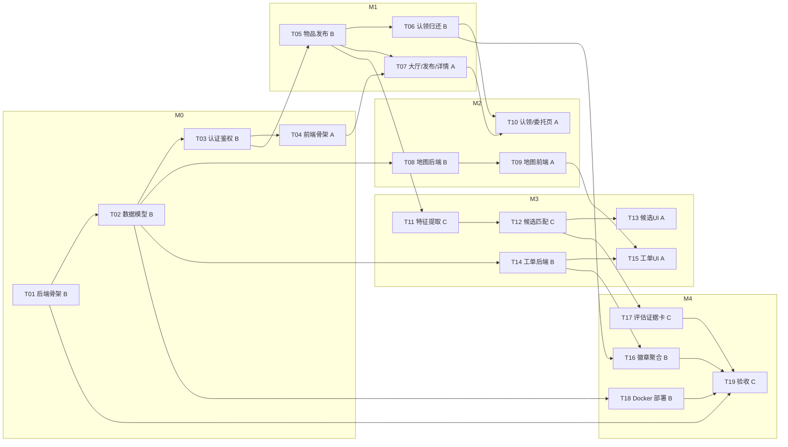

# 校园寻物局 · 阶段3 编码任务规划（tasks.md）

| 项 | 内容 |
|---|---|
| 项目 | 校园寻物局（校园失物协作平台） |
| 阶段 | 阶段3：编码任务规划 |
| 特性名 | `campus_lost_found` |
| 写入路径 | `.codeartsdoer/specs/campus_lost_found/tasks.md` |
| 上游输入 | `spec.md` v1.0 + `design.md` v1.0（2026-10-03） |
| 状态 | v1.0（2026-10-03） |

## 0. 约定与负责人

| 代号 | 负责人 | 职责范围 |
|---|---|---|
| **A** | 前端/地图/交互 | React 工程、Leaflet 图片地图、大厅/发布/认领/委托/工单页 |
| **B** | 后端/权限/数据库/状态/部署 | FastAPI 骨架、认证鉴权、状态机、脱敏、事务、工单、徽章、Docker |
| **C** | AI/评估/证据/演示 | 特征提取、候选匹配、来源标识、评估证据卡、演示脚本、Rules/Skill、验收 |

**后端先行原则**：B 的接口契约是 A/C 的前置。
**目录约定**：`backend/`（FastAPI）、`frontend/`（React+TS）、根目录 `docker-compose*.yml`、`.env`（入 `.gitignore`）。

## 1. 里程碑与交付节奏

| 里程碑 | 时间窗口 | 可运行版本目标 | 主导任务 |
|---|---|---|---|
| **M0 后端可跑** | 第 1–2 天 | `docker compose up` 后后端可 `/health`，12 表迁移成功 | T01–T04 |
| **M1 业务闭环** | 第 3–4 天 | 后端"发布→列表→详情→认领→核验→归还"闭环可 curl | T05–T07 |
| **M2 前端闭环+地图** | 第 5–6 天 | 前端大厅/发布/认领可用，地图标点/圈选/路线渲染 | T08–T10 |
| **M3 AI+工单** | 第 7–8 天 | 候选推荐（含降级）+ 协助工单协作闭环 | T11–T15 |
| **M4 收尾+验收** | 第 9–10 天 | 徽章、评估证据卡、demo 部署、Rules/Skill、EARS 验收 | T16–T19 |

## 2. 任务依赖图

## 3. 任务明细总表

| ID | 标题 | 负责人 | 前置依赖 | 关联接口/实体 | 关联 EARS |
|---|---|---|---|---|---|
| T01 | 后端工程骨架 | B | — | `/health` | — |
| T02 | 12 张实体建模与迁移 | B | T01 | 12 实体 | — |
| T03 | 认证鉴权 + 角色守卫 + 脱敏 | B | T02 | A 组接口；`user` | 6.1 |
| T04 | 前端工程骨架 + 通用组件 | A | T03 | Axios/路由/登录态 | — |
| T05 | 物品发布/列表/详情 + 状态机 | B | T03, T02 | B 组接口 | 6.2 |
| T06 | 认领/核验/归还事务 + 幂等 | B | T05 | E 组接口 | 6.4, 6.5 |
| T07 | 大厅/发布/详情前端页 | A | T04, T05 | B 组接口 | 6.2, 6.8 |
| T08 | 地图后端（图层/标定/点位） | B | T02 | C 组接口 | 6.7 |
| T09 | Leaflet 地图前端交互 | A | T08 | C 组接口 | 6.7 |
| T10 | 认领/我的委托前端页 | A | T06, T07 | E+G 组 | 6.4, 6.8 |
| T11 | 特征提取适配器 + 降级 | C | T05 | D 组 extract | 6.2, 6.3 |
| T12 | 候选匹配 + 来源标识 + 缓存 | C | T11 | D 组 candidates | 6.3 |
| T13 | 候选列表前端 + 来源标识 | A | T12 | D 组 | 6.3 |
| T14 | 工单状态机 + 授权后端 | B | T02 | F 组接口 | 6.6 |
| T15 | 工单协作 UI + 核查清单 | A | T14, T09 | F 组 | 6.6 |
| T16 | 徽章去重 + 我的委托聚合 | B | T06, T14 | G 组接口 | 6.8 |
| T17 | 匹配评估 + 证据卡 + 演示 | C | T12 | `candidate/claim_evidence` | 6.5, 7 |
| T18 | Docker Compose + 密钥后端化 | B | T02 | 3 套 compose | — |
| T19 | Rules/Skill 配置 + 阶段验收 | C | T01–T18 | 全部 | 6.1–6.8 |

## 4. 逐任务详细说明

### T01 后端工程骨架（B）
- **输出**：`backend/` FastAPI 工程，`pyproject.toml`/`requirements.txt`、`app/main.py`、配置加载、`GET /api/v1/health`、CORS、统一错误结构、`.env.example`。
- **验收**：`/api/v1/health` 返回 `{"status":"ok"}`；错误响应 `{code,message,details?}`。

### T02 12 张实体建模与迁移（B）
- **输出**：12 张 SQLAlchemy 模型 + Alembic 首版迁移；枚举严格对齐状态机；`UNIQUE(username)`、`UNIQUE(claim.idempotency_key)`、`UNIQUE(badge.user_id,kind)`。
- **验收**：`alembic upgrade head` 建 12 表；`layer.pixels_per_meter` 为空时不输出米数。

### T03 认证鉴权 + 角色守卫 + 脱敏序列化器（B）
- **输出**：register/login/me/admin/staff 接口；JWT；`RoleGuard(student/staff/admin)`；脱敏序列化器（剥离私密字段）。
- **验收**：见 EARS 6.1；注册禁止 role≠student；公开序列化不含私密字段。

### T04 前端工程骨架 + 通用组件（A）
- **输出**：`frontend/`（Vite+React+TS+Router+Axios interceptor+状态库）、登录/注册页、`<RequireAuth>`、通用组件。
- **验收**：未登录跳登录页；前端不存密钥、不自行判权限。

### T05 物品发布/列表/详情 + 状态机骨架（B）
- **输出**：`POST /items`、`GET /items`（筛选脱敏）、`GET /items/{id}`、`POST /items/{id}/map-anchor`；附件上传。
- **验收**：见 EARS 6.2；列表/详情不含私密字段。

### T06 认领/核验/归还事务 + 幂等（B）
- **输出**：`POST /claims`、`POST /claims/{id}/review`、`POST /claims/{id}/complete`；归还事务（FOR UPDATE+行锁+CAS）；证据私密域。
- **验收**：见 EARS 6.4/6.5；同一物品仅一次归还；学生越权 403。

### T07 大厅/发布/详情前端页（A）
- **输出**：大厅、发布、详情页。
- **验收**：见 EARS 6.2/6.3；模型提取失败可手动继续。

### T08 地图后端（B）
- **输出**：`GET /layers`、`GET /layers/{id}/image`、`GET /layers/{id}/points`、`POST /layers/{id}/calibrate`。
- **验收**：3 图层；未标定不返回米数；模拟点位标记；calibrate 仅 admin。

### T09 Leaflet 地图前端交互（A）
- **输出**：图片图层渲染、缩放/标点/画圈/分层路线、版本缓存失效、米数门控。
- **验收**：见 EARS 6.7；未标定不显示米数；模拟点位标记。

### T10 认领/我的委托前端页（A）
- **输出**：认领提交页；我的委托页。
- **验收**：见 EARS 6.4/6.8。

### T11 特征提取适配器 + 降级兜底（C）
- **输出**：`POST /items/{id}/extract`；模型适配器可选 Key/超时/容错/额度；降级链。
- **验收**：见 EARS 6.2/6.3；模型不可用返回空+503 不阻断。

### T12 候选匹配 + 来源标识 + 缓存（C）
- **输出**：`GET /items/{id}/candidates`（≤3+解释+source四类）；候选缓存；过滤私密。
- **验收**：见 EARS 6.3；来源标识；无候选提示转工单。

### T13 候选列表前端 + 来源标识（A）
- **验收**：见 EARS 6.3；渲染来源标识+解释。

### T14 工单状态机 + 授权后端（B）
- **输出**：tickets 全组接口；authorize-route；route 权限控制。
- **验收**：见 EARS 6.6；未授权/未分配 403。

### T15 工单协作 UI + 核查清单（A）
- **验收**：见 EARS 6.6；模拟点位标记；未授权不渲染路线。

### T16 徽章去重 + 我的委托聚合（B）
- **验收**：见 EARS 6.8；徽章去重。

### T17 匹配评估 + 证据卡 + 演示脚本（C）
- **验收**：仅报告实际结果，来源分别标记。

### T18 Docker Compose + 密钥后端化（B）
- **验收**：`docker compose up` 拉起服务；密钥仅存后端。

### T19 Rules/Skill 配置 + 阶段验收（C）
- **验收**：重点检查矩阵覆盖；不伪造记录。

## 5. 业务约束落地对照表

| # | 硬约束 | 主要落点 | 关键实现 |
|---|---|---|---|
| 1 | 后端强制权限 | T03,T06,T08,T14 | `RoleGuard`；403 |
| 2 | 私密字段不进公共接口 | T03,T05,T06 | 脱敏序列化器 |
| 3 | AI 仅提取与推荐 | T06,T11,T12 | 模型仅读，写路由不暴露 |
| 4 | 同一物品仅一次归还 | T06 | 事务+行锁+CAS |
| 5 | 模型故障降级 | T11,T12,T18 | 降级链+503 |
| 6 | 路线默认私密最小授权 | T08,T14,T15 | `route.is_private` |
| 7 | 四类来源标识 | T12,T13 | `candidate.source` |
| 8 | 无比例尺不显示米数 | T08,T09 | `pixels_per_meter IS NULL` |
| 9 | 模拟点位恒标记 | T04,T08,T09,T15 | `is_simulated` |
| 10 | 密钥仅存后端 | T18 | `.env` 入 `.gitignore` |
| 11 | 真实性声明 | T17,T19 | 分别标记 |

## 6. 验收与测试任务汇总

| 阶段 | 测试任务 | 覆盖 |
|---|---|---|
| M1 | 后端闭环集成测试 | 6.2/6.4/6.5 |
| M2 | 地图保存/楼层/无比例尺 | 6.7 |
| M3 | 模型降级/来源标识/工单授权 | 6.3/6.6 |
| M4 | 权限矩阵全量回归 + EARS 验收 | 6.1–6.8 |