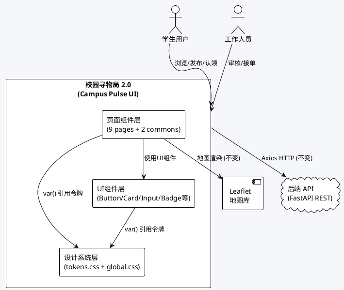
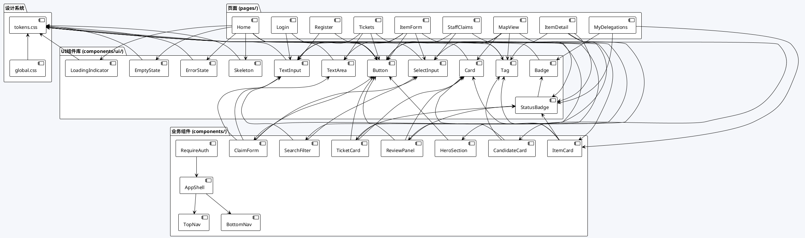
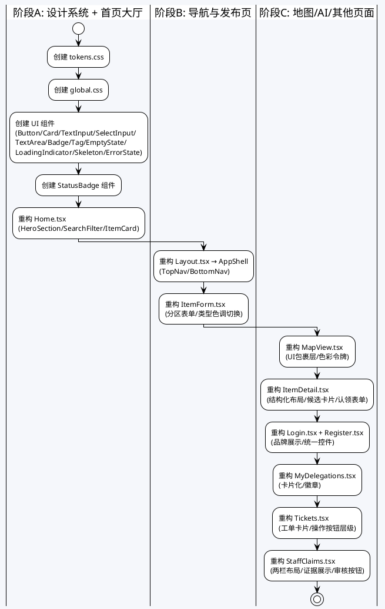
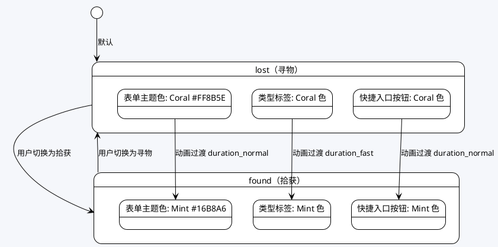
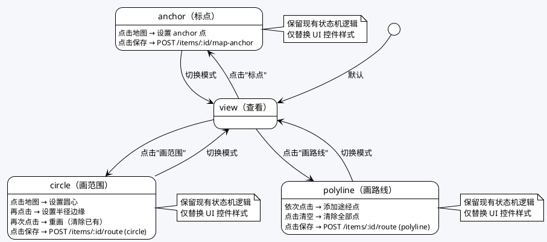
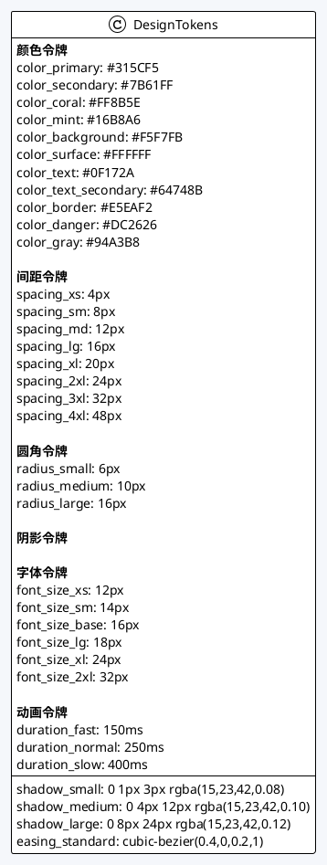
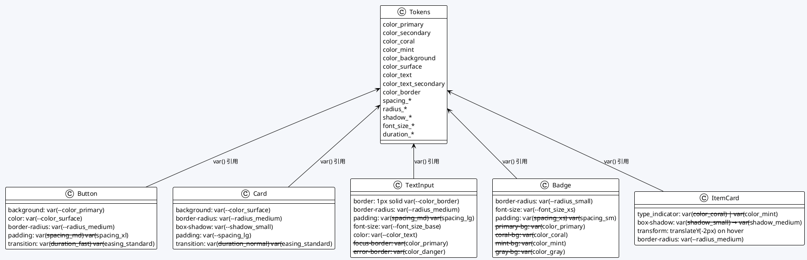
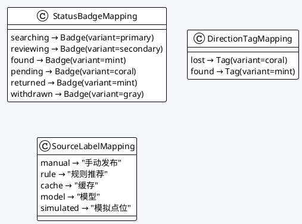

# 校园寻物局 2.0 — Campus Pulse UI/UX 工程化升级实现方案

## 0. 文档信息

| 项 | 内容 |
|---|---|
| 项目 | 校园寻物局 2.0（Campus Pulse · 校园信号站） |
| 阶段 | UI/UX 工程化升级技术设计 |
| 特性名 | `campus_pulse_ui` |
| 写入路径 | `.codeartsdoer/specs/campus_pulse_ui/design.md` |
| 状态 | 待确认 v1.0 |
| 关联需求 | `.codeartsdoer/specs/campus_pulse_ui/spec.md` |

---

# 一、需求与存量功能关系分析

## 1.1 需求功能与存量功能对比

### 1.1.1 已实现功能

| 需求功能 | 存量功能 | 代码位置 | 匹配度 |
|---------|---------|---------|--------|
| 大厅列表展示物品记录 | Home.tsx 已实现物品列表渲染，含 direction/category/location/status 展示 | `frontend/src/pages/Home.tsx:48-59` | 75% |
| 类型筛选（寻物/拾获/全部） | Home.tsx 已实现 direction 筛选 select 控件 | `frontend/src/pages/Home.tsx:35-39` | 100% |
| 类别搜索 | Home.tsx 已实现 category 输入框搜索 | `frontend/src/pages/Home.tsx:40` | 100% |
| 状态筛选 | Home.tsx 已实现 status 筛选 select 控件 | `frontend/src/pages/Home.tsx:41-46` | 100% |
| 卡片点击导航到详情页 | Home.tsx 已实现 Link to `/items/${item.id}` | `frontend/src/pages/Home.tsx:51` | 100% |
| 顶部导航栏（桌面端） | Layout.tsx 已实现 nav 含大厅/发布/我的委托/工单/地图/认领审核链接 | `frontend/src/components/Layout.tsx:15-24` | 50% |
| 角色信息与退出按钮 | Layout.tsx 已实现 role 显示和 logout 按钮 | `frontend/src/components/Layout.tsx:22-23` | 75% |
| 发布页表单（direction/category/title/description/location_area/precise_location） | ItemForm.tsx 已实现全部字段和提交逻辑 | `frontend/src/pages/ItemForm.tsx:36-54` | 75% |
| 类型切换（寻物/拾获） | ItemForm.tsx 已实现 direction select 切换 | `frontend/src/pages/ItemForm.tsx:42-45` | 50% |
| 提交按钮加载状态 | ItemForm.tsx 已实现 busy 状态和 disabled 逻辑 | `frontend/src/pages/ItemForm.tsx:53` | 75% |
| 地图页面 Leaflet 初始化 | MapView.tsx 已实现完整的 Leaflet 地图初始化、图层加载、标记渲染 | `frontend/src/pages/MapView.tsx:118-203` | 100% |
| 图层选择器 | MapView.tsx 已实现 layer select 控件 | `frontend/src/pages/MapView.tsx:409-415` | 75% |
| 操作模式切换（查看/标点/画范围/画路线） | MapView.tsx 已实现 modeLabels 和 changeMode 逻辑 | `frontend/src/pages/MapView.tsx:52-57,329-332` | 75% |
| 地图标记色彩区分 | MapView.tsx 已实现 lost=#2563eb、found=#16a34a 色彩区分 | `frontend/src/pages/MapView.tsx:235` | 50% |
| 绘制预览色彩 | MapView.tsx 已实现 #7c3aed 紫色绘制预览 | `frontend/src/pages/MapView.tsx:279-298` | 50% |
| 模拟点位标识 | MapView.tsx 已实现 #d97706 橙色模拟点位 | `frontend/src/pages/MapView.tsx:259` | 50% |
| 比例尺状态提示 | MapView.tsx 已实现 calibrated 状态文字提示 | `frontend/src/pages/MapView.tsx:461` | 50% |
| 信息卡片（选中物品） | MapView.tsx 已实现 selectedItem 卡片展示 | `frontend/src/pages/MapView.tsx:449-457` | 50% |
| 详情页基本信息展示 | ItemDetail.tsx 已实现 title/direction/category/status/description/location 展示 | `frontend/src/pages/ItemDetail.tsx:76-81` | 75% |
| 候选匹配列表（寻物） | ItemDetail.tsx 已实现 candidates 列表展示 | `frontend/src/pages/ItemDetail.tsx:86-94` | 50% |
| 认领表单（拾获） | ItemDetail.tsx 已实现 evidence textarea 和 lostItemId select | `frontend/src/pages/ItemDetail.tsx:95-106` | 50% |
| 地图位置链接 | ItemDetail.tsx 已实现 Link to `/map?layer=...` | `frontend/src/pages/ItemDetail.tsx:82-84` | 75% |
| 模拟点位标识 | ItemDetail.tsx 已实现 is_simulated 文字提示 | `frontend/src/pages/ItemDetail.tsx:85` | 50% |
| 登录页品牌展示 | Login.tsx 已实现 h1 "校园寻物局" | `frontend/src/pages/Login.tsx:27` | 25% |
| 登录表单 | Login.tsx 已实现 username/password 输入和提交 | `frontend/src/pages/Login.tsx:28-41` | 75% |
| 登录/注册切换链接 | Login.tsx 已实现 Link to /register | `frontend/src/pages/Login.tsx:43` | 100% |
| 注册页表单 | Register.tsx 已实现 username/displayName/password 输入和提交 | `frontend/src/pages/Register.tsx:28-47` | 75% |
| 注册/登录切换链接 | Register.tsx 已实现 Link to /login | `frontend/src/pages/Register.tsx:49` | 100% |
| 我的委托页分区展示 | MyDelegations.tsx 已实现 我的发布/我的认领/我的工单 三个分区 | `frontend/src/pages/MyDelegations.tsx:38-69` | 75% |
| 徽章展示 | MyDelegations.tsx 已实现 badges 文字展示 | `frontend/src/pages/MyDelegations.tsx:36` | 25% |
| 地图定位链接 | MyDelegations.tsx 已实现 Link to `/map?layer=...` | `frontend/src/pages/MyDelegations.tsx:48-50` | 75% |
| 工单列表展示 | Tickets.tsx 已实现 ticket 卡片列表 | `frontend/src/pages/Tickets.tsx:56-73` | 50% |
| 学生申请协助 | Tickets.tsx 已实现 itemId select 和申请按钮 | `frontend/src/pages/Tickets.tsx:48-54` | 75% |
| 工作人员接单/反馈 | Tickets.tsx 已实现 assign/feedback 操作 | `frontend/src/pages/Tickets.tsx:59-68` | 50% |
| 授权路线按钮 | Tickets.tsx 已实现 authorize-route 按钮 | `frontend/src/pages/Tickets.tsx:70-72` | 50% |
| 认领审核页 | StaffClaims.tsx 已实现列表+详情布局 | `frontend/src/pages/StaffClaims.tsx:62-89` | 50% |
| 状态筛选 | StaffClaims.tsx 已实现 status select | `frontend/src/pages/StaffClaims.tsx:64-67` | 75% |
| 审核操作按钮 | StaffClaims.tsx 已实现 approve/reject/complete 按钮 | `frontend/src/pages/StaffClaims.tsx:83-87` | 50% |
| 权限守卫 | StaffClaims.tsx 已实现 role !== 'staff' 重定向 | `frontend/src/pages/StaffClaims.tsx:61` | 100% |
| 全局基础样式 | index.css 已实现 :root 字体/颜色、.page/.card/.actions 工具类 | `frontend/src/index.css` | 25% |
| XSS 防护（esc 函数） | MapView.tsx 已实现 esc 函数 | `frontend/src/pages/MapView.tsx:59-63` | 100% |
| 认领提交幂等键 | ItemDetail.tsx 已实现 idempotency_key 逻辑 | `frontend/src/pages/ItemDetail.tsx:60-64` | 100% |
| AuthContext 状态管理 | AuthContext.tsx 已实现完整的 login/register/logout 逻辑 | `frontend/src/auth/AuthContext.tsx` | 100% |
| RequireAuth 权限守卫 | RequireAuth.tsx 已实现 token 检查和重定向 | `frontend/src/components/RequireAuth.tsx` | 100% |
| API client 拦截器 | client.ts 已实现 token 注入和 401 处理 | `frontend/src/api/client.ts` | 100% |

### 1.1.2 需要扩展的功能

| 需求功能 | 存量功能 | 差异说明 | 扩展方向 |
|---------|---------|---------|---------|
| Hero 区域（品牌标语+视觉主元素+快捷入口） | Home.tsx 仅有一个 `<h1>大厅</h1>` 标题 | 缺少品牌标语、信号波纹动画、视觉主元素、寻物/拾获快捷入口按钮 | 新增 HeroSection 组件，替换现有 h1 标题区域 |
| 物品卡片视觉升级（类型色条、状态徽章、悬停动画） | Home.tsx 使用简单 li + inline style，无类型色彩区分、无状态徽章、无悬停效果 | 卡片缺少 Coral/Mint 类型色条、状态徽章组件、悬停上浮动画 | 新增 ItemCard 组件，替换现有 li 列表项 |
| 空状态展示（插画+文案+清除筛选按钮） | Home.tsx 仅显示 `<p>暂无符合条件的记录</p>` | 缺少空状态插画/图标、清除筛选按钮 | 新增 EmptyState 组件 |
| 加载状态（骨架屏） | Home.tsx 仅显示 `<p>加载中…</p>` | 缺少骨架屏或统一加载动画 | 新增 Skeleton/LoadingIndicator 组件 |
| 错误状态统一展示 | Home.tsx 仅显示 `<p role="alert">{error}</p>` | 缺少统一错误提示卡片样式和重试按钮 | 新增 ErrorState 组件 |
| AppShell 布局框架 | Layout.tsx 仅有简单 nav + Outlet，无响应式切换 | 缺少顶部导航栏品牌标识、移动端底部导航栏、响应式切换逻辑 | 重构 Layout.tsx 为 AppShell，新增 BottomNav 组件 |
| 底部导航栏（移动端） | 无 | 完全缺失移动端底部导航 | 新增 BottomNav 组件 |
| 导航栏品牌标识 | Layout.tsx 无品牌标识 | 缺少"校园寻物局"品牌 logo/文字 | 在导航栏中添加品牌标识 |
| 发布页分区式表单布局 | ItemForm.tsx 使用简单 grid 布局，无分区 | 缺少类型选择区、基本信息区、位置信息区的分区布局 | 重构 ItemForm.tsx 为分区式表单 |
| 类型切换视觉反馈（Coral/Mint 色调跟随） | ItemForm.tsx 类型切换无色调反馈 | 切换寻物/拾获时表单色调不变 | 根据 direction 动态切换表单主题色 |
| 表单输入控件统一样式（focus/error 状态） | ItemForm.tsx 使用原生 input/select/textarea，无 focus/error 样式 | 缺少统一 UI 组件样式的输入控件 | 新增 TextInput/SelectInput/TextArea UI 组件 |
| 详情页结构化布局（分区+类型色系标识条+状态徽章） | ItemDetail.tsx 使用简单文本排列，无分区、无色系标识、无状态徽章 | 缺少结构化分区布局、类型色系标识条、状态徽章组件 | 重构 ItemDetail.tsx 为结构化布局 |
| 候选匹配卡片化 | ItemDetail.tsx 候选匹配使用简单 article.card，缺少匹配依据/来源的卡片化展示 | 缺少卡片化样式、匹配依据和来源标识的视觉强化 | 使用 CandidateCard 组件替换现有 article |
| 认领表单统一样式 | ItemDetail.tsx 认领表单使用原生控件 | 缺少统一 UI 组件样式 | 使用 TextInput/TextArea/SelectInput UI 组件 |
| 登录页品牌展示与样式统一 | Login.tsx 仅有 h1 标题，无品牌标语、无统一控件样式 | 缺少品牌氛围、统一输入控件、统一按钮样式 | 重构 Login.tsx 视觉层 |
| 注册页样式统一 | Register.tsx 与登录页风格不一致 | 缺少视觉一致性 | 重构 Register.tsx 视觉层 |
| 我的委托页卡片化 | MyDelegations.tsx 使用简单 ul/li 列表 | 缺少卡片化展示、状态标识视觉强化 | 使用 ItemCard/ClaimCard/TicketCard 组件替换列表 |
| 徽章醒目展示 | MyDelegations.tsx 徽章仅文字 join 展示 | 缺少圆形图标+文字描述的醒目视觉 | 新增 Badge 组件 |
| 工单列表卡片化 | Tickets.tsx 使用 article.card 但样式简陋 | 缺少状态徽章色彩区分、操作按钮视觉层级 | 使用 TicketCard 组件 + 统一按钮样式 |
| 认领审核页两栏布局 | StaffClaims.tsx 使用列表+详情纵向排列 | 缺少两栏（列表+详情）横向布局 | 重构为两栏布局 |
| 证据展示区域视觉区分 | StaffClaims.tsx 证据区域无"私密"标识 | 缺少私密标签视觉区分 | 新增私密标识样式 |
| 审核操作按钮视觉层级 | StaffClaims.tsx 三个按钮样式相同无主次区分 | 缺少主操作/次操作的色彩区分 | 主操作用 Primary 色，次操作用警示色 |
| 地图页面 UI 包裹层 | MapView.tsx 使用 inline style，控件样式不统一 | 缺少统一 UI 组件样式包裹层 | 使用设计系统组件重构非地图元素 |
| 地图标记色彩规范 | MapView.tsx 使用 #2563eb/#16a34a/#7c3aed/#d97706 | 色值与设计系统不一致（应为 Primary/Mint/Secondary/Coral） | 替换为设计令牌引用 |
| 比例尺状态视觉区分 | MapView.tsx 仅文字提示 | 缺少 Mint 色/灰色标签视觉区分 | 新增状态标签组件 |
| 响应式布局（移动端/平板/桌面端） | 全项目使用 inline style，无响应式断点 | 缺少全部响应式适配 | 通过 CSS Modules 媒体查询实现 |
| 语义化 HTML | 全项目使用 div/h1/h2/p 等基础标签 | 缺少 header/nav/main/section/article/footer 语义标签 | 逐步替换为语义化标签 |
| 设计令牌体系 | index.css 仅有少量硬编码值 | 缺少完整的设计令牌定义 | 新增 tokens.css |
| 全局样式重置与基础样式 | index.css 仅有 22 行简单样式 | 缺少完整的 CSS Reset 和全局工具类 | 新增 global.css |

### 1.1.3 需要新增的功能或接口

**设计系统模块**

| 功能点 | 输入 | 输出 | 核心逻辑 | 依赖 |
|--------|------|------|---------|------|
| tokens.css | 无（静态定义） | CSS 自定义属性文件 | 定义 26 个设计令牌（颜色/间距/圆角/阴影/字体/动画） | 无 |
| global.css | 无（静态定义） | 全局样式文件 | CSS Reset + 基础排版 + 全局工具类（引用 tokens） | tokens.css |
| Button 组件 | variant/size/disabled/children/loading | React 组件 | 主按钮/次按钮/危险按钮/加载状态 | tokens.css |
| Card 组件 | children/variant/elevation/onClick | React 组件 | 卡片容器，支持悬停上浮效果 | tokens.css |
| TextInput 组件 | value/onChange/placeholder/error/label/disabled | React 组件 | 统一输入框，支持 focus 高亮和 error 提示 | tokens.css |
| SelectInput 组件 | value/onChange/options/placeholder/error/label | React 组件 | 统一下拉框，支持 focus 高亮和 error 提示 | tokens.css |
| TextArea 组件 | value/onChange/placeholder/error/label/disabled/maxLength | React 组件 | 统一文本域，支持 focus 高亮和 error 提示 | tokens.css |
| Badge 组件 | variant/children | React 组件 | 状态徽章，支持多种色彩变体 | tokens.css |
| Tag 组件 | variant/children | React 组件 | 类型标签（寻物 Coral/拾获 Mint） | tokens.css |
| EmptyState 组件 | icon/title/description/action | React 组件 | 空状态展示 | tokens.css |
| LoadingIndicator 组件 | size/label | React 组件 | 加载指示器 | tokens.css |
| Skeleton 组件 | variant/width/height | React 组件 | 骨架屏 | tokens.css |
| ErrorState 组件 | message/onRetry | React 组件 | 错误状态展示 | tokens.css |

**首页模块**

| 功能点 | 输入 | 输出 | 核心逻辑 | 依赖 |
|--------|------|------|---------|------|
| HeroSection 组件 | 无 | React 组件 | 品牌名称+标语+信号波纹动画+快捷入口按钮 | tokens.css, Button |
| SearchFilter 组件 | direction/category/status/onChange | React 组件 | 类型筛选+类别搜索+状态筛选，使用统一 UI 组件 | SelectInput, TextInput |
| ItemCard 组件 | item/onClick | React 组件 | 类型色条+标题+类别+地点+状态徽章+时间+悬停动画 | Tag, Badge, tokens.css |

**导航模块**

| 功能点 | 输入 | 输出 | 核心逻辑 | 依赖 |
|--------|------|------|---------|------|
| AppShell 组件 | children | React 组件 | 顶部导航栏+底部导航栏+内容区域，响应式切换 | TopNav, BottomNav |
| TopNav 组件 | role/onLogout | React 组件 | 桌面端导航栏，含品牌标识+导航链接+角色信息 | tokens.css |
| BottomNav 组件 | activeRoute | React 组件 | 移动端底部导航栏，含图标+文字 | tokens.css |

**其他页面模块**

| 功能点 | 输入 | 输出 | 核心逻辑 | 依赖 |
|--------|------|------|---------|------|
| StatusBadge 组件 | status | React 组件 | 根据 ItemStatus 映射色彩和文案 | Badge, tokens.css |
| CandidateCard 组件 | candidate | React 组件 | 候选匹配卡片，含标题/类别/地点/依据/来源 | Card, Tag, tokens.css |
| ClaimForm 组件 | evidence/lostItemId/onSubmit/busy | React 组件 | 认领表单，使用统一 UI 组件 | TextInput, TextArea, SelectInput, Button |
| TicketCard 组件 | ticket/role/actions | React 组件 | 工单卡片，含编号/状态徽章/操作按钮 | Card, Badge, Button |
| ReviewPanel 组件 | detail/found/onAct/busy | React 组件 | 认领审核详情面板，含证据展示+操作按钮 | Card, Badge, Button |

## 1.2 存量功能详细分析

### 1.2.1 Home.tsx（首页大厅）

**接口契约**：
- 入参：无（内部通过 useEffect 调用 `/items` API，支持 direction/category/status 查询参数）
- 出参：渲染物品列表
- 异常：API 错误时展示 error 文案
- 副作用：筛选条件变化触发重新请求

**业务规则**：
- 三维筛选：direction（lost/found/全部）、category（文本搜索）、status（全部/6种状态）
- 筛选条件变化自动触发 API 请求（useEffect 依赖 direction/category/status）
- active 标志防止竞态条件（组件卸载后不更新状态）

**扩展点**：
- 筛选逻辑保留不变，仅替换 UI 控件样式
- 列表渲染替换为 ItemCard 组件
- 新增 HeroSection、EmptyState、LoadingIndicator

**约束**：
- 保留三维筛选功能不退化
- 保留竞态条件防护逻辑
- 保留 `/items` API 调用路径和参数结构

### 1.2.2 Layout.tsx（布局组件）

**接口契约**：
- 入参：无（通过 useAuth 获取 role，通过 Outlet 渲染子路由）
- 出参：导航栏 + 内容区域
- 异常：无
- 副作用：logout 时清除 token 并跳转

**业务规则**：
- role === 'staff' 时显示认领审核链接
- 导航链接：大厅/发布/我的委托/工单/地图 + 认领审核（staff 限定）
- 退出按钮调用 logout() 并 navigate('/login')

**扩展点**：
- 重构为 AppShell，增加响应式导航切换
- 新增品牌标识
- 新增移动端 BottomNav

**约束**：
- 保留 role 条件渲染逻辑（staff 专属入口）
- 保留 logout 逻辑
- 保留 Outlet 渲染机制

### 1.2.3 ItemForm.tsx（发布页）

**接口契约**：
- 入参：无（表单内部状态管理）
- 出参：POST `/items` 提交表单数据
- 异常：API 错误展示 error 文案
- 副作用：提交成功后 navigate('/')

**业务规则**：
- direction 默认 lost，可切换 lost/found
- 必填字段：category、title
- 提交参数：direction/category/title/description/location_area/precise_location
- busy 状态防止重复提交
- precise_location 为空时传 null

**扩展点**：
- 重构为分区式表单布局
- 类型切换增加 Coral/Mint 色调反馈
- 使用统一 UI 组件替换原生控件

**约束**：
- 保留全部 6 个表单字段
- 保留 POST `/items` API 调用路径和参数结构
- 保留 busy 防重复提交逻辑
- 保留 precise_location 空值传 null 逻辑

### 1.2.4 MapView.tsx（地图页面）

**接口契约**：
- 入参：searchParams（layer/nx/ny/item 用于定位聚焦）
- 出参：Leaflet 地图 + UI 控件
- 异常：图层/底图/数据加载失败展示 error
- 副作用：地图初始化、图层切换、标记渲染、绘制交互

**业务规则**：
- 图层选择 → 地图重新初始化
- 4 种操作模式：view/anchor/circle/polyline
- 标记色彩：lost=#2563eb、found=#16a34a、绘制=#7c3aed、模拟点位=#d97706
- 绘制操作需先选择目标委托
- anchor 模式：点击一次标点 → 保存
- circle 模式：点击圆心 → 点击半径边缘 → 保存
- polyline 模式：依次点击途经点 → 保存（至少 2 点）
- 保存后刷新 items 和 routes 数据
- 比例尺未标定时不换算实际米数
- esc 函数防止 XSS

**扩展点**：
- 替换硬编码色值为设计令牌引用
- UI 包裹层使用设计系统组件
- 比例尺状态用标签组件区分
- 信息卡片用 Card 组件
- 操作模式按钮用 ButtonGroup 组件

**约束**：
- 保留 Leaflet 初始化和事件绑定逻辑
- 保留全部 useEffect 依赖链
- 保留 esc XSS 防护函数
- 保留 searchParams 定位聚焦逻辑
- 保留绘制交互状态机逻辑
- 保留保存后刷新逻辑
- 保留 modeRef 防竞态逻辑

### 1.2.5 ItemDetail.tsx（详情页）

**接口契约**：
- 入参：id（路由参数）、lost（query 参数，关联寻物）
- 出参：物品详情 + 候选匹配（寻物+物主）或认领表单（拾获+学生）
- 异常：API 错误展示 error
- 副作用：认领提交使用 idempotency_key 防重复

**业务规则**：
- 寻物 + is_owner → 请求候选匹配列表
- 拾获 + student + pending/reviewing → 展示认领表单
- 认领提交参数：found_item_id/lost_item_id/evidence/idempotency_key
- 认领提交后本地更新 status 为 reviewing
- submitted 状态防止重复提交
- key.current 在 id/evidence/lostItemId 变化时重置

**扩展点**：
- 重构为结构化分区布局
- 类型色系标识条
- 状态徽章
- 候选匹配卡片化
- 认领表单统一 UI 组件

**约束**：
- 保留 idempotency_key 幂等键逻辑
- 保留 is_owner 条件判断
- 保留 role === 'student' 条件判断
- 保留 submitted 防重复逻辑
- 保留 key.current 重置逻辑
- 保留 `/items/:id` 和 `/items/:id/candidates` API 调用

### 1.2.6 AuthContext.tsx + RequireAuth.tsx（鉴权）

**接口契约**：
- AuthContext：token/role/userId/ready/login/register/logout
- RequireAuth：token 检查 → Navigate to /login

**业务规则**：
- sessionStorage 持久化 token
- 401 响应触发 auth-expired 事件 → 自动 logout
- login → POST /auth/login → accept(token) → GET /auth/me
- register → POST /auth/register → accept(token) → GET /auth/me

**约束**：
- 禁止修改 AuthContext 状态管理逻辑
- 禁止修改 RequireAuth 权限守卫逻辑
- 禁止修改 client.ts 拦截器逻辑

### 1.2.7 index.css（全局样式）

**接口契约**：
- 静态 CSS 文件，定义 :root 字体/颜色和基础工具类

**业务规则**：
- .page：24px padding，1000px max-width，居中
- .card：16px padding，白色背景，8px 圆角
- .actions：flex 布局，8px gap
- button/input/select/textarea：继承字体，6px 10px padding
- button:disabled：opacity 0.6，cursor wait

**扩展点**：
- 替换为 tokens.css + global.css 设计系统
- 保留 .page/.card/.actions 工具类但改为引用设计令牌

**约束**：
- 过渡期保留现有工具类，确保功能不退化
- 逐步迁移 inline style 到 CSS Modules

---

# 二、增量设计方案

## 2.1 实现模型

### 2.1.1 上下文视图



### 2.1.2 服务/组件总体架构



### 2.1.3 实现设计文档

**阶段划分与依赖关系**：



**关键状态流转 — ItemForm 类型切换色调跟随**：



**关键状态流转 — 地图操作模式**：



## 2.2 接口设计

### 2.2.1 总体设计

UI 组件接口分为三类：
1. **基础 UI 组件**（components/ui/）：无业务语义的纯展示组件，接口稳定
2. **业务组件**（components/）：含业务语义的复合组件，接口中等稳定
3. **页面组件**（pages/）：路由级组件，接口由 React Router 定义

所有组件采用 TypeScript 强类型定义，禁止使用 any。组件 props 使用 interface 定义，枚举值使用 union type。

**接口稳定性等级**：

| 接口分类 | 稳定性 | 变更策略 |
|---------|--------|---------|
| 基础 UI 组件 props | 稳定 | 仅新增可选 props，不修改已有 props |
| 业务组件 props | 稳定 | 仅新增可选 props，不修改已有 props |
| 页面组件 | 稳定 | 路由路径不变，内部重构不影响外部 |
| 设计令牌 CSS 变量 | 稳定 | 仅新增令牌，不修改已有令牌名和值 |

### 2.2.2 接口清单

#### Button 组件

```typescript
interface ButtonProps {
  variant: 'primary' | 'secondary' | 'danger' | 'ghost'
  size: 'sm' | 'md' | 'lg'
  disabled?: boolean
  loading?: boolean
  children: React.ReactNode
  onClick?: () => void
  type?: 'button' | 'submit'
  ariaLabel?: string
}
```

- **业务说明**：统一按钮组件，primary 用于主操作，secondary 用于次操作，danger 用于拒绝/删除，ghost 用于弱化操作
- **前置条件**：无
- **后置条件**：点击时触发 onClick 回调；loading 时按钮禁用且显示加载指示
- **异常映射**：无（按钮不直接处理异常）
- **调用示例**：`<Button variant="primary" size="md" loading={busy} onClick={onSubmit}>提交</Button>`

#### Card 组件

```typescript
interface CardProps {
  variant?: 'default' | 'elevated' | 'outlined'
  onClick?: () => void
  children: React.ReactNode
  ariaLabel?: string
}
```

- **业务说明**：统一卡片容器，default 为默认轻微阴影，elevated 为悬停增强阴影，outlined 为边框无阴影
- **前置条件**：无
- **后置条件**：onClick 存在时鼠标悬停有上浮效果（translateY -2px + shadow_medium）
- **异常映射**：无
- **调用示例**：`<Card variant="elevated" onClick={() => navigate(`/items/${item.id}`)}>...</Card>`

#### TextInput 组件

```typescript
interface TextInputProps {
  value: string
  onChange: (value: string) => void
  placeholder?: string
  label?: string
  error?: string
  disabled?: boolean
  required?: boolean
  type?: 'text' | 'password'
  maxLength?: number
  ariaLabel?: string
}
```

- **业务说明**：统一文本输入框，支持 label 关联、error 提示、focus 高亮
- **前置条件**：无
- **后置条件**：focus 时边框变为 Primary 色；error 时边框变为 #DC2626 并展示错误文案
- **异常映射**：无
- **调用示例**：`<TextInput value={title} onChange={setTitle} label="标题" required error={titleError} />`

#### SelectInput 组件

```typescript
interface SelectInputProps {
  value: string
  onChange: (value: string) => void
  options: { value: string; label: string }[]
  placeholder?: string
  label?: string
  error?: string
  disabled?: boolean
  ariaLabel?: string
}
```

- **业务说明**：统一下拉选择框，支持 label 关联、error 提示、focus 高亮
- **前置条件**：无
- **后置条件**：focus 时边框变为 Primary 色；error 时边框变为 #DC2626
- **异常映射**：无
- **调用示例**：`<SelectInput value={direction} onChange={setDirection} options={[{value:'lost',label:'寻物'},{value:'found',label:'拾获'}]} label="类型" />`

#### TextArea 组件

```typescript
interface TextAreaProps {
  value: string
  onChange: (value: string) => void
  placeholder?: string
  label?: string
  error?: string
  disabled?: boolean
  required?: boolean
  maxLength?: number
  minHeight?: number
  ariaLabel?: string
}
```

- **业务说明**：统一文本域，支持 label 关联、error 提示、focus 高亮、resize vertical
- **前置条件**：无
- **后置条件**：focus 时边框变为 Primary 色
- **异常映射**：无
- **调用示例**：`<TextArea value={description} onChange={setDescription} label="描述" placeholder="请描述物品特征" />`

#### Badge 组件

```typescript
interface BadgeProps {
  variant: 'primary' | 'secondary' | 'coral' | 'mint' | 'gray'
  children: React.ReactNode
}
```

- **业务说明**：状态徽章，primary=Primary色背景/secondary=Secondary色背景/coral=Coral色背景/mint=Mint色背景/gray=灰色背景，白色文字
- **前置条件**：无
- **后置条件**：无
- **异常映射**：无
- **调用示例**：`<Badge variant="primary">寻找中</Badge>`

#### Tag 组件

```typescript
interface TagProps {
  variant: 'coral' | 'mint' | 'primary' | 'secondary'
  children: React.ReactNode
}
```

- **业务说明**：类型标签，coral 用于寻物标识、mint 用于拾获标识，轻量级色彩标识
- **前置条件**：无
- **后置条件**：无
- **异常映射**：无
- **调用示例**：`<Tag variant="coral">寻物</Tag>`

#### StatusBadge 组件

```typescript
interface StatusBadgeProps {
  status: ItemStatus
}
```

- **业务说明**：根据 ItemStatus 自动映射色彩和文案的徽章组件
- **前置条件**：无
- **后置条件**：无
- **异常映射**：无
- **色彩映射**：searching→primary, reviewing→secondary, found→mint, pending→coral, returned→mint, withdrawn→gray
- **调用示例**：`<StatusBadge status={item.status} />`

#### EmptyState 组件

```typescript
interface EmptyStateProps {
  icon?: React.ReactNode
  title: string
  description?: string
  actionLabel?: string
  onAction?: () => void
}
```

- **业务说明**：空状态展示，包含图标/标题/描述/操作按钮
- **前置条件**：无
- **后置条件**：点击操作按钮触发 onAction
- **异常映射**：无
- **调用示例**：`<EmptyState title="暂无符合条件的记录" description="试试调整筛选条件" actionLabel="清除筛选" onAction={clearFilters} />`

#### LoadingIndicator 组件

```typescript
interface LoadingIndicatorProps {
  size?: 'sm' | 'md' | 'lg'
  label?: string
}
```

- **业务说明**：加载指示器，旋转动画 + 可选文案
- **前置条件**：无
- **后置条件**：无
- **异常映射**：无
- **调用示例**：`<LoadingIndicator label="加载中…" />`

#### Skeleton 组件

```typescript
interface SkeletonProps {
  variant?: 'text' | 'card' | 'circle'
  width?: string
  height?: string
}
```

- **业务说明**：骨架屏占位组件，数据加载时展示
- **前置条件**：无
- **后置条件**：无
- **异常映射**：无
- **调用示例**：`<Skeleton variant="card" />`

#### ErrorState 组件

```typescript
interface ErrorStateProps {
  message: string
  onRetry?: () => void
}
```

- **业务说明**：错误状态展示，包含错误文案和可选重试按钮
- **前置条件**：无
- **后置条件**：点击重试按钮触发 onRetry
- **异常映射**：无
- **调用示例**：`<ErrorState message="请求失败，请重试" onRetry={reload} />`

#### HeroSection 组件

```typescript
interface HeroSectionProps {
  onPublishLost: () => void
  onPublishFound: () => void
}
```

- **业务说明**：首页 Hero 区域，展示品牌名称、标语、信号波纹动画、寻物/拾获快捷入口
- **前置条件**：无
- **后置条件**：点击快捷入口跳转到对应发布页
- **异常映射**：无
- **调用示例**：`<HeroSection onPublishLost={() => navigate('/publish?direction=lost')} onPublishFound={() => navigate('/publish?direction=found')} />`

#### SearchFilter 组件

```typescript
interface SearchFilterProps {
  direction: Direction | ''
  category: string
  status: string
  onDirectionChange: (value: Direction | '') => void
  onCategoryChange: (value: string) => void
  onStatusChange: (value: string) => void
}
```

- **业务说明**：搜索筛选区域，包含类型筛选、类别搜索、状态筛选
- **前置条件**：无
- **后置条件**：筛选条件变化触发对应回调
- **异常映射**：无
- **调用示例**：`<SearchFilter direction={direction} category={category} status={status} onDirectionChange={setDirection} onCategoryChange={setCategory} onStatusChange={setStatus} />`

#### ItemCard 组件

```typescript
interface ItemCardProps {
  item: Item
  onClick: () => void
}
```

- **业务说明**：物品卡片，展示类型色条、标题、类别、地点、状态徽章、时间、模拟标识
- **前置条件**：无
- **后置条件**：鼠标悬停时卡片上浮 + 阴影增强；点击触发 onClick
- **异常映射**：无
- **调用示例**：`<ItemCard item={item} onClick={() => navigate(`/items/${item.id}`)} />`

#### AppShell 组件

```typescript
interface AppShellProps {
  children: React.ReactNode
}
```

- **业务说明**：应用级布局框架，桌面端显示 TopNav，移动端显示 BottomNav，内容区域自适应
- **前置条件**：需在 RequireAuth 内使用
- **后置条件**：导航栏切换路由
- **异常映射**：无
- **调用示例**：`<AppShell><Outlet /></AppShell>`

#### TopNav 组件

```typescript
interface TopNavProps {
  role: Role | null
  onLogout: () => void
}
```

- **业务说明**：桌面端顶部导航栏，含品牌标识、导航链接、角色信息、退出按钮
- **前置条件**：无
- **后置条件**：点击退出调用 onLogout
- **异常映射**：无
- **调用示例**：`<TopNav role={role} onLogout={handleLogout} />`

#### BottomNav 组件

```typescript
interface BottomNavProps {
  currentPath: string
}
```

- **业务说明**：移动端底部导航栏，含大厅/发布/地图/我的四个入口
- **前置条件**：无
- **后置条件**：点击导航项跳转路由
- **异常映射**：无
- **调用示例**：`<BottomNav currentPath={location.pathname} />`

#### CandidateCard 组件

```typescript
interface CandidateCardProps {
  candidate: Candidate
  lostItemId: string
}
```

- **业务说明**：候选匹配卡片，展示拾获物品标题、类别、地点、匹配依据、来源标识
- **前置条件**：无
- **后置条件**：点击跳转到拾获详情页（带 lost 参数）
- **异常映射**：无
- **调用示例**：`<CandidateCard candidate={c} lostItemId={id} />`

#### ClaimForm 组件

```typescript
interface ClaimFormProps {
  evidence: string
  lostItemId: string
  lostItemOptions: Item[]
  busy: boolean
  submitted: boolean
  onEvidenceChange: (value: string) => void
  onLostItemIdChange: (value: string) => void
  onSubmit: () => void
  message: string
}
```

- **业务说明**：认领表单，使用统一 UI 组件，包含私密证据输入和关联寻物选择
- **前置条件**：物品为拾获类型且用户为学生
- **后置条件**：提交认领申请
- **异常映射**：无
- **调用示例**：`<ClaimForm evidence={evidence} lostItemId={lostItemId} lostItemOptions={mine} busy={busy} submitted={submitted} onEvidenceChange={setEvidence} onLostItemIdChange={setLostItemId} onSubmit={submitClaim} message={msg} />`

#### TicketCard 组件

```typescript
interface TicketCardProps {
  ticket: Ticket
  role: Role | null
  userId: string | null
  busy: boolean
  editingId: string
  result: string
  onAssign: (id: string) => void
  onStartFeedback: (id: string) => void
  onSubmitFeedback: (id: string) => void
  onCancelFeedback: () => void
  onResultChange: (value: string) => void
  onAuthorizeRoute: (id: string) => void
}
```

- **业务说明**：工单卡片，展示工单编号、状态徽章、结果信息、操作按钮
- **前置条件**：无
- **后置条件**：根据角色和状态展示不同操作按钮
- **异常映射**：无
- **调用示例**：略（参数较多，由 Tickets 页面组装）

#### ReviewPanel 组件

```typescript
interface ReviewPanelProps {
  detail: ClaimDetail
  foundItem: Item | null
  busy: boolean
  onApprove: () => void
  onReject: () => void
  onComplete: () => void
}
```

- **业务说明**：认领审核详情面板，展示拾获物品信息、私密证据、审核操作按钮
- **前置条件**：detail 不为 null
- **后置条件**：审核操作触发对应回调
- **异常映射**：无
- **调用示例**：`<ReviewPanel detail={detail} foundItem={found} busy={busy} onApprove={() => act('approve')} onReject={() => act('reject')} onComplete={() => act('complete')} />`

## 2.3 数据模型

### 2.3.1 设计目标

1. **支持的业务场景**：所有现有业务场景（发布、筛选、认领、工单、地图、我的委托等）的视觉升级
2. **性能目标**：tokens.css + global.css 合计 ≤15KB（gzip）；首屏渲染 ≤2s；动画 60fps
3. **扩展性目标**：设计令牌可扩展（新增令牌不影响已有组件）；UI 组件可复用（新页面可直接使用）
4. **兼容策略**：保留现有 .page/.card/.actions 工具类，过渡期 inline style 与 CSS Modules 共存

### 2.3.2 模型实现

**设计令牌数据模型**（tokens.css 中的 CSS 自定义属性）：



**UI 组件与设计令牌的引用关系**：



**状态徽章色彩映射模型**：



---

## 2.4 阶段化实施计划

### 2.4.1 阶段A：设计系统 + 首页大厅

**修改顺序与依赖关系**：

```
1. tokens.css (无依赖)
2. global.css (依赖 tokens.css)
3. UI 组件库 (依赖 tokens.css)
   3.1 Button
   3.2 Card
   3.3 TextInput
   3.4 SelectInput
   3.5 TextArea
   3.6 Badge
   3.7 Tag
   3.8 EmptyState (依赖 Button)
   3.9 LoadingIndicator
   3.10 Skeleton
   3.11 ErrorState (依赖 Button)
   3.12 StatusBadge (依赖 Badge)
4. 业务组件
   4.1 HeroSection (依赖 Button, Tag)
   4.2 SearchFilter (依赖 SelectInput, TextInput)
   4.3 ItemCard (依赖 Tag, StatusBadge, Card)
5. 页面重构
   5.1 Home.tsx (依赖 HeroSection, SearchFilter, ItemCard, EmptyState, LoadingIndicator, Skeleton, ErrorState)
   5.2 index.css (替换为 global.css 引用，保留过渡期工具类)
   5.3 main.tsx (更新 import 路径)
```

**具体文件修改清单**：

| 序号 | 文件路径 | 操作 | 修改内容概述 | 保留的现有逻辑 |
|------|---------|------|-------------|---------------|
| A1 | `frontend/src/styles/tokens.css` | 新建 | 定义 26 个 CSS 自定义属性（颜色/间距/圆角/阴影/字体/动画） | 无（全新文件） |
| A2 | `frontend/src/styles/global.css` | 新建 | CSS Reset + 基础排版 + 全局工具类（.page/.card/.actions 引用令牌） | 保留 .page/.card/.actions 类名和功能 |
| A3 | `frontend/src/components/ui/Button.tsx` | 新建 | Button 组件 + Button.module.css | 无 |
| A4 | `frontend/src/components/ui/Card.tsx` | 新建 | Card 组件 + Card.module.css | 无 |
| A5 | `frontend/src/components/ui/TextInput.tsx` | 新建 | TextInput 组件 + TextInput.module.css | 无 |
| A6 | `frontend/src/components/ui/SelectInput.tsx` | 新建 | SelectInput 组件 + SelectInput.module.css | 无 |
| A7 | `frontend/src/components/ui/TextArea.tsx` | 新建 | TextArea 组件 + TextArea.module.css | 无 |
| A8 | `frontend/src/components/ui/Badge.tsx` | 新建 | Badge 组件 + Badge.module.css | 无 |
| A9 | `frontend/src/components/ui/Tag.tsx` | 新建 | Tag 组件 + Tag.module.css | 无 |
| A10 | `frontend/src/components/ui/EmptyState.tsx` | 新建 | EmptyState 组件 + EmptyState.module.css | 无 |
| A11 | `frontend/src/components/ui/LoadingIndicator.tsx` | 新建 | LoadingIndicator 组件 + LoadingIndicator.module.css | 无 |
| A12 | `frontend/src/components/ui/Skeleton.tsx` | 新建 | Skeleton 组件 + Skeleton.module.css | 无 |
| A13 | `frontend/src/components/ui/ErrorState.tsx` | 新建 | ErrorState 组件 + ErrorState.module.css | 无 |
| A14 | `frontend/src/components/ui/StatusBadge.tsx` | 新建 | StatusBadge 组件（依赖 Badge） | 无 |
| A15 | `frontend/src/components/HeroSection.tsx` | 新建 | Hero 区域组件 + HeroSection.module.css | 无 |
| A16 | `frontend/src/components/SearchFilter.tsx` | 新建 | 搜索筛选组件 + SearchFilter.module.css | 无 |
| A17 | `frontend/src/components/ItemCard.tsx` | 新建 | 物品卡片组件 + ItemCard.module.css | 无 |
| A18 | `frontend/src/pages/Home.tsx` | 修改 | 替换 h1 为 HeroSection；替换筛选 div 为 SearchFilter；替换 ul/li 为 ItemCard 列表；替换加载/空/错误为对应组件 | 保留 useEffect 筛选逻辑、API 调用、竞态防护 |
| A19 | `frontend/src/index.css` | 修改 | 替换为 global.css 的 import；保留过渡期工具类 | 保留 .page/.card/.actions 类名 |
| A20 | `frontend/src/main.tsx` | 修改 | 更新 CSS import 路径 | 保留 React/Router/AuthProvider 结构 |

**Home.tsx 重构细节**：

保留不变：
- `useEffect` 中 `/items` API 调用逻辑（params 构建、active 竞态防护）
- `direction/category/status` 三个 state 及其筛选逻辑
- `loading/error/items` 三个 state 及其使用方式

替换内容：
- `<h1>大厅</h1>` → `<HeroSection onPublishLost={...} onPublishFound={...} />`
- 筛选 `<div>` 区域 → `<SearchFilter direction={direction} ... />`
- `<ul>` 列表 → `<div>` + `items.map(item => <ItemCard item={item} onClick={...} />)`
- `<p>加载中…</p>` → `<LoadingIndicator label="加载中…" />` 或 `<Skeleton variant="card" />`
- `<p>暂无符合条件的记录</p>` → `<EmptyState title="暂无符合条件的记录" actionLabel="清除筛选" onAction={clearFilters} />`
- `<p role="alert">{error}</p>` → `<ErrorState message={error} onRetry={reload} />`

### 2.4.2 阶段B：导航与发布页

**修改顺序与依赖关系**：

```
1. TopNav 组件 (依赖 tokens.css)
2. BottomNav 组件 (依赖 tokens.css)
3. AppShell 组件 (依赖 TopNav, BottomNav)
4. Layout.tsx → AppShell (依赖 AppShell)
5. ItemForm.tsx 重构 (依赖 TextInput, SelectInput, TextArea, Button, Tag)
```

**具体文件修改清单**：

| 序号 | 文件路径 | 操作 | 修改内容概述 | 保留的现有逻辑 |
|------|---------|------|-------------|---------------|
| B1 | `frontend/src/components/TopNav.tsx` | 新建 | 桌面端顶部导航栏 + TopNav.module.css | 无 |
| B2 | `frontend/src/components/BottomNav.tsx` | 新建 | 移动端底部导航栏 + BottomNav.module.css | 无 |
| B3 | `frontend/src/components/AppShell.tsx` | 新建 | 应用布局框架 + AppShell.module.css | 无 |
| B4 | `frontend/src/components/Layout.tsx` | 修改 | 替换为 AppShell 组件包装；保留 Outlet 渲染 | 保留 role 条件渲染、logout 逻辑、Outlet |
| B5 | `frontend/src/pages/ItemForm.tsx` | 修改 | 分区式表单布局；类型切换色调跟随；统一 UI 组件 | 保留全部 6 个字段、POST /items、busy 防重复、precise_location 空值传 null |

**Layout.tsx → AppShell 重构细节**：

保留不变：
- `useAuth()` 获取 role 和 logout
- `useNavigate()` 用于 logout 跳转
- `role === 'staff'` 条件渲染认领审核链接
- `<Outlet />` 渲染子路由

替换内容：
- `<nav style={...}>` → `<AppShell>` 包裹 `<TopNav role={role} onLogout={onLogout} />` + `<BottomNav currentPath={location.pathname} />` + `<main><Outlet /></main>`
- 导航链接样式 → TopNav 组件内部使用 CSS Modules
- 移动端自动切换 → AppShell 内部使用媒体查询判断显示 TopNav 或 BottomNav

**ItemForm.tsx 重构细节**：

保留不变：
- `direction/category/title/description/locationArea/preciseLocation` 6 个 state
- `onSubmit` 函数中 POST `/items` 的参数结构（direction/category/title/description/location_area/precise_location）
- `busy` 防重复提交逻辑
- `preciseLocation || null` 空值处理
- `navigate('/')` 提交成功跳转
- `errorMessage(error)` 错误处理

替换内容：
- `<select>` direction → `<SelectInput>` 或分段按钮组，切换时表单主题色跟随变化（Coral/Mint）
- `<input>` category/title → `<TextInput>` with label
- `<textarea>` description → `<TextArea>` with label
- `<input>` locationArea/preciseLocation → `<TextInput>` with label
- `<button>` submit → `<Button variant="primary" loading={busy}>`
- `<p style={{color:'#dc2626'}}>` error → `<ErrorState>` 或 TextInput error prop
- 表单布局 → 分区式：类型选择区 / 基本信息区 / 位置信息区

### 2.4.3 阶段C：地图、AI及其他页面

**修改顺序与依赖关系**：

```
1. MapView.tsx 重构 (依赖 SelectInput, Button, Card, StatusBadge, Tag)
2. ItemDetail.tsx 重构 (依赖 StatusBadge, CandidateCard, ClaimForm, Tag, Card, Button)
3. Login.tsx 重构 (依赖 TextInput, Button)
4. Register.tsx 重构 (依赖 TextInput, Button)
5. MyDelegations.tsx 重构 (依赖 ItemCard, Badge, StatusBadge)
6. Tickets.tsx 重构 (依赖 TicketCard, Button, TextInput, TextArea)
7. StaffClaims.tsx 重构 (依赖 SelectInput, ReviewPanel, Button)
```

**具体文件修改清单**：

| 序号 | 文件路径 | 操作 | 修改内容概述 | 保留的现有逻辑 |
|------|---------|------|-------------|---------------|
| C1 | `frontend/src/pages/MapView.tsx` | 修改 | UI 包裹层使用设计系统组件；标记色彩替换为令牌值；比例尺状态标签化 | 保留 Leaflet 初始化、事件绑定、绘制状态机、esc 函数、searchParams 聚焦、全部 useEffect |
| C2 | `frontend/src/pages/ItemDetail.tsx` | 修改 | 结构化分区布局；类型色系标识条；状态徽章；候选匹配卡片化；认领表单统一 UI | 保留 idempotency_key、is_owner 条件、role 条件、submitted 防重复、key.current 重置、API 调用 |
| C3 | `frontend/src/pages/Login.tsx` | 修改 | 品牌展示+标语；统一 TextInput/Button 样式 | 保留 login() 调用、errorMessage、navigate、Link to /register |
| C4 | `frontend/src/pages/Register.tsx` | 修改 | 与登录页一致的视觉风格；统一 TextInput/Button | 保留 register() 调用、errorMessage、navigate、Link to /login |
| C5 | `frontend/src/pages/MyDelegations.tsx` | 修改 | 卡片化列表；徽章醒目展示；状态标识 | 保留 Promise.all 数据加载、四个分区数据、地图定位链接 |
| C6 | `frontend/src/pages/Tickets.tsx` | 修改 | 工单卡片化；操作按钮视觉层级；统一表单控件 | 保留 action() 函数、feedback() 函数、role 条件渲染、授权路线逻辑、API 调用 |
| C7 | `frontend/src/pages/StaffClaims.tsx` | 修改 | 两栏布局；证据展示私密标识；审核按钮视觉层级 | 保留 role !== 'staff' 重定向、open() 函数、act() 函数、API 调用 |
| C8 | `frontend/src/components/CandidateCard.tsx` | 新建 | 候选匹配卡片组件 + CSS Module | 无 |
| C9 | `frontend/src/components/ClaimForm.tsx` | 新建 | 认领表单组件 + CSS Module | 无 |
| C10 | `frontend/src/components/TicketCard.tsx` | 新建 | 工单卡片组件 + CSS Module | 无 |
| C11 | `frontend/src/components/ReviewPanel.tsx` | 新建 | 认领审核详情面板 + CSS Module | 无 |

**MapView.tsx 重构细节**：

保留不变（核心逻辑）：
- 全部 `useRef`（containerRef/mapRef/itemGroupRef/pointGroupRef/drawGroupRef/routeGroupRef）
- 全部 `useState`（layers/selected/points/items/routes/calibrated/error/interaction/myItems/selectedItem/busy/msg）
- `modeRef` 和对应的 useEffect
- 图层加载 useEffect（`/layers` API）
- 我的发布 useEffect（`/me/items` API）
- 我的路线 useEffect（`/me/routes` API）
- 地图初始化 useEffect（Leaflet L.map、L.imageOverlay、bounds、click 事件、searchParams 聚焦）
- 物品标记 useEffect（L.circleMarker、bindTooltip、bindPopup、setSelectedItem）
- 模拟点位 useEffect（L.circleMarker）
- 绘制预览 useEffect（anchor/circle/polyline 绘制逻辑）
- 路线渲染 useEffect（circle/polyline 路线展示）
- `changeMode/resetDraw/saveDraw` 函数
- `esc` 函数

替换内容：
- `<h1>地图</h1>` → 页面标题区域使用设计系统样式
- `<select>` 图层选择 → `<SelectInput>` 组件
- `<button>` 模式切换 → ButtonGroup 样式（当前选中高亮）
- `<div className="card">` 绘制操作提示 → `<Card>` 组件
- `<div className="card">` 选中物品信息 → `<Card>` + `<StatusBadge>` + `<Tag>` 组件
- 标记色彩：`#2563eb` → `var(--color_primary)`、`#16a34a` → `var(--color_mint)`、`#7c3aed` → `var(--color_secondary)`、`#d97706` → `var(--color_coral)`
- 比例尺状态：文字提示 → `<Tag variant="mint">已标定</Tag>` 或 `<Tag variant="gray">未标定</Tag>`
- `<p role="alert">{error}</p>` → `<ErrorState message={error} />`
- `<p>暂无图层...</p>` → `<EmptyState title="暂无图层" description="请先初始化地图数据" />`
- 地图容器 inline style → CSS Module 样式

**ItemDetail.tsx 重构细节**：

保留不变：
- `useParams` 获取 id
- `useSearchParams` 获取 lost 参数
- `useAuth` 获取 role
- `useEffect` 中 `/items/:id` API 调用
- 寻物 + is_owner → `/items/:id/candidates` API 调用
- 拾获 + student → `/me/items` API 调用筛选 lost 列表
- `requestedLost` 自动选中逻辑
- `key.current` 幂等键逻辑（crypto.randomUUID）
- `submitClaim` 函数中 POST `/claims` 参数（found_item_id/lost_item_id/evidence/idempotency_key）
- `submitted` 防重复提交
- `key.current` 在 id/evidence/lostItemId 变化时重置
- 提交后本地 status 更新为 reviewing

替换内容：
- `<h1>{item.title}</h1>` → 结构化布局（类型色系标识条 + 标题区 + 状态徽章）
- `<p>{directionLabels}...{statusLabels}</p>` → `<Tag>` + `<StatusBadge>` 组件
- `<p>{item.description}</p>` → 描述区 Card
- `<p>地点：...</p>` → 位置信息区 Card
- `<Link>在地图查看位置</Link>` → `<Button variant="secondary">` 醒目按钮
- `<p>演示记录 / 模拟位置</p>` → `<Tag variant="secondary">演示记录</Tag>`
- 候选匹配 `<article className="card">` → `<CandidateCard>` 组件
- 认领表单 `<section className="card">` → `<ClaimForm>` 组件
- `<p role="alert">{error}</p>` → `<ErrorState>`
- `<main className="page">加载中…</main>` → `<LoadingIndicator>`

---

## 2.5 需要保留的现有逻辑汇总

以下逻辑在所有阶段的重构中必须严格保留，不得修改或删除：

### 2.5.1 API 调用层

| 逻辑 | 代码位置 | 说明 |
|------|---------|------|
| Axios client 配置 | `api/client.ts:3-6` | baseURL/timeout 不变 |
| Token 拦截器 | `api/client.ts:18-23` | Authorization header 注入 |
| 401 拦截器 | `api/client.ts:25-30` | auth-expired 事件触发 |
| errorMessage 函数 | `api/client.ts:32-39` | 错误信息提取逻辑 |

### 2.5.2 鉴权层

| 逻辑 | 代码位置 | 说明 |
|------|---------|------|
| AuthContext 全部逻辑 | `auth/AuthContext.tsx` | login/register/logout/accept 不变 |
| sessionStorage 持久化 | `auth/AuthContext.tsx:35` | STORAGE_KEY = 'campus-session' |
| RequireAuth 守卫 | `components/RequireAuth.tsx` | token 检查 + Navigate |

### 2.5.3 业务逻辑层

| 逻辑 | 代码位置 | 说明 |
|------|---------|------|
| Home 筛选竞态防护 | `pages/Home.tsx:15-26` | active 标志 + cleanup |
| ItemForm 表单提交参数 | `pages/ItemForm.tsx:23-30` | 6 字段 + precise_location 空值 |
| ItemForm busy 防重复 | `pages/ItemForm.tsx:19-20` | if(busy) return + setBusy |
| ItemDetail idempotency_key | `pages/ItemDetail.tsx:60-64` | crypto.randomUUID 幂等键 |
| ItemDetail submitted 防重复 | `pages/ItemDetail.tsx:56-57` | if(busy \|\| submitted) return |
| ItemDetail key.current 重置 | `pages/ItemDetail.tsx:53` | useEffect 依赖 id/evidence/lostItemId |
| ItemDetail 候选匹配条件 | `pages/ItemDetail.tsx:36-39` | lost + is_owner → /candidates |
| ItemDetail 认领条件 | `pages/ItemDetail.tsx:40-47` | found + student + pending/reviewing |
| MapView esc 函数 | `pages/MapView.tsx:59-63` | XSS 防护 |
| MapView Leaflet 初始化 | `pages/MapView.tsx:118-203` | L.map + imageOverlay + bounds + click |
| MapView 绘制状态机 | `pages/MapView.tsx:169-187` | anchor/circle/polyline 交互逻辑 |
| MapView modeRef | `pages/MapView.tsx:89-92` | 防竞态 mode 引用 |
| MapView saveDraw | `pages/MapView.tsx:338-401` | 保存逻辑 + 数据刷新 |
| StaffClaims 权限守卫 | `pages/StaffClaims.tsx:61` | role !== 'staff' → Navigate |
| Tickets action 函数 | `pages/Tickets.tsx:33-39` | busy 防重复 + load 刷新 |
| Tickets 授权路线逻辑 | `pages/Tickets.tsx:70-72` | requester + !authorized + !feedback |

### 2.5.4 路由层

| 逻辑 | 代码位置 | 说明 |
|------|---------|------|
| 路由配置 | `App.tsx:14-37` | 全部路由路径不变 |
| /login /register 公开 | `App.tsx:17-18` | 不需要 RequireAuth |
| 其他路由需认证 | `App.tsx:19-33` | RequireAuth 包裹 |
| 404 重定向 | `App.tsx:34` | Navigate to "/" |

---

## 2.6 新建文件目录结构

```
frontend/src/
├── styles/
│   ├── tokens.css          (A1) 设计令牌定义
│   └── global.css          (A2) 全局样式重置与基础样式
├── components/
│   ├── ui/                 (A3-A14) UI 组件库
│   │   ├── Button.tsx + Button.module.css
│   │   ├── Card.tsx + Card.module.css
│   │   ├── TextInput.tsx + TextInput.module.css
│   │   ├── SelectInput.tsx + SelectInput.module.css
│   │   ├── TextArea.tsx + TextArea.module.css
│   │   ├── Badge.tsx + Badge.module.css
│   │   ├── Tag.tsx + Tag.module.css
│   │   ├── EmptyState.tsx + EmptyState.module.css
│   │   ├── LoadingIndicator.tsx + LoadingIndicator.module.css
│   │   ├── Skeleton.tsx + Skeleton.module.css
│   │   ├── ErrorState.tsx + ErrorState.module.css
│   │   └── StatusBadge.tsx + StatusBadge.module.css
│   ├── AppShell.tsx + AppShell.module.css    (B3)
│   ├── TopNav.tsx + TopNav.module.css        (B1)
│   ├── BottomNav.tsx + BottomNav.module.css  (B2)
│   ├── HeroSection.tsx + HeroSection.module.css  (A15)
│   ├── SearchFilter.tsx + SearchFilter.module.css (A16)
│   ├── ItemCard.tsx + ItemCard.module.css    (A17)
│   ├── CandidateCard.tsx + CandidateCard.module.css (C8)
│   ├── ClaimForm.tsx + ClaimForm.module.css  (C9)
│   ├── TicketCard.tsx + TicketCard.module.css (C10)
│   ├── ReviewPanel.tsx + ReviewPanel.module.css (C11)
│   ├── Layout.tsx           (B4) 修改为使用 AppShell
│   └── RequireAuth.tsx      不变
├── pages/
│   ├── Home.tsx             (A18) 修改
│   ├── ItemForm.tsx         (B5) 修改
│   ├── MapView.tsx          (C1) 修改
│   ├── ItemDetail.tsx       (C2) 修改
│   ├── Login.tsx            (C3) 修改
│   ├── Register.tsx         (C4) 修改
│   ├── MyDelegations.tsx    (C5) 修改
│   ├── Tickets.tsx          (C6) 修改
│   └── StaffClaims.tsx      (C7) 修改
├── api/
│   └── client.ts            不变
├── auth/
│   └── AuthContext.tsx      不变
├── App.tsx                  不变
├── main.tsx                 (A20) 修改 CSS import
├── index.css                (A19) 修改为 global.css 引用
└── types.ts                 不变
```

---

## 2.7 响应式布局设计

### 2.7.1 断点定义

| 断点名称 | 范围 | 导航形式 | 卡片布局 | 内容区域 |
|---------|------|---------|---------|---------|
| mobile | ≤768px | BottomNav | 单列 | padding 16px |
| tablet | 769px-1024px | TopNav（紧凑） | 双列可选 | padding 20px |
| desktop | ≥1025px | TopNav（完整） | 多列 | padding 24px，max-width 1200px |

### 2.7.2 关键响应式规则

- **导航切换**：≤768px 显示 BottomNav 隐藏 TopNav；>768px 显示 TopNav 隐藏 BottomNav
- **内容区域 padding**：mobile 16px / tablet 20px / desktop 24px
- **卡片列表列数**：mobile 1 列 / tablet 2 列 / desktop 3-4 列
- **地图容器高度**：mobile ≥400px / desktop ≥560px
- **表单宽度**：mobile 100% / desktop max-width 480px 居中
- **详情页布局**：mobile 单栏 / desktop 双栏（基本信息 + 候选/认领）
- **底部安全间距**：mobile 内容区域 padding-bottom 72px（为 BottomNav 预留空间）
- **最小点击区域**：mobile 所有可交互元素 ≥44×44px

---

## 2.8 微交互设计

| 交互场景 | 触发条件 | 动画效果 | 时长 | 缓动曲线 |
|---------|---------|---------|------|---------|
| 卡片悬停 | mouseenter | translateY(-2px) + shadow_medium | duration_normal | easing_standard |
| 卡片离开 | mouseleave | translateY(0) + shadow_small | duration_normal | easing_standard |
| 按钮按压 | active | scale(0.97) | duration_fast | easing_standard |
| 输入框聚焦 | focus | border-color → color_primary | duration_fast | easing_standard |
| 输入框失焦 | blur | border-color → color_border | duration_fast | easing_standard |
| 类型切换色调 | direction change | background-color 过渡 | duration_normal | easing_standard |
| 状态徽章出现 | data loaded | opacity 0→1 + scale(0.8→1) | duration_normal | easing_standard |
| 加载指示器 | loading | rotate 360° 循环 | 1s linear | linear |
| 骨架屏闪烁 | loading | opacity 0.5→1 循环 | 1.5s | ease-in-out |
| 页面切换 | route change | opacity 0→1 | duration_fast | easing_standard |
| 导航项激活 | click | color → color_primary | duration_fast | easing_standard |
| 底部导航切换 | click | icon scale(1.1) + color change | duration_fast | easing_standard |

**降级策略**：当 `prefers-reduced-motion: reduce` 时，所有动画降级为即时切换（duration: 0ms），功能不受影响。

---

## 2.9 可访问性设计

| 规则 | 实现方式 | 验收方法 |
|------|---------|---------|
| 语义化 HTML | header/nav/main/section/article/footer 替换 div | 检查 DOM 结构 |
| ARIA 标签保留 | 保留现有 role="alert"/role="status"/aria-label | 检查组件属性 |
| 新增 ARIA | 所有新增交互元素补充 aria-label | 检查组件属性 |
| 键盘导航 | 所有按钮/链接/输入框支持 Tab + Enter/Space | 键盘操作测试 |
| 焦点可见 | :focus-visible 样式（Primary 色 outline 2px） | Tab 聚焦检查 |
| 色彩对比度 | Text(#0F172A) on Surface(#FFFFFF) = 15.8:1; Text Secondary(#64748B) on Surface = 4.6:1 | 对比度工具检查 |
| 表单标签关联 | 每个 TextInput/SelectInput/TextArea 有关联 label | 检查 label[for] |
