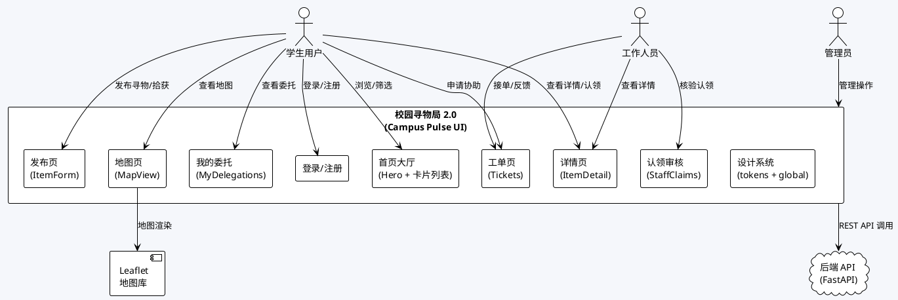
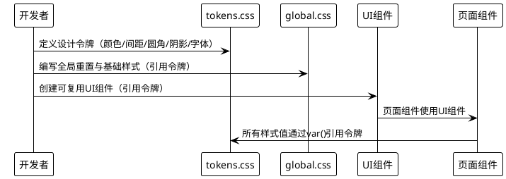
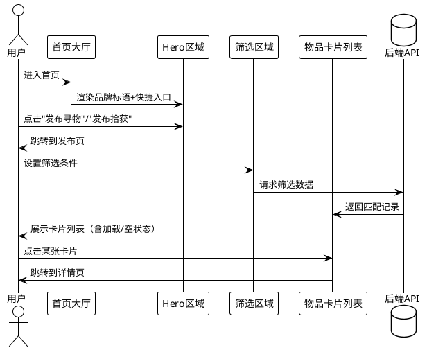
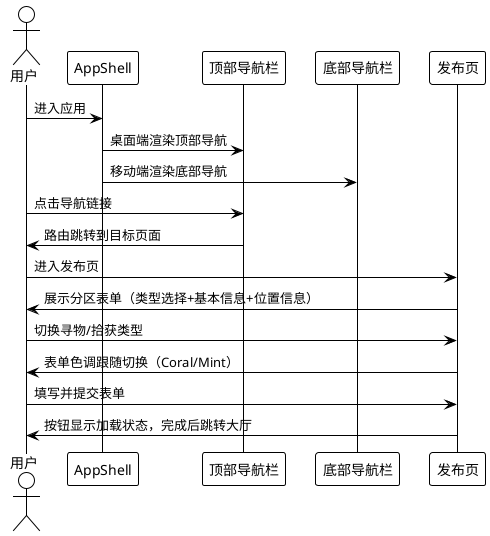
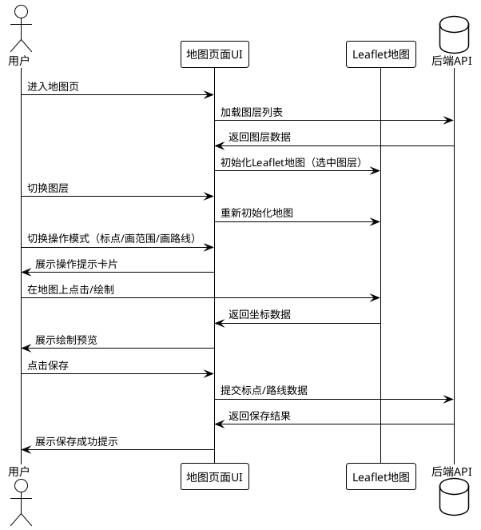
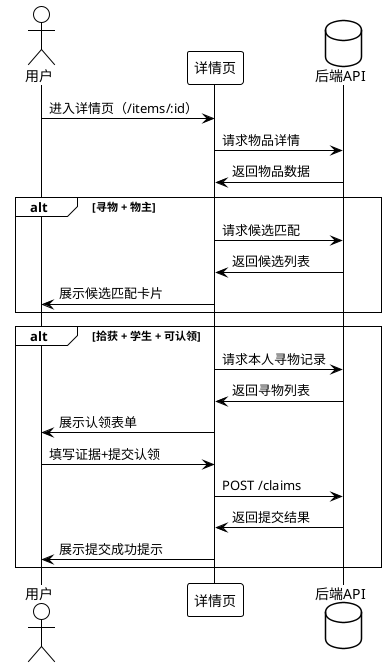

# 校园寻物局 2.0 — Campus Pulse UI/UX 工程化升级需求规格

## 0. 文档信息与约定

| 项 | 内容 |
|---|---|
| 项目 | 校园寻物局 2.0（Campus Pulse · 校园信号站） |
| 阶段 | UI/UX 工程化升级需求规格设计 |
| 特性名 | `campus_pulse_ui` |
| 写入路径 | `.codeartsdoer/specs/campus_pulse_ui/spec.md` |
| 状态 | 待确认 v1.0 |

**品牌标语**：让每一件失物都有回家的路

**EARS 约定**：触发关键字与固定短语保持英文（`When`/`While`/`If`/`Where`/`The … shall`），事件、前置条件、响应等可变部分本地化为中文；默认主语为 `the 系统`，必要时替换为具体模块名。

**改造原则**：功能不退化 > 代码可运行 > 操作效率 > UI美观 > 动效表现

**技术约束**：
- 保留 React + TypeScript + Vite、React Router、CSS Modules、Leaflet 地图实现
- 禁止引入 ArkTS/ArkUI/鸿蒙工程结构，禁止迁移到其他框架
- 禁止重写项目或以新项目替代现有代码
- 禁止修改后端业务接口、数据库结构和权限逻辑
- 本次为渐进式视觉与交互重构，不是技术栈迁移

---

# 1. 组件定位

## 1.1 核心职责

本组件负责对校园寻物局前端界面进行全面的视觉设计系统升级与交互体验重构，实现从功能可用到精致美观的跨越，使平台具备鲜明校园特色和现代审美。

## 1.2 核心输入

1. **现有前端代码库**：React + TypeScript + Vite 项目，包含 9 个页面组件（Home、ItemDetail、ItemForm、Login、Register、MapView、MyDelegations、Tickets、StaffClaims）和 2 个通用组件（Layout、RequireAuth）
2. **设计系统色彩规范**：Primary #315CF5、Secondary #7B61FF、Coral #FF8B5E、Mint #16B8A6、Background #F5F7FB、Surface #FFFFFF、Text #0F172A、Text Secondary #64748B、Border #E5EAF2
3. **品牌定位**：Campus Pulse · 校园信号站，标语"让每一件失物都有回家的路"
4. **现有业务接口**：后端 FastAPI 提供的全部 REST API（不修改，仅适配前端展示）

## 1.3 核心输出

1. **设计系统文件**：tokens.css（设计令牌定义）、global.css（全局样式重置与基础样式）
2. **UI 组件库**：基于设计系统的可复用 UI 组件（按钮、卡片、输入框、标签、徽章等）
3. **改造后的页面组件**：9 个页面 + 2 个通用组件的视觉与交互升级版本
4. **响应式布局**：适配桌面端和移动端的弹性布局方案
5. **微交互效果**：过渡动画、状态反馈动画、加载动画等交互细节

## 1.4 职责边界

- **不负责**后端接口的修改、新增或删除
- **不负责**数据库结构变更或权限逻辑调整
- **不负责**技术栈迁移或框架替换
- **不负责**业务功能的新增或删减（所有现有功能必须保留且不退化）
- **不负责**鸿蒙/ArkTS 适配
- **不负责**真实地图数据或监控系统的接入

---

# 2. 领域术语

**设计令牌（Design Token）**
: 以 CSS 自定义属性形式定义的设计系统原子变量，涵盖颜色、间距、圆角、阴影、字体等维度，是所有 UI 组件样式的唯一来源。

**Campus Pulse · 校园信号站**
: 本次升级的设计主题名称，寓意校园中失物信息的脉冲信号，每一条寻物/拾获信息都是一个等待回应的信号。

**Hero 区域**
: 首页顶部的品牌展示区域，包含品牌标语、视觉主元素和核心行动入口，是用户进入平台后的第一视觉焦点。

**任务快捷入口**
: 首页中提供"发布寻物"和"发布拾获"两个核心操作的快速通道，以醒目的卡片或按钮形式呈现。

**物品卡片**
: 大厅列表中展示单条寻物/拾获信息的卡片式组件，包含类型标识、标题、类别、地点、状态等关键信息。

**AppShell**
: 应用级布局框架，包含顶部导航栏、底部导航栏和内容区域，为所有页面提供统一的视觉骨架。

**BottomNav**
: 移动端底部导航栏，提供大厅、发布、地图、我的等主要页面的快速切换入口。

**微交互（Micro-interaction）**
: 用户操作触发的细粒度视觉反馈，包括按钮按压效果、卡片悬停动画、状态切换过渡、加载指示等。

**寻物类型（Lost）**
: 用户丢失物品后发布的寻找信息，在 UI 中以 Coral（#FF8B5E）色系标识。

**拾获类型（Found）**
: 用户拾到物品后发布的招领信息，在 UI 中以 Mint（#16B8A6）色系标识。

**状态徽章（Status Badge）**
: 物品卡片上展示当前业务状态的小型标签组件，如"寻找中""待认领""已找回"等。

---

# 3. 角色与边界

## 3.1 核心角色

- **学生用户**：通过自助注册登录，使用大厅浏览、发布寻物/拾获、提交认领、申请协助工单、查看我的委托等功能。升级后需获得更直观的操作引导和更愉悦的视觉体验。
- **工作人员**：由管理员创建账号，除学生功能外还可接单、核验认领、确认归还。升级后需在认领审核页面获得更高效的工作流体验。
- **管理员**：系统初始化时创建，拥有创建工作人员账号和标定地图比例尺的权限。升级后管理操作的视觉体验需同步提升。

## 3.2 外部系统

- **后端 API 服务（FastAPI）**：提供全部业务数据接口，本次升级不修改后端，仅适配前端展示层
- **Leaflet 地图库**：提供地图渲染能力，本次升级保留 Leaflet 实现，仅优化地图页面的 UI 包裹层和交互控件样式

## 3.3 交互上下文

---

# 4. DFX约束

## 4.1 性能

1. **首屏加载时间**：首页首屏内容（Hero 区域 + 任务快捷入口 + 首屏卡片）渲染完成时间不超过 2 秒（标准网络环境）
2. **页面切换响应**：路由切换时新页面内容开始渲染的延迟不超过 200ms
3. **动画帧率**：所有微交互动画在主流设备上保持 60fps，不允许出现明显卡顿
4. **CSS 体积**：设计系统 tokens.css + global.css 合计不超过 15KB（gzip 压缩后）
5. **地图页面**：Leaflet 地图初始化时间不超过 1.5 秒，地图交互操作响应不超过 100ms

## 4.2 可靠性

1. **功能不退化**：所有现有业务功能（发布、筛选、认领、工单、地图、我的委托等）在升级后必须 100% 可用
2. **降级策略**：当 CSS 动画不被支持时，界面须降级为无动画状态且功能不受影响
3. **错误状态展示**：所有 API 调用失败时须展示统一的错误提示样式，不得出现未样式化的原始错误信息
4. **加载状态展示**：所有异步数据加载须展示统一的加载指示器，不得出现空白闪烁

## 4.3 安全性

1. **XSS 防护不变**：现有 XSS 防护逻辑（如 esc 函数）须保留，升级不得引入新的 XSS 风险
2. **权限展示不变**：前端权限控制逻辑须保留现有行为，工作人员专属入口仅对 staff/admin 角色可见
3. **私密信息隔离**：认领证据、联系方式、精确位置等私密信息的展示逻辑须与现有实现一致

## 4.4 可维护性

1. **设计令牌单一来源**：所有颜色、间距、圆角、阴影值必须通过 tokens.css 中的 CSS 自定义属性引用，禁止在组件中硬编码
2. **CSS Modules 保留**：组件级样式继续使用 CSS Modules，不得引入 styled-components 或其他 CSS-in-JS 方案
3. **代码结构不变**：现有目录结构（pages/、components/、api/、auth/）须保留，新增 UI 组件放在 components/ 下
4. **TypeScript 类型安全**：所有新增 UI 组件须有完整的 TypeScript 类型定义，不得使用 any

## 4.5 兼容性

1. **浏览器兼容**：支持 Chrome 90+、Firefox 88+、Safari 14+、Edge 90+
2. **响应式断点**：移动端 ≤768px、平板 769px-1024px、桌面端 ≥1025px
3. **接口兼容**：不修改任何现有 API 调用路径和参数结构，前端仅适配展示层

---

# 5. 核心能力

## 5.1 设计系统建立

### 5.1.1 业务规则

1. **设计令牌定义**：系统必须定义完整的设计令牌体系，涵盖颜色、间距、圆角、阴影、字体、动画时长等维度
   - 验收条件：[tokens.css 文件创建后] → [所有 UI 组件均可通过 var() 引用令牌值，无硬编码色值]

2. **色彩令牌映射**：系统必须按品牌规范定义色彩令牌，Primary=#315CF5 用于主操作，Secondary=#7B61FF 用于 AI/科技强调，Coral=#FF8B5E 用于寻物类型，Mint=#16B8A6 用于拾获类型
   - 验收条件：[查看 tokens.css] → [色彩令牌名称与色值一一对应，且用途注释清晰]

3. **全局样式重置**：系统必须提供 global.css 文件，包含 CSS Reset、基础排版样式、全局工具类（如 .page、.card、.actions）
   - 验收条件：[global.css 加载后] → [页面基础排版统一，无浏览器默认样式干扰]

4. **禁止硬编码**：所有组件样式中的色值、间距、圆角、阴影值必须引用设计令牌，禁止直接写入具体数值
   - 验收条件：[搜索组件 CSS 文件] → [不出现 #315CF5、16px、8px 等硬编码值（令牌定义文件除外）]

5. **禁止项**：禁止引入 styled-components、emotion 等 CSS-in-JS 库
   - 验收条件：[检查 package.json] → [不出现 CSS-in-JS 相关依赖]

### 5.1.2 交互流程

### 5.1.3 异常场景

1. **令牌缺失**
   - 触发条件：组件引用了未定义的 CSS 自定义属性
   - 系统行为：浏览器使用 fallback 值或初始值渲染
   - 用户感知：样式可能与预期不一致，但功能不受影响

2. **旧样式冲突**
   - 触发条件：现有 inline style 与新 CSS Modules 样式同时作用
   - 系统行为：须逐步迁移 inline style 到 CSS Modules，过渡期保持功能正常
   - 用户感知：过渡期可能出现样式不一致，但不得出现功能异常

---

## 5.2 首页大厅改造

### 5.2.1 业务规则

1. **Hero 区域展示**：首页顶部必须展示 Hero 区域，包含品牌名称"校园寻物局"、品牌标语"让每一件失物都有回家的路"，以及视觉主元素（如信号波纹动画或校园主题插画）
   - 验收条件：[用户进入首页] → [首先看到 Hero 区域，品牌名称和标语清晰可见]

2. **任务快捷入口**：Hero 区域下方必须提供"发布寻物"和"发布拾获"两个快捷入口按钮，分别使用 Coral 和 Mint 色系标识
   - 验收条件：[用户查看 Hero 区域下方] → [看到两个醒目的快捷入口，点击后跳转到对应发布页面]

3. **搜索筛选区域**：筛选区域必须包含类型筛选（寻物/拾获/全部）、类别搜索、状态筛选三个维度，筛选控件须使用统一的 UI 组件样式
   - 验收条件：[用户操作筛选控件] → [列表实时更新，筛选控件样式统一且交互反馈清晰]

4. **物品卡片展示**：列表中的每条记录必须以卡片形式展示，卡片包含类型标识（寻物用 Coral 色、拾获用 Mint 色）、标题、类别、地点、状态徽章、发布时间
   - 验收条件：[用户浏览大厅列表] → [每条记录以卡片呈现，类型色彩区分明确，关键信息一目了然]

5. **卡片悬停交互**：鼠标悬停在物品卡片上时，卡片须有轻微上浮和阴影增强效果，提示可点击
   - 验收条件：[鼠标悬停卡片] → [卡片轻微上浮（translateY -2px~4px），阴影增强，鼠标变为指针]

6. **卡片点击导航**：点击物品卡片须导航到对应详情页
   - 验收条件：[用户点击卡片] → [跳转到 /items/:id 详情页]

7. **空状态展示**：当筛选结果为空时，须展示友好的空状态提示，包含引导文案和操作建议
   - 验收条件：[筛选无结果] → [展示空状态插画/图标 + "暂无符合条件的记录"文案 + 建议操作]

8. **加载状态展示**：数据加载过程中须展示骨架屏或加载指示器，不得出现空白闪烁
   - 验收条件：[数据加载中] → [展示骨架屏或统一加载动画，无空白闪烁]

9. **禁止项**：禁止移除现有的筛选功能维度（类型、类别、状态）
   - 验收条件：[升级后检查筛选区域] → [三个筛选维度均保留且功能正常]

### 5.2.2 交互流程

### 5.2.3 异常场景

1. **API 请求失败**
   - 触发条件：/items 接口返回错误或超时
   - 系统行为：展示统一错误提示卡片，保留筛选控件可用
   - 用户感知：看到错误提示文案 + 重试按钮

2. **筛选条件组合无结果**
   - 触发条件：某筛选组合返回空列表
   - 系统行为：展示空状态组件
   - 用户感知：看到空状态插画 + "暂无符合条件的记录" + "清除筛选"按钮

3. **图片资源加载失败**
   - 触发条件：Hero 区域视觉元素或卡片图片加载失败
   - 系统行为：展示占位图或降级为纯色背景
   - 用户感知：看到占位元素，不影响文字信息和功能操作

---

## 5.3 导航与发布页改造

### 5.3.1 业务规则

1. **AppShell 布局**：应用必须使用统一的 AppShell 布局框架，包含顶部导航栏（桌面端）和底部导航栏（移动端），内容区域自适应
   - 验收条件：[任意页面加载] → [导航栏样式统一，内容区域在导航框架内正确渲染]

2. **顶部导航栏（桌面端）**：桌面端导航栏须包含大厅、发布、地图、我的委托、工单链接，工作人员额外显示认领审核入口，右侧显示角色信息和退出按钮
   - 验收条件：[桌面端查看导航栏] → [所有导航链接可见且样式统一，工作人员可见认领审核入口]

3. **底部导航栏（移动端）**：移动端须展示底部导航栏，包含大厅、发布、地图、我的四个主要入口，使用图标+文字形式
   - 验收条件：[移动端（≤768px）查看] → [底部导航栏可见，四个入口图标+文字清晰，点击可切换页面]

4. **导航栏品牌标识**：导航栏须包含"校园寻物局"品牌标识或 logo 元素，强化品牌认知
   - 验收条件：[查看导航栏] → [品牌标识可见，与整体设计风格一致]

5. **发布页表单重构**：ItemForm 页面须重构为分区式表单布局，包含类型选择区（寻物/拾获切换）、基本信息区（类别、标题、描述）、位置信息区（地点、精确位置）
   - 验收条件：[用户进入发布页] → [表单分区清晰，类型切换醒目，输入控件样式统一]

6. **类型切换交互**：寻物/拾获类型切换须有明显的视觉反馈，切换后表单色调（Coral/Mint）跟随变化
   - 验收条件：[用户切换类型] → [表单主题色调切换为对应色系，切换动画流畅]

7. **表单输入控件统一样式**：所有输入框、下拉框、文本域须使用统一的 UI 组件样式，包含 focus 状态高亮、error 状态提示
   - 验收条件：[用户操作表单控件] → [focus 时有高亮边框反馈，error 时有红色提示]

8. **提交按钮状态**：提交按钮须展示加载状态（发布中…），加载期间按钮禁用，防止重复提交
   - 验收条件：[用户点击提交] → [按钮显示加载状态且禁用，完成后恢复或跳转]

9. **禁止项**：禁止移除现有的任何表单字段（direction、category、title、description、location_area、precise_location）
   - 验收条件：[检查发布页表单] → [所有原有字段均保留且可正常提交]

10. **禁止项**：禁止修改表单提交的 API 路径和参数结构
    - 验收条件：[检查网络请求] → [POST /items 请求参数结构与升级前一致]

### 5.3.2 交互流程

### 5.3.3 异常场景

1. **表单验证失败**
   - 触发条件：必填字段（category、title）为空
   - 系统行为：后端返回 422 错误，前端展示字段级错误提示
   - 用户感知：对应字段下方显示红色错误文案

2. **提交超时**
   - 触发条件：POST /items 请求超时
   - 系统行为：按钮恢复可点击状态，展示错误提示
   - 用户感知：看到"发布失败，请重试"提示，按钮可再次点击

3. **移动端导航遮挡内容**
   - 触发条件：底部导航栏遮挡页面底部内容
   - 系统行为：内容区域须预留底部安全间距（padding-bottom）
   - 用户感知：所有内容可正常浏览，不被导航栏遮挡

---

## 5.4 地图页面改造

### 5.4.1 业务规则

1. **地图页面 UI 包裹层**：MapView 页面须在 Leaflet 地图外围添加统一的 UI 包裹层，包含页面标题、图层选择器、操作模式切换按钮、信息卡片等，所有非地图元素须使用设计系统样式
   - 验收条件：[用户进入地图页] → [地图外围控件样式统一，与整体设计风格一致]

2. **图层选择器样式**：图层下拉选择器须使用统一的 Select 组件样式，选中图层信息（名称+标定状态）清晰展示
   - 验收条件：[用户操作图层选择器] → [选择器样式统一，图层信息展示清晰]

3. **操作模式切换**：查看/标点/画范围/画路线四种模式切换按钮须使用统一的按钮组样式，当前选中模式有高亮反馈
   - 验收条件：[用户切换操作模式] → [按钮组样式统一，当前模式有高亮标识]

4. **地图标记色彩规范**：寻物标记使用 Primary 色（#315CF5），拾获标记使用 Mint 色（#16B8A6），绘制预览使用 Secondary 色（#7B61FF），模拟点位使用 Coral 色（#FF8B5E）
   - 验收条件：[查看地图标记] → [色彩与设计规范一致，图例说明清晰]

5. **信息卡片样式**：选中物品后的信息卡片和绘制操作提示卡片须使用统一的 Card 组件样式
   - 验收条件：[选中地图标记或进入绘制模式] → [信息卡片样式统一，内容清晰可读]

6. **比例尺状态提示**：已标定/未标定比例尺的状态提示须以不同视觉样式区分（如已标定用 Mint 色标签、未标定用灰色标签）
   - 验收条件：[查看比例尺提示] → [状态区分明确，文案清晰]

7. **禁止项**：禁止修改 Leaflet 地图的核心初始化逻辑和交互事件绑定
   - 验收条件：[检查 MapView 代码] → [Leaflet 初始化和事件绑定逻辑保留]

8. **禁止项**：禁止替换 Leaflet 为其他地图库
   - 验收条件：[检查 package.json] → [leaflet 依赖保留]

### 5.4.2 交互流程

### 5.4.3 异常场景

1. **图层加载失败**
   - 触发条件：/layers 接口返回错误
   - 系统行为：展示错误提示，地图区域显示空状态
   - 用户感知：看到错误提示文案 + "暂无图层，请先初始化地图数据"

2. **底图图片加载失败**
   - 触发条件：图层图片资源请求失败
   - 系统行为：地图区域显示灰色矩形占位（现有逻辑保留）
   - 用户感知：看到灰色占位区域 + 错误提示

3. **绘制操作无目标委托**
   - 触发条件：用户进入绘制模式但未选择目标委托
   - 系统行为：展示提示文案"请先选择要标记/绘制的委托"
   - 用户感知：看到提示信息，保存按钮点击后给出引导

---

## 5.5 详情页改造

### 5.5.1 业务规则

1. **详情页布局重构**：ItemDetail 页面须重构为结构化布局，包含物品基本信息区、描述区、位置信息区、候选匹配区（寻物）或认领操作区（拾获）
   - 验收条件：[用户进入详情页] → [信息分区清晰，关键信息层级分明]

2. **类型色彩标识**：详情页须根据物品类型（寻物/拾获）在页面顶部展示对应色系标识条或标签
   - 验收条件：[查看详情页顶部] → [寻物显示 Coral 色标识，拾获显示 Mint 色标识]

3. **状态徽章展示**：物品当前状态须以徽章形式醒目展示，不同状态使用不同色彩
   - 验收条件：[查看详情页状态] → [状态徽章色彩区分明确（寻找中/核验中/已找回/待认领/已归还/已撤销）]

4. **候选匹配卡片**：寻物详情页的候选匹配列表须以卡片形式展示，每张卡片包含拾获物品标题、类别、地点、匹配依据和来源标识
   - 验收条件：[查看寻物详情页候选区] → [候选信息以卡片展示，依据和来源清晰可见]

5. **认领表单样式**：拾获详情页的认领表单须使用统一的表单组件样式，私密证据输入框和关联寻物选择器样式一致
   - 验收条件：[查看拾获详情页认领区] → [表单控件样式统一，提交流程清晰]

6. **地图位置链接**：当物品有地图坐标时，须提供醒目的"在地图查看位置"链接按钮
   - 验收条件：[物品有坐标时] → [地图位置链接按钮可见且样式醒目]

7. **模拟点位标识**：模拟点位/演示记录须有明显的视觉标识区分
   - 验收条件：[查看模拟点位物品] → [标识清晰可见，提示"演示记录/模拟位置"]

8. **禁止项**：禁止移除认领提交的幂等键（idempotency_key）逻辑
   - 验收条件：[检查认领提交代码] → [idempotency_key 逻辑保留]

### 5.5.2 交互流程

### 5.5.3 异常场景

1. **物品不存在**
   - 触发条件：/items/:id 返回 404
   - 系统行为：展示"记录不存在"提示 + 返回大厅链接
   - 用户感知：看到空状态提示和导航链接

2. **候选匹配请求失败**
   - 触发条件：/items/:id/candidates 接口错误
   - 系统行为：候选区域展示错误提示，不影响其他信息展示
   - 用户感知：看到候选区错误提示，其余信息正常

3. **认领提交失败**
   - 触发条件：POST /claims 返回错误
   - 系统行为：保留表单内容和证据文本，展示错误提示
   - 用户感知：看到错误信息，表单内容不丢失，可修改后重新提交

---

## 5.6 登录/注册页改造

### 5.6.1 业务规则

1. **登录页品牌展示**：登录页须展示"校园寻物局"品牌标识和标语，营造品牌氛围
   - 验收条件：[用户进入登录页] → [品牌标识和标语可见，页面风格与整体设计一致]

2. **登录表单样式**：登录表单须使用统一的输入控件和按钮样式，错误提示样式一致
   - 验收条件：[用户操作登录表单] → [控件样式统一，错误提示清晰]

3. **注册页样式统一**：注册页须与登录页保持一致的视觉风格和组件样式
   - 验收条件：[对比登录页和注册页] → [视觉风格一致，组件样式统一]

4. **登录/注册切换链接**：两页之间须提供清晰的切换链接
   - 验收条件：[查看登录页底部] → [看到"注册"链接；查看注册页底部] → [看到"登录"链接]

5. **禁止项**：禁止修改登录/注册的 API 调用逻辑和 AuthContext 状态管理
   - 验收条件：[检查 auth 代码] → [AuthContext 逻辑保留不变]

### 5.6.2 异常场景

1. **登录失败**
   - 触发条件：用户名或密码错误
   - 系统行为：展示错误提示"登录失败，请检查用户名或密码"
   - 用户感知：看到红色错误提示，表单内容保留

2. **注册失败**
   - 触发条件：用户名已存在或不符合要求
   - 系统行为：展示错误提示
   - 用户感知：看到红色错误提示，表单内容保留

---

## 5.7 我的委托页改造

### 5.7.1 业务规则

1. **我的委托页分区展示**：页面须分为"我的发布""我的认领""我的工单"三个分区，每个分区有清晰的标题和内容区域
   - 验收条件：[用户进入我的委托页] → [三个分区标题清晰，内容组织有序]

2. **徽章展示**：协助徽章须以醒目的视觉形式展示，体现用户的贡献荣誉
   - 验收条件：[用户有徽章时] → [徽章以特殊样式展示，如圆形图标+文字描述]

3. **列表项卡片化**：各分区的列表项须以卡片或结构化列表形式展示，包含关键信息和状态标识
   - 验收条件：[查看各分区列表] → [每条记录以卡片/结构化项展示，状态标识清晰]

4. **地图定位链接**：有坐标的物品须提供"地图定位"链接
   - 验收条件：[物品有坐标时] → [地图定位链接可见且可点击]

5. **禁止项**：禁止移除现有的任何数据展示维度（发布、认领、工单、徽章）
   - 验收条件：[检查页面内容] → [四个维度均保留]

### 5.7.2 异常场景

1. **数据加载失败**
   - 触发条件：/me/items 或 /me/claims 等接口错误
   - 系统行为：展示统一错误提示
   - 用户感知：看到错误提示文案

2. **无数据状态**
   - 触发条件：某分区列表为空
   - 系统行为：展示"暂无"提示
   - 用户感知：看到空状态提示，了解当前无相关记录

---

## 5.8 工单页改造

### 5.8.1 业务规则

1. **工单列表卡片化**：工单列表须以卡片形式展示，每张卡片包含工单编号、状态徽章、结果信息（如有）
   - 验收条件：[查看工单列表] → [每条工单以卡片展示，状态徽章色彩区分明确]

2. **学生申请协助区域**：学生角色的协助申请区域须使用统一的表单组件样式
   - 验收条件：[学生查看工单页] → [申请协助区域样式统一，操作流程清晰]

3. **工作人员操作按钮**：接单、反馈结果等操作按钮须使用统一按钮样式，不同操作有不同视觉层级（主操作/次操作）
   - 验收条件：[工作人员查看工单页] → [操作按钮样式统一，主次操作区分明确]

4. **授权路线按钮**：授权路线按钮须有醒目的视觉提示，授权后状态须清晰展示
   - 验收条件：[查看授权按钮] → [未授权时按钮醒目可点击，已授权时展示"已授权"状态]

5. **反馈表单样式**：工作人员反馈核查结果的表单须使用统一的表单组件样式
   - 验收条件：[工作人员进入反馈编辑] → [表单控件样式统一]

6. **禁止项**：禁止修改工单的任何 API 调用路径和参数结构
   - 验收条件：[检查网络请求] → [工单相关 API 调用与升级前一致]

### 5.8.2 异常场景

1. **工单列表加载失败**
   - 触发条件：/tickets 接口错误
   - 系统行为：展示统一错误提示
   - 用户感知：看到错误提示文案

2. **接单/反馈操作失败**
   - 触发条件：POST 操作返回错误
   - 系统行为：展示错误提示，按钮恢复可点击
   - 用户感知：看到错误信息，可重新操作

---

## 5.9 认领审核页改造

### 5.9.1 业务规则

1. **认领审核页布局**：StaffClaims 页面须重构为两栏布局（列表+详情），左侧展示认领申请列表，右侧展示选中申请的详情和证据
   - 验收条件：[工作人员进入认领审核页] → [列表和详情分区清晰，工作流高效]

2. **状态筛选样式**：申请状态筛选器须使用统一的 Select 组件样式
   - 验收条件：[操作状态筛选器] → [样式统一，筛选反馈清晰]

3. **证据展示区域**：私密认领证据须在详情区域中以醒目的卡片形式展示，与公开信息视觉区分
   - 验收条件：[查看认领详情] → [证据区域有明确的视觉标识（如"私密"标签），与公开信息区分]

4. **审核操作按钮**：通过核验/拒绝申请/确认归还三个操作按钮须有明确的视觉层级，主操作（通过/确认）使用 Primary 色，次操作（拒绝）使用警示色
   - 验收条件：[查看审核操作按钮] → [主次操作色彩区分明确，按钮样式统一]

5. **关联物品链接**：查看拾获详情和关联寻物的链接须样式统一且醒目
   - 验收条件：[查看关联链接] → [链接样式统一，点击可跳转到对应详情页]

6. **禁止项**：禁止修改认领审核的任何 API 调用路径和参数结构
   - 验收条件：[检查网络请求] → [认领审核 API 调用与升级前一致]

7. **禁止项**：禁止移除权限守卫逻辑（role !== 'staff' 时重定向到首页）
   - 验收条件：[非工作人员访问 /staff/claims] → [重定向到首页]

### 5.9.2 异常场景

1. **认领列表加载失败**
   - 触发条件：/claims 接口错误
   - 系统行为：展示统一错误提示
   - 用户感知：看到错误提示文案

2. **证据详情加载失败**
   - 触发条件：/claims/:id 接口错误
   - 系统行为：详情区域展示错误提示，列表保持可用
   - 用户感知：看到详情区错误提示，可重新选择其他申请

3. **审核操作失败**
   - 触发条件：POST /claims/:id/review 或 /complete 返回错误
   - 系统行为：展示错误提示，按钮恢复可点击
   - 用户感知：看到错误信息，可重新操作

---

## 5.10 响应式布局

### 5.10.1 业务规则

1. **移动端适配（≤768px）**：所有页面须在移动端正常展示，包含底部导航栏、单列卡片布局、适配触屏操作的控件尺寸（最小点击区域 44×44px）
   - 验收条件：[在 ≤768px 设备上查看各页面] → [布局自适应，底部导航可见，控件可触屏操作]

2. **平板适配（769px-1024px）**：平板尺寸下须优化布局间距和卡片排列，可选双列卡片布局
   - 验收条件：[在 769px-1024px 设备上查看] → [布局间距合理，卡片排列优化]

3. **桌面端适配（≥1025px）**：桌面端须充分利用宽屏空间，大厅列表可多列展示，详情页可双栏布局
   - 验收条件：[在 ≥1025px 设备上查看] → [空间利用合理，信息密度适中]

4. **导航栏响应式切换**：桌面端显示顶部导航栏，移动端显示底部导航栏，两种导航不可同时出现
   - 验收条件：[切换设备尺寸] → [导航栏形式正确切换，不出现两种导航同时显示]

5. **地图页面响应式**：地图容器高度须根据设备尺寸自适应，移动端不低于 400px，桌面端不低于 560px
   - 验收条件：[在不同设备上查看地图页] → [地图容器高度自适应，交互区域充足]

### 5.10.2 异常场景

1. **极端窄屏**
   - 触发条件：设备宽度 <320px
   - 系统行为：布局降级为单列，文字和控件尺寸保持最小可读/可操作
   - 用户感知：内容可读、功能可用，但视觉密度较高

---

## 5.11 可访问性

### 5.11.1 业务规则

1. **语义化 HTML**：所有页面须使用语义化 HTML 标签（header、nav、main、section、article、footer）
   - 验收条件：[检查页面 DOM 结构] → [语义化标签使用正确]

2. **ARIA 标签保留**：现有的 role="alert"、role="status"、aria-label 等无障碍属性须保留
   - 验收条件：[检查组件属性] → [原有 ARIA 属性保留，新增交互元素补充 ARIA]

3. **键盘导航**：所有可交互元素（按钮、链接、输入框）须支持 Tab 键聚焦和 Enter/Space 操作
   - 验收条件：[使用键盘操作页面] → [所有交互元素可 Tab 聚焦，Enter/Space 可触发操作]

4. **色彩对比度**：文本与背景的色彩对比度须满足 WCAG AA 标准（正文 ≥4.5:1，大字 ≥3:1）
   - 验收条件：[使用对比度检查工具] → [所有文本对比度达标]

5. **焦点可见**：键盘聚焦时须有清晰的焦点指示（focus-visible 样式）
   - 验收条件：[Tab 聚焦元素] → [焦点指示清晰可见]

6. **表单标签关联**：所有表单控件须有关联的 label 元素或 aria-label
   - 验收条件：[检查表单控件] → [每个控件有关联 label 或 aria-label]

---

# 6. 数据约束

## 6.1 设计令牌（Design Token）

1. **color_primary**：#315CF5，品牌主色，用于主操作按钮、导航栏品牌标识、链接
2. **color_secondary**：#7B61FF，AI/科技强调色，用于绘制预览、科技感元素
3. **color_coral**：#FF8B5E，寻物类型标识色，用于寻物卡片标识、寻物表单主题
4. **color_mint**：#16B8A6，拾获类型标识色，用于拾获卡片标识、拾获表单主题
5. **color_background**：#F5F7FB，全局页面背景色
6. **color_surface**：#FFFFFF，卡片/面板背景色
7. **color_text**：#0F172A，主要文本色
8. **color_text_secondary**：#64748B，辅助文本色
9. **color_border**：#E5EAF2，分隔线/边框色
10. **spacing_unit**：4px 基础间距单位，所有间距值为 4 的倍数（4/8/12/16/20/24/32/48）
11. **radius_small**：6px，小圆角（标签、徽章）
12. **radius_medium**：10px，中圆角（卡片、输入框）
13. **radius_large**：16px，大圆角（大型容器、模态框）
14. **shadow_small**：0 1px 3px rgba(15,23,42,0.08)，轻微阴影（卡片默认）
15. **shadow_medium**：0 4px 12px rgba(15,23,42,0.10)，中等阴影（卡片悬停）
16. **shadow_large**：0 8px 24px rgba(15,23,42,0.12)，深度阴影（弹层、模态框）
17. **font_size_xs**：12px，辅助文本
18. **font_size_sm**：14px，次要文本
19. **font_size_base**：16px，正文
20. **font_size_lg**：18px，标题
21. **font_size_xl**：24px，页面标题
22. **font_size_2xl**：32px，Hero 标题
23. **duration_fast**：150ms，快速动画（按钮按压、色彩切换）
24. **duration_normal**：250ms，常规动画（卡片悬停、面板展开）
25. **duration_slow**：400ms，慢速动画（页面过渡、大型元素变换）
26. **easing_standard**：cubic-bezier(0.4, 0, 0.2, 1)，标准缓动曲线

## 6.2 物品卡片（Item Card）

1. **type_indicator**：寻物用 Coral 色条/标签，拾获用 Mint 色条/标签，必须位于卡片左侧或顶部
2. **title**：主要文本色，font_size_base，单行截断（ellipsis）
3. **category**：辅助文本色，font_size_sm
4. **location_area**：辅助文本色，font_size_sm，为空时显示"未知地点"
5. **status_badge**：状态对应色彩（寻找中=Primary、核验中=Secondary、已找回=Mint、待认领=Coral、已归还=Mint、已撤销=灰色），font_size_xs
6. **time_occurred**：辅助文本色，font_size_xs，相对时间格式（如"3小时前"）
7. **is_simulated**：模拟点位标识，须有"模拟"标签

## 6.3 状态徽章色彩映射（Status Badge Color Mapping）

1. **searching（寻找中）**：Primary 色（#315CF5）背景，白色文字
2. **reviewing（核验中）**：Secondary 色（#7B61FF）背景，白色文字
3. **found（已找回）**：Mint 色（#16B8A6）背景，白色文字
4. **pending（待认领）**：Coral 色（#FF8B5E）背景，白色文字
5. **returned（已归还）**：Mint 色（#16B8A6）背景，白色文字
6. **withdrawn（已撤销）**：灰色（#94A3B8）背景，白色文字

## 6.4 导航项（Navigation Item）

1. **desktop_nav_link**：辅助文本色默认，Primary 色 hover/active，font_size_sm，padding 间距统一
2. **mobile_nav_item**：图标 24×24px + 文字 font_size_xs，Primary 色 active，辅助文本色默认，最小点击区域 44×44px
3. **nav_brand**：Primary 色，font_size_lg，加粗

## 6.5 表单控件（Form Control）

1. **input_border**：默认 Border 色，focus 时 Primary 色，error 时 #DC2626
2. **input_radius**：radius_medium（10px）
3. **input_padding**：12px 16px
4. **input_font**：font_size_base，主要文本色
5. **input_placeholder**：辅助文本色
6. **button_primary**：Primary 色背景，白色文字，radius_medium，padding 12px 24px
7. **button_secondary**：Surface 色背景，Primary 色文字，Border 色边框
8. **button_disabled**：opacity 0.6，cursor wait
